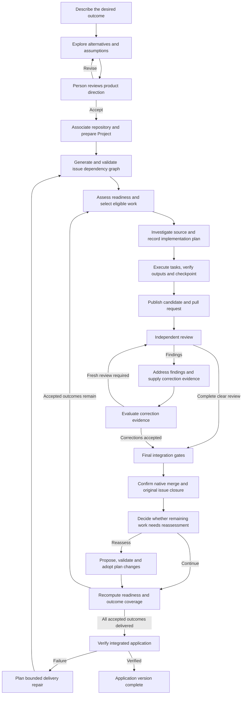

# Factory feed and Ralph4days integration

Soda OS will absorb Ralph4days's agent experience into its Factory experience:
recognizable role authors, structured communication, inspectable work and useful
workspace interactions. The intended finished Soda factory procedure leads this
integration. Its current implementation does not limit the experience being
designed.

This is the durable design record of the owner's discussion on 18 October 2026.
It owns the feed and Ralph integration direction and the open presentation choices.
The [product contract](../product/overview.md),
[workflow design](../development/factory-workflow-plan.md),
[workflow contracts](../development/factory-workflow-contracts.md),
[factory interfaces](../architecture/factory-interfaces.md) and
[trust model](../architecture/trust.md) continue to own execution behavior and
authority. [Spaces UX](spaces-ux.md) owns the surrounding workspace experience.
The procedure below maps those contracts to a proposed presentation; it does not
replace them or create a second implementation task catalog.

## Agreed direction

- Put the feed **inside Soda OS**, following real Factory work.
- Consolidate subscribed activity into **one combined feed**, with the newest
  posts at the top. Users subscribe to feeds/projects; project-only views and
  threads support navigation but do not replace this combined experience.
- Let users **comment on feed posts**. Agents can read authorized comments and
  use them to make plans and/or create issues through existing Factory owners.
  Derived work links back to its originating discussion and exposes its result
  or failure. A subscription grants no access and a comment alone is not an
  automatic dispatch or a new approval requirement.
- Make the entire intended factory procedure understandable, including decisions,
  parallel tasks, reviews, corrections, waits, recovery and application verification.
- Use the marketing website's factory film as a source of component and interaction
  ideas. Ground the real feed in recorded work and evidence.
- Use the established seven agent personas as recognizable authors. Keep the
  author separate from the type of event or message.
- Extend role-scoped MCP controls so agents can explain their work and maintain
  their feed contributions during an assignment.
- Adopt Ralph's eight communication verbs: **ask, flag, learned, suggest, partial,
  blocked, stuck and done**. Use Soda's existing Factory MCP implementation and
  profiles. Done submits the role's formal result; Factory confirms completion.
- Treat Ralph4days absorption as a product integration spanning identity,
  communication, work inspection, prompts and workspace interactions.
- Absorb Ralph's useful capabilities, communication vocabulary and interaction
  behavior into a fresh Soda interface in Lit and TypeScript. The owner explicitly
  ruled out React integration. Ralph's visual design is a reference to assess;
  component layouts, styling and portraits need their own Soda design decisions.
  Reuse suitable framework-independent code and assets where they fit.
- Establish the complete procedure map before defining the final state machines,
  MCP additions, component catalog and screen layout.
- Continue design discussion before implementation. Specific tool names, the
  exact post/thread model and character assignments remain open choices.

## Complete intended procedure

The main route starts with an outcome and ends with verification of a particular
application version. New requests and accepted scope changes continue the process
while preserving prior outcomes and history. Manually authored issues can enter
the issue workflow under their existing authority; they do not manufacture an
application intent or a whole-app verification subject.

This diagram shows the successful and repair routes. Waiting, invalidation and
attention paths apply throughout. Its arrows are dependencies, not a requirement
to delay checks that can already run. Product exploration and consolidation can
use the existing bounded draft service before Project association; the Product
Lead's generative Project run follows authorized association and preparation.

| Stage | Responsible actor | Visible work and components | Evidence required to advance |
| --- | --- | --- | --- |
| Capture intent | Person | Objective, organizational context, constraints and desired outcomes | Saved request and supplied information |
| Explore and review direction | Person and exploration service; JEV assesses supplied alternatives | Alternatives, material assumptions, questions and accepted or declined choices | Revision-bound product choices; unresolved material decisions return to the person |
| Prepare execution | Factory and authorized people | Repository association, persistent Project, preparation and resource standing | Required access, preparation, provider/account authority, capacity and finite allowances |
| Decompose accepted outcomes | Product Lead; JEV assesses alternatives; Factory validates and applies | Cohesive issue proposals, outcome coverage and dependency graph | Valid scope and provenance, complete coverage, valid DAG and confirmed native issue bindings |
| Select work | Factory determines eligibility; JEV prioritizes alternatives | Ready, waiting and blocked issues; selected issue and supplied selection evidence | Complete eligible inventory and fresh admission conditions |
| Investigate and plan | Architect | Source inspected, prerequisite outputs, findings, approach, immutable plan and task lanes | Current source and prerequisite bindings, resolved mandatory facts, validated executable plan |
| Implement and checkpoint | Builder and admitted workers; trusted executor checks and integrates | Ready/running/completed tasks, ownership, verified outputs, commits and joins | Verified prerequisite outputs, coherent checked checkpoints, required tasks complete on the integrated candidate |
| Publish | Factory using the submitted implementation result | Candidate, branch, PR and links to the issue and attempt | Attributable candidate and confirmed native publication |
| Review and correct | Inspector and Fixer; JEV where the correction route requires judgment | Review coverage, actionable and optional findings, inline locations, dispositions, fixes and regression evidence | Complete clear review, or complete correction evidence accepted through the permitted JEV path; current native policy still applies |
| Integrate and confirm issue completion | Factory; JEV only where the applicable delivery decision requires it | Check results, accepted evidence, merge request, confirmed merge and original issue closure | Same current candidate, current policy, required checks and reviews, confirmed native merge and original closing occurrence |
| Reconsider remaining work | JEV; Strategist when reassessment is selected; Factory adopts | Continue/reassess decision, proposed graph changes, protected work and adoption results | Fresh complete inventory, bounded validated proposal, required assessment and confirmed adoption before dependent dispatch |
| Verify application version | Trusted check executor and Test Pilot | Accepted-outcome coverage, application journeys, fixture/artifact identity, check receipts and failures | Every required outcome verified against the same integrated delivery, with current inputs and completed retirement |
| Continue or complete | Factory and person | Verified version, remaining attention or follow-up work, next change request | Exact verified delivery; failed verification follows bounded delivery repair, while new product scope returns to review |

A complete clear independent review can establish delivery acceptance without an
extra delivery JEV call. Corrected work can receive a fresh independent review or
candidate-bound JEV acceptance of complete correction evidence where policy
permits. Optional feedback, disputes, confidence and allowance limits follow
[D07 and D08](../development/factory-workflow-contracts.md#d07--corrections-and-review-cycles).
The marketing film's illustrated repeated-review route does not eliminate either
valid production route.

After each verified issue completion,
[D13](../development/factory-workflow-contracts.md#d13--reassess-current-issues-after-every-verified-completion)
governs the repository's reassessment fence and complete remaining inventory.
Reassessment preserves delivered, active, manually controlled and other protected
work. An in-scope delivery repair creates appropriate follow-up work while
retaining completed identities. Whole-app completion follows
[D16](../development/factory-workflow-contracts.md#d16--whole-app-verification-and-honest-completion).
Deployment remains a separate authorized action.

## Waiting and recovery belong in the feed

| Situation | What the person should see |
| --- | --- |
| Unanswered product question | Exact question, available options, consequence, responsible person and affected work |
| Unmet prerequisite | Required outcome, producing issue and what releases the dependency |
| Resource wait | Missing capacity, provider/account access, allowance or preparation and the next resolving event |
| Changed source, scope or policy | Which plan or evidence became stale and what must be refreshed |
| Failed task or check | Recorded failure, affected output and permitted next action |
| Genuine planning stall | Diagnosed cause and bounded Strategist repair proposal, distinct from ordinary waiting |
| Pause, stop, cancellation or takeover | Requested action, observed outcome and any unresolved retirement |
| Uncertain operation outcome | Reconciliation of the existing effect before any permitted retry |
| Failed application verification | Failed outcome/journey, exact delivery evidence and bounded follow-up repair |

These entries explain the existing workflow's recovery paths. They do not add
routine approvals for every technical task or turn an unchanged wait into another
model call. Waiting in one dependency component or application intent must not
conceal independently eligible work elsewhere.

## Role authors and visual identities

The seven roles are established in
[D14](../development/factory-workflow-contracts.md#seven-instruction-templates-and-generated-task-messages)
and [the canonical MCP profiles](../../internal/factory/mcp_profile.go).

| Primary author | Responsibility | Existing formal result control |
| --- | --- | --- |
| Product Lead | Propose issues and dependencies covering accepted product outcomes | `factory.finish_product_plan` |
| Architect | Investigate current source and plan the selected issue | `factory.finish_issue_plan` |
| Builder | Implement the task DAG and supply output/checkpoint evidence | `factory.finish_implementation` |
| Inspector | Independently review the exact candidate and carried findings | `factory.finish_review` |
| Fixer | Address the complete finding set and supply correction evidence | `factory.finish_correction` |
| Strategist | Reassess or repair the work plan against the admitted cause | `factory.finish_reassessment` |
| Test Pilot | Verify the integrated delivery against all accepted outcomes | `factory.finish_app_verification` |

Human choices use the actual person's identity. JEV decisions use JEV. Preparation,
dispatch, trusted verification, adoption, merge and other observed system effects
use Factory attribution. A role's result and the Factory's confirmation remain
distinguishable even when displayed together.

The proposed author header emphasizes the role, followed by issue or PR, round or
lane where relevant, and time. Expanded detail identifies the actual run, harness,
model and evidence. A persona can remain recognizable across different runs and
model providers. Persona names do not create additional native execution accounts.

Ralph's disciplines describe expertise such as Frontend, Backend, Data and
Security. Soda's roles describe workflow responsibility. A possible combination
is **Builder · Backend** or **Inspector · Security**. Technical specialties and
their selection are an open design choice; they must not replace the seven roles.

Ralph's character catalog associates portraits, crops, colors, icons, skills,
instructions and conventions. That pattern can give a role the same recognizable
identity in a feed avatar, issue card and larger role view. The actual mapping of
characters to Soda roles remains open. Soda also has an existing
[robot avatar system](avatars.md); it is not an established seven-role portrait
assignment. Human illustrations, robots, new artwork and reuse of existing
portraits have not been selected by this discussion.

## Feed and component proposal

The primary composition is one combined feed of the user's subscribed activity,
with newest posts first. This accepted direction supersedes the earlier
project-overview/per-project-feed starting proposal. Every post retains project,
repository, issue/assignment and author provenance; project filters and expandable
threads preserve context without fragmenting the primary feed. Readers can open
native changes and evidence and return to the same reading position.

Each useful entry answers: **what happened, who did it, why it matters, and what
follows**. Decision entries show the recorded choice and supplied criteria and
evidence. They must not invent an explanation attributed to JEV.

| Component family | Content |
| --- | --- |
| Direction and review | Business request, accepted outcomes, assumptions and consequential choices |
| Work graph and issue preview | Objective, prerequisites, readiness, required outputs and acceptance |
| Investigation | Inspected references, findings, affected interfaces and unresolved facts |
| Task plan and lanes | Dependencies, ownership, parallel work, verified outputs and join conditions |
| Checkpoints and changes | Coherent commits, tested trees, candidate and native PR links |
| Review and correction | Coverage, findings, native locations, dispositions, fix evidence and rounds |
| Judgment | Question, eligible choices, supplied evidence, raw/effective choice and attention state |
| Checks and integration | Results for the exact candidate, requested operations and confirmed outcomes |
| Reassessment and repair | Before/after plan, reason for change, protected work and adoption outcome |
| Application verification | Accepted-outcome coverage, approved journeys, exact delivery and receipts |
| Question and reply | Structured question, options/recommendation, blocking meaning and recorded answer |
| User discussion and derived work | Persisted user comments/replies, agent-visible context, originating discussion and linked plan/issue creation result or failure |
| Wait and attention | Cause, affected scope, responsible owner and release condition |

Useful reading behavior includes stable expanded entries, filters, access to older
history, explicit missing/truncated history and new updates that preserve the
reader's position. Playback or history browsing is separate from pausing factory
execution. Feed reads do not run agents or advance workflow state. Semantic status
colors describe outcomes; author identity also needs readable names and icons.

Newest-first post ordering and combined subscribed activity are settled. Exact
subscription unit/defaults, reply/update bump behavior, threading depth, live
update behavior and mobile layout still need design. The existing persistent Work/Spaces owner and
terminal lifetimes remain relevant constraints, as defined by [Spaces UX](spaces-ux.md).

### Subscriptions, comments and executable work

R32 owns authenticated communication/comment mutations and their stable identities;
R42 owns authorized combined readback and subscription preferences in the existing
domain/Store. R43 presents them through Work/Spaces. Server-derived human identity
and project access govern comment writes; agent identity comes from its admitted
run. Subscription membership is a filter within already permitted activity, never
a grant. Reads, counts, paging and agent context recheck access, including after
revocation, account changes or a subscription change. Do not copy private posts
into a globally readable stream or grant an agent access to everything a human
can see.

Persist the post/comment ID, author, scope, revision and discussion relationship.
Feed posts sort newest first with a stable unique tie-break and bounded
cursor paging; ordering must not depend on whichever page arrived last. Specify
reply ordering and whether replies/edits bump a root before implementing that
behavior. Preserve a reader's position, expanded threads and unsent drafts as
new posts arrive; a deliberate return-to-latest action can reveal queued updates.
Changing subscriptions or permissions must not leave another account's cached
content visible. Neither a timer nor a notification service is required by this
direction.

Agents receive comments as attributed user input through R31's bounded context
and evidence reads. A selected discussion can supply a draft/plan input via
R12/R15 and an issue/graph request via R13's existing native adoption path. Bind
the triggering post/comment revision and a durable request identity to the
resulting plan/issue; retries recover the original result rather than create
duplicate issues or spend again. Changed or deleted input, lost effect replies,
unavailable agents and insufficient scope/grants produce visible stale, pending,
refused or failed results, not a fabricated success. A resulting native issue or
plan keeps its own canonical owner and links back to the discussion.

The capability to turn discussion into plans/issues is adopted. The exact trigger
is still a bounded product choice: explicit user action, an addressed agent
request, or an existing authorized assignment consuming relevant comments.
Select supported triggers and routing before enabling that slice; do not infer
universal auto-dispatch. Ordinary commenting/readback and feed aggregation can
proceed independently. Existing consequential product decisions and issue/graph
authority remain in force, without adding approval to every comment. Comments
are untrusted content, not instructions to bypass those contracts.

Acceptance joins R32/R42/R43/R49: two authorized subscribed projects in one
newest-first feed; equal-time posts and concurrent pagination; persisted comments
after reload/restart; denial across an inaccessible project; one authorized
comment-to-plan/issue path with origin link, replay and visible failure. Use the
same records for formal agent results and human replies. No separate social task
database, parallel backlog or mock-only browser demonstration.

## Recommended frontend stack

Use **Lit and strict TypeScript**, Soda's existing shared CSS tokens and Bun build,
inside the current Work/Spaces extension. The owner requested a fresh Soda
interface and explicitly instructed that React must not be integrated. Ralph's
capabilities and useful interaction behavior inform this new implementation;
preserving its React component tree or visual design is not a requirement.
Keep the existing Workspace owner and host/resource lifetimes.
The existing [Lit guide](../development/lit.md) and
[TypeScript guide](../development/typescript.md) own implementation conventions.

| Concern | Recommended approach |
| --- | --- |
| Feed and artifact components | Lit templates and custom elements, with elements owning independent state or resource lifetimes |
| Payloads | Typed, runtime-validated records; a known component kind selects the appropriate renderer |
| Appearance | Existing Soda CSS, typography, spacing, semantic statuses and light/dark themes |
| Reading state | Component-owned expansion, filters and drafts; preserve stable entry identity across updates |
| Work state and history | Existing Go APIs and durable record owners; the browser renders reports and confirmed outcomes |
| Build and checks | Existing Bun extension build, strict TypeScript, Lit analysis and focused component/browser checks |
| Ralph UI integration | Implement useful behaviors in fresh Lit components; assess framework-independent code and artwork individually |

Lit's [keyed list rendering](https://lit.dev/docs/templates/lists/) can preserve
entry DOM identity when items move or arrive. Stable keys support preserving open
details and input state; scroll behavior still needs deliberate design. Use
bounded history paging, with any list-windowing dependency justified by actual
volume and reading requirements. Select live update transport against the
existing admitted transport and lifecycle contracts; SSE, WebSocket or polling
has not been chosen by this discussion.

## Source reuse and React migration assessment

The first source assessment covers Ralph's character catalog, signal rendering
and replies, data hooks, UI primitives, workspace state and prompt recipes. It
identifies integration boundaries, not a completed migration or measured effort
estimate. The inspected dependency graph shows why a mechanical React-to-Lit port
would involve substantial manual work. The chosen direction is a fresh Lit
interface shaped by Soda's procedure, using Ralph as a functional reference.

| Existing source | Reuse opportunity | Work required for Soda |
| --- | --- | --- |
| Portrait PNGs, crop coordinates, icons/colors and discipline YAML | Retain useful artwork and metadata; adapt the catalog to chosen Soda identities | Decide role/specialty mapping, asset delivery, provenance and semantic status treatment |
| Typed signal payloads and MCP verbs | Reuse communication vocabulary and shape of questions, findings, knowledge and proposals | Bind to Soda capability/assignment identity and existing workflow evidence; replace completion claims with formal result plus confirmed outcome |
| `SignalDisplay.tsx` | Reference for meaningful question, finding, proposal and progress presentations | Design Soda components in Lit around role/evidence links and canonical payloads |
| `SignalSection.tsx`, `SignalEditor.tsx`, reply components | Reference for posting, replies and saved history | Implement Soda queries, answer authority, history, error handling and component lifecycle in the existing stack |
| TanStack Query hooks and cache helpers | Reference for request/cache behavior; assess any pure helpers separately | Use Soda transport, identity and state ownership without adding Ralph's React hooks |
| Radix/Base UI primitives, forms, drag/drop and resizable layouts | Reference for demonstrated interaction and accessibility requirements | Use suitable existing Soda controls and verify keyboard, focus and overlay behavior |
| Workspace kernel and Zustand store | Reuse tested ideas and assess pure TypeScript functions individually | Map to Soda's persistent owner, navigation and session lifetimes; avoid parallel owners of the same tabs/terminals |
| Rust prompt recipes and persona sections | Retain useful content, context ordering and inspectability patterns | Keep Soda's canonical instructions, phase/subject bindings, tool permissions and Go prompt owner; assess pure reusable code at the destination boundary |
| SQLite task/signal services and standalone execution runtime | Inform semantic mapping and identify genuinely useful isolated code | Soda's native issue records, existing store/coordinator and Rust host remain the owners of those responsibilities |

Concrete evidence for the UI coupling:

- [Ralph's dependency manifest](../../../ralph4days/package.json) includes React,
  TanStack React Query, Zustand, Radix/Base UI, React Hook Form, React drag/drop and
  resizable-panel packages, Tailwind and Tauri APIs.
- [The avatar view](../../../ralph4days/src/components/shared/SignalAvatar.tsx)
  reads discipline data through a React hook. Its
  [cropped image component](../../../ralph4days/src/components/ui/cropped-image.tsx)
  owns loading/cache behavior and calls a Ralph image command.
- [The query hook](../../../ralph4days/src/hooks/api/useInvoke.ts) uses TanStack
  React Query and enables calls in the Tauri environment. The
  [invocation boundary](../../../ralph4days/src/lib/tauri/invoke.ts) calls Tauri
  directly. Keeping React does not itself make these components browser-ready in
  Soda; this boundary needs adaptation.
- [Signal mutations](../../../ralph4days/src/hooks/tasks/useSignalMutations.ts)
  combine React editing/reply state with Ralph commands and task cache updates.
- [Dialog](../../../ralph4days/src/components/ui/dialog.tsx) and
  [avatar](../../../ralph4days/src/components/ui/avatar.tsx) primitives wrap Radix
  React components. Their behavior is not reusable as Lit template syntax alone.

React can technically render into a dedicated DOM container within a Lit-owned
component using [React roots](https://react.dev/reference/react-dom/client/createRoot).
Such a boundary needs explicit DOM ownership, property/event transfer, styling
and mount/unmount handling through the [Lit lifecycle](https://lit.dev/docs/components/lifecycle/).
That interoperability does not convert React components into Lit. The owner has
explicitly excluded this integration from the Factory feed plan.
[Radix's accessibility behavior](https://www.radix-ui.com/primitives/docs/overview/accessibility)
also illustrates why replacing its controls involves focus and keyboard behavior
as well as appearance.

Trace one representative flow through role avatar, typed question, reply, saved
history and refreshed feed to define the new Lit components and Soda appearance.
Include native host navigation, account changes, mobile use and persistent
terminal continuity. Implementation remains deferred during design refinement.

## MCP communication proposal

Soda's existing architecture has **one Factory MCP server implementation with
seven role-scoped profiles**. Common reads are `factory.context`,
`factory.evidence`, `factory.status` and `factory.receipt`. All profiles can report
incomplete work. Builder/Fixer can submit task outputs, and Builder can request
handoff to an approved successor. The existing fourteen-tool catalog is the
baseline; this discussion proposes additions, not a claim that new tools exist.

Ralph contributes a useful distinction between author and communication intent.
Its signal verbs include `done`, `partial`, `stuck`, `ask`, `flag`, `learned`,
`suggest` and `blocked`, with structured payloads and corresponding views.

### Adopted verb vocabulary

The owner agreed to carry these eight verbs into the integration blueprint while
retaining Soda's existing MCP system. **Role identifies who is speaking; verb
identifies the communication; workflow state records what actually happened.**
The names of new MCP tools and whether the seven nonterminal verbs use separate
tools or a typed communication tool remain interface choices. The vocabulary
does not require eight new tools or a replacement server.

The following fields are the proposed semantic payloads, not a frozen wire schema.
Normal scope, submission identity and expected-input binding come from the
existing MCP admission contract.

| Verb | Proposed content | Feed component | Relationship to Soda's procedure |
| --- | --- | --- | --- |
| **ask** | Specific question; blocking meaning; optional answers and recommendation; consequence and affected work | Question with options, linked work and reply history | Route material product choices through existing review; a reply or reported blocking flag does not independently change authority or bypass readiness |
| **flag** | Problem, severity, category, affected outcome and evidence references | Finding/problem card with evidence and native location where available | Link canonical review findings rather than creating a second finding truth; distinguish informational warnings from actionable defects |
| **learned** | Observation, decision or convention; rationale where relevant; applicable scope and evidence | Knowledge/discovery card | Retain useful context without promoting an agent assertion into accepted policy; actual decisions link their authorized records |
| **suggest** | Proposed change, kind, reason, affected issue/outcomes and supporting evidence | Proposal with consequences and disposition | Use the appropriate existing product, reassessment or repair route; a suggestion itself does not create issues, edit dependencies or authorize new scope |
| **partial** | Progress made, remaining work and reason it remains | Progress/remaining-work component | May be a nonterminal progress report; ending an incomplete assignment uses its existing formal incomplete control and retirement rules |
| **blocked** | Known blocking condition, kind, affected work, relevant prerequisite/question and what would resolve it | Dependency/resource/question wait card | Server assessment determines effective readiness; resolving the reported condition triggers reassessment under the existing gates |
| **stuck** | Why meaningful progress cannot continue, attempted approaches and relevant evidence | Attention/diagnosis card | Distinguish diagnosis needed from a known blocker; existing bounded stall classification decides whether repair, a wait or owner attention is appropriate |
| **done** | Role-specific structured result and evidence references | Result-submitted card, followed by validation/confirmation | Use the existing role-specific finish control; recorded submission, accepted result, observed retirement and verified downstream completion remain distinct |

All seven roles can communicate within their admitted subject. Their permitted
formal result tools remain role-specific. A native Builder child does not gain
the parent's MCP mutation capability merely because it appears as a lane author;
its recorded output remains attributable through the existing parent/worker path.

### Example role and verb combinations

| Author and verb | Readable feed entry | Follow-through |
| --- | --- | --- |
| Architect · **ask** | Which departments may see this data? | Answer is recorded against the relevant product choice and affected plan |
| Inspector · **flag** | A task owner can read another employee's task | Link the finding, exact reviewed candidate and native discussion |
| Fixer · **partial** | Owner access is corrected; inactive-account coverage remains | Show current progress without implying that the complete finding set is resolved |
| Strategist · **suggest** | Split reminder scheduling from delivery retries | Validate and assess through the existing reassessment/adoption path |
| Builder · **done** | Implementation result submitted | `factory.finish_implementation` submits the candidate; Factory records validation and subsequent publication |
| Test Pilot · **done** | Application verification result submitted | `factory.finish_app_verification` carries verified/failed/incomplete outcome and trusted receipts; Factory determines the delivery's effective state |

### Post maintenance and result binding

The eight verbs describe meaningful communication. Editing a post's current
headline/summary, arranging supported artifact components and appending history
still need a concrete post model. Earlier example names such as
`factory.update_post`, `factory.add_component`, `factory.append_update` and
`factory.request_input` are not selected API names. Reconcile any maintenance
controls with the adopted verbs and existing result submissions to avoid duplicate
ways to ask the same question or report the same outcome.

An assignment could receive one Factory-created post with its author and scope
already bound. The agent would maintain its presentation and append meaningful
updates; formal finish controls would connect result records to that post. This
one-post-per-assignment model remains a proposal.

Tool payloads should describe typed content and evidence references. The UI owns
rendering components; arbitrary agent-authored HTML or layout is not implied.
Post revisions retain history. Native findings, plans and completion receipts keep
their existing canonical owners rather than being copied into a competing feed
truth. A question's answer follows the appropriate existing product/authority
route before it can change execution.

Authorship derives from the admitted role/run/assignment. A caller cannot select
another author, repository or scope. Communication records do not independently
authorize implementation, accept their own fixes, release dependent work, merge,
change budgets or deploy. Existing capability, lifetime and admission rules apply
to the proposed controls too. Exact schemas, idempotency, volume bounds and
permissions must be designed with the MCP additions.

## State machine design

The procedure needs connected state machines at several levels:

| Level | Owns |
| --- | --- |
| Request/application version | Product choices, accepted outcomes, delivery coverage and app verification |
| Repository coordination | Eligibility, selection, capacity and post-completion reassessment |
| Issue attempt | Investigation, implementation, publication, review, correction and integration |
| Task execution | Readiness, ownership, running work, verified outputs and checkpoints |
| Operation | Requested, executing, confirmed, failed and uncertain effects |
| Feed presentation | Post revisions, expansions, filters, history position and pending visual updates |

For each transition define **trigger → required facts → responsible actor → action
→ recorded outcome → next permitted actions**. The feed presents those outcomes
and role reports while keeping proposed, requested and confirmed states distinct.
An application's completed issues, active review and blocked tasks can coexist;
one project-wide current-step label cannot describe all of them.

The marketing film's playback and popover state machines govern play, pause, seek,
chapter preview and reading interactions. They can inform browsing behavior. Actual
workflow transitions are driven by current evidence and policy, not elapsed scene
duration or a simulated scene sequence.

## What to absorb and where it fits

| Source capability | Integration direction | Existing Soda owner to preserve |
| --- | --- | --- |
| Marketing film artifacts and issue previews | Adapt visual vocabulary for real plans, lanes, reviews, decisions and reassessment | Work/Spaces presentation and native collaboration links |
| Ralph character/discipline catalog | Reuse the identity-and-crop pattern; decide artwork and seven-role mapping | Canonical role profiles, branding and asset provenance |
| Ralph MCP signals and typed displays | Adapt communication semantics into role-authored components | Factory MCP admission and durable records |
| Ralph signal replies | Keep questions and answers beside the relevant work | Existing scope review and authorized action routes |
| Ralph task detail panels | Present complete issue/attempt journeys | Native issue truth and existing plan/review/check/merge records |
| Ralph workspace tabs and terminals | Adapt navigation between activity, plan, changes and output | Persistent Work/Spaces owner and managed terminal lifecycle |
| Ralph prompt recipes and preview | Make supplied role instructions, context and allowed tools inspectable | Soda prompt ownership, fixed policy and credential boundaries |
| Ralph specialty metadata | Consider expertise alongside workflow responsibility | Seven-role procedure and admitted execution profiles |

Ralph4days uses Rust/Tauri with a React frontend and project-local SQLite. Soda is
a mixed-language system: its network coordinator and APIs use Go, privileged/host
operations use Rust, and its browser UI uses Lit/TypeScript. Shared use of Rust
does not make the standalone runtimes or UI components directly interchangeable.
Assess reusable assets and code at their actual boundaries, and adapt components
where the destination differs. Soda keeps one coordinator, its existing data
owners and native forge authority. This discussion does not decide Ralph's
independent product future or introduce a replacement task database or runtime.

## Concept image

The first vertical image illustrates a complete sample onboarding run, with role
authors, an expanded issue thread, task lanes, review/correction evidence,
reassessment and whole-app verification. Its copy, counts, timestamps, colors and
layout are illustrative; the procedure and dependencies above control the design.

[Open the preserved vertical concept](../../.artifacts/design/factory-feed/concept-2026-10-18.png).

The PNG is a generated design output kept under ignored `.artifacts/` according to
repository policy. It is available in this checkout; the tracked design record
remains understandable without that local image.

## Open design choices and next design deliverable

The owner requested integration into the existing 55-task list. The
[catalog addition](../development/factory-remaining-tasks.md#owner-addition-on-18-october-2026-ralph4days-absorption)
maps this scope to R30 authority, R32 communication producers, R42 durable
readback, R43 visible absorption and R49 installed journey acceptance. Existing
task identities, dependencies and the single execution ledger are retained.

Before implementation, resolve:

1. Subscription unit/defaults and the exact project/issue/assignment post/thread
   structure within the adopted combined newest-first feed; reply/edit bump rules.
2. The role character set and whether/how technical specialties appear.
3. The exact tool representation and schemas for the adopted eight verbs,
   permitted components, post maintenance and existing formal-result bindings.
4. Which facts are linked from their existing owners and which new communication
   history needs durable storage, ordering, paging and revision semantics.
5. Comment-to-agent trigger/routing, revision/deletion handling and transitions
   into existing plan/issue/product-decision owners. Commenting and agents using
   comments to create plans/issues are accepted capabilities, not optional scope.
6. Mobile presentation, live update behavior and history inspection.
7. Concrete Ralph code/assets to reuse or adapt, their destination owners, and
   genuine gaps requiring new work.

The next design deliverable is one annotated full procedure linking each stage to
its actor, permitted actions, feed components, evidence conditions and reuse
sources. Include a substantial reuse inventory distinguishing assets/code that
can be retained, code requiring adaptation, responsibilities already owned by Soda,
and demonstrated new work. Define the fresh Lit interface using concrete Ralph
behaviors, Soda's procedure and existing host/lifetime constraints. React
integration is excluded; visual design and portrait selection remain open.
Refine this record in the existing R32/R43 slices; the canonical task cards now
hold their dependency-ordered execution instructions. Resolve only the choices
needed for the next slice rather than requiring another whole-design pass.

## Source references

The reviewed source snapshots were Ralph4days
`f4a073b37e4e860dae2021ae99852cf9f906c513` and the marketing website
`384920da55cc12f1f1b01dba41f64f8ddb20334f`. These identify reuse research, not
production behavior acceptance.

- [Ralph discipline content and artwork](../../../ralph4days/crates/catalog-disciplines/README.md)
- [Ralph discipline identity schema](../../../ralph4days/crates/core-contracts/src/disciplines.rs)
- [Ralph task signal tools](../../../ralph4days/crates/ai-prompt-builder/src/mcp/task_signals_server.ts)
- [Ralph signal components](../../../ralph4days/src/components/workspace/task-detail/components/SignalDisplay.tsx)
- [Ralph threaded signal view](../../../ralph4days/src/components/workspace/task-detail/components/SignalSection.tsx)
- [Ralph role avatar](../../../ralph4days/src/components/shared/SignalAvatar.tsx)
- [Ralph prompt recipe](../../../ralph4days/crates/ai-prompt-builder/src/recipes/task_exec.rs)
- [Marketing film components](../../../soda-os-website/src/app/components/organisms/home/factory-film.tsx)
- [Marketing issue preview](../../../soda-os-website/src/app/components/molecules/issue-preview.tsx)
- [Marketing authored scene sequence](../../../soda-os-website/src/app/content/factory-film.ts)
- [Soda MCP profiles and tool permissions](../../internal/factory/mcp_profile.go)
- [Soda workflow and completion contracts](../development/factory-workflow-contracts.md)
