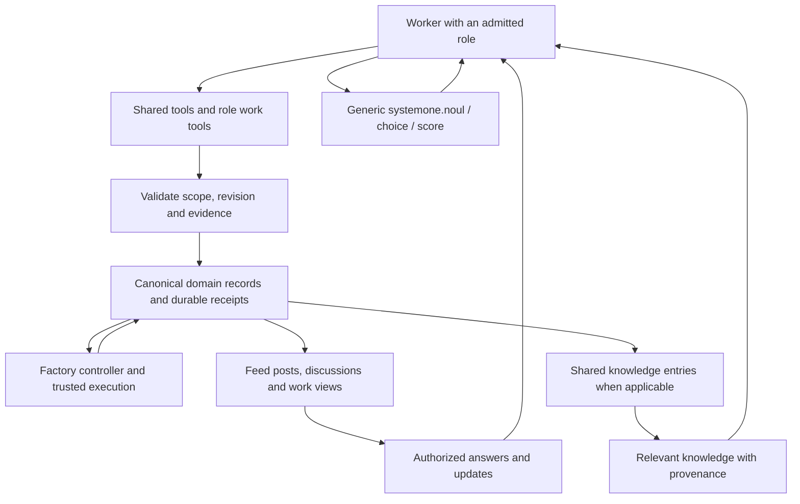

# Factory worker MCP redesign: work, feed and shared knowledge

This document defines the seven production worker roles, Library Admin and Researcher, their context, work, communication and shared knowledge. The implemented catalog now contains 57 tools across nine profiles; the implementation section identifies current behavior. The larger proposed work interfaces and issue-contract extensions below retain their explicit task scope.

The owner has requested the full redesign. The previously described 21-tool
target covers the existing catalog plus seven communication tools; it is a
minimum communication extension, not a complete answer to this broader scope.
The requirement for actual Ask, Flag, Learned, Suggest, Partial, Blocked, Stuck
and Done MCP outlets remains. Additional names below are proposed API names.
Done continues to use the admitted role's structured finish tool in this proposal.

The owner subsequently identified two omissions: a dedicated decision-recording
outlet and a bot that can maintain both knowledge and decision items. This
revision adds shared decision tools and the Library Admin profile. The seven
production roles and their work ownership remain; the original source baseline had
seven profiles and 14 tools. Shared communication and decision tools have since
been added, with the [executable feed catalog](../../internal/factory/feed_components.json)
binding each component to permitted roles and outlets. Library Admin is now the eighth runtime profile. The later Researcher route (§11, R10.2) adds the ninth runtime profile with its `research` phase and `factory.finish_research` tool. An accepted issue with a `soda` JSON fence containing `{"role":"library_admin"}` selects the `maintain_library` phase. It runs as the reviewer account, scoped to the project library, without source publication or a code-completion claim.

The later [issue work-contract brainstorm](#issue-work-contracts) extends this
design with typed issue metadata, specialist routing, knowledge-only completion
and agent-created prerequisites. It recommends Researcher and five additional
tools as explicit options beyond the main catalog below; those choices remain
proposed and have their own mapped task scope.

The owner also requires three built-in generic System One tools:
`systemone.noul`, `systemone.choice` and `systemone.score`. They are shared by
every role alongside the Factory interface. The main inventory therefore has
63 Factory tools plus three generic judgment tools; the research extension
remains separately proposed. The generic judgments are implemented now; the
larger 63-Factory-tool inventory remains design scope, distinct from the current 42.

## 1. What the redesign must accomplish

A worker should be able to answer five practical questions throughout its run:

1. What am I responsible for, what is current, and what may I do next?
2. What information, prior knowledge and other people's answers can help?
3. How do I record useful work before the whole assignment is finished?
4. How do I explain progress, uncertainty and decisions so people can follow?
5. What should the next worker learn from this work, including failed approaches?

The interface must support three connected destinations:

| Destination | What it needs | What counts as success |
| --- | --- | --- |
| Factory progression | Structured plans, dependencies, evidence, findings, dispositions, checkpoints and results | The controller can determine and execute the next permitted transition from recorded evidence. |
| Front-end feed | Understandable events, questions, replies, artifacts, explanations and confirmed outcomes | A person can understand what happened and what follows without watching terminal output. |
| Shared knowledge library | Searchable, scoped, reusable observations with sources, applicability and revision history | A later worker can find a useful lesson, assess whether it still applies, use it and correct it. |

These destinations overlap without requiring three separate worker submissions.
A single meaningful action should record its domain object and create the
appropriate feed event. An explicitly reusable learning should additionally
create or update its library entry. A status refresh or routine task event should
not automatically become permanent knowledge.

### Verified starting points

- The [source catalog](../../internal/factory/mcp_profile.go) now contains 45
  tools filtered by eight roles: 46 Factory tools plus generic `systemone.noul`, `systemone.choice` and `systemone.score`. Shared communication, library search/read and artifact upload precede role-specific tools in discovery. Library Admin operations apply actual revisioned knowledge and decision changes.
- [D14](../development/factory-workflow-contracts.md#d14--one-factory-mcp-implementation-and-seven-profiles)
  already defines one Factory MCP implementation, scoped admission, receipts,
  role finishes and separate native execution tools.
- The feed design already calls for a
  combined subscribed feed, structured contributions, comments and links from
  discussions to resulting work. Several interaction and record schemas remain
  unspecified.
- The initial inspection found a knowledge/discovery feed concept without a
  library lifecycle. The current implementation adds revisioned knowledge and
  decisions, scoped search/read tools, maintenance tools and project library UI.
- Ralph's local `crates/ai-prompt-builder/src/mcp/task_signals_server.ts` exposes
  eight signal tools, including a learning with kind, reason and scope.
  `crates/ai-rag/src/learning.rs` adds provenance, deduplication/conflict handling,
  review metadata and reuse-oriented learning records. These are reuse candidates,
  not proof of a working Soda library or interchangeable authorization models.

The concrete insufficiency is missing interaction lifecycles and consumers. Tool
count alone neither establishes nor resolves it.

## 2. Recommended shape: one service, complete role interfaces

### Implemented worker binding and startup

The interface is instantiated for a particular assignment immediately before
its worker starts. The server already knows the repository/project, actor,
role, assignment, run, source binding, preparation and expiry from its admitted
capability. These are supplied in discovery/context and attached to stored
submissions by the server. A worker supplies the content of its question,
decision, progress or result; it does not repeatedly select its identity or
claim another project's authority through tool arguments.

The privileged host stages the run-scoped credential and fixed MCP
configuration before releasing the existing model-start marker. Codex loads
its per-run `config.toml`; Muse loads its per-run `settings.json`. Both invoke
`/usr/libexec/soda/project-terminal factory-mcp`. This stdio relay connects only
to the private Factory Unix socket and reads the root-staged credential from
that run's home. Missing socket, helper or staging fails startup rather than
quietly launching a worker with no Factory tools. Credentials stay out of
prompts, feed posts and saved run receipts. The server rechecks actual run and
stop authority; an expired or stopped assignment cannot keep submitting merely
because its relay process still exists.

Muse Builder parents use `factory.start_task` with
`{"payload":{"task_id":"task-key"}}`; singleton Fixer parents use
`factory.release_output` with the same shape. These tools appear only for an
admitted Muse run and the corresponding role. The server derives the exact
run, native invocation and retained manifest, checks current work and the live
process, then calls that process's existing native task owner. Retries recover
the same task admission. No MCP submission ledger, new task grant or inferred
child result is created. Observed output still passes through
`factory.submit_task_output` and the existing committed checkpoint before
dependent work may proceed. Codex retains its native dynamic task tools.

Library Admin has dedicated revision-checked mutation tools, scoped to the current project. `learned` and `record_decision` create real searchable library entries together with their posts. Edit, remove, restore, consolidate, split, relate and supersede preserve attributed history. Project feed users can search these entries and inspect their revisions.

Artifacts use `factory.publish_artifact`: stable upload ID, byte offset, base64 chunks of at most 32 KiB and an explicit final chunk, with an 8 MiB file limit. Only finalization publishes a post; chunk replay recovers the same receipt. Artifact references resolve through project authorization, with lazy image/video/audio/text previews and downloads. Graph edges come from explicit item IDs and dependencies.

Communication payloads also accept `source: {path, revision?, start_line, code, after?, highlight_lines?}` and `commits: [{revision, summary}]`. Each excerpt is limited to 32 lines and 3,072 bytes; highlighted absolute line numbers must occur in `code`. Up to eight commits carry full 40-character revisions and summaries of at most 160 characters. The existing 8 KiB post bound still applies. Source and commit data pass through the authenticated tool, storage and feed projection without worker-supplied identity. These fields enable annotated findings, corrections and checkpoint trails; they record reported evidence without granting review, merge or completion authority.

Test Pilot now has production admission: completed accepted intent tasks, a current integrated source and a ready reviewer preparation with approved application assertions create a delivery assignment. Funding and the scoped MCP are recorded before launch. `factory.verification_evidence` reads independently observed native checks; F10 is recorded only after the completed report matches that exact source, receipt and outcome coverage. Missing assertions or unavailable checks produce an actionable Factory event.

Generic System One tools accept state, instructions and primitive-specific criteria directly. Credentials stay server-side, and results carry no Factory acceptance authority. They use the same live worker binding and request limits. Workers receive guidance to compare three independent, counterbalanced questions for substantive decisions.

Local checks cover the stdio-to-Unix-HTTP exchange, role/outlet enforcement,
configuration for both harnesses, staging before model start and exclusion of
credentials from durable receipts. This does not by itself establish a new
paid model run on the installed VM or the entire proposed 63-tool design.

### Shared implementation, role-specific interfaces

Keep one Factory MCP server implementation and give every worker a role-specific
interface composed of shared tools plus the tools for its assigned job. A
Product Lead and an Inspector should see different work tools and input schemas.
They should both be able to ask questions, consult knowledge and explain progress.
Library Admin gets a separate maintenance profile on that same service, scoped
to explicitly granted knowledge/decision collections and a bounded assignment.
Compose the generic `systemone.*` provider module into that same worker-facing
MCP service. Its input/output contract remains reusable outside Factory; it
does not require Factory issues, roles or workflow purposes to express a question.

Splitting this into seven independent server implementations would also split
question routing, knowledge visibility, receipts and lifecycle rules unless those
were rebuilt as shared services. No demonstrated requirement here needs that
deployment split. The redesign is primarily about capabilities and semantics.



The loop matters. Publishing a question without retrieving its answer, or writing
a learning without finding it on the next assignment, is an incomplete interface.

### Five categories workers can understand

- **Understand:** assignment, status, evidence, relevant knowledge and new replies.
- **Evaluate:** ask a typed System One question about supplied context.
- **Work:** operations specific to the role, such as draft a plan, submit an output
  or record a finding assessment.
- **Communicate:** ask, answer, flag, suggest, report progress and explain a wait.
- **Finish:** submit a complete role result or explicitly end incomplete.

The frontend can group these actions for people. Tool discovery should expose
the admitted role and subject, with concise descriptions and clear preconditions.
A blocked operation returns the unmet condition and permitted next step. It does
not disappear unpredictably, nor acquire authority through a generic dispatcher.
Test actual harness usability before deciding how many tools to expose together;
do not assume either a tiny catalog or every possible tool is automatically better.

## 3. Shared interface, first

Every admitted parent role receives the following capabilities: three generic
System One tools and 25 Factory tools. The names in this section are the proposed
complete shared set; existing source names retain
their current spelling. Native child capabilities require their own qualified
contract and do not inherit the parent's Factory credentials.

<a id="generic-systemone-tools"></a>
### Generic System One judgments

These are worker-callable primitives in the `systemone` namespace, built into
each role's MCP surface. All seven production roles and Library Admin receive
the same three contracts; Researcher receives them if that profile is adopted.
Role context changes the questions asked, not the tool names or provider semantics.

| Tool | Input meaning | Typed answer |
| --- | --- | --- |
| `systemone.noul` | Supplied state plus a yes/no question, optionally describing what true and false mean. | `noul`: probability of yes from 0 to 1. There is no separate confidence field; 0.5 expresses uncertainty, not medium severity. |
| `systemone.choice` | Supplied state, a selection question and named candidate options with their criteria. | Selected `choice`, probabilities across the supplied options, and `confidence`. Include a no-match option when the candidates may not cover the input. |
| `systemone.score` | Supplied state, the dimension to assess and ordered descriptive levels. | Probability-weighted `score` on the level indices, level probabilities, `legend` and `confidence`. With N levels the scale is 0 through N−1; it is not implicitly a percentage. |

The primitive semantics follow the live TypeSafe references for
[Noul](https://docs.typesafe.ai/primitives/noul),
[Choice](https://docs.typesafe.ai/primitives/choice) and
[Score](https://docs.typesafe.ai/primitives/score). The
[provider API](https://docs.typesafe.ai/api) evaluates state against typed
questions; these three MCP names are our interface to it, not three separate
provider HTTP endpoints.

**Proposed MCP shape:** each tool accepts `state` and a `questions` map keyed by
caller-chosen IDs. Each question has `instructions` and the primitive's
`criteria`; the tool supplies its fixed question type. Permit structured
instructions/criteria where the provider permits them. One question is a map
with one entry; independent questions of the same primitive over shared state
can be batched. Dependent questions require new state and a subsequent call.
Return typed `answers` under the same IDs, provider/model identity, usage and a
generic invocation reference. Resolve credentials and configured model through
the host service. No issue ID, plan, Factory decision purpose or Factory result
schema is required in the generic arguments.

**Context and authority:** the caller supplies the evidence, alternatives and
criteria needed for the judgment. The primitive does not browse, search the
library or silently gather additional context. Hosting supplies authenticated
caller identity, allowed provider access and finite usage accounting outside
the semantic payload; non-Factory callers use their own admitted session.
The caller may ask any relevant bounded question within that grant. Existing
controller-owned Jev selection/acceptance procedures keep their prescribed
inputs and consumers; a worker's free-form judgment cannot substitute for their
receipt or approve its own work. The context-preparation once-per-capability
rule applies to that controller operation, not to all generic consultations.

**Execution and failure:** these are explicit paid evaluations, not spend-free
Factory reads. Keep secrets server-side; validate request shape/size and each
answer's question/type/options/levels before exposing it as a result. Missing
configuration, unavailable allowance, authentication failure, rate limiting,
timeout and malformed/partial answers return explicit errors, never a made-up
zero, false or default choice. An uncertain valid answer remains available with
its distribution; no universal confidence threshold or automatic triple-call
policy is built into the tools. The consumer decides whether more evidence or
another evaluation is useful within its allowance.

Use the generic invocation identity and actual recorded state to recover lost
replies. Replaying a completed invocation returns its existing result; changed
inputs require a new invocation. A provider timeout may leave execution/charge
unknown: expose that uncertainty, and make any retry an explicitly accounted
attempt rather than claiming provider-wide exactly-once execution. Retiring a
worker prevents new calls and new dependent work; an already sent request still
needs accounting. Source changes can make a stored answer inapplicable without
rewriting the historical answer.

**Work, feed and library:** a judgment returns to its caller. It neither records
a Factory decision nor publishes a post, creates knowledge or advances an issue
by itself. When consequential, the worker uses existing Record Decision, Learned,
Flag, Suggest or its role output to explain the conclusion and reference the
invocation and supplied evidence. Preserve human/worker authorship of that action
and label Jev as the judgment source. Do not fabricate a provider-written rationale:
these primitives return typed answers, not generated explanations. Routine calls
remain inspectable work detail; meaningful consequences use the existing feed
components and exact library identities.

For example, Product Lead can compare scope options; Architect can compare
approaches; Builder can check a claim against supplied output; Inspector can
assess severity; Fixer can compare correction options; Strategist can compare
repair routes; Test Pilot can assess supplied observations; Library Admin can
evaluate possible duplicates or contradictions. These are uses of the same
three tools, not new role-specific judgment endpoints or acceptance authorities.

**Current implementation:** the role-filtered worker catalog exposes all three generic tools. `systemone_typesafe.go` owns their provider transport and the MCP adapter accepts state, instructions and criteria without Factory-specific question fields. The server supplies its provider credential, run admission and request limits. Live synthetic-input checks returned typed Noul, Choice and Score answers. These judgments do not write feed/library records by themselves; consequential decisions can reference them through `factory.record_decision`. Controller-owned Choice selection keeps its separate existing acceptance and accounting rules.

### Situation, evidence and interaction reads

| Proposed tool | Worker use | Result and downstream behavior |
| --- | --- | --- |
| `factory.context` | Start or reorient after interruption. | Required role facts, admitted scope, current source/plan/candidate, available controls, knowledge references, open questions and missing-input indicators. Required facts remain discoverable across bounded pages. |
| `factory.status` | Check what is progressing and what prevents the next action. | Actual task/operation states, allowance, stop state and actionable unmet conditions. Reported state and confirmed state are separate. |
| `factory.evidence` | Inspect an authorized evidence reference. | Bounded content, exact source identity, completeness and provenance; source/diff/check/artifact evidence uses its existing owner. |
| `factory.receipt` | Recover an uncertain submission outcome. | The original submission, validation/consumer state and resulting object references. Retrying a lost reply does not create another action. |
| `factory.inbox` | Find new answers, changed prerequisites, findings, stale knowledge and routed requests. | Ordered updates since a cursor, affected work and links to current records. Reading does not mark anything acted upon or resolve anything. |
| `factory.discussion` | Read a relevant thread and exact comment revisions. | Attributed, authorized context and explicit missing history. A comment is input; changed execution scope still follows the appropriate adoption route. |
| `factory.validate_result` | Check whether the current draft/result can be submitted. | Deterministic missing coverage, unresolved inputs, invalid references and stale bindings. No spending, publication, reservation or state transition; finish revalidates. |

`context` is the orientation page; specialized role reads expose detailed work
objects. They must share the same projections and identities rather than return
competing versions of the plan or finding set.

### Communication actions with actual consumers

| Proposed tool | Required meaning | Factory, feed and knowledge effect |
| --- | --- | --- |
| `factory.ask` | A precise question, affected work, why it matters, options/recommendation where useful and whether the worker can continue. | Creates an open question with a routing owner and answer state; renders an answerable card. No automatic broadcast to a person. |
| `factory.answer` | A response to a specific question revision, supported by evidence and an option selection where applicable. | Records the worker's answer and links it to affected work. Product authority comes from the existing authorized decision route, including human answers through the frontend; the worker cannot impersonate that owner. |
| `factory.reply` | A relevant contribution to an existing authorized discussion. | Appends a discussion reply with evidence/artifacts. Does not silently change acceptance criteria or create execution. |
| `factory.flag` | A specific problem, scope, impact, severity and evidence. | Creates an actionable report. An Inspector's valid defect becomes a draft canonical review finding; other roles' reports retain their actual authority. The feed shows the same object. |
| `factory.learned` | A reusable observation, why it matters, evidence and where it applies. | Creates a scoped library observation and its discovery feed entry in one accepted action. It is immediately identifiable as observed/unreviewed, not silently promoted to policy. |
| `factory.suggest` | A proposed change, expected benefit, consequences and affected objects. | Creates a proposal routed to the existing product/plan/repair/knowledge-sharing owner. Its disposition stays visible. It does not apply its own suggestion. |
| `factory.partial` | What changed, what remains, useful evidence and next intended action. | Updates meaningful progress within the work thread. Actual completion counts come from canonical task/checkpoint records. |
| `factory.blocked` | A known unmet prerequisite, affected work, release condition and attempted machine resolution. | Records a blocker for assessment and routing. The controller determines effective readiness; unaffected work can continue. |
| `factory.stuck` | Failed approaches, current evidence, uncertainty and the diagnosis needed. | Creates a bounded diagnosis request. The controller can route to existing reassessment/repair or expose the precise exhausted path. |
| `factory.finish_incomplete` | A terminal blocked/failed/cancelled result with evidence and preserved partial work. | Ends the assignment through observed retirement and settlement. It remains separate from an ongoing report. |

Done is the role-specific finish operation listed in section 4. It is the eighth
adopted communication action even though the API name names the actual role result.

For open nonterminal reports, the same dedicated action may submit a new revision
using its record ID and expected revision. Revisions preserve prior content.
Permitted amendments, withdrawals and claimed resolutions are typed for that
record kind. A worker may correct its own report; it cannot erase somebody else's
answer, withdraw a published native finding or declare a controller-owned blocker
resolved by editing prose. Resolution is linked to the confirming evidence/event.

Question routing should try existing evidence and machine owners first. A real
product choice can reach the responsible person without making every technical
question a human approval. An answer can cause bounded reassessment after a
mutation; polling the question must not launch work.
Workers check the inbox at meaningful boundaries using a cursor, not an unbounded
poll loop. They may continue unaffected work or finish incomplete when no progress
is possible. An answer arriving after retirement follows existing fresh admission;
it does not revive the old process or capability. Reporting during a context hold
needs an explicitly permitted reporting path and cannot bypass the work gate.

The current implementation checks the prepared selection and required inputs
before an authenticated native launch, a new work proposal or a new paid worker
System One call. Missing inputs, absent receipts and uncertain choices hold
those actions. A prepared choice records the actual scoped input digest, bounded
own-run and authorized parent previews, and fixed bundle descriptions; later
status changes reuse that frozen request without another consultation. Packet
staging and its start timestamp supply no execution history: the attempt
bundle requires a retained native observation, credential delegation or final
checkpoint. A never-launched or confirmed-unused run cannot make it eligible.
Existing immutable action replays, receipt reads, communication reports and
`factory.finish_incomplete` remain available. A later context hold preserves
reconciliation and adoption of already admitted durable proposals; their normal
authority, prerequisite and native evidence checks still apply. A new child
launch passes its own context gate.

`factory.context` supplies typed required role inputs independently of optional
history selection. Large role fields travel as ordered UTF-8 JSON fragments in
`current_role_page`: concatenate a field's parts and decode its JSON. The complete
collection is bounded to 1 MiB, 512 records and 64 pages; exceeding a bound is
explicitly unavailable and never clipped. Each page is at most 32 KiB and 50
records. Continuations use the private worker MCP key for authentication, bind
the capability, stream and complete input snapshot, and expire at the earlier
of five minutes or the capability deadline. Every page repeats the source grant
checks. Current SQL activity is distinct from confirmed native observation, and
the admitted integration commit is distinct from a committed native final
checkpoint's verified integration commit.

### Knowledge and artifacts

| Proposed tool | Worker use | Result |
| --- | --- | --- |
| `factory.knowledge_search` | Find applicable lessons, decisions, conventions, pitfalls and verification recipes. | Bounded authorized results with applicability, revision, evidence quality, conflicts and freshness. Uses prepared indexes; the read buys no model call. |
| `factory.knowledge_read` | Inspect an entry before relying on it. | The exact revision, sources, rationale, limitations, related entries and superseding/conflicting information. |
| `factory.knowledge_amend` | Correct or extend a reusable learning. | An attributable new revision or proposed amendment, depending on ownership and authority. It does not silently overwrite a corroborated or governed entry. |
| `factory.knowledge_feedback` | Record supported, contradicted, stale, not-applicable, duplicate-candidate or used-with-result feedback. | Evidence-linked feedback and a possible reassessment need. Popularity does not establish truth. Usage can also be supplied with the work result, avoiding a mandatory extra call. |
| `factory.attach_artifact` | Attach a diagram, screenshot, repro, document or trace to a work object. | Registers an allowed staged artifact or existing capture reference with type, description and access. It is a presentation/evidence attachment, not proof that a required check passed. |

`learned` is the library creation outlet. Do not add a second unrelated
`knowledge_create` path that can disagree with it. Broader sharing uses a
`suggest` proposal bound to the entry and target scope; the library's authorized
owner applies it. Workers do not grant new readers access themselves.

Artifact registration must not accept arbitrary host paths, credentials or
unrestricted fetch URLs. Existing authorized evidence may be attached by
reference. Generated images, demonstrations and mockups are labeled illustrative;
trusted execution receipts retain their distinct source.

<a id="decision-recording"></a>
### Decisions are first-class records

All profiles also receive these tools. Learned records an observation; a
decision records a choice, its reason and who had authority to make it.

| Proposed tool | Worker use | Result |
| --- | --- | --- |
| `factory.record_decision` | Log a choice within the role's admitted authority, or reference a decision already made by an authorized person/controller. | Creates a revisioned decision record with rationale, alternatives, scope, sources and actual decision owner; creates its feed event and searchable library reference. Logging does not itself apply a plan, change acceptance or execute an issue operation. |
| `factory.decision_search` | Find applicable decisions by scope, subject, owner, status and source revision. | Bounded authorized results distinguishing operative decisions, local choices, superseded decisions and unresolved application. No spending or execution. |
| `factory.decision_read` | Inspect an exact decision and its history before relying on it. | Chosen option, rationale, alternatives/tradeoffs, authority/source, applicability, related work, supersession and observed application state. |

The decision payload contains the question/subject, chosen option, alternatives
considered, rationale, consequences, affected objects and versions, evidence,
applicability and any review trigger. Attribution and authority are server-derived
or verified from the cited source. Separate the author who logs the decision
from the person/role/system that made it. A worker may record its own technical
choice within its assignment without asking for human approval. A choice outside
its authority uses Ask or Suggest and remains a proposal until the proper owner
decides. Recording a preference cannot manufacture an accepted product policy.

Use one decision identity across work, feed and library. Existing acceptance,
Jev judgment and adoption receipts remain the authoritative sources for their
decisions: index/reference those records instead of creating a competing decision
with a different owner. Knowledge search may return a decision reference; Learned
must not create another authoritative copy. Reusable observations arising from a
decision can be separate knowledge entries linked to that decision.

Decision validity (current, superseded, retracted), library visibility and work
application state are separate. A recorded architectural choice can still await
plan acceptance. A later decision can supersede one scope while another remains
applicable. Supersession identifies the exact replacing decision, authority and
affected scope. Historical work retains the revision it actually used. Changed
decisions notify affected assignments through Inbox; they do not silently rewrite
accepted plans or an already running worker's input binding.

## 4. Full role interfaces

Every row below adds to the complete shared set. The division follows the work
each role owns. Similar nouns do not justify different endpoints unless their
authority, lifecycle or consumer actually differs.

The current proposal contains 25 shared Factory tools plus three generic System
One tools. Each profile includes all 28
plus the work tools below, including its own finish. These counts describe this
draft; they are not an implementation target or a measure of completeness.

| Worker profile | Shared Factory tools | Generic System One tools | Additional work/finish tools | Total visible MCP tools |
| --- | --- | --- | --- | --- |
| Product Lead | 25 | 3 | 4 | 32 |
| Architect | 25 | 3 | 4 | 32 |
| Builder | 25 | 3 | 5 | 33 |
| Inspector | 25 | 3 | 4 | 32 |
| Fixer | 25 | 3 | 6 | 34 |
| Strategist | 25 | 3 | 5 | 33 |
| Test Pilot | 25 | 3 | 3 | 31 |
| Library Admin (proposed maintenance profile) | 25 | 3 | 10 | 38 |

Builder and Fixer reuse `tasks`, `task_inputs` and `submit_task_output` with
different admitted scopes. Across all profiles there are 63 distinct proposed
Factory tool names plus three generic System One names: 66 in this main catalog.
Native editing/execution tools and the five proposed research/issue additions
are outside these counts. Factory and Jev remain system actors, not additional
worker profiles.

### Product Lead

**Job:** turn accepted product outcomes into coherent proposed work, preserving
the user's intent and identifying consequential missing decisions.

**Always gets:** the exact accepted intent revision, outcomes, accepted/declined
ideas, constraints, repository association, existing related work and allowance.
**May retrieve:** authorized discussions, previous alternatives, product decisions,
domain knowledge and reusable patterns. Private drafts outside its grant remain
excluded.

| Proposed role tool | What it enables |
| --- | --- |
| `factory.product_map` | Inspect outcome-to-issue coverage, dependencies, delivered work and unresolved product choices. |
| `factory.draft_product_plan` | Save and revise bounded decomposition candidates with outcome coverage, dependencies, alternatives, assumptions and supporting evidence. The result is a durable draft, not created native issues. |
| `factory.compare_product_plans` | Read a deterministic comparison of saved candidates: coverage, dependency shape, missing facts and declared tradeoffs. Model-supplied judgments retain attribution; this read does not invoke Jev. |
| `factory.finish_product_plan` | Seal the selected structured proposal and its exact evidence for the existing validation, judgment and adoption consumers. |

Shared Ask handles necessary product choices; Suggest handles newly discovered
scope outside accepted outcomes. The feed can show the proposed experience,
alternatives and why the selected work covers it. The library can retain an
authorized product decision and rationale, with applicability to this product.

**Done means:** the decomposition result has been submitted. Factory confirms
which native issues and dependencies were actually created or adopted. The role
cannot use a feed post to manufacture those facts.

### Architect

**Job:** investigate the issue and produce an executable, evidence-backed task
plan with coherent ownership, prerequisites and checks.

**Always gets:** the accepted issue, exact source, prerequisite output receipts,
repository guidance, available execution capabilities and check policy.
**May retrieve:** prior investigations, architecture decisions, component contracts,
known failure patterns and authorized technical discussions.

| Proposed role tool | What it enables |
| --- | --- |
| `factory.issue_context` | Inspect the selected issue, acceptance, prerequisite outputs and source bindings in detail. |
| `factory.record_investigation` | Record inspected interfaces, evidence, tested assumptions, alternatives and unresolved facts as a versioned investigation artifact. |
| `factory.draft_issue_plan` | Construct and revise task outputs, dependencies, lanes, owned paths/interfaces and check definitions before acceptance. |
| `factory.finish_issue_plan` | Seal the investigation and complete executable plan after validation of required facts, ownership and coverage. |

The current finish accepts the full typed `InvestigationPlan` in `tasks`.
Discovery states the hexadecimal identities, exact source/preparation bindings,
plan-local check keys and `task`/`integration` scopes. Initial plans echo the
existing source commit as `integration_commit`; investigation creates no new
candidate. Malformed new plans return a correctable error before recording a
terminal proposal, including `expected_plan_digest` for the exact typed fields.
Retained proposals keep their original bytes. Accepted receipts also expose the
actual settled outcome, so consumption alone cannot imply successful planning.

The feed should expose the approach, important discoveries, meaningful tradeoffs
and the resulting lanes. The library should receive reusable interface facts,
architecture rationale and demonstrated constraints through Learned.

**Done means:** a plan is submitted for executable acceptance. Once accepted,
Builder cannot edit it in place; a material change becomes a proposal with the
appropriate replacement/admission path.

### Builder

**Job:** execute the accepted DAG and submit attributable outputs for trusted
checks and checkpoints.

**Always gets:** immutable plan, ready tasks, ownership, required inputs/checks,
integration state, execution capacity and remaining allowance.
**May retrieve:** task-specific knowledge, predecessor evidence, relevant prior
attempts and the exact answers to questions that affect implementation.

| Proposed role tool | What it enables |
| --- | --- |
| `factory.tasks` | Read task readiness, dependencies, ownership, assigned native workers and observed checkpoints. Fixer may use its admitted singleton projection. |
| `factory.task_inputs` | Fetch the exact manifest, predecessor outputs and applicable context for one admitted task. |
| `factory.submit_task_output` | Submit an observed native worker's output for the existing trusted checkpoint/check path; Fixer uses the singleton variant. |
| `factory.finish_implementation` | Submit the coherent candidate and complete required task/integration evidence. |

Native tools still edit files, run permitted commands and start/join qualified
children. MCP is where that activity becomes attributable Factory work. Actual
worker start/exit and check completion come from native observation, not another
agent-authored `mark_started` or `mark_passed` call.

Builder can Ask about an ambiguity, Flag a source defect, Suggest a plan change,
and record Partial progress while independent tasks continue. Useful library
entries include implementation pitfalls, environment facts and failed approaches
with precise applicability. Feed lane progress comes from task records; prose
explains meaningful choices and remaining work.

**Done means:** the implementation result is submitted. Verified checkpoint,
publication, review and merge are separate observed events.

### Inspector

**Job:** independently inspect the exact candidate, cover required outcomes and
assess every carried finding.

**Always gets:** candidate/base tuple, diff, acceptance, required coverage, native
review context, canonical findings and trustworthy check/correction evidence.
**May retrieve:** relevant standards, known regressions and prior review facts.
Builder's private reasoning is not imported through a library or discussion link
to bypass the independent-review boundary.

| Proposed role tool | What it enables |
| --- | --- |
| `factory.review_scope` | Read the exact review subject, coverage obligations and complete carried findings. |
| `factory.record_review_coverage` | Record what was inspected, how, against which candidate and with which evidence or limitation. |
| `factory.assess_finding` | Assess whether a carried finding remains, is resolved or lacks sufficient evidence on the current candidate. |
| `factory.finish_review` | Seal clear/findings/incomplete, the complete coverage and finding set. Clear requires an explicit complete assessment. |

`factory.flag` with the Inspector's finding schema creates or revises the draft
canonical finding: stable identity, concrete defect, impact, location and evidence.
There is no separate generic feed defect that later has to be matched to a
different review finding. Publication to native review follows its existing
consumer; early feed visibility labels it as reported/draft.

The library can retain a reproducible failure pattern or a verification method.
An isolated claim that a component is defective should not become a permanent
rule after the finding has been corrected.

**Done means:** the independent review result is submitted. It does not merge,
self-approve changes or silently treat incomplete coverage as clear.

### Fixer

**Job:** address the entire admitted finding set and provide evidence for every
disposition, including justified disputes and declined optional advice.

**Always gets:** full finding records/digest, candidate, prior relevant dispositions,
singleton work manifest, approved checks and correction allowance.
**May retrieve:** exact review evidence, previous correction attempts, repro recipes
and applicable library entries.

| Proposed role tool | What it enables |
| --- | --- |
| `factory.correction_scope` | Read the full required finding set, outstanding dispositions and current candidate bindings. |
| `factory.record_disposition` | Record a proposed fix, evidence-based dispute, no-change verification or declined optional suggestion against one canonical finding. |
| `factory.tasks` / `factory.task_inputs` | Inspect the admitted singleton task and its allowed inputs/checks. |
| `factory.submit_task_output` | Submit singleton output for trusted observation/checkpointing. |
| `factory.finish_correction` | Seal the complete disposition set and exact candidate/checkpoint evidence. |

The feed shows finding → proposed correction → verified evidence → accepted
resolution. Partial updates cannot make unanswered findings disappear. Learned
can record the root cause and regression test so future work avoids recurrence;
it links to the corrected finding and exact verification, not merely to a claim
that the fix worked.

**Done means:** all required dispositions are submitted. Acceptance and native
thread resolution belong to the correction/review consumers.

### Strategist

**Job:** diagnose the admitted completion, stall or failed delivery and propose
the smallest coherent adjustment while preserving accepted and protected work.

**Always gets:** exact cause, sealed inventory, accepted outcomes, graph, readiness,
protected active/manual/completed work, prior repair effects and remaining budget.
**May retrieve:** relevant product decisions, failure patterns and prior repair
evidence within the cause's authorized lineage.

| Proposed role tool | What it enables |
| --- | --- |
| `factory.reassessment_scope` | Read the complete cause-bound inventory and its missing/completeness indicators. |
| `factory.record_diagnosis` | Record the evidence for a stall/failure diagnosis, alternatives and uncertainty. |
| `factory.draft_repair` | Propose bounded graph/plan changes, a justified no-change result or a verified wait, using the admitted cause's schema. |
| `factory.preview_repair` | Deterministically inspect effects on coverage, dependencies, protected work and readiness before submission. It does not apply the proposal or call Jev. |
| `factory.finish_reassessment` | Seal the diagnosis and proposal for existing judgment/adoption consumers. |

`factory.preview_repair` is implemented as a capability-bound read over the
current sealed cause and complete inventory. It reuses the deterministic graph
preflight and reports coverage, protected/mutable issue indexes and proposed
create/edit/dependency counts with preserved/rebound/retired task keys. Missing
inventory, changed source or authority and foreign causes refuse. Structural
refusals return their reason without staging a draft, consulting Jev or changing
graphs, readiness, allowances or charges. `valid` describes adoption preflight:
a no-change completion may have no effects; a real stall or failed delivery still
needs changed work or attention. A valid no-change diagnosis is not thereby an
invalid terminal report. Actual adoption retains its independent funded judgment
and fresh validation. Installed native preview qualification remains separate.

`factory.reassessment_scope` reuses canonical required-context pages for the
complete admitted cause/inventory and remaining allowance, plus eight own
diagnosis/draft receipt references per feed-sequence page. Reads reserve nothing.
`factory.record_diagnosis` persists a cause-bound report with reported causal
state, evidence, alternatives and uncertainty. Its immutable submission ID is the
diagnosis ID, and its receipt and attributed ST02 feed post commit together.
Exact replay returns the original identity; changed bytes, foreign cause/input/
source/inventory, unowned artifacts and inactive workers refuse. Payloads are
at most 8 KiB and each assignment has 32 diagnosis slots while retaining its
terminal slot. Diagnosis can report under a context-selection hold; it never
supplies missing work authority, paid assessment or native truth.

`factory.draft_repair` records the complete cause-specific typed report and
optional `diagnosis:<submission ID>` references belonging to the exact same
assignment/input. Its ST06 post is a bounded proposed-graph preview with explicit
abbreviation notices; the canonical submission retains every byte. Both diagnosis
and draft references can be recovered through `reassessment_scope` using
`record` and byte `offset`: concatenate UTF-8 JSON fragments of at most 4 KiB,
verify the canonical payload hash, then decode the full original report. Missing,
foreign, stale or mid-rune reads refuse. There are 32 draft slots per assignment,
within the 64 KiB payload bound, independently of diagnosis slots and the terminal
slot. A draft does not pass graph preflight or a paid judgment by being recorded.
The final finish still carries its complete typed report; recovery does not finish
by reference or automatically promote a draft. Installed native qualification
remains separate.

The feed needs a before/after view and the concrete reason each change helps.
The library can retain a recurring stall pattern and an evidence-backed recovery
recipe. The Strategist role is not automatically the administrator of every
knowledge entry or every product decision.

**Done means:** the reassessment/repair result is submitted. Actual graph adoption
and newly ready work appear only after their consumers confirm them.

The stall path now supplies `current.role.repair` from its retained genuine
episode/cycle: exact complete native issue bodies and accepted local material,
source/preparation, sole-run charge, prior cycle outcomes and remaining finite
grant budget. The ordinary dispatcher records sponsorship, allowance and MCP
before launch. A checked settled `StallRepairReport` receives its distinct
`stall-repair-proposal-v1` judgment once; the protected graph owner then activates
one recorded successor at a time and confirms exact readback. A submission does
not itself clear the stall. No-change holds for attention, and fresh readiness
retires obsolete diagnosis. A second automatic cycle needs materially new facts;
graph rewrites and replacement identifiers cannot buy another investigation.
Grant withdrawal blocks new paid calls and graph operations while preserving
receipt recovery of already admitted operations. Real PostgreSQL integration
covers these paths with explicit chooser/native endpoint fixtures; installed
funded Strategist qualification remains separate.

### Test Pilot

**Job:** assess the integrated delivery against all accepted outcomes and approved
journeys, preserving exact artifact, fixture and evidence identities.

**Always gets:** delivery/outcome map, integrated source/artifact, approved
verification manifest, fixture identity, required prior failures and check receipts.
**May retrieve:** relevant regression patterns, journey explanations and prior
verification evidence.

| Proposed role tool | What it enables |
| --- | --- |
| `factory.verification_scope` | Read the exact delivery, required outcomes/journeys and existing check evidence. |
| `factory.record_journey_result` | Record an outcome-linked journey observation with steps, expected/observed behavior, evidence, limitations and candidate identity. |
| `factory.finish_app_verification` | Seal complete outcome coverage and verified/failed/incomplete with the required trusted receipts. |

The first two tools now have a bounded local implementation. Scope reads return
the exact admitted delivery/outcome IDs and pages of four recorded observations.
One observation binds delivery/input/source/preparation/manifest, outcome IDs,
steps, expected/observed behavior, limitations and assignment-owned artifacts.
Its submission ID is the journey ID, with an atomic durable receipt and TP03
feed post. The maximum is 32 observations at 8 KiB each. These are attributed
reports, not trusted check receipts or automatic terminal coverage; the existing
finish and independent F10 adoption retain their authority checks.

The finish's `evidence_refs` can nominate `journey:<submission ID>` citations.
They retain the same canonical identity through a typed report and any later
failed-verification repair cause. Admission and final consumers reject foreign
or missing records; a verified claim cannot cite a failed or incomplete journey.
The worker still supplies full outcome coverage and matching native check
receipts. Merely recording or citing observations establishes neither completion
nor a new repair allowance.

Journey failures already have canonical identities; a feed issue links to that
failure rather than asking the worker to retype it through Flag. Screenshots,
traces and recordings attach to the same journey. Reusable test recipes and
cross-feature failure patterns may become library entries.

[D16](../development/factory-workflow-contracts.md#d16--whole-app-verification-and-honest-completion)
currently puts the entire approved deterministic check manifest before CLI start.
This proposal preserves that arrangement. New exploratory browser journeys need
their own qualified harness/fixture admission; `record_journey_result` by itself
does not authorize running a new environment, weakening checks or retrying a
failed manifest. A separate bounded exploratory execution design is an option,
not an existing capability assumed by this tool list.

**Done means:** the verification result is submitted. Confirmed application
completion requires complete current evidence; deployment remains separately
authorized.

<a id="library-admin"></a>
### Library Admin

**Job:** maintain useful, accurate, navigable knowledge and decision collections:
edit, remove, restore, consolidate, split, relate and supersede items. This is a
dedicated `library_admin` profile, in addition to the seven production
roles. The owner explicitly requested this responsibility; it is no longer left
as a hypothetical future Librarian option.

**Always gets:** the maintenance objective, granted collections and permitted
operations, item revisions, authority/provenance, duplicate/conflict/staleness
reports, dependent work references and finite allowance. **May retrieve:** exact
knowledge/decision records, their accessible sources, relevant discussions and
prior maintenance receipts. The profile receives no general source-edit, Git
issue-edit, merge or product-policy authority.

| Proposed role tool | What it enables |
| --- | --- |
| `factory.library_inventory` | Read a bounded collection inventory, candidate duplicates, contradictions, stale/orphaned items and incoming references, with explicit completeness. |
| `factory.preview_library_changes` | Deterministically preview typed edits/removals/consolidations/splits/relations/supersessions against exact revisions, including references, visibility and affected work. A read does not reserve, apply changes or call Jev. |
| `factory.edit_library_item` | Edit a knowledge or decision item's content/metadata with an attributable revision, reason and evidence. Uses the same underlying owners as worker amendments; source authority is preserved. |
| `factory.remove_library_item` | Remove an item from ordinary library discovery and retrieval, retaining a removal marker, reason and historical references. This is a reversible removal, not fabricated completion or erasure of a decision's prior effects. |
| `factory.restore_library_item` | Restore a removed item after checking current source access, validity, replacements and conflicts. Restoration does not automatically reinstate a superseded decision. |
| `factory.consolidate_library_items` | Consolidate duplicate/overlapping items into a named target with explicit source-to-target mappings, preserved evidence, applicability and history. |
| `factory.split_library_item` | Split an overloaded item into focused items with explicit claim/decision-scope mappings, provenance and links back to the original. |
| `factory.relate_library_items` | Add, correct or remove typed relations such as contradicts, depends-on, duplicate-of or explains, with evidence. A contradiction link does not settle the dispute. |
| `factory.supersede_library_item` | Mark the exact replaced scope and replacement item. For decisions, requires the actual replacing decision/authority; for knowledge, requires the supporting correction. |
| `factory.finish_library_maintenance` | Submit the maintenance summary, applied/refused operation receipts, unresolved items and remaining work. It does not reapply earlier changes. |

Each operation accepts a strict `knowledge` or `decision` variant with exact
item IDs/expected revisions and per-operation content. These are dedicated
actions, not an arbitrary patch dispatcher. The same endpoint supports both item
kinds where the operation is shared; decision authority rules are stricter.
Allowed maintenance mutations apply through their owners and return receipts
during the assignment. Finish reports those effects; an incomplete finish does
not roll them back. Preview is useful for complicated changes but does not impose
a mandatory human approval round for routine authorized edits.

The bot can improve wording, classification, links and recorded rationale. It
cannot change what somebody historically decided, forge an authority source or
turn several conflicting decisions into a new accepted policy. A substantive
change to the effective choice goes to its actual decision owner, then is
recorded and linked as a replacement. An inaccurate historical description can
be corrected with attribution and source evidence while preserving the prior
revision. Immutable native acceptance/Jev receipts remain immutable; their
library summaries and links can be maintained.

Consolidation and splitting preserve qualified claims, limitations, authority,
visibility and old references. Different scopes/versions may explain apparent
contradictions. A candidate duplicate is insufficient evidence for a destructive
merge. When a decision is split, each derived item retains the originating
decision and authorized scope; it does not invent new approvals. Protected
mandatory decisions remain available through their authoritative context source
even if removed from library discovery, until actually superseded or revoked.

Validate all referenced revisions and access at application time. Commit each
bounded multi-item operation, its reference mappings and projection obligations
atomically in the existing Store. A concurrent edit refuses the stale operation;
a lost reply recovers its receipt. Index/feed delays retry projections from the
same operation. Revoked source content must not survive through a consolidated
summary or stale cache. Broader sharing remains a separate publication grant.

**Feed:** a concise maintenance post with edited items, consolidation/split
mapping, removed/restored items, unresolved conflicts and affected decisions.
Routine edits can be grouped per maintenance episode; consequential decision
changes retain their own explanation and links. The profile header follows the
same outside-card presentation as the other roles.

**Admission and Done:** explicit maintenance requests or configured bounded
maintenance triggers produce a collection-scoped assignment through existing
admission/accounting. No read/search starts the bot. Its finite queue and budget
are separate from an issue's completion criteria. Done records the confirmed
maintenance operations and remaining problems, not a claim that the entire
library is now correct. Qualification of this new subject/profile, instruction
template, context and finish consumer is required before it can run.

<a id="git-issue-ownership"></a>
### Who manages Git-host issues

**Product Lead owns initial issue decomposition. Strategist owns ongoing issue
plan maintenance. Factory applies accepted issue operations through the existing
native Git-host owner.** Library Admin maintains information, not the backlog.

| Responsibility | Worker/decision owner | Native effect owner and route |
| --- | --- | --- |
| Initial issue titles, acceptance, outcome coverage and dependency proposal | Product Lead, within accepted product intent | `draft_product_plan` → `finish_product_plan` → existing validated graph adoption/generation. Factory confirms actual issue IDs and dependencies. |
| Clarify, split/combine, add missing in-scope tasks, retire redundant tasks and revise dependencies | Strategist, within its admitted completion/stall/delivery-repair cause | `reassessment_scope` → `draft_repair` → `preview_repair` → `finish_reassessment`, then existing judgment and protected graph adoption. |
| Investigate one issue and define its executable tasks/checks | Architect | `draft_issue_plan` and `finish_issue_plan`; this does not grant general backlog editing. |
| Report newly discovered work or a needed issue change | Any worker | Flag/Suggest/Ask links to the relevant issue; route product-scope choices to Product Lead/product owner and in-scope graph repair to admitted Strategist work. |
| Change product scope or manually controlled/protected issues | Existing authorized product/native issue owner | Existing review/acceptance route; the worker cannot enlarge its grant by recording a decision. |
| Publish accepted issue text/dependencies and reconcile uncertain writes | Factory controller with native Git-host operation owner | One attributable operation and observed native readback; replay recovers existing issue IDs/effects. |
| Close an issue as delivered | Factory completion/merge path | Required acceptance, merged result and original issue-closing evidence. A worker's Done or a retired duplicate is not delivered completion. |

The existing D13 repair contract already permits the bounded maintenance actions
above for idle Factory-generated work. Active, delivered, PR-linked, manually
changed or otherwise protected work retains its bindings and prescribed
protection. Retiring redundant tasks uses supersession and removes dispatch
authority; it does not delete/close them to claim delivery. Ordinary labels,
assignees, milestones, arbitrary reopening/deletion and arbitrary manual issue
administration have no general worker API in this proposal; they need an explicit
native issue-management contract if requested. No `issue.edit` catch-all is
implied by the role names.

## 5. Records and lifecycle: what a call actually buys

The shared durable objects are questions/answers, reports, proposals, work drafts,
evidence/artifact references, role results, decisions, knowledge entries and
library-maintenance operations. Each has one
domain owner. The feed projects their events and discussions; it is not a second
task, finding or decision database.

Every mutation returns enough information to continue without guessing:

```text
submission receipt and state
canonical object reference and revision
admitted scope and input binding
validation issues or recorded outcome
related feed event/thread and knowledge entry, when applicable
consumer status and next permitted action
```

The server derives role, run, assignment, source scope and authority. The worker
supplies only the permitted typed content, evidence references, submission
identity and expected input/object revision. Retain D14 idempotency, byte/count
limits, revocation and reserved terminal capacity; define finite per-assignment
bounds for drafts, discussion contributions, knowledge mutations and artifacts.

| Object | Useful lifecycle | Who controls the consequential transition |
| --- | --- | --- |
| Question | open → answered → incorporated, or withdrawn/superseded | Answer authority and the appropriate product/work consumer; an answer existing does not prove incorporation. |
| Suggestion | proposed → assessed → adopted/declined/deferred/superseded | The existing scope/plan/repair owner, with human input only where necessary. |
| Blocker | reported → assessed → waiting or actionable → resolved/stale | The readiness owner using current prerequisite/effect evidence. |
| Stuck report | reported → diagnosis assigned → diagnosis/result → resolved or precise attention | Existing bounded stall/reassessment routing. |
| Work draft | draft revisions → sealed submission → accepted/refused/stale | Role validator and native-effect consumer. A draft never grants execution. |
| Role result | recorded → verifying → accepted/refused; actual retirement/effects remain linked | Existing result and execution owners. |
| Knowledge | observed/proposed → supported/contested; current/superseded/retired tracked separately | Evidence and entry-specific governance; a popularity counter is not an acceptance gate. |
| Decision | recorded/current → superseded or retracted; library visibility and application tracked separately | The actual decision owner controls the choice; Library Admin maintains its representation and verified relationships. |
| Library maintenance | recorded → applied/refused; feed/index projection pending/confirmed | Existing item owners validate grants, revisions, authority and reference preservation. Removal/restore and multi-item operations retain receipts. |

Draft storage is justified by resumability and inspectable work. A worker should
not recreate a large graph or investigation from terminal prose after a lost
response. Final results can reference sealed draft revisions and digests instead
of resubmitting competing copies. This would require a coordinated result-schema
change; it is a proposal, not a claim the current finish schemas already support it.
Final results also reference unresolved questions/proposals, reusable learning
revisions and knowledge used where relevant. They cannot quietly discard an open
required item. After a terminal submission freezes mutations, later corrections
use an authorized successor or human/controller route; late feed edits do not
reopen the retired worker.

Record the domain change and a durable projection/event obligation atomically in
the existing Store. If a feed/index update is delayed, replay that obligation from
the same identity. Do not report that all three surfaces succeeded when only a
post was written. External native effects still need their own confirmed receipts;
a local transaction cannot make a remote merge atomic.

## 6. The feed is a work conversation people can follow

Each visible entry should answer: who acted, what changed, why it matters, what
evidence supports it, and what follows. The role action and authoritative domain
state determine the component composition through the server's authorized
projection. The worker may supply a plain-language explanation and safe
attachments; the server and UI determine state, counts, controls and rendering.
Several components can update from one action, and observed system failures do
not require an invented worker-authored report. No model call selects a renderer.

### Proposed presentation model

- Use one stable work thread per assignment or explicitly scoped work episode.
  Preserve links across planning, build, review, correction and verification.
- Give consequential events their own posts in the existing combined newest-first
  feed: a question, proposed plan, actionable finding, verified checkpoint,
  changed blocker, accepted repair or confirmed outcome.
- Coalesce routine Partial updates into the assignment's progress contribution,
  preserving revisions inside the thread. Repeated unchanged waits do not create
  another root post. A genuinely changed release condition is meaningful.
- Replies stay inside their thread and do not reorder the whole feed by default.
  A confirmed milestone can create a new post that links back to the discussion.
  This is a recommendation for the previously open bump rule.
- Display reported, submitted, accepted and confirmed states distinctly. Factory
  owns verified event attribution; the role owns its explanation/report.
- Keep reading position, expanded threads, drafts and explicit return-to-latest
  behavior. Subscription filters only already permitted material.

| Worker contribution | Feed component | Useful human interaction |
| --- | --- | --- |
| Product proposal | Outcome map and experience explanation with alternatives | Correct an assumption or answer a consequential choice. |
| Architect plan | Investigation references, approach and dependency/lane view | Inspect rationale and see what would change if an assumption changes. |
| Builder output | Task lane, artifact preview and verified checkpoint link | Inspect the work and evidence, then follow review. |
| Inspector finding | Defect, impact, source location, repro and current state | Discuss the finding and follow its canonical correction. |
| Fixer disposition | Before/after behavior, disposition and regression evidence | See disputed, pending and accepted resolutions separately. |
| Strategist repair | Cause and before/after work graph | Understand changed work and protected completed work. |
| Test Pilot journey | Expected versus observed behavior and outcome coverage | Inspect screenshots/traces and follow any repair. |
| Learned entry | Reusable lesson with source, scope and reliability label | Open the library entry, suggest a correction or see later uses. |

Human comments and answers use authenticated frontend operations against these
same domain objects. They do not borrow a worker capability. Submitting a human
comment invokes JEV assessment; if new work is selected, a Product Lead LLM writes
the issue and the native issue owner creates it. The
comment intake contract
binds the exact source revision, funded assessment, authoring and native result.
It also covers discussion-only, clarification and existing-work outcomes. Reads,
draft typing and generated agent replies do not invoke this intake. A created
issue follows existing readiness, pause, grant and allowance rules; routine
authorized issue creation does not gain a separate approval requirement. The
generic `systemone.choice` tool itself still has no issue-writing side effect:
this controller consumer supplies the product behavior.

There is no worker tool for arbitrary HTML, forged authors, setting completion
percentages or editing authoritative workflow states. A presentation correction
can amend prose without changing the underlying result. Hiding a feed component
does not remove its evidence or change factory execution.

## 7. Shared knowledge as a product capability

The library is a durable body of reusable information, available through the
worker interface and a human browsing/search surface. A feed tells the story of
when a lesson was learned. The library maintains what is currently known, where
it applies and why someone should rely on it.

### What belongs in it

| Entry kind | Example | Evidence/applicability needed |
| --- | --- | --- |
| Product decision | Only managers may approve expenses for their own department. | Accepted decision revision and product scope; a worker cannot invent the policy. |
| Architecture/interface fact | This API treats omitted fields differently from explicit null. | Source/version, contract or demonstrated test. |
| Convention | New handlers use the established authorization helper. | Authoritative repository guidance or an explicitly labeled observed pattern. |
| Pitfall/root cause | Pagination combined with this sort key can skip equal-time records. | Repro, affected versions and correction evidence. |
| Verification recipe | How to reproduce a multi-account visibility regression. | Fixture/check references, expected result and required environment. |
| Failed approach | This cache invalidation approach failed under concurrent edits. | Attempt, failure evidence, circumstances and why alternatives were chosen. |
| Environment fact | A required local service is provided by the prepared project profile. | Preparation/profile version and observed behavior; no credentials. |
| Domain explanation | What a business term means in this product. | Supplied/accepted domain source and limits of applicability. |

Temporary task progress, raw logs, private reasoning, unexamined guesses and every
chat message do not become reusable knowledge automatically. Failed approaches
are valuable when their circumstances and evidence are preserved. Repetition
alone does not make a statement correct.

### Suggested entry contract

```text
entry identity, revision, title, kind and concise claim
explanation/rationale and concrete example
applicability: product/component/outcome/path/interface/environment/version
visibility scope and source-derived disclosure constraints
evidence references and source revisions
origin: assignment, role, canonical finding/decision/check and feed event
support: observed, corroborated or contested, with evidence records
governance: observation, proposal or authorized decision/convention
validity: current, stale, superseded or retired
related entries, contradiction/duplicate links and superseding revision
last supported observation and explicit usage feedback with results
```

Keep support, governance and validity separate. An old authorized decision can
be superseded; a recent discovery can still be uncorroborated. A single confidence
number or `approved` flag cannot represent those distinctions.

### Scope and sharing

Recommend repository/project knowledge as the normal shared boundary, with
component/outcome/task applicability inside it. Department/organization-wide
collections are useful for reusable domain and engineering knowledge, but require
an explicit grant and publication model. The inspected context contract does
not already provide that model.

A library entry's disclosure cannot exceed the visibility of the material it
contains. Making an entry “general” or removing a source link does not authorize
sharing private facts. A broader reusable version is a separately reviewed
publication with safe content and provenance, not a pointer that lets a broader
audience read restricted evidence. Search, snippets, counts and cached results
must all respect current access.

Workers receive an explicit library grant alongside their assignment grant.
This is a deliberate extension beyond local attempt-lineage history. Being
subscribed to a person's feed does not confer their knowledge permissions, and
the absence of a feed subscription does not erase an otherwise authorized
project library entry. Context and library visibility need their own precise
relationship, rather than accidentally sharing a broad repository scan.

### Creation, trust and correction

1. Learned records a scoped observation and links its evidence. The entry is
   available to authorized readers with its actual support/governance state.
   Saving an ordinary observation requires no mandatory human review queue.
2. Deterministic checks validate reference membership, revisions and structural
   applicability. Exact duplicates can reuse the entry while preserving the new
   observation; near-duplicates become suggestions, not destructive merges.
3. Independent source/check evidence can corroborate a bounded factual claim.
   A worker's self-reported certainty does not automatically corroborate it.
4. Governed decisions and conventions link to their actual authorized decision
   or repository guidance. No model vote can manufacture product authority.
5. Contradictory evidence marks a conflict. Preserve both claims, their contexts
   and sources; investigate whether they apply to different versions or scopes.
6. An amendment creates a revision with evidence. Superseded entries remain
   inspectable so old work can explain which revision it relied on.
7. Source changes mark potentially affected entries stale or needing validation;
   they do not prove every claim is false. Referencing an old version explicitly
   may still be correct for historical work.

Every production role contributes and challenges knowledge in its expertise.
The owner-requested [Library Admin](#library-admin) maintains both knowledge and
decision records through its dedicated profile. Code handles identity, visibility,
revision checks and stale dependencies. The bot handles evidence-backed curation;
ambiguous factual disputes can become bounded investigation work, and changes to
the effective product choice go to the actual decision owner. Its maintenance
grant does not turn it into a product authority or Git issue administrator.

### Retrieval and context

Required accepted decisions, repository rules and current task facts belong in
the mandatory context. Optional knowledge is selected by applicability and
relevance, with a bounded preview and references for further reading. A worker
must be able to see why an entry was included and whether it is stale or disputed.

Start with structured applicability plus ordinary indexed search. Embeddings
or a model reranker can be evaluated later if representative retrieval cases
show a concrete shortcoming. Do not make an unproven semantic search stack a
prerequisite for a usable library.

The existing [Jev context contract](../development/factory-workflow-contracts.md#d14-worker-context)
still applies: code builds fixed authorized bundles, one funded preparation
choice selects emphasis, and reads do not spend. Adding library references to
those bundles requires the explicit grant and bounded projection. Jev cannot
grant access, make a learning authoritative or omit required knowledge. Further
model-based consolidation/ranking would need its own scoped mutation-time job
and finite funding; it is not implicitly included in the current consultation.

### Human library experience

Provide search and filters by project, component, entry kind, applicability and
support/validity. An entry shows the concise lesson first, then examples, sources,
revision history, contradictions, related work and evidence of later use. People
can propose corrections, and authorized owners can adopt governed changes or
broader sharing. Access revocation also removes cached snippets and previews.

The library should answer “what do we know about this?” without requiring the
person to scroll through months of feed events.

## 8. Complete journeys that stress the design

### A. Product ambiguity becomes implementation and reusable knowledge

1. Product Lead reads accepted outcomes and notices an unresolved permission
   consequence. Ask records one question with options and affected outcomes.
2. The feed shows the question. The responsible person's answer follows the
   existing product-decision route; the adopted revision appears in the inbox.
3. Product Lead revises and validates its draft, then finishes the product plan.
   Factory's confirmed issue creation appears as a separate linked outcome.
4. Architect investigates, consults applicable knowledge and drafts a checked
   task graph. The feed exposes the approach and lanes.
5. Builder executes ready tasks through its native harness, submits outputs,
   observes trusted checkpoints and finishes the implementation.
6. Inspector covers the exact candidate; Fixer handles any findings; Factory
   confirms eligible integration. Test Pilot records complete journey coverage.
7. The accepted permission decision is reusable product knowledge; the specific
   implementation lesson is a separate evidence-linked observation. Neither is
   inferred merely from the product-plan summary.

### B. A defect becomes a regression lesson

1. Inspector flags a tenant-boundary defect with a reproducible case and exact
   location. One finding identity appears in review and the feed.
2. Fixer reads the finding, records a proposed disposition and submits checked
   output. A Partial update explains what remains without resolving the finding.
3. Independent assessment and the correction consumer confirm resolution for
   the exact candidate. The finding's feed component updates from pending to
   accepted; historical statements remain visible.
4. Learned records the root cause and reusable regression recipe, linked to the
   finding and confirmed evidence. A later Architect finds it for a related API.
5. That Architect's eventual work result references the library revision used.
   Usage is visible without treating it as a second independent verification.

### C. A blocker resolves while other work progresses

1. Builder reports that task B needs an unavailable predecessor artifact.
   Blocked identifies the artifact, task and release condition.
2. Factory confirms the dependency wait while independent task C remains ready.
3. A trusted predecessor checkpoint arrives. The controller reassesses B and
   records readiness; inbox/feed show the actual resolution.
4. Builder retrieves the new task inputs and continues. No person had to approve
   the routine dependency release, and no polling read triggered a new run.

### D. Stale knowledge and a lost response

1. A worker reads a library entry, tests its advice and finds it contradicts the
   current interface. Knowledge feedback records exact contradictory evidence.
2. The entry becomes visibly contested/stale for that interface version; a new
   amendment is assessed without erasing the historical claim.
3. The amendment call's reply is lost. Receipt lookup recovers the original
   revision; neither another library entry nor another feed event is created.
4. If source access is revoked, future reads and snippets refuse it. The library
   cannot preserve a private copy as a way around revocation.

### E. A proposed repair fails to apply

1. Strategist diagnoses a stall, stages a bounded repair and previews its effect
   against the sealed inventory.
2. A concurrent accepted change makes that inventory stale before adoption.
3. The submission and feed retain the proposal, but show stale/refused adoption.
   No diagram claims the graph changed. Existing reconciliation decides the
   next admissible assessment without reapplying an uncertain operation.

These journeys expose missing tools and consumers more reliably than counting
endpoints. They also show which changes should be machine-driven and which need
an actual decision.

## 9. Choices considered and recommended direction

| Choice | Recommendation | Reason and remaining question |
| --- | --- | --- |
| One implementation or seven servers | One implementation with complete role profiles. | Preserves shared scope, receipts and knowledge; deployment separation is not required by the identified needs. |
| Dedicated actions or one message endpoint | Dedicated tools for adopted actions and meaningful role operations. | Models and validators can see intent; one generic catch-all hides important lifecycle differences. |
| Generic Done or role-specific finishes | Keep role-specific finishes. | Result schema and authority remain explicit; the feed may label all of them Done without weakening validation. |
| All results only at finish or durable work-in-progress | Durable typed drafts/assessments plus a sealed finish. | Supports inspection, interruption recovery and useful feed updates; draft-to-result schemas need coordinated design. |
| Separate feed publishing or domain-derived feed | Domain-derived feed plus bounded narrative/artifact contributions. | Avoids a green feed card when the underlying work failed. |
| Every event becomes knowledge or explicit reusable learning | Explicit Learned with source-linked library records. | Keeps the library useful and allows deliberate correction/retirement. |
| Mandatory review of every learning or immediate qualified observations | Save observations immediately with honest labels; govern decisions/sharing separately. | Allows learning without creating a human queue for routine facts. |
| Repository-only forever or global unrestricted memory | Repository default plus explicitly granted broader collections. | Supports reuse while preserving private work and source access. |
| Library maintenance ownership | Add the owner-requested Library Admin alongside the seven production roles. | Dedicated edit/remove/restore/consolidate/split controls cover knowledge and decisions; bounded grants preserve authority, history and references. |
| Decision logging | Shared Record Decision plus decision search/read. | A choice needs its own rationale, alternatives, authority and lifecycle; Learned and Suggest do not substitute for this record. |
| Full semantic search now or an evidence-driven retrieval baseline | Start with applicability filters and indexed search. | A real retrieval gap can justify more machinery; reads must remain bounded and spend-free. |

The remaining product choices are the initial broader sharing boundary,
governance for organization-level entries, precise feed aggregation/bump behavior,
and whether exploratory Test Pilot execution belongs in this scope. Recommended
defaults above let the design proceed without inventing answers about current
implementation. Strict payload schemas, storage limits and harness interaction
tests are implementation-design work after these interfaces are assessed.

## 10. Integration and validation

The owner requested full integration into the task list. The
[complete tool-to-task map](../development/factory-remaining-tasks.md)
assigns every proposed operation and the connected context, feed, library,
decision, issue-ownership and maintenance behavior to existing tasks. Those
task cards contain concrete deliverables and acceptance cases; the design is
implementation scope, not an unassigned brainstorm. Exact schemas/names can be
refined in their owning task without implying implementation or qualification.

This proposal should be refined as one connected work/feed/knowledge contract,
then translated into exact schemas. It should not be implemented as an isolated
list of tool stubs or another feed-only layer.

| Existing owner | Redesign responsibility |
| --- | --- |
| R10/R11/R30 and D14 admission | Typed maintenance subject/result, bounded common dispatch/accounting, role/collection capabilities, discovery, mutation lifecycle and native parent isolation for every added action. |
| R30, with R11 accounting | Generic `systemone.noul`, `systemone.choice`, `systemone.score` adapters shared by every role; reusable provider contract, explicit paid calls, typed answers and bounded failure/recovery. |
| R31 | Complete context for the seven production roles and proposed Library Admin; inbox/discussion, decision retrieval and explicit library-grant projections; bounded, spend-free reads. |
| R32 | Shared question/report/proposal/decision lifecycles, role planning drafts and their actual consumers. Proposed home for library mutations and maintenance completion within existing domain/control/Store ownership, subject to explicit schema allocation. |
| R33–R35 | Builder/Fixer work records, role assessments, finish integration, incomplete settlement and handoff semantics. |
| R36–R40 | Diagnosis, repair drafts/previews, verification coverage and confirmed effects. |
| R42 | Authorized work/feed/discussion/library read models and prepared retrieval indexes. |
| R43 | The feed and library experience in the existing Lit/Work/Spaces UI. |
| R48–R49 | End-to-end role, interaction, knowledge-reuse and native/installed evidence for the adopted design. |

Keep Go domain/control/Store/API owners, the existing Rust trusted execution
boundary and the existing frontend owner. Do not create an independent knowledge
daemon or generic workflow framework simply to host these records. Ralph can
contribute payload ideas, deduplication cases and presentation behaviors; its
storage, prompt-injection keyword filter and fallback-to-all-comments behavior
are not adequate replacements for Soda's grants, bounded retrieval and separation
between data and authority. Knowledge text must remain attributed data even if
it contains instruction-like language; a string scrubber is not that boundary.

The [restructured execution map](../development/factory-remaining-tasks.md)
owns the implementation sequence. It starts with the typed issue/workflow and
admitted-subject contracts, then releases shared MCP/context/System One and
record lifecycles to independently useful consumers. Communication/knowledge
reuse, role delivery, research prerequisites, UI and qualification have explicit
Rxx.y tasks rather than appended scope inside oversized parents. Its
[complete tool map](../development/factory-remaining-tasks.md)
assigns every main-design tool one primary executable owner; the five proposed
issue/research additions have separate, explicit owners in that same list.
Preserve accepted mechanisms and replace changed unreleased callers together.

Acceptance must cover successful paths as well as the failures that would make
the design misleading:

- Every role can complete its actual job through advertised controls; forbidden
  cross-role actions fail even if invoked directly.
- Every meaningful action has a canonical owner, a consumer and a visible next
  state. Open questions and proposals cannot vanish into a feed-only log.
- Lost replies, duplicate calls and restart recover the same object/effect.
- Missing/stale evidence prevents false completion; a draft never runs tasks.
- Required findings and outcomes remain complete across paging and revisions.
- Questions, blockers, stuck reports and terminal incomplete results remain
  distinguishable; ordinary machine recovery does not require human approval.
- Learned is retrievable on a later assignment; feedback and amendments change
  future retrieval while preserving historical references.
- Cross-project leakage, source revocation, stale caches, contradictions and
  self-reinforcing false knowledge are exercised explicitly.
- Decisions retain actual authorship/authority, alternatives and application
  state; logging or library editing cannot approve a product/graph change.
- Library Admin edit/remove/restore/consolidate/split/supersession preserve
  references, visibility and history; concurrent changes refuse safely and lost
  replies recover one operation. Conflicting decisions remain distinguishable.
- Product Lead initial issues and Strategist maintenance use existing graph
  adoption; Library Admin cannot edit the backlog or manufacture completion.
- Read operations perform no spending, durable mutation or execution. Actual
  mutations retain bounded counts/history and reserved terminal capacity.
- Feed, native workflow and library refer to the same canonical facts. A missing
  projection can be repaired without replaying the original external effect.
- People can understand the result, inspect its evidence, answer a question and
  find the resulting knowledge without reading implementation terminology.

The design is complete only when these loops work. Endpoint names are the
entrypoints; progressing work, comprehensible activity and reusable knowledge
are the outcomes the interface must deliver.

<a id="issue-work-contracts"></a>
## 11. Issue work contracts and specialist routing — defined (R10.1)

The owner requested a brainstorm about Soda metadata in issue content: the issue
should determine the appropriate worker/expertise, expected deliverable and
completion route; a blocked worker may need to create prerequisite research
whose only output is knowledge. R10.1 promotes that proposal to defined
contracts: the work-type/specialty vocabulary, the workflow registry and the
supported routes below are decided. Researcher and the five additional Factory
tool names below are decided interfaces with executable owners in the
remaining-tasks map, not existing runtime capabilities or a silent change to
the preceding catalog.

### Separate work type, expertise, workflow and deliverable

An issue is a contract for an outcome. Its metadata should answer what work is
needed, which expertise matters, what must be delivered and how the result will
be accepted. One role need not own every stage of an issue.

| Dimension | Recommended starting vocabulary / meaning |
| --- | --- |
| Work type | Research, diagnosis, design, implementation, verification, decision, planning/replanning, curation. A correction is an implementation purpose; documentation may be the deliverable of several work types. |
| Specialty | Frontend/UI; backend/API; data/storage; integrations/protocols; security/identity/privacy; native systems/runtime; infrastructure/release; UX/accessibility; architecture/interfaces; testing/quality; performance/reliability; product/domain; developer tooling/documentation. |
| Workflow | A registered route defining required stages, worker responsibilities and acceptance. Examples: code change, research report, design specification, verification result, product decision, library maintenance. |
| Deliverable | Code/configuration change, knowledge entry with report/evidence, diagnosis/reproduction, decision, specification, documentation or verification evidence. Each required deliverable has a stable key and concrete acceptance criteria. |
| Relationships | Originating issue/task/blocker, dependencies and the exact required result, related/duplicate issues and affected outcomes. “Related to” is not “blocks.” |
| Guidance | Affected components/paths, required conventions, approach hints, relevant decisions/plans and things that must be preserved. State the intended result clearly; a hint does not silently become a permission or an immutable implementation prescription. |
| Constraints | Allowed scope and source access, needed execution capabilities, assumptions, exclusions, cost/time and follow-up-work allowance. Requested capabilities never grant themselves. |

Use one primary specialty with optional supporting specialties. Tags guide
context, tools and worker selection; they are not separate people, new security
grants or mandatory stage transitions. Builder + frontend and Inspector +
frontend perform different responsibilities with relevant expertise. An issue
spanning frontend and backend may use both specialties in one coherent plan;
split it when ownership, inputs, outputs or acceptance genuinely require separate
work. Do not create an issue for every tag.

Start with a small controlled work-type/workflow registry and extensible
specialties. Unknown or contradictory metadata produces a precise classification
question or correction proposal, not an arbitrary default implementation run.

### Metadata in the native issue

Keep native title/body as the editable source. Recommend one visible structured
Soda block, editable through a friendly issue form with raw content available.
A fenced block is a candidate representation; choose one strict parser/format
when implementing. Do not maintain separately editable labels, body metadata
and a shadow Soda issue that can disagree. Labels can be derived navigation aids.

The user-facing form needs only objective, work type, expertise, deliverables and
acceptance; the system can fill inherited scope, relationships and routing
defaults. More advanced constraints are available when needed. Example content,
illustrative rather than a finalized wire schema:

```yaml
soda:
  work_type: research
  specialties:
    primary: security_identity
    supporting: [backend_api]
  workflow: research_report
  questions:
    - Which identity does the authorization check actually evaluate?
    - Can the approved request path expose another user's task?
  deliverables:
    - key: authorization_findings
      kind: knowledge
      acceptance:
        - Cite the applicable source and demonstrate the relevant behavior.
        - Separate observed facts, recommendations and unresolved questions.
  origin:
    issue: "#42"
    blocker: authorization_behavior_unknown
  resolves:
    - issue: "#42"
      required_output: authorization_findings
  exclusions:
    - No production changes.
```

The parser binds this to the exact accepted native content and permitted workflow.
The author proposes desired work; Factory resolves the admitted stages, actual
worker, capabilities and allowance. Runtime status, confirmed acceptance,
timestamps and outcomes are system-owned projections, never body fields the
worker can set to declare success. Changes to required outputs, routing or
dependencies use the existing acceptance/revision path and invalidate affected
future dispatch. A UI edit does not rewrite a running assignment's contract.

Require one unambiguous block, bounded structured fields and readable diagnostics
for missing/invalid/conflicting values. An ordinary manual issue without metadata
can receive a classification proposal; reading it does not auto-enroll it,
grant execution or assume it needs a PR. Arbitrary prose/instructions in the
body remain attributed source material rather than tool authority.

### Workflow routes and the Researcher resolution

| Work needed | Suggested route | Completion |
| --- | --- | --- |
| Feature or code/configuration correction | Architect when planning is needed → specialist Builder/Fixer → independent Inspector and applicable checks | Accepted delivered change with the required native evidence. |
| Bounded factual research or comparison | Researcher with the relevant specialty → verification required by its output contract | Accepted report/knowledge and evidence; no synthetic commit or PR. |
| Unknown defect/root cause | Researcher or Architect investigates → concrete diagnosis/reproduction → separately admitted correction if needed | Diagnosis can complete even when correction remains another issue. |
| Interface/UX/architecture design | Architect with the relevant specialties; Product Lead/owner resolves consequential product choices | Accepted specification/decision; implementation is a separate deliverable when requested. |
| Product choice | Product Lead prepares alternatives → actual decision owner | An attributed accepted decision, not a model preference represented as policy. |
| Whole-app verification | Test Pilot under the existing approved manifest/fixture contract | Required outcome coverage and trusted delivery evidence. |
| Plan/dependency repair | Strategist under the admitted cause and accepted scope | Confirmed protected graph changes or justified no-change/wait. |
| Knowledge/decision curation | Library Admin | Confirmed item operations and preserved history/references. |

### Defined workflow registry

Workflow keys are stable identifiers. An issue names one workflow; the author
proposes, Factory admits. Unknown or contradictory metadata produces a precise
classification question or correction proposal, never a default coding run.

| Workflow key | Roles | Issue subject | Typed result | Completion |
| --- | --- | --- | --- | --- |
| `code_change` | Architect → Builder/Fixer → Inspector + checks | issue | plan → implementation → review/clear | Accepted delivered change with required native evidence |
| `correction` | Inspector verdict → Fixer → Inspector + checks | issue (correction cycle) | correction over carried findings | Accepted correction bound to the carried finding set |
| `research_report` | Researcher (+ Inspector review where the output contract requires it) | research (R10.2) | research report + evidence | Accepted report/knowledge and evidence; no synthetic commit or PR |
| `diagnosis` | Researcher or Architect → separately admitted correction if needed | issue | diagnosis/reproduction | Diagnosis can complete while correction remains another issue |
| `design_specification` | Architect (+ Product Lead/owner for consequential choices) | issue | specification/decision | Accepted specification/decision; implementation is separate when requested |
| `product_decision` | Product Lead prepares → actual decision owner | issue | attributed decision | An accepted decision, not a model preference represented as policy |
| `verification_result` | Test Pilot under the approved manifest/fixture contract | issue | verification evidence | Required outcome coverage and trusted delivery evidence |
| `plan_repair` | Strategist under the admitted cause and accepted scope | issue | confirmed graph changes or justified no-change/wait | Protected graph changes or justified wait |
| `library_maintenance` | Library Admin | collection (R10.2) | maintenance operations | Confirmed item operations with preserved history/references |

**R10.1 resolution:** add a Researcher profile for explicit information-producing
work. It owns questions, investigation methods, source gathering, experiments,
evidence, comparisons, uncertainty and a useful conclusion. Architect owns
turning findings into a technical design/executable plan. Library Admin maintains
the records afterwards. This distinction avoids forcing all research to emit
an implementation plan or making the curator responsible for new investigations.

The resolution is grounded in actual subjects and results, not preference.
Every typed result in the runtime binds a phase, role and subject
(`PhaseOutput`: plan, implementation, review/clear, correction, verification,
repair, maintenance, ...). None fits information-producing work: the
investigation plan is an executable implementation plan with checks and
manifests that R10.3/R11 advance and restage, and stuffing reports into it
would corrupt exactly that contract. An Architect research-only variant covers
narrow code investigations but leaves product/domain research and comparative
studies homeless — the gap the R32.13 interfaces exist to fill. Researcher
follows the established responsibility split (Builder versus Inspector):
a role with distinct completion semantics (accepted report with evidence,
no synthetic commit or PR), while specialties stay expertise, never roles.
It needs its own admitted subject, instructions, bounded source/experiment
capabilities, context and typed finish; merely adding a name or prompt is
insufficient. R10.2 admits the research/non-code subjects, R30.1 finalizes
the `research_scope`/`record_research`/`finish_research` schemas, and R27.2
supplies the attributable non-code completion route; the maintainer-confirmed
route stays the baseline until then.

Research context includes the exact questions, scope, available evidence,
relevant known/conflicting knowledge, required deliverables, evidence-quality
criteria, intended consumers and remaining allowance. It may use source reads,
authorized external sources and isolated experiments when granted. A declared
specialty cannot unlock arbitrary network, credentials or production writes.

Reuse existing evidence and require independent assessment only where the
accepted result contract calls for it. A deterministic fact may be established
by applicable trusted checks/source. A broader report may need an Inspector with
a typed research-review subject and suitable expertise. Consequential product
choices retain their actual owner. Neither a self-reported confidence score nor
an arbitrary second agent makes an unsupported conclusion true.

### Bounded issue creation from blocked work

Every worker should be able to raise an actionable missing-work request. Existing
authorized scope can allow Factory to create it directly; a new product outcome,
manual/protected change or unavailable allowance follows the actual scope owner.

1. Check existing evidence, answers, knowledge and relevant open issues first.
   A quick factual lookup need not become a new issue.
2. Identify the missing result, why the parent needs it and whether any work can
   continue. Missing credentials/preparation may need the existing machine/human
   resolution path rather than a research issue.
3. Create a focused issue contract or reuse a matching existing issue. Include
   the origin, affected task/blocker, specialty, deliverable and acceptance.
4. Factory validates scope, visibility, deduplication, dependency cycles, source
   revisions, execution capacity and finite follow-up allowance, then performs
   the permitted native issue/dependency operations with attributable receipts.
   Routine in-scope creation does not require a new blanket human approval.
5. Preserve completed work and pause/settle only the affected execution. The
   current code plan and active acceptance cannot be edited in place. A new
   prerequisite changes accepted inputs: use an explicitly designed pause and
   successor-admission path. In the current single-repository slot model, settle
   or release the blocked run before admitting its research child; do not have a
   waiting parent occupy the only slot and deadlock its prerequisite.
6. Run the prerequisite workflow, record its exact results and verify the
   declared acceptance route.
7. Reassess the parent's specific required result and other blockers. Resume
   through fresh authorized context/plan admission where needed, referencing the
   accepted findings. Issue creation, a “done” message or closure alone does not
   release the parent.

A duplicate-creation replay recovers the original native issue. If creation
commits but linking/admission fails, show that issue and the pending/refused
relationship; reconcile it without creating another issue or claiming the
blocker is connected. New requests share the origin's finite funding/follow-up
policy; recursive research must not manufacture more budget. Independent
questions can become several bounded research tasks; findings do not silently
convert a knowledge-only issue into coding work.

### Completion is defined by the requested output

Research completion requires useful answers to the declared questions, evidence
and sources, known limitations and a retrievable result bound to the issue.
Knowledge storage, decision adoption, result acceptance and dependency
satisfaction remain separate facts. A documented negative answer can be a valid
research result. If the parent requires a capability that the research disproves,
the parent needs a decision or redesign; it is not unblocked by a completed report.

An inconclusive investigation can preserve valuable partial knowledge without
satisfying its original prerequisite. Exhausted scope/budget uses incomplete
finish or a bounded follow-up proposal. Start with focused issues whose required
outputs finish together; split independently useful research questions when they
need different scheduling/completion times rather than claiming an open issue
satisfies today's closed-issue prerequisite rule.

**Existing contract gap:** the [non-code prerequisite contract](../product/overview.md#prerequisites-and-answers)
currently requires a closed issue and a maintainer-accepted exact resolution;
automatic code completion has a separate attributable route. To make accepted
research unblock routinely without a human queue, explicitly add a typed Factory
non-code completion route bound to an approved output contract, exact results,
required independent verification and confirmed native resolution/closure.
Keep the existing human route for genuinely human-owned decisions or external
assertions. This is new completion/readiness work, not something achieved by
metadata, Learned or the existing merge-only completion path.

A later knowledge edit/consolidation preserves the revision used by historical
work. New contradictory evidence can withdraw readiness for affected unfinished
work and create a new investigation/change request; it cannot rewrite a past
merge or silently treat all historical output as undone.

### Proposed MCP additions and existing tool extensions

These five names are decided interfaces beyond the previous catalog, with executable owners in the remaining-tasks map:

| Proposed addition | Responsibility and consumer |
| --- | --- |
| `factory.create_issue` | Submit a complete issue work contract, origin and optional required-prerequisite relationship. The existing Factory/native issue owner creates/adopts the allowed work and returns recorded/applied/refused state with actual issue references. No unrestricted issue-edit credential. |
| `factory.request_prerequisite` | Request a specific result from an existing issue for the affected work. Validate type, scope, native edge, cycles and accepted-input change; return the actual adoption state. Reuses the same relationship owner as creation with a prerequisite. |
| `factory.research_scope` | Researcher reads questions, required outputs, relevant sources/knowledge, limitations, consumer needs and allowance. |
| `factory.record_research` | Save attributable findings, inspected sources, observations/experiments, comparisons, unanswered questions and evidence. Record useful explanations, not private reasoning transcripts. |
| `factory.finish_research` | Submit complete/inconclusive research results and exact report/knowledge/evidence references for the declared verification/completion consumer. Acceptance and native closure are separate observed effects. |

Creation/prerequisite requests are shared only within each admitted subject's
grant; collection-only Library Admin cannot manufacture project-write authority.
Use existing Suggest for metadata/workflow revisions and existing Blocked/Stuck
for the actual interruption. Extend Context/Inbox/Status with the issue contract,
routing reason, prerequisite/result state and changed inputs. Learned and Record
Decision remain their existing canonical entry paths; research finish references
their exact records instead of creating conflicting copies. Inspector review
would need an explicit research-subject schema, with no fake code candidate/PR.

### Feed, knowledge and failure behavior

The structured native issue presentation
defines the issue detail/editor and compact list/feed previews: objective,
work type, expertise, deliverables/acceptance, workflow/current responsibility,
directional dependencies, context/boundaries and results. It keeps editable
instructions distinct from observed execution and renders the same native Soda
block through labeled fields rather than requiring raw metadata editing.
Show the responsible role plus specialty where
useful in the outside-card header. Distinct post content includes research
questions/scope, sourced findings, a comparison, a knowledge result and a linked
“prerequisite created / research accepted / work resumed” event. Retain newest
first, separate posts and useful medium-detail visuals. Full reports/evidence
open separately; no mandatory post for each search or source read.

| Non-happy path | Required behavior |
| --- | --- |
| Missing or contradictory metadata | Show the exact classification/schema problem; no guessed broad role or privileges. |
| No eligible specialist/capability | Name the unavailable capability and owner/release condition. Do not silently use an unqualified workflow. |
| Multiple specialties or a handoff | Keep one coherent result contract; use planned stages/tasks, split only where meaningful. |
| Duplicate research requests | Reuse the existing issue/result when scope and freshness match; preserve every origin and avoid leaking inaccessible duplicates. |
| Dependency cycle or recursively growing research | Refuse the invalid link, retain useful work and route bounded repair; inherit finite limits. |
| Parent is active or changes while research runs | Preserve pinned work, settle/rebind affected execution and re-evaluate the result against current requirements. |
| Sources disagree or evidence is unavailable | Show supported facts, conflict and uncertainty; no invented conclusive result. |
| Good negative result or inconclusive result | Distinguish answered research from whether it satisfies the parent's required outcome; incomplete work retains useful knowledge. |
| Native issue created but reply/link/dispatch fails | Recover the same issue/operation; show each real effect separately and avoid duplicate creation. |
| Knowledge recorded but review/index/closure pending | Show recorded/accepted/searchable/closed states accurately; repair projection without rerunning research or native effects. |
| Parent cancelled or another project can reuse findings | Cancel unnecessary work through normal custody; retain useful authorized knowledge without broadening visibility. |
| Library item later split, consolidated, removed or contradicted | Keep exact historical result references and re-evaluate affected unfinished dependencies; avoid silent policy or completion changes. |

### Task ownership for this extension

The [integrated issue/research tasks](../development/factory-remaining-tasks.md)
are part of the main execution map. R10.1/R10.2 resolve the role/workflow and
typed subject, R13.2 owns the native metadata, R14.2 resolves routing and R32.12
creates/reuses issues and required-result relations. R32.13 produces research;
R34.3 assesses it and R27.2 applies exact non-code resolution/closure. R35.2
releases the blocked parent's slot; R15.2/R36.2 admit fresh continuation only
when its requirements are met. R42.5/R43.8/R43.9 render the issue/research
surfaces; R47.4/R49.3 qualify the full route. These are stable parent refinements,
not a separate backlog. Specific Researcher/tool names remain proposed until
their owning contract task selects one implementation.
