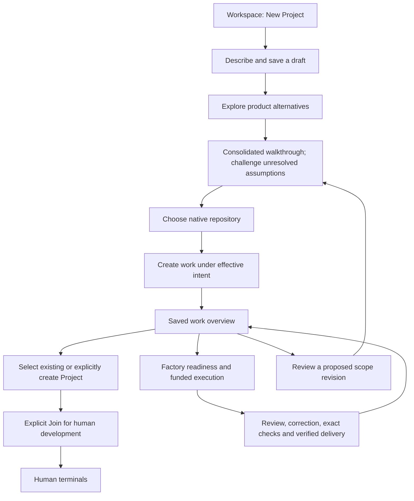

# Spaces UX design

Design specification for the Spaces page and persistent workspace panel. Product contract:
[Spaces](../product/spaces.md). Terminal behavior: [Terminal](../reference/terminal.md).
Annotated sheets: [design/spaces](spaces/README.md).

## Direction

Spaces exposes live factory CLI work and supports human development and
intervention under the [Spaces contract](../product/spaces.md). Intent-first
creation begins with product direction, followed by repository association and
explicit human Project creation or reuse. The end-to-end proposal below develops
the interactions that connect those capabilities. The
[operator reference](../reference/factory.md) documents the existing command interface.

A Project is the place to describe work, follow progress and review results.
The page sidebar is a compact Project switcher: name, owner, observed runtime
status and an attention count when an authorized terminal needs attention.
Selecting a Project opens **Work**. **Terminals** is a secondary Project view;
its session list, pane tabs and splits support hands-on development. Native CLI
agents remain inside real terminals; there is no separate
agent-chat frontend or application origin. Checkout and worktree policy belongs to the
[factory concurrency rules](../product/overview.md#concurrency-and-usage-limits),
not this presentation design.

Visual language matches Soda brand tokens: Barlow interface type, Plex Mono for
controls/terminal, square geometry, thin rules, restrained red primary actions and
clear whitespace. Every repository lives on this Forgejo; there is no external
provider picker in onboarding.

### Everyday Project flow

- **Work** lists the signed-in person's plans for the selected repository. **New
  work** opens the existing description/review flow and suggests that repository
  at the later explicit repository choice. It does not create another Project.
- **Saved plans** is a separate entry for drafts without a repository, accepted
  work and closed plans across repositories. It is not appended to Project
  navigation. **Continue planning**, **View progress** and **Review** resume the
  existing saved-request route.
- List states are facts about a plan: Draft, Accepted and Closed. Accepted does
  not mean running or delivered. The request's progress view owns execution and
  result evidence. Loading failures and partially loaded lists remain explicit.
- Project runtime and access setup live behind **Terminals** and **Project
  settings**. A stopped runtime does not redirect someone away from planning.
  **New project** retains the guided first-use flow and explicit provisioning.
- Terminal and live-watch owners stay mounted across views, Project selection
  and filtering. Selecting a Project changes planning context; an existing
  terminal keeps its original repository/account until explicitly selected or
  ended. The terminal's own header identifies that context.

The persistent native panel remains a compact session tool while browsing
Forgejo. The page provides the work-first Project experience in the same native
shell. Neither view creates, joins or starts an environment merely by opening it.

## First-use journey

The proposed interaction sequence develops the intent-first product contract:

1. New Project opens a sparse description page: **What do you want to build?**
2. System One compares alternatives and challenges assumptions; consolidate one
   understandable walkthrough, asking only necessary assumption questions.
3. Associate the reviewed direction with an authorized native repository.
4. Request native work under the exact effective revision and existing authority;
   no separate blanket approval of every idea or technical plan.
5. Configure/create or reuse the Project; explicitly Join for human terminal use.
6. Follow Factory work or develop manually in the working Workspace.

The native Forgejo header stays with Forgejo's page. Login, consent, callback and
the remaining auth/recovery flows listed in [Trust](../architecture/trust.md) use
the host's normal top-level handling. Prefer one composition per step over
dashboard clutter.

## Proposed end-to-end experience

This section is a design brainstorm for review, not a claim that the screens,
routes or read interfaces exist. It covers the requested intent, review, graph,
planning, execution, lifecycle customization and everyday Workspace experience.
The [product contract](../product/spaces.md#intent-first-creation) remains
authoritative; implementation and verification belong to the
[UX implementation tasks and parallel lanes](../development/factory-implementation-plan.md#end-to-end-ux-implementation-tasks).
New choices below are recommendations, not approved product requirements.

### One journey, distinct effects

The recommended path is:



Project preparation for Factory work follows its existing authorized owner;
human Join is not a Factory prerequisite. Opening the overview, watching output
or following an issue link creates no environment or account. An accepted request
can have native issues while environment preparation or funding remains blocked.
Selecting an existing Project does not Start, prepare, Join or open a terminal;
those effects need their own explicit action or applicable standing authority.

Use **New Project** for the requested entry button and page. Explain once:
“Describe the work first, then choose its repository and create or reuse its
development environment.” In ongoing work use **Build request** for the reviewed
product direction, **Project** for the repository environment, **Work item** for
a linked native issue, and **Session** for a real terminal or observed run.
Native repository issue boards retain their host terminology. An existing
Project also needs a **Plan new work** entry and direct manual terminal access;
neither requires creating another environment.

The three contexts must remain unmistakable: the repository currently being
browsed, the repository bound to a build request, and the Project/account of a
retained terminal. Navigation never silently transfers any of them.

### Navigation and saved addresses

Keep the native Workspace navigation entry visible and provide a prominent
**New Project** button in global Workspace content, including when Projects
already exist. The repository Workspace empty state has the same action with
that repository offered later as a suggestion. An existing repository Project
offers **Plan new work**, **Open Workspace** and the appropriate explicit setup
actions. All creation entries reach the same page composition.

Proposed URLs are `/workspace/new` and `/workspace/requests/:request`, with a
readable step in the latter's query. These names require checking native route
collisions and Fountain contribution capabilities before implementation; they
are not reference API claims. Use the host's `appSubUrl`, current account,
title, query/fragment and history. Request identifiers are opaque and scoped to
current access. Do not place descriptions, credentials or department text in URLs.

Back and Forward restore the recorded step and current request, not perform an
effect again. Before acceptance, Back preserves edits and selections. After
acceptance, Back may inspect the accepted review or return to the saved overview;
it cannot treat that revision as a fresh submission or casually change its
repository. A repository change requires a separate reviewed request, without
pretending previously created native work moved or vanished.

Save drafts to the existing private server owner with an honest **Saved** or
**Unsaved changes** indicator. Offer **Save and leave**; ask about losing edits
only when they have not been saved. Do not add a confirmation to every step.
An offline draft may remain in the current view, but reload recovery must not be
promised for unsaved text. Restore saved requests after reload and native login
under the same actor; an account change must not reopen another actor's flow.
Browser navigation keeps the one retained Workspace/terminal owner.

### Screen and action inventory

| Surface | What the person sees | Main actions and boundaries |
| --- | --- | --- |
| Global Workspace | Search, Projects, saved requests, human sessions and work needing a decision; loading/failure distinct from an empty inventory | New Project, resume a draft, open existing work or terminal; navigation only |
| Repository Workspace | Native repository header, exact associated Project, accepted requests, current work and recent activity | Plan new work, inspect work, explicitly create/reuse/start/join the correct Project when permitted |
| New Project | Centered objective textarea, optional Department, quiet planning allowance, saved state | Explore ideas, Save and leave; no opening repository picker or automatic provisioning |
| New department dialog | Name, description and private-context explanation | Save/select or Cancel; preserves the objective and grants no access |
| Exploring | The retained objective and the bounded operation being performed | Leave safely; stop a pending request only if its cancellation contract exists; no fake ETA |
| Product alternatives | System One's supplied comparisons, consolidated recommendation and consequential unknowns | Inspect or correct if useful; no required vote on each alternative |
| Product review | Plain-language user walkthrough, meaningful branches, illustrative example and necessary assumption challenges | Optional Change something; answer only an unresolved consequential assumption requiring human intent or authority |
| Repository selection | Eligible native repositories, ownership/visibility, existing Project and native Create repository link | Choose context; Back preserves review; native repository creation returns to the saved request |
| Work commitment/status summary | Exact repository, effective outcomes, approach, visible native effects and finite planning allowance | Progress automatically under existing explicit authorization; Create work only when initiating that effect, with no extra blanket review approval |
| Generation/status | Acceptance saved; atomic native graph result, authority-linking progress and original request identity | Open created issues or inspect the original pending/refused result; never blind duplicate submission |
| Work overview | Accepted direction, evidenced work-item counts, attention, dependencies and native issue/PR links | Inspect work, readiness and plans; change direction through a reviewed revision |
| Project setup | Existing environment or immutable installed OS profile, authority/readiness and exact target | Explicit Create Project or reuse/start existing root; no distro switch for an existing Project |
| Join/access | Account to be created or already joined, relevant access and SSH-key options | Explicit Join, then Open terminal; never request a private SSH key |
| Human Workspace | Project/account identity, terminal tabs/panes, status, retained layouts and contextual controls | New terminal, select, split, move, rename, hide or explicitly end; Stop Project is separate |
| Factory work detail | Native issue, accepted outcome, plan freshness, readiness, attempts, review/check/merge evidence | Open native collaboration or Watch output; authorized interventions only |
| Material decision | What stopped, product consequence, exact proposed change and affected work | Accept/decline/correct that change; no routine per-issue approvals |
| Scope revision | Old and proposed outcomes, changed assumptions and work/dependency effects | Review a new revision; do not erase delivered work or silently retarget running attempts |
| Settings | Project Overview, Access, Network and Factory, with permission-aware summaries | Edit only the setting the actor can change; show read-only state otherwise |
| Activity and optional actions | Timestamped native events, links, configured actor/targets and action results | Read events; privileged configuration is separate from viewing |
| Recovery | Exact affected request/Project/session/run, last confirmed fact and next available action | Resume, restore native login, refresh authority or inspect an uncertain result without losing context |

### New Project, exploration and review

The opening composition uses whitespace, one strong heading and a generously
sized textarea. Department and planning controls are a compact secondary row.
Keep provider grants, advanced limits and infrastructure setup off the opening
page. If exploration cannot run, identify the planning allowance or configured
judgment service and link to its owning control without throwing the description
away. Current exploration uses the operator-configured TypeSafe service; it does
not use the person's selected execution-provider connection.

Illustrative opening composition, inside the native page:

```text
Fountain native navigation                              Account
──────────────────────────────────────────────────────────────
                         New Project

                 What do you want to build?
              ┌────────────────────────────────┐
              │ Describe the outcome you need… │
              │                                │
              └────────────────────────────────┘
              Department ▾  New department
              Planning allowance ▾
              Save and leave        Explore ideas
              Saved
```

The text drawing is a design composition, not a new navbar implementation or an
installed screenshot. On a repository entry the native repository header remains
the host's; repository selection still occurs after product review.

Departments remain private contextual metadata under the current contract.
Selection is optional. The dialog has a labeled name and description, inline
validation, Save and Cancel, and restores focus to its trigger. Do not imply a
shared organizational directory or permission group. Accepted native requirements
must not automatically publish the private department record.

Real brainstorming needs product alternatives, not merely “complete first” versus
“incremental.” For example, where supported by the objective, compare a small
single-person workflow with a shared review workflow, or a self-service path with
a managed intake path. Explain different behavior, audience, complexity and
dependencies. The planning owner supplies alternatives and evidence; Jev judges
them. Do not invent research or show generated rationale as a quotation from Jev.
When only a conservative baseline is supported, label it honestly and show the
consequential unknowns.

System One's comparisons, assumption challenges and consolidation feed one
proposal. The [judgment contract](../product/overview.md#planning-and-priority-judgments)
owns the opportunities and resource boundaries; they do not each need a human
screen. The review starts with **Here's how it would work**, showing the experience in
ordinary people's terms. The [nontechnical review composition](#review-for-nontechnical-people)
below connects a walkthrough to the material choices. Keep the technical task
breakdown expandable and informative; twenty generated issues do not produce
twenty acceptance prompts.

Corrections change the proposal. Mark the previous proposal out of date, preserve
the person's decisions, and show the affected differences when exploration returns.
The system chooses the delivery approach within effective outcomes; the person
can correct it. Show when usable parts would arrive; a milestone is not
automatically a scope reduction. A routine approach change does not require
another approval when outcomes and authority remain the same.
Declining the whole direction preserves the request history and supports revising
the objective. Do not perform work dependent on an unresolved consequential
assumption; independent authorized work need not wait for an unrelated answer.

### Review for nontechnical people

The person should be able to explain the proposed experience in their own words
and spot a wrong outcome without understanding issues, dependency graphs,
providers, architecture or implementation stages. Plain copy alone is not enough:
lead with a short walkthrough of the future product. This audience requirement
is the owner's explicit correction; the composition and labels below are design
recommendations.

Default to minimum interaction. The system does the comparison and consolidation;
the walkthrough can be inspected and corrected without becoming a mandatory tour
or an approval checklist. A single **Change something** entry lets the person
correct the proposed behavior in their own words. Reveal per-step editing only
when useful. Do not ask the person to choose every alternative or certify each
assumption just because it appears in the proposal.

Recommended reading order:

1. **What this helps you do:** one sentence about the desired outcome.
2. **Who will use it:** the people involved and who can see or change what.
3. **Here's how it would work:** roughly three to six steps, each naming the
   person, action and visible result. Show meaningful branches where the outcome
   differs, such as approval versus a request for changes.
4. **Try an example:** a concrete, explicitly illustrative scenario using the
   same proposed behavior. A diagram or click-through helps where it adds clarity;
   a numbered text walkthrough remains available.
5. **What we assumed:** brief consequential assumptions beside the affected step,
   with optional corrections and only the unanswered questions that need human intent.

Use the [intent contract](../product/overview.md#intent-review-and-derived-work)
to distinguish inputs:

| Basis | Interaction |
| --- | --- |
| The person explicitly requested it | Preserve it; do not ask them to approve it again |
| Relevant evidence supports the choice | Apply it within scope; retain evidence and allow correction |
| A harmless reversible assumption within scope | Choose autonomously and make it easy to change |
| A consequential unsupported assumption | Seek evidence and assess alternatives first; challenge it only if human intent or authority is still required |

Low confidence alone is not a reason to interrupt. Ask what would happen if the
assumption is wrong and whether a safe within-scope choice or available evidence
resolves it. More model calls cannot invent missing human intent. Sensitive
visibility, new obligations, spending, access or difficult-to-reverse effects are
possible consequences of a wrong assumption; existing grants remain usable for
the effects they actually cover.

This flow describes the people using the requested product, not Factory's own
planning/coding/review/merge pipeline. Use roles and familiar verbs instead of
internal component names. Some products have parallel paths or different roles;
show those relationships without forcing every experience into one linear chain.
Changes in the example, flow and summary must reflect the same reviewed proposal.
A preview with behavior that differs from the accepted requirements is misleading.

For a time-off request, an illustrative walkthrough could be:

```text
Employee chooses dates and submits a request
    → Manager sees the request and makes a decision
        → Approved: employee sees confirmation
        → Declined: employee sees the reason and can revise the request
```

This is an illustration, not required HR functionality. Whether a calendar
updates, an email is sent, or a different person approves are material choices,
not details the preview should silently invent. State who sees a request and
what happens if there is no decision yet. Distinguish a proposed behavior from
a fact the person supplied and from a question that still needs an answer.

Only when necessary, use a focused assumption challenge near the affected step:

```text
We assumed everyone on the team could see each request.
Your description does not establish that, and it exposes individual dates.
We recommend limiting visibility to the employee and their manager.

Use employee and manager only · Share with the team · Explain a correction
```

A necessary question names what the system assumed, why it could be wrong,
the consequence and a recommended resolution. Combine independent necessary
challenges in one concise interaction. Preserve the person's corrections instead
of asking again downstream. A rejection must not automatically choose an opposite
behavior where several alternatives remain. Silence or a timeout is never approval;
hold dependent work and continue independent progress.

**Change this step** opens a short correction field in everyday language. After
the change, identify affected steps and show a concise before/after explanation.
The updated flow and any illustrative screens change with it; mark an older
proposal as out of date. Do not ask the person to edit a diagram's syntax or
approve generated engineering tasks. Further interruption is only for a
consequential unsupported assumption introduced or revealed by the change.
Explicit corrections are not returned for another approval.

The overview can show **Included**, **Not included** and **Still needs an answer**
without requiring approval of each entry. Keep essential scope, access and
spending consequences visible. Selecting a repository or initiating native work
is a direct effect action, not an additional vote on an already authorized plan.
Use **Create work**, with an adjacent explanation:

> This saves your direction and creates tracked work in **[repository]**.
> Factory can carry it out automatically when the required Project, access and
> funding are ready. You can follow progress and intervene.

If the initiating request already authorizes native work for the exact repository
within current grants and limits, advance without another **Create work**
confirmation. Keep direct effect controls where the person is actually initiating
an action, rather than adding approvals after that action is already authorized.

The actual commitment names the exact effective revision, repository and
applicable finite allowance, distinguishing requested facts, evidence-supported
choices, autonomous decisions and human corrections. Do not record a model's
selection as something the person explicitly approved. Show whether work can
proceed under existing authority or which setup is missing; do not ask for that
same authority again. Product review before repository selection
uses **Continue to choose a repository**; it does not imply acceptance or native
effects yet. Rejecting a draft leaves the recorded request available for revision;
it does not delete previously accepted native work.

This target requires a real intent-contract change: current `reviewReady` requires
every idea to leave `pending`, and `IntentRevision.Validate` rejects pending ideas
in an accepted revision. Hiding controls or automatically marking every idea as
human-approved would leave or falsify that gate. Implementation must represent
the decision basis and block only consequential unanswered assumptions, with
backend enforcement and exact durable authority. This design round does not
claim that behavior is implemented.

On narrow screens the flow stacks in reading order. Use text labels for roles,
arrows and branch outcomes, a keyboard-accessible ordered-text equivalent,
visible controls and explicit focus after edits. Color, icons, animation or
hover must not be the only way to understand the behavior. Avoid mandatory
animation or a long click-through before a person can inspect the whole flow.

Later usability verification should ask a nontechnical reviewer to explain who
uses the product, what happens on each meaningful branch, who can see the result,
how to correct a wrong assumption and what acceptance will do. Their answers and
ability to make a correction are stronger usability evidence than approval of
the wording by agents or Jev. No such human test is claimed in this design round.

### Repository, acceptance and environment setup

The repository picker follows review. Show exact namespace/name and current
eligibility rather than selecting from display metadata. Distinguish no matching
repositories, no eligible repository, failed search, unavailable integration and
an existing Project. Native repository creation uses native forms; save the request
before leaving and provide a clear return path. Context inherited from a repository
page is a suggestion until explicitly selected.

Before committing, summarize included outcomes, consequential assumptions,
delivery approach, exact repository and finite planning allowance. Explain that
generated issues become visible according to the repository's native permissions.
The primary button is **Create work**, using the plain-language
effect summary above. Acceptance records one exact revision; native generation
has its own visible status.
The server must still enforce the current actor's write authority.
An existing explicit authorization is carried forward rather than reconfirmed;
unresolved consequential assumptions remain the only product-review interruption.

Project setup and Factory execution are distinct next actions on the overview.
Reuse an existing environment whenever the contract permits it. Human setup
shows the installed supported profile and its immutable nature, then explicit
Create, Join and Open terminal actions. Factory setup uses existing standing
authority and preparation, independent of human Join. Show which setup is needed
instead of forcing every person through all administration forms.

Execution may already be authorized by valid standing grants. Acceptance must
then state that eligible work can proceed under those grants, instead of implying
no execution will occur. When they are missing, say what is waiting and offer the
appropriate setup. New access, additional spending or a new consequential effect
needs a concrete decision; ordinary progression does not need another Build
confirmation after all required authority is present.

If generation is pending or refused, retain the accepted revision and original
request. Native graph mutation is atomic. Incomplete progression may mean
**Native work committed, authority linking incomplete**, rather than some
mutations within one graph packet committing independently. Show verified native
mappings separately from unconfirmed adoption. **Work items created** means
native creation/adoption finished, not that the requested product has been
delivered. Environment failure also leaves accepted work available for inspection.

### Work overview and native graph

Lead with the accepted outcome and a compact work-item summary, for example:
**2 delivered · 1 working · 3 waiting · 1 needs your decision**. Counts come from
recorded facts. They count work items; several closed issues may satisfy only
part of one accepted product outcome. Default to a readable list grouped by useful
status; offer the dependency graph as another view with a keyboard-accessible
list equivalent. Use native issue identities and links throughout. An overview is connective
Workspace content, not a replacement issue tracker or a new application shell.

Each item shows its outcome, actual state, why it waits, and issue/PR links.
Root issues can be ready together. Dependency edges identify the required outcome,
not merely an unexplained arrow or arbitrary sequence number. Selecting an item
opens details without discarding terminal layouts. Native issue changes, splits,
consolidations and dependency revisions show attribution and their effect on the
accepted request; the browser does not manufacture authority or graph truth.

**Ready** means the relevant execution gates pass, not that an idea looks useful.
**Working** is supported by actual execution evidence. **Needs attention** names
the person or role who can resolve the blocker. **Delivered** links to verified
completion evidence. Unknown or stale observations are marked with their age,
without turning a failed refresh into “no work.” Overall completion requires
evidence for the accepted product outcomes, not a single merged PR.

### Planning and next-work selection

Distinguish the states people need to understand:

| State | Explanation and useful next view |
| --- | --- |
| Waiting for prerequisite | Name the native issues and outcomes blocking execution |
| Provisional plan available | Show stable decisions and details still dependent on unfinished work |
| Refreshing plan | Identify the changed prerequisite/source/accepted revision and finite remaining allowance |
| Ready to execute | The plan is current and independent execution gates pass |
| Planning unavailable | Name missing authority, exhausted allowance, failed judgment or unavailable service |

A plan includes the accepted outcome, supplied evidence, chosen approach,
unresolved facts, freshness and invalidation reasons. Reuse unchanged valid work
instead of animating repeated model calls. Prerequisite completion refreshes the
affected provisional details before coding. A planning allowance does not waive
execution gates or fund provider execution automatically.

When one issue is eligible, explain that it is next without a priority consultation.
For several, show the selected issue and a concise **Why this is next** disclosure:
eligible snapshot, supplied impact/effort/age facts, recorded advice and any
fairness rule used. Unknown estimates remain unknown. Jev uncertainty is optional
detail, not a permission or correctness badge. A rationale belongs to the supplied
facts and planner, not invented model prose. Stale judgments cannot launch work;
the display should explain a changed selection after revalidation. Larger eligible
sets must retain all candidates in the bounded selection procedure, without
requiring a person to approve its internal rounds.

### Execution, review, checks and delivery

Show the actual current role and attempt, the latest useful outcome, native issue
and PR links, and a short evidence timeline. **Watch output** is read-only;
**Stop watching** closes observation, not execution. Keep factory output visually
distinct from the human terminal that accepts input. Avoid making raw CLI output
the only way to know the state.

The default progression remains planning, coding, independent review, correction
where needed, fresh checks on the exact reviewed candidate, verified native merge,
confirmed original-issue closure and dependent pickup. Summarize routine reviewer
corrections without asking for product approval. Native PR views own diffs, comments,
human review and merge controls. Link to the exact PR and reviewed head; if it
changes, show that previous review/check evidence is stale.

Distinguish **checks failed**, **awaiting required checks**, **merge not permitted**,
**merge confirmed, issue closure pending** and **delivered**. Required original
closure must be confirmed for work-item delivery; a pending optional completion
comment cannot hold delivered work in a waiting state. A stop, pause, budget
change or human takeover must name its exact execution or repository scope and describe its
actual effect. Only expose controls supported by their owning APIs; hiding
output is always a separate presentation action.

### Material decisions and scope revisions

Interrupt with one concrete choice and its consequence: what stopped, why, who
can resolve it, and what continues independently. Product questions return to a
focused review of the affected outcome. Access problems link to Access, provider
connection problems to the selected connection, and operator repairs to useful
inspection evidence. Routine implementation correction stays autonomous.

A proposed revision compares added, changed and removed outcomes and assumptions,
then shows reused/new/superseded native work and changed dependency edges. Explain
the treatment of work already running or delivered. Do not imply that rejecting
a new proposal undoes a merge or deletes native issues. Acceptance records the
new revision only after material conflicts are resolved.

Propose an allowance-only adjustment that does not re-create native work or
reset product scope. This needs a distinct allowance contract: current
`PlanningCalls` is part of the immutable accepted revision, and a replacement
revision invalidates earlier derived acceptance. The design must not present an
independent planning-budget adjustment as an existing capability.

### Funding, access and settings

Use a concise readiness summary with actionable links instead of opening with
every Factory form. Retain Project Overview, Access, Network and Factory.
Within Factory group accepted direction/readiness, execution policy, planning
allowance, provider funding and activity configuration. A viewer sees permission
and current values without editable controls they cannot save.

Planning shows its actual allowance unit, available usage evidence and remaining
limit. Execution shows selected provider/account, sponsoring owner, grant scope
and finite allowance. Calls, money and execution units are not interchangeable;
do not invent a currency estimate. Distinguish consumed, reserved and available
where the source provides them, and mark unavailable usage honestly. A busy or
expired selected connection cannot silently switch provider, billing method or
account. Increasing a limit states the exact new amount and scope.

Access distinguishes repository visibility/write authority, Project ownership,
human Join, managed SSH keys, Factory standing authority, native publication
actor and provider grants. Native account controls stay in the host shell.
Show revocation consequences accurately. Disable affected actions and protected
streams when access expires without deleting retained files or pretending the
old browser flow belongs to a new actor.

### Activity and bounded optional lifecycle actions

Put readable recent activity in repository work context, outside administration.
Show timestamp, event, native issue/PR link and confirmed outcome; represent an
unknown timestamp honestly. The existing three repository-wide switches affect
display only. Label them **Activity visibility**, not automation or execution
policy. Distinguish owner-editable preferences from read-only viewing.

The recommended candidates below cover all three requested lifecycle events.
They are proposed native actions whose exact upstream capabilities and costs
must be verified before implementation. Use existing native subscriptions where
they meet the notification need. Keep the complete Factory default useful when
every optional action is disabled.

| Event and candidate | Actor, target and visible effect | Bound, retry and failure |
| --- | --- | --- |
| Generated issue created: label or assign | Configured actor with current native repository authority applies a fixed repository label and/or explicitly eligible assignee to the exact generated issue | Proposed cap: one label and one assignee per issue/event; verify existing state before retry; label/assignee failure is visible without undoing issue creation |
| PR created: request human review | Configured native actor requests explicitly selected eligible reviewers on the exact generated PR | Proposed cap: three reviewers per PR/event; deduplicate requests; no notification loop; failure leaves PR and mandatory independent Factory review intact |
| Verified merge and original closure: completion note | Configured actor posts one bounded native completion comment on the exact original issue, linking verified PR/outcome | Proposed cap: one 1,000-character note per original issue/event, only after both facts confirmed; reconcile uncertain publication before retry; failure cannot invalidate delivery or emit repeated completion comments |

Configuration shows what happens, exact targets, acting authority, finite native
operation budget, and failure behavior. These candidates consume no AI calls;
their actual native quotas/costs still need checking rather than an invented
currency promise. A suggested first retry limit is one initial attempt plus one
retry after a definitive no-effect failure, per desired target/event. Permission
denial does not retry; uncertain outcomes require native reconciliation before
another write. These caps are design suggestions, not existing limits.
Disabled, active, pending, delivered and failed action states link to the
triggering native event. Revocation stops further effects. A dry
summary may show the configured effect without executing it.

Do not add arbitrary scripts, deployment, generic hooks, extra AI prompts or a
second mandatory review system. The label/reviewer/completion choices remain
recommendations; three model preferences do not turn unverified capabilities
into an approved contract.

### Everyday terminals, discovery and compact layouts

Page sidebar search finds Projects by name or owner. The selected Project's
Terminals view lists its sessions; the native panel searches Projects and session
names. Saved plans and Project activity have separate content areas.
Recent items use exact stable identity. Show an empty inventory differently from
an unavailable one. Native repository Workspace selects its own context without
changing a terminal already attached to another Project.

Retain the existing terminal tabs, splits, Move menu, keyboard-resizable separators,
rename/hide/end distinctions and panel/full-page composition. Show Project and
account at the terminal input boundary even when browsing a different repository.
New terminal requires current authority and actual joined/running readiness.
Rename changes metadata, Hide changes presentation, End terminates that session,
and Stop Project has broader shared impact. Confirm only actions whose actual
destructive impact warrants it and name affected work.

On small screens show one usable selected content view with accessible overflow
and Projects/Sessions switching. Preserve the underlying pane layout and terminal
elements while hiding inactive views; do not dispose a socket to achieve a
responsive layout. Returning to full width restores the user's layout. Opening
a dialog, work card or status update must not steal ongoing terminal input.
Graphical desktop access remains deferred.

### Recovery and state language

| Situation | Presentation and safe next action |
| --- | --- |
| No saved work | Explain New Project or manual use of an existing Project; no empty dashboard of disabled controls |
| Nothing runnable | Keep waiting work visible with named prerequisites; distinguish from no accepted work |
| Draft or proposal changed elsewhere | Preserve local corrections and compare with current revision before acceptance |
| Exploration unavailable | Keep description/decisions; identify planning allowance or the configured judgment service failure |
| Login expired/account switched | Use native authentication; retire the old authority flow and resume only with a matching authorized actor |
| Visibility or write authority lost | Show the specific access boundary; disable protected actions/streams; no phantom new request |
| Native generation result uncertain | Check the original durable request and show verified mappings; no generic resubmit button |
| Project preparation/provisioning failed | Keep accepted work; show existing environment facts and the supported recovery action |
| Funding exhausted/connection busy | Name planning versus execution, the relevant service or selected execution account and needed owner action; do not substitute another billing route |
| Terminal disconnected | Keep exact session/Project identity and last observation; Reconnect attaches to the existing authorized session, not a new terminal |
| Status refresh failed | Mark last confirmed state with its time; do not present stale data as current or clear it into an empty result |
| Review/check/merge stale or blocked | Identify the exact changed candidate or missing check/permission; lead to native evidence |
| Merge confirmed, closure/action pending | Show delivery facts and remaining closure/optional-action status separately |
| Service recovers | Refresh the original state; reconcile pending effects before enabling an explicit retry |

Errors identify the failed action, what was retained, and one useful next step.
Avoid raw internal receipt tags as primary copy. Diagnostic detail may expose
safe identifiers and evidence to authorized operators without credentials.
Never infer successful cancellation, termination, merge or restoration from a
button click or a model judgment.

### Accessibility and visual treatment

Use native HTML labels, buttons, selects and dialogs wherever practical. Provide
visible focus, meaningful headings, error associations, keyboard-complete flows
and a list alternative to every graph or drag interaction. Explain disabled
actions through nearby text. On step changes focus the heading or relevant field;
restore focus on closing a dialog without taking input from a retained terminal.
Announce meaningful saving/status/error transitions politely, not every streamed
output update. Keep keyboard and screen-reader observation distinct from terminal
input ownership.

Use existing Barlow/Plex Mono, square geometry, thin rules, whitespace and
restrained primary red. Do not make color the only state signal. Long repository,
Project and outcome names wrap without losing their identity. Check narrow screens,
touch targets, zoom, reduced motion and contrast. Show plain outcome language first;
advanced technical evidence is available on demand.

### Design tradeoffs and verification

Three fresh Jev consultations compared equivalent reworded source facts and
alternatives. They all selected a dedicated routed creation composition over an
embedded wizard or long modal; an evidence-based request/work overview over a
stage board or enhanced native issue list alone; and bounded native action
candidates for all three lifecycle events over subscriptions/display alone or
only PR reviewer requests. Their uncertainty varied, especially for optional
actions. These are advisory choices, not capability or usability verification.

Acceptance ordering disagreed: one selected collecting optional Project details
before acceptance, while two selected native-work acceptance followed by separate
environment setup. Inspection of `apiIntentGenerate`, `apiIntentRevision` and
`configureProject` confirms repository/revision-bound generation does not require
human Project configuration. Prefer separate work/environment steps to preserve
manual reuse and avoid unrelated setup before an inspectable native graph. The
commitment summary still needs all applicable scope, funding and authority facts;
there is no majority-vote proof and no claim of unanimous ordering advice.

Implement in coherent journey slices: reachable New Project and saved-state
navigation; meaningful exploration/review and explicit commitment; integrated
work/readiness/planning evidence; native delivery/intervention detail; then
verified bounded optional actions and everyday refinements. Each slice should
include its actual error/resume behavior rather than postponing recovery to a
separate polish pass. Read APIs for missing facts must be designed with their
existing owner instead of deriving status from CLI prose.

Affected acceptance scenarios should demonstrate:

- Visible New Project entry with both empty and populated Workspace; direct global
  and repository navigation in shared native templates with account controls.
- Draft Save, leave/resume, reload, Back/Forward and exact query/fragment behavior;
  no native issue, Project or account effect caused by navigation.
- Corrected ideas, conflicting assumptions, changed approach and stale revision
  refusal; acceptance names exact scope/repository/effects and binds one revision.
- Evidence-supported choices and harmless defaults progress without individual
  questions or repeated authorization. Only necessary consequential-assumption
  challenges interrupt dependent work; requested facts, autonomous choices and
  human corrections retain distinct provenance. Relevant changes refresh affected
  judgments while matching unchanged inputs reuse recorded results.
- Confirmed, adoption-incomplete and uncertain generation recovery with one
  original request; Project failure cannot lose acceptance or duplicate native work.
- Branching prerequisites, provisional plans, actual-output refresh, separate
  planning/execution allowance and factual readiness/priority displays.
- Autonomous review/correction, failed or stale checks, verified merge, original
  closure and dependent pickup, with correct distinction between observation and
  execution control.
- Scope revision handling of running/delivered work; account/permission changes
  terminate old authority without exposing another actor's records.
- Keyboard/compact/zoom usability and persistent terminal DOM, renderer/socket
  lifetime, focus and existing human process at the scope actually exercised.
- Optional actions enforce exact event, actor/target, finite operations,
  deduplication, uncertain-result reconciliation and visible failure.

These are proposed scenarios, not tests run in this design round. Source evidence,
browser fixtures and installed behavior must be reported separately. The existing
annotated sheets predate this proposal and are not evidence that it is implemented.

## Full-page workspace

- Compact Project navigation in a sidebar; Work opens first, with Terminals as a
  secondary Project view. Saved plans has a separate entry.
- Local tabs within a pane; splits for simultaneous views.
- Focus is input ownership; attention is advisory from real signals.
- Measured pane minima after xterm render; do not collapse on stale geometry.
- Rename is display metadata. Hide is presentation-only. End is confirmed.
- Project Stop is a separate shared-impact action.

## Persistent panel composition

```text
┌─────────────────────────────┬──────────────────────────────┐
│ Native Forgejo browsing     │ Spaces workspace / terminals │
└─────────────────────────────┴──────────────────────────────┘
```

Fountain owns this generic host layout and retains installed extension panels
while native Forgejo pages change. Soda owns only the workspace contribution; it
does not supply a replacement shell, frame or copy of Forgejo navigation.

- Two useful surfaces, not a modal.
- Preserve native forms, routing and focus on the Forgejo side.
- The Spaces page and panel share one workspace owner layer.
- Compact layouts keep controls and terminal input usable; Hide does not End work.

## Profile and desktop extension

Graphical access is [deferred](../product/scope.md#deferred); these notes constrain
a possible extension rather than describe a supported first-factory surface.

Terminal and Desktop identify the same project account and real files. A desktop
tab references an exact graphical session with its own display/input owner; it is
not a PTY ID in the personal-terminal API. Compact screens show one usable selected
view with accessible navigation.

## Sheets and tooling

Hand-authored SVG sheets under `docs/design/spaces/` are design source. The retained
`render-sheets.ts` tool compiles with Bun and writes rendered PNGs to ignored
`.artifacts/`. The superseded interactive mockup and its preview tool are retired;
the sheets are not runtime UI or installed screenshots.
