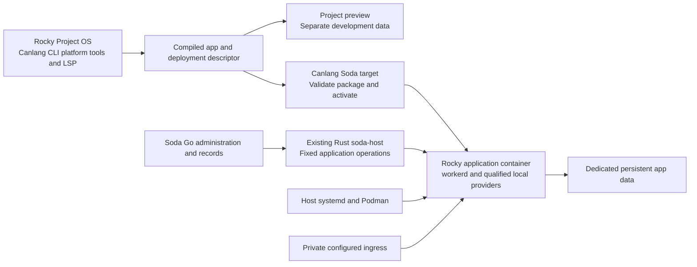
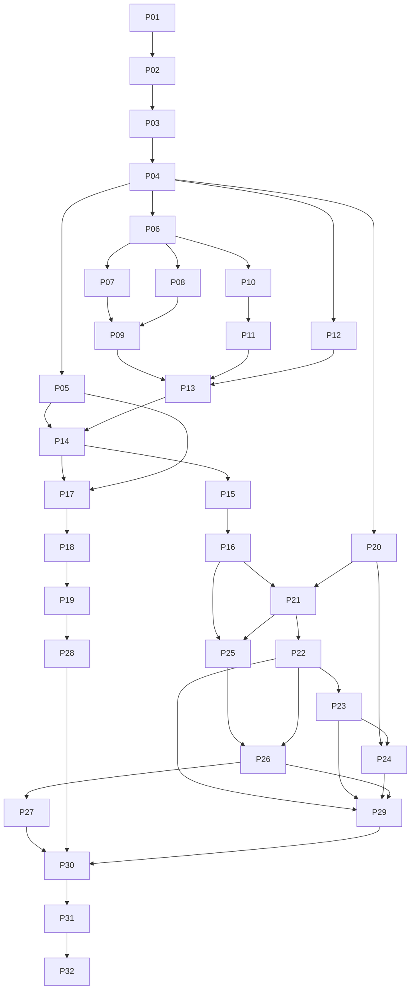

# Canlang and Soda OS implementation plan

## Wind-down status — 18 October 2026

Execution is stopped. The [canonical remaining outcomes](factory-remaining-tasks.md#consolidated-remaining-outcomes--execution-stopped) contain every unmet P outcome and its shared factory/release consumers; no second queue is dispatched here. Historical app/domain/UI and local Miniflare evidence remains accepted at its exact scope. Direct-workerd P14–P16 and affected P25–P29 are planned/unproved replacement work; P08/P09/P10, real-client P22, P30/P31/G4 and plan absorption retain explicit unmet criteria. Existing source/native component receipts are not reopened or promoted to full candidate acceptance.

**Runtime replacement planned 18 October 2026 · historical native evidence from 14 October 2026**

The [production workerd investigation and implementation chapter](canlang-soda-os-implementation-plan/production-workerd.md)
now owns the proposed replacement of Miniflare in production. It recommends
direct pinned workerd, a maintained D1 provider, the existing Files actor and
Soda lifecycle, with an explicitly separate production dependency closure.
The current request authorizes investigation and planning; this update does
not implement or deploy the replacement. Native storage, parent-death/writer
ownership and retained-data compatibility are first implementation gates.

Completed results below describe the historical Miniflare implementation.
P14–P16 and the affected P25–P29 portions are reopened for the replacement;
their existing evidence is preserved. The chapter decomposes those same task
IDs and feeds the already-open P30/P31/G4. It does not create a second task queue
or reopen unrelated application semantics and administration.

Canlang applications should be developed in Soda OS Project OS and deployed to a separate Rocky Linux application container for a small team on one private appliance. The application runs on Cloudflare's open source **workerd** runtime, with local implementations of the services its compiled artifact requires. Soda OS supplies deployment administration, private access, supervision and recovery; Canlang retains ownership of application semantics, identity, storage and background work.

This is feasible within that bounded scope. Packaging workerd is the easy part. The substantial work is completing Canlang's existing runtime joins and proving that local service implementations preserve acknowledged writes, file lifecycle, work delivery and migration rules. A container cannot package Cloudflare's entire managed platform or automatically inherit its production guarantees.

The earlier implementation used appliance-managed
lifetime, separate Rocky runtime/app images, the pinned Miniflare/workerd launcher,
app-local owner bootstrap and explicit stopped backups. First-app
scope is D1, accounts/browser/MCP, persistent files and durable scheduled work,
with separate private app hostnames and the existing local/supplied TLS policy.
The new production-runtime recommendation is defined by the linked chapter;
these historical implementation choices are not evidence for its new runtime.
Automatic backup frequency and recovery objectives remain unset. Publication and
deployment to an existing appliance are outside this task.

Prove the native runtime before extending appliance orchestration; keep the
developer image and application image separate. These decisions do not make D1
the eventual limit of the requested Cloudflare service coverage.

## Current execution evidence

Implementation started with canonical Soda checkout
`ac345eed55de568cdc9461c1bc601a7d50c560ee` (existing changes preserved) and Canlang
`f1911db36bf6b18dfdaac90555b334bc9f335639`. The Soda checkout is shared with other
ongoing work and has advanced during implementation; receipts record the tested
revisions. No worktrees were created.

- **G1 passed locally:** compiled `.can` HTTP operation, real D1 write/read,
  native process restart, abrupt container death and retained-volume replacement,
  graceful shutdown, and refusal of missing/read-only required storage. Native
  x86_64 Rocky 10.2, Node 24.21.0, Miniflare 4.20260730.0, workerd 1.20260730.1,
  compatibility date `2026-07-15`, flags `[]`. Canlang's executable receipt is
  `scripts/verify-native-runtime.mjs --containers`; results are task-local under
  `.artifacts/soda-native-runtime/` in Canlang.
- **Files provider leaf passed:** actual workerd SQLite Durable Object storage,
  full default 10 MiB upload/finalization, retry after lost acknowledgement,
  verified byte digest and restart persistence. Native SQLite rejected one large
  BLOB; transactional 64 KiB chunks preserve the existing file limit and API.
  This does not qualify R2.
- **Installed tools passed locally:** frozen offline archive
  `f97a6cbe09f1383065ed1b1663e7dca16b64e5ea1f1496d882889aa7e85a5e8a`, compiler,
  real preview/examples with retained D1 and isolated fixtures, offline Rocky
  startup and LSP diagnostics/completion/navigation/formatting. Receipts:
  `.artifacts/canlang-preview-20261014/` and
  `.artifacts/canlang-final-delta-20261014/` in Soda. These consumers' files are
  byte-identical in the current archive; its changed `soda-run` launcher is
  separately qualified by `.artifacts/canlang-lock-20261014/` and the current
  production image proof. The genuine retained Project also passed compilation,
  protected preview persistence, isolated examples and explicit maintenance in
  the CoreOS component proof below.
- **Fresh complete Project image passed locally:** current full Project recipe
  built from pinned public Rocky, real current Soda helpers, verified public
  tools and the admitted Canlang closure. Image
  `sha256:5c5c5eba14380fa276e33edcb107baafb041af63b3ce01cb5bf3c312f2a39ed4`.
  A fresh container with networking disabled, an ordinary account and no Canlang
  checkout compiled, checked/linted/formatted, served a protected authenticated
  preview, retained D1/Identity across restart, ran isolated actual examples and
  exercised LSP diagnostics/completion/navigation/formatting. Exact commands,
  recipe/source/tool hashes and results:
  `.artifacts/canlang-fresh-project-20261014/{commands.sh,results.json}`.
  This local image workflow is distinct from a matching-release appliance's
  Project Create/systemd boot qualification.
- **G2 passed locally:** actual two-user browser/MCP and concurrent revision
  conflicts, authenticated File upload/download and denied access, missed durable
  work executing once despite duplicate wakeups, retained sessions/grants/data
  across process restart and container replacement. Receipt:
  `.artifacts/canlang-soda-full-v4-20261014/results.json`.
- **D1 full-storage failure/recovery passed:** actual shipped application on a
  bounded task-owned 32 MiB ext4 filesystem rejected a valid HTTP mutation
  visibly without committing; full required storage refused startup. Freeing
  only the task filler and restarting retained the prior acknowledged record
  and confirmed the failed write absent; the same large input then committed.
  Receipt `.artifacts/canlang-enospc-20261014/{results.json,README.md}`. No shared
  filesystem was filled; task containers and loop mount were removed.
- **Production images passed locally:** separate Rocky runtime/app images,
  UID 10000, read-only root, no startup network, graceful shutdown and SIGKILL
  replacement retaining application/File/work/session state. Receipt:
  `.artifacts/canlang-production-images-v3-20261014/results.json`. Runtime ID
  `sha256:6f504c78ff5eb81d58b2420c4150a645c71765b83c29c26a936d4646b7241947`,
  app ID `sha256:e959ac43b7255f1025d5556d5df3029f555e6a205339aa567dd97bbac719e85a`.
- **Private ingress and stopped recovery passed locally:** real pinned Caddy
  HTTPS against the compiled app, CRUD/MCP/File authorization, exact native route
  owner; `.artifacts/canlang-ingress-20261014/results.json`. Full stopped storage
  copy/checksum and fresh-directory restore, then actual login, record/File read
  and duplicate-work refusal; G2 receipt's `recovery-results.json` and
  `recovery-application.log`. Copy/verification took 0.493 s, application reopen,
  read and shutdown 2.530 s in this fixture; these are not RPO/RTO guarantees.
- **G3 component proof passed on fresh CoreOS:** native install/start/stop and
  same-artifact image replacement, stale-generation and runtime/tools mismatch
  rejection before effects, private hostname HTTPS with actual Caddy CA trust,
  Project-stop independence, and two genuine guest reboots. D1/File/session/MCP/
  durable-work state survived; explicit stopped intent survived the second boot.
  Stopped backup restored into fresh storage and reopened through workerd. The
  retained Project's real installed compiler/preview/examples and maintenance
  passed without checkout or startup downloads. Receipt and exact commands:
  `.artifacts/canlang-g3-vm-20261014/{results.json,README.md}`. Final native host
  SHA-256 `05edfa205ff0f1d3a0dc61df0aa309c5a95033d96e36f48ba29ab4b93e0f72c5`;
  the earlier actual reboot proof records its own binary identity separately.
  The new task-owned VM used older cached public media plus current components;
  this qualifies component boundaries, not a full matching-source release or
  physical LAN/Tailnet clients. The VM and task HTTP server are stopped.
- **Administration and release source checks passed:** real PostgreSQL CAS,
  immutable revision/grant/data/endpoint records, authorized API actions, honest
  unknown outcomes, existing Spaces controls and native generation/readiness/
  writer/route boundaries. Receipts `.artifacts/canlang-p20-20261014/` and
  `.artifacts/canlang-p23-20261014/`. Public tool admission, checksum-bound git
  snapshot handoff, Project image staging, retained maintenance and native backup
  binary delivery are wired through their existing release owners.
- **P27 release integration passed source checks:** the fixed seventh image role,
  `canlang-runtime`, uses the existing frozen-input build/export, payload, shared
  OCI/media, installer, offline import and retained-release readers. Candidate
  content binds runtime tool inventory/attribution and host archive/lock.
  Native Install/Replace fence selected runtime/tools before effects; existing
  admitted generations remain inspectable/startable/stoppable after an OS update.
  Receipt `.artifacts/canlang-p27-20261014/results.md` records focused tests and
  actual qualified runtime OCI metadata/attribution readback. No full seven-role
  matching-source appliance candidate is claimed by the component export.

The [operating guide](../guides/canlang-applications.md) owns current procedures.
Reproduction commands and retained outputs belong to task receipts. G3 component
checks permit source release integration. G4, a full matching-source appliance,
physical LAN/Tailnet clients, matching-release Project Create/boot and the
installed UI/API/runtime journey remain open. Failed earlier driver runs remain failed
and are retained separately.

From the respective repository root, the executable native checks are:

```sh
# Canlang: fresh task-owned output paths under /home; the compiler must be built.
node scripts/verify-native-runtime.mjs --compiler compiler/target/release/can \
  --state "$HOME/.cache/canlang-proof/native" --containers
node scripts/verify-preview-persistence.mjs --tool-root "$CAN_TOOL_ROOT" \
  --state "$HOME/.cache/canlang-proof/preview"
node scripts/verify-soda-host.mjs --tool-root "$CAN_TOOL_ROOT" \
  --state "$HOME/.cache/canlang-proof/full" --containers \
  --podman-state "$HOME/.cache/canlang-proof/native"
# Soda: use admitted final project-tools and the generated full/input.json.
node system/containers/canlang/verify-runtime-image.mjs \
  --assets .artifacts/canlang-integration-20261014/final-assets-v2 \
  --bundle "$HOME/.cache/canlang-proof/full/input.json" \
  --release system/project/canlang-release.json \
  --state "$HOME/.cache/canlang-proof/images" \
  --podman-state "$HOME/.cache/canlang-proof/native"
cargo test --locked -p soda-host --lib
cargo test --locked -p soda-release-image --lib
```

Each driver records versions, identities, commands and outcomes. Container
drivers require explicitly selected task-owned Podman storage and cached/pulled
images; image recipes are not downloaded or compiled during app startup. The
production image driver accepts both `--runtime-image` and `--application-image`
to reuse exact cached bytes for a fresh fixture run.

## Runtime and environment requirements

The requested outcome is one Canlang application model targeting workerd, usable
on Cloudflare Workers, in a Soda development environment, and in a self-hosted
container on CoreOS. Each environment must supply the application's declared
runtime capabilities and service bindings. The owner's phrase "all the cloudflare
services" leaves the intended breadth unresolved. A defined supported subset is
the adopted first-app scope, without limiting eventual coverage. Unsupported
required services are explicitly rejected by the target. These
are acceptance requirements for implementation and qualification. The
production scope and operating choices under [Scope and existing decisions](#scope-and-existing-decisions)
and [Adopted decisions and remaining choices](#adopted-decisions-and-remaining-choices)
remain proposals where explicitly marked.

| Environment | Execution and services | Packaging and lifetime |
| --- | --- | --- |
| Cloudflare deployment | Compiled Worker on Cloudflare; declared bindings connect to managed resources. | Preserve Canlang's Cloudflare deployment target and compatibility configuration. |
| Soda development | Actual local workerd with Miniflare supplying supported local bindings; separately declared remote bindings where supported. | Extend the existing Rocky Project OS with Canlang tools and a working preview/test command. Development state belongs to the Project. |
| Soda production | workerd with implementations qualified for the application's required bindings. | Adopted separate Rocky runtime base and app image, supervised by host Podman/systemd; production data and lifetime are independent of the Project. |

CoreOS supplies the host kernel and container infrastructure. Rocky supplies
container userspace. A runtime base may bundle local providers or connect to
separately operated services; a binding's availability and behavior matter more
than whether its provider runs in the same container.

| ID | Requirement | Acceptance and existing task owners |
| --- | --- | --- |
| R01 | **One application contract across targets.** Reuse Canlang's emitted application, deployment descriptor and portable worker bundle. Target adapters supply configuration and providers without changing application semantics. | The same compiled application can be packaged for Cloudflare and Soda without target-specific application source edits, provided its requirements are supported by both. Validate the claimed common subset on both targets. P04, P14, P17. |
| R02 | **Declare and check capabilities.** Reuse the existing Canlang compatibility descriptor for required capabilities, bindings, secrets and schedules. Describe each environment's actual provider support in machine-readable form. | Build/preflight explains unsupported requirements; installation/activation refuses them before application effects. Diagnostics name the requirement and target. A configuration declaration or success stub is not proof of a provider. P04, P12, P13. |
| R03 | **Record execution compatibility.** Pin workerd, Node, Canlang producer and provider versions; development also pins Miniflare. Preserve the application's compatibility date and flags separately from provider settings. Cloudflare manages its own runtime binary. | Production uses the separately inventoried direct-workerd closure proposed in the replacement chapter; its native G1 evidence is required. Development retains its own Miniflare closure. Node owns host tooling while workerd executes the application. P02, P03, P14. |
| R04 | **Ship a complete developer environment.** Package the compiler, matching platform tools, runtime dependencies and local providers in the existing Project OS. | A fresh Project can compile, start an HTTP preview and run actual application examples without a Canlang source checkout or startup dependency downloads. Preview data persists across preview restart; test fixtures are isolated. Existing Projects use explicit same-root maintenance. P05, P17, P18. |
| R05 | **Define production execution separately.** Specify the runtime entrypoint, permissions, app payload, providers, storage and credentials independently of development. Distinct final images and appliance-managed lifetime are adopted. | The app starts from installed artifacts without building or downloading dependencies and does not acquire developer privileges, homes, engine access or credentials. It must remain available when its Project stops. P16, P21, P26. |
| R06 | **Separate and preserve state.** Give development, tests and production distinct writable storage and resource identities. Follow [Persistence and operations](#persistence-and-operations) for production data. | Acknowledged database/file/work state survives the promised restart and replacement operations. Missing required storage refuses startup instead of silently becoming ephemeral. Backup/restore and migration behavior pass G2/G3. P09, P11, P15, P25, P26. |
| R07 | **Make external dependencies explicit.** Local and remote providers are deliberate target configuration with scoped credentials and declared network requirements. | Local preview does not silently access production resources. An offline profile rejects remote-only requirements. Development remote-binding support alone does not qualify a self-hosted production adapter. P04, P12, P14. |
| R08 | **Qualify each claimed service.** Use the [service feasibility matrix](#feasibility-of-the-service-set) as the initial candidate inventory, then prove only the subset the selected app needs. | D1 is the initial database; Files uses the qualified native SQLite DO adapter, not R2. Other bindings are conditional. Durable named queues need durable delivery evidence. Local simulations are not Cloudflare-equivalent production guarantees merely because API calls succeed. P01, P03, P11, P12, P15. |

These requirements refine the existing tasks below rather than create a second
execution queue. The first implementation proof is a compiled app, one callable
HTTP path and persistent D1 on native Rocky; extend it with the selected app's
files and durable work before adding appliance administration or release builds.

## Code ownership and placement

The existing Rocky container is [system/project/Containerfile](../../system/project/Containerfile),
currently based on Rocky Linux 10.2. It is the persistent development environment,
with systemd, accounts, SSH, mise and nested Podman. Its recipe now installs the
admitted Canlang/workerd tools. Separate production recipes live under
`system/containers/canlang/`; their package set excludes the Project privileges.

| Concern | Existing owner or proposed placement | Boundary |
| --- | --- | --- |
| Application requirements and compatibility | Canlang `packages/contracts/src/deployment.ts` | Extend the existing descriptor and environment verdict; do not introduce a competing Soda application manifest. |
| Portable application bundle | Canlang `packages/cloudflare/src/deploy/bundle.ts` and worker assembly | Reuse emitted workerd modules, resource discovery and bundle identity for both deployment targets. |
| Local preview and test execution | Canlang `packages/cloudflare/src/dev/local-run.ts` and `packages/cloudflare/src/cli/platform.ts` | Complete the existing local runner/CLI using shared assembly; Soda only installs and invokes the tools. |
| Self-hosted target and provider configuration | Proposed focused modules alongside Canlang's existing `packages/cloudflare/src/deploy/` code, P14 | Own binding construction, persistence configuration and runtime launch in Canlang. Freeze exact module names during P04; keep the Cloudflare target intact. |
| Rocky developer image | [system/project/Containerfile](../../system/project/Containerfile), [rootfs](../../system/project/rootfs/) and [public tool acquisition](../../tools/release-assets/src/fetch/) | Add verified installed compiler/platform/runtime assets and explicit maintenance support. |
| Rocky production runtime image | `system/containers/canlang/Containerfile` and its image assets, P16 | Package only the separately qualified production subtree with Rocky userspace and dedicated app data mounts; preserve direct runtime, provider and license inventory. The Project retains the development closure. |
| Appliance lifecycle and service units | [lib/host/src/](../../lib/host/src/) and [system/host/services/](../../system/host/services/), P21 | Add dedicated application operations using existing Rust host ownership and systemd/Podman. Project preview remains inside the Project boundary. |
| App administration and API | Proposed Go application domain under `internal/`, existing [store](../../internal/store/) and [web API](../../internal/web/api/), P20/P23 | Own app/deployment metadata and authorization, while Canlang owns application behavior and data semantics. Exact new package allocation remains P20 work. |
| Release image and tool delivery | [production_images.rs](../../lib/soda-release-build/src/production_images.rs), [production_inputs.rs](../../lib/soda-release-build/src/production_inputs.rs), [production_assets.rs](../../lib/soda-release-build/src/production_assets.rs), [tools/release-assets/](../../tools/release-assets/) | Integrate qualified image inputs and public tools through existing release owners after runtime proof. |
| Verification | Canlang's runtime/CLI checks, Soda [tests/build/](../../tests/build/), [tests/installed/](../../tests/installed/) and [tools/acceptance/](../../tools/acceptance/) | Use focused native proofs first; extend existing packaging and installed journey checks. Container startup or tool presence alone does not prove application behavior. |

The proposed placement table records the original assignment. Implemented source
now includes Canlang `deploy/soda*.ts`, `cli/soda.ts`, `runtime/soda-application.ts`,
Soda `internal/application`, `internal/store/applications.go`, application API and
Spaces controls, `lib/host/src/application`, and both production image recipes.
The historical source assessments below are not current missing-feature claims.

## Scope and existing decisions

The intended environment is a trusted small team, a single Fedora CoreOS host, Podman containers and private LAN access with optional Tailnet connectivity. Soda currently supports native Linux x86_64 qualification only. Rocky supplies container userspace; containers share the host kernel.

| Decision | Planning consequence |
| --- | --- |
| Use Rocky Linux | Start with Soda's existing Rocky 10.2 foundation, freeze an image digest and qualify its actual packages and target CPU. Alpine work is excluded. |
| Prebuild the software | Ship compiler/platform tools in Project OS and runtime dependencies in the app image. Startup must work without downloading packages or compiling the application. |
| Keep environments distinct | Development accounts, SSH, compilers and nested Podman belong to Project OS. Production gets only the runtime, app assets, required providers and an unprivileged process. |
| Private use by a small team | One active writer per application data directory; brief maintenance downtime is acceptable as a proposed first-release operating model. Public and hostile-tenant hosting are excluded. |
| Integrate both repositories | Soda consumes Canlang artifacts and tools. Canlang gets a Soda target using its existing compiler/runtime/deployment contracts. |
| Implement locally in dependency order | The owner authorized implementation and native verification; qualification gates still constrain release delivery claims. |

Private Canlang applications are an adopted narrow product extension. Public and
general production hosting remain excluded; factory merge authority remains
separate from application deployment authority. Current owners are
[product scope](../product/scope.md), [product overview](../product/overview.md),
[networking](../architecture/networking.md) and the
[application guide](../guides/canlang-applications.md).

## Source baseline and implementation gaps

The original planning baseline is Soda OS `9a8dbcfd1f0439ff0811c8079e1094c87d50cccc` and Canlang `96cf12f5509f96286f171a13e5a1e372f857959f`. The requirements update rechecked Soda placement at `455a2f16` and the selected Canlang contracts at that original Canlang revision; it did not refresh all Canlang implementation gaps against a newer branch. The earlier Soda baseline `cd7c7622…` differs in release-build module organization, so release tasks below use the split owners. This is a focused source and upstream feasibility assessment; native runtime and installed release qualification remain future task outcomes.

A focused follow-up checked Canlang HEAD `645c7eea8af5a4317f6c37ac7a3adc5d13d90422`.
The [local runner](https://github.com/veighnsche/canlang/blob/645c7eea8af5a4317f6c37ac7a3adc5d13d90422/packages/cloudflare/src/dev/local-run.ts)
now implements caller-configured D1 persistence and a protected loopback listener;
the [platform CLI](https://github.com/veighnsche/canlang/blob/645c7eea8af5a4317f6c37ac7a3adc5d13d90422/packages/cloudflare/src/cli/platform.ts)
invokes the compiled-example testkit and refuses zero examples. Reuse these
implementations for Project packaging. This source inspection did not execute
them, qualify production durability or establish the complete user-facing preview
workflow. Except for the explicitly refreshed runner/CLI row, the gap inventory
below remains an original-baseline assessment and must be revalidated before
assigning implementation work.

Canlang's compiler is implemented in Rust, emits JavaScript and compile artifacts, and exposes an LSP. The Cloudflare package supplies `can-platform`; installing only the `can` binary does not supply the platform commands. The old root README understates implementation progress and must not be used to conclude that the compiler is absent. [Compiler source](https://github.com/veighnsche/canlang/blob/96cf12f5509f96286f171a13e5a1e372f857959f/compiler/src/cli.rs), [code generation](https://github.com/veighnsche/canlang/blob/96cf12f5509f96286f171a13e5a1e372f857959f/compiler/src/codegen/mod.rs), [platform package](https://github.com/veighnsche/canlang/blob/96cf12f5509f96286f171a13e5a1e372f857959f/packages/cloudflare/package.json).

| Existing component | Integration work still required |
| --- | --- |
| Compiler artifact and deployment descriptor | Reuse resource requirements, migrations, schedules and compatibility identity. Add authored app identity/locale/owner metadata: the current assembly derives app identity from the first source filename. Durable scope must survive file moves. |
| Portable deployment bundler | Reuse the emitted app and module assembly. Stage the required files, work and provider dependencies deliberately rather than copying compiler logic into Soda. |
| Local runner and platform CLI (refreshed at `645c7ee`) | Reuse the existing Miniflare/workerd runner, configurable D1 persistence, protected loopback listener and real compiled-example execution. Qualify the installed developer workflow and the selected app's full binding set. This CLI's `run` route stages modules; inspect the separate `can-dev` entry before concluding that a higher-level serving command is missing. |
| Worker browser and MCP serving | Complete operation/authentication routes, authenticated page/query context and the file receiver; preserve the existing MCP invocation path. |
| D1 identity and state storage | Close the documented identity multi-step write-fence gap. Shared database placement alone does not make identity transitions atomic. |
| File lifecycle and blob port | Reconcile the synchronous blob port with asynchronous R2 operations while preserving metadata ownership, authorization, finalization and garbage collection. |
| Durable work and deployment gates | Connect real state/provider inventory, outstanding work, scheduler wakeups and writer fencing to installed activation. Gate every effect, including MCP grant creation. Declaration checks alone do not prove real bindings. |
| Installed Canlang packages | Close the release dependency set and remove checkout-relative sibling `dist` assumptions. A working monorepo bundle does not prove that a clean installed compiler/platform/runtime can load. |
| Project OS and appliance services | Existing nested workloads are development services. Add a separate production application lifecycle, authority model, private endpoint and release payload integration. |

Canlang evidence: [deployment descriptor](https://github.com/veighnsche/canlang/blob/96cf12f5509f96286f171a13e5a1e372f857959f/packages/contracts/src/deployment.ts), [bundler](https://github.com/veighnsche/canlang/blob/96cf12f5509f96286f171a13e5a1e372f857959f/packages/cloudflare/src/deploy/bundle.ts), [local runner](https://github.com/veighnsche/canlang/blob/96cf12f5509f96286f171a13e5a1e372f857959f/packages/cloudflare/src/dev/local-run.ts), [platform CLI](https://github.com/veighnsche/canlang/blob/96cf12f5509f96286f171a13e5a1e372f857959f/packages/cloudflare/src/cli/platform.ts), [worker assembly](https://github.com/veighnsche/canlang/blob/96cf12f5509f96286f171a13e5a1e372f857959f/packages/cloudflare/src/worker/assembly.ts), [identity storage](https://github.com/veighnsche/canlang/blob/96cf12f5509f96286f171a13e5a1e372f857959f/packages/identity/src/storage/d1.ts), [file ports](https://github.com/veighnsche/canlang/blob/96cf12f5509f96286f171a13e5a1e372f857959f/packages/files/src/ports.ts), [installed probe](https://github.com/veighnsche/canlang/blob/96cf12f5509f96286f171a13e5a1e372f857959f/packages/cloudflare/src/deploy/installed.ts), [activation](https://github.com/veighnsche/canlang/blob/96cf12f5509f96286f171a13e5a1e372f857959f/packages/cloudflare/src/deploy/activate.ts).

Additional Canlang evidence: [artifact schema](https://github.com/veighnsche/canlang/blob/96cf12f5509f96286f171a13e5a1e372f857959f/packages/contracts/src/artifact.ts), [production main and grants](https://github.com/veighnsche/canlang/blob/96cf12f5509f96286f171a13e5a1e372f857959f/packages/cloudflare/src/worker/main.ts), [release package set](https://github.com/veighnsche/canlang/blob/96cf12f5509f96286f171a13e5a1e372f857959f/.github/workflows/release.yml).

Soda evidence: [Project OS image](https://github.com/levitateos/sodaos/blob/9a8dbcfd1f0439ff0811c8079e1094c87d50cccc/system/project/Containerfile), [development service boundary](https://github.com/levitateos/sodaos/blob/9a8dbcfd1f0439ff0811c8079e1094c87d50cccc/docs/guides/project-services.md), [architecture](https://github.com/levitateos/sodaos/blob/9a8dbcfd1f0439ff0811c8079e1094c87d50cccc/docs/architecture/overview.md), [release image producer](https://github.com/levitateos/sodaos/blob/9a8dbcfd1f0439ff0811c8079e1094c87d50cccc/lib/soda-release-build/src/production_images.rs).

## Feasibility of the service set

workerd supports self-hosting, but its standard Linux binary needs glibc 2.35 or later and specific CPU features. Rocky 10 raises the x86 baseline to x86-64-v3. The actual appliance CPU, final image libraries and selected binary must pass the first native proof; a compatible container cannot supply missing CPU instructions. workerd also cautions that its standalone isolate sandbox does not reproduce Cloudflare's complete protection against malicious code. [workerd requirements](https://github.com/cloudflare/workerd#running-workerd), [Rocky 10 architecture requirements](https://docs.rockylinux.org/latest/releases/release_notes/10_0/).

The historical candidate used Miniflare `4.20260730.0` and workerd
`1.20260730.1`. The replacement starts with the same workerd binary to isolate
the orchestration/provider change, with the currently admitted Node `24.22.0`
and separate application/provider compatibility settings. Miniflare remains a
development/testing dependency. The [replacement investigation](canlang-soda-os-implementation-plan/production-workerd.md)
records exact upstream commits, native storage caveats and production gates.
The service table below remains feasibility context, not a production claim for
every Miniflare plugin. [Miniflare purpose](https://developers.cloudflare.com/workers/testing/miniflare/).

| Capability | Local feasibility and requirement |
| --- | --- |
| Workers execution | workerd runs compiled worker modules locally. Supply real bindings, pinned compatibility settings, graceful shutdown and process supervision. |
| D1 | Baseline requirement. Use local SQLite-backed D1 and an explicit persistent root. Prove atomic batch rollback, revision fences, replay behavior and migrations through Canlang's real engine. |
| R2 and files | Required by applications using files. Miniflare supplies local metadata/blob storage. Qualify only the R2 operations and file semantics used by Canlang. An S3 server alone does not supply a Worker R2 binding. |
| SQLite Durable Objects | Conditional on compiled root authority. Prove namespace identity, transactional behavior, restart routing and alarms. Local disk storage is marked experimental in workerd, so storage-format compatibility is an upgrade gate. |
| KV and cache | Local implementations are available. Canlang's deployment resource union does not currently cover KV; either add its deliberate mapping or reject artifacts requiring it. Keep reconstructible caches disposable and exclude authoritative identity/business state. |
| Queues and durable work | The pinned Miniflare queue broker is in memory. It cannot meet restart-safe delivery by adding a persistence directory. Use Canlang's durable outbox/recovery path where its contract permits, and qualify an explicit durable transport for named queue requirements or reject them. |
| Scheduling | Supply wakeups into Canlang's durable due-work scans and define missed-run/retry behavior. For pinned v4, use verified programmatic dispatch rather than assuming newer cron configuration examples apply. Avoid a second competing business scheduler. |
| Service bindings | Local worker-to-worker bindings are feasible. Admit only declared destinations and real dependencies; preserve their identity and isolate credentials. |
| Analytics Engine | The local plugin's `writeDataPoint` is a no-op. Provide a real bounded telemetry sink and documented semantics, or reject required analytics. A stub is unsuitable as business or audit storage. |
| Workflows | Treat as unsupported in the initial target unless a selected application declares it and a concrete durable implementation is qualified. Canlang's work engine is not an automatic replacement for the Cloudflare API. |
| Workers AI and Vectorize | No packaged equivalent of the managed Cloudflare service is established here. An explicit external or local adapter can be future work; offline deployments must reject unsupported requirements. |
| Email, payments and other providers | These are explicit Canlang integrations with separate credentials and network dependencies. Installing workerd does not install the vendor service. Offline testing uses declared fixtures, never silent success mocks. |

Pinned provider evidence: [D1 plugin](https://github.com/cloudflare/workers-sdk/blob/miniflare%404.20260730.0/packages/miniflare/src/plugins/d1/index.ts), [R2 plugin](https://github.com/cloudflare/workers-sdk/blob/miniflare%404.20260730.0/packages/miniflare/src/plugins/r2/index.ts), [queue storage](https://github.com/cloudflare/workers-sdk/blob/miniflare%404.20260730.0/packages/miniflare/src/plugins/queues/index.ts), [analytics behavior](https://github.com/cloudflare/workers-sdk/blob/miniflare%404.20260730.0/packages/miniflare/src/workers/analytics-engine/analytics-engine.worker.ts), [core options](https://github.com/cloudflare/workers-sdk/blob/miniflare%404.20260730.0/packages/miniflare/src/plugins/core/index.ts), [workerd storage schema](https://github.com/cloudflare/workerd/blob/v1.20260730.1/src/workerd/server/workerd.capnp).

The supported capability matrix must be machine-readable and consumed by build, install and activation. Every declared requirement receives a real provider or a clear unsupported result. Optional capabilities can be deferred; capabilities required by the selected qualification app cannot be waived to make its demonstration pass.

## Architecture alternatives

| Option | Benefit | Cost and decision |
| --- | --- | --- |
| Embedded pinned Miniflare and workerd | Reuses the current package, local providers and bundle assembly; supplied the recorded first native evidence. | Historical baseline. Superseded as the recommended production architecture by the 18 October investigation. Retain for development/testing. |
| Direct workerd with local provider workers | Explicit runtime configuration and a separate production dependency closure. | Recommended replacement candidate: built-in D1 client plus maintained backend and existing Files actor. Native storage, lifetime and retained-data gates remain open; see the linked chapter for exact ownership/tasks. |
| Local execution with remote Cloudflare bindings | Retains selected managed services. | Optional future mode with explicit internet, credentials, latency and outage behavior. Development remote-binding support does not establish a production adapter contract. |
| Reimplement every Cloudflare service | Potentially broad compatibility. | Reject for this scope. It creates a platform maintenance project before the first local application is proven. |

The adopted placement uses Project OS for development and appliance-managed
production for independent application lifetime. Both consume Canlang's existing
artifact/provider contracts; development, tests and production have separate
writable state and credentials.

## Recommended component boundaries



**Project OS** ships the verified `can` compiler, matching `can-platform` packages and capability catalog, the required Node runtime, and editor/LSP integration. Rust source-build tooling is only needed for compiler development. Do not assume Bun can replace Node in the selected Miniflare launcher. Existing retained Projects receive explicit maintenance of the same root; terminal Open never installs tools or recreates the environment.

**Application image** starts the runtime directly. It contains the pinned public runtime dependencies, Canlang packages, admitted app modules and assets, and any qualified local provider workers. Run as an unprivileged user, confine writes to app state, and apply bounded resource limits. Do not inherit Project OS's SSH, sudo, nested engine, developer homes, host socket or provider credentials. Reduce the Rocky package set after the working image is proven.

**Canlang** owns artifact semantics, worker assembly, identity, file/work rules, provider ports, migration planning and activation fences. Keep the Cloudflare target and Wrangler renderer intact; expose only the shared bundle and gate operations needed by Soda. A broad generic-provider framework or package rename is unnecessary.

**Soda** owns app administration, deployment metadata, native lifecycle and configured private endpoints. Keep domain/store/API responsibilities in Go and privileged native operations/release work in the existing Rust owners. Canlang's generated JavaScript remains part of its runtime. Reuse Soda's PostgreSQL for deployment metadata where appropriate; application D1 data stays separate.

**Packaging recommendation:** ship a pinned generic runtime base with Soda and derive each application image from that admitted base and an exact Canlang artifact. Record both digests and their compatibility identity. Do not accept arbitrary image references merely because Podman can start them. Freeze this choice in P01 before designing delivery.

A pinned runtime image loading a verified read-only app bundle remains a delivery
alternative. It separates app updates from image production but needs atomic
bundle staging and explicit runtime association. Update frequency, distribution
and build requirements must inform this choice. Separate development/runtime
images and per-app OCI delivery are distinct decisions; neither is established
by the existence of a Rocky developer image.

## Persistence and operations

Place persistent application state on the explicitly admitted roomy `/home` filesystem. The small root disk is excluded. A stable app data identity owns database files, object metadata/blobs, Durable Object state and durable work records. Bind names and storage identities survive image replacement. Only one runtime may write a given data directory.

The historical runtime uses pinned Miniflare persistence options. The direct
replacement must preserve the actual D1/actor disk roots, namespace keys,
object-ID inputs and auxiliary alarm/WAL metadata listed in the
[storage contract](canlang-soda-os-implementation-plan/production-workerd.md#files-scheduling-and-storage-identity).
A missing, read-only or full required mount must fail visibly rather than fall
back to ephemeral storage. Reopening a stopped copy of retained baseline data
is required before claiming runtime-only replacement compatibility.

Systemd owns boot and restart supervision; Soda records requested operations and observes the actual container generation and health. Opening a browser view does not start or deploy an app. Start and Stop retain its data. Replacement and activation are explicit operations; deleting data is a separate action with its own authority.

The adopted initial backup is explicit, stopped and application-consistent:
stop admission and writers, take the exclusive existing writer lock, copy the
complete storage tree and storage identity with checksums, then resume. Restore
into a fresh data identity and verify application records and authorized file
bytes before allowing writes. Frequency/RPO/RTO remain unset. Live copying of
SQLite database files alone can omit committed WAL data. [SQLite WAL behavior](https://www.sqlite.org/wal.html), [SQLite backup API](https://www.sqlite.org/backup.html).

Upgrade requires preflight compatibility, a consistent pre-upgrade backup, the real Canlang migration and outstanding-work gates, old-writer fencing, and readiness before switching ingress. An image rollback does not undo database migrations. Recovery must use proven backward-compatible storage, a defined reverse migration, or the complete backup. State explicitly whether restoring it loses writes accepted after the backup.

Private network reachability does not authenticate an app user. Preserve Canlang's principal/team/session/MCP model. Keep appliance administration, app administration and app use distinct. Default to explicit app-owner bootstrap; any Soda/Forgejo identity mapping is a separate designed integration. Never forward Forgejo browser cookies to apps or inherit Identity Broker credentials.

Use an explicitly configured private endpoint and TLS policy. The existing Caddy configuration is not a general app router. Observing a Podman bridge address or enrolling the host in Tailnet does not prove a client can reach the app. Client routing and trust must be demonstrated. Disable development inspector/explorer/trigger endpoints and redact secrets in runtime logs.

## Proof gates and reconsideration

| Gate | Required evidence | If it fails |
| --- | --- | --- |
| G1 Native boundary | Exact locked binaries load on target x86_64 Rocky/Podman; an actual compiled app reaches its D1 engine and a callable interface. | Resolve CPU, library or bundle incompatibility before adding orchestration. Reconsider the selected launcher rather than repeating full Soda builds. |
| G2 Complete runtime | Real browser/auth/MCP and file/work paths; concurrent edits and denied access; acknowledged state survives abrupt restart and replacement. | Return findings to the owning Canlang/runtime task. A successful container start is insufficient. |
| G3 Operational lifecycle | Production survives Project stop and host reboot; real private access; consistent backup/restore; failed upgrade cannot admit incompatible writers. | Fix the specific lifecycle boundary before release integration is declared ready. |
| G4 Native release | Exact packaged tools, runtime image and app artifact are present in an installed Soda candidate, with the complete user journey exercised. | Keep the candidate unqualified. Reuse development artifacts for diagnosis without relabeling them as release proof. |

The first qualification app should exercise two users, team access, a state mutation, a denied mutation, a file upload/download, and durable scheduled work with a declared test provider. Include explicit DO or named-queue fixtures when those capabilities are claimed. No broad release build is needed to answer G1 or G2.

## Ordered implementation tasks

Reopened runtime tasks use the [replacement substeps](canlang-soda-os-implementation-plan/production-workerd.md#implementation-packets-and-dependencies). Their result paragraphs below record the historical implementation; direct-workerd acceptance remains open. Completed app/domain/UI work retains its evidence.

Items are authorized for local implementation in dependency order. Dependencies
identify demonstrated outcomes, not merely started work. Older source gap claims
above are historical assessments; refresh each against current source. In
particular authored app identity, browser/auth/MCP routes, persistent D1 and
compiled-example execution already existed and are reused. The listed lanes are
ownership queues, not a requirement for simultaneous workers.

### Establish scope and prove the native boundary

- [x] **P01 Adopt the private application scope and select the qualification app** — Lane A, no prerequisites. Settle the production lifetime, app administration/bootstrap, private endpoint/TLS, packaging choice, required services, external dependencies, maintenance downtime and backup objectives. Update the owning Soda product/trust/network contracts only when this extension is adopted. Completion: one bounded contract and app feature inventory, with unresolved choices retained as blockers for their tasks.

  **Current result:** Adopted by the owner: first-app service scope, appliance lifetime, separate images, private hostname/TLS, app-local identity and explicit stopped backup. Eventual service breadth and automatic recovery targets remain separate choices.

- [x] **P02 Freeze the reproducible input set** — Lane A, depends on P01. Record compiler/platform/catalog versions, Node, locked Miniflare/workerd, compatibility date/flags, Rocky digest, architecture and checksums/licenses. Use Canlang manifests and Soda's admitted release inputs rather than incidental upgrades. Completion: a reproducible bundle/image input manifest and the exact native host prerequisites.

  **Current result:** Frozen installed archive and tools.json inventories, notices, compiler/platform/catalog identities and native Rocky digest recorded. Local dirty producer changes are disclosed; the archive digest identifies exact tested bytes.

- [x] **P03 Run the smallest native runtime proof** — Lane D, depends on P01 and P02. Build a disposable Rocky experiment on `/home`, load actual emitted Canlang modules through the existing test/injection seams, exercise their D1 engine and callable path, then restart with a persistent path. Completion: G1 evidence including CPU/library/signals. This controlled probe does not claim active production deployment or bypass its unresolved activation gates.

- [x] **P04 Freeze the authored app and Soda target contracts** — Lane A, depends on P03. Extend the compiler artifact and deployment descriptor with stable authored app identity, locale/owner metadata, runtime producer versions, bindings, storage identities, provider configuration and schedule inputs. Keep shared semantics and the Cloudflare target. Completion: versioned schemas/exports and contract fixtures establish stable durable app scope and agreed state/file/work ports. Later tasks prove actual consumer integration.

  **Current result:** Reused already-authored app identity and existing artifact/descriptor/compatibility/environment schemas. Added a focused Soda bundle/launcher without a competing manifest; migrations and unsupported bindings refuse.

### Complete Canlang runtime joins

- [x] **P05 Close the installed Canlang producer packages** — Lane A packaging owner, depends on P04. Build/export and release every runtime dependency required by the selected app, including interfaces/identity/UI/files/work/services as applicable. Replace checkout-relative load assumptions with admitted installed artifacts. Completion: compile/docs/bundle loading works outside the source checkout; missing/stale producers fail clearly. This can run beside kernel and files work under distinct file ownership.

  **Current result:** Final archive closure validates all 13 owning producers and external native dependencies; actual installed compile/preview/example/LSP and offline runtime pass.

- [x] **P06 Complete state and identity write fencing** — Lane A, depends on P04. Own `packages/state/**` and `packages/identity/**`; close multi-step identity transitions and provide agreed kernel commands needed by files/work. Completion: real D1 atomic rollback, one conditional claim winner, stale-write rejection and identity invariants, with SQLite DO checks when selected.

  **Current result:** Real D1 owner/member atomic conditional claims, retry after lost acknowledgement, stale-state conflict and existing Identity policies passed focused checks and compiled-app use.

- [x] **P07 Complete production browser authentication and operation dispatch** — Lane B, depends on P06. Own `cloudflare/src/worker/{assembly,main}.ts` and `runtime/env-assembly.ts`. Connect sessions, authenticated pages/read queries, team policy, operations and MCP to the shared engines. Completion: two users can use the compiled app; unauthorized operations fail through real routes without unavailable placeholders or anonymous interim context.

  **Current result:** Existing browser/auth/MCP assembly reused. Real compiled two-user routes, authenticated reads, denied access and production-only serving passed G2/P16.

- [ ] **P08 Define and implement the asynchronous blob seam** — Lane B, depends on P04 and P06. Own `packages/files/**`; preserve state-owned metadata commands supplied by Lane A. Completion: local and R2-compatible adapters use an explicit asynchronous contract and preserve finalized-object integrity and failure outcomes.

  **Current result:** Deferred for R2: the selected native Files port preserves the existing synchronous contract via transactional SQLite chunks. No asynchronous R2-compatible seam or R2 qualification is claimed.

- [ ] **P09 Connect authenticated file routes and lifecycle** — Lane B, depends on P07 and P08. Join upload authorization, receiver routing, finalization, download, quota/retention and cleanup to the selected blob provider. Completion: the compiled app's files survive replacement, unauthorized access fails, and interrupted uploads remain recoverable or visibly failed under the established lifecycle.

  **Current result:** Native Files intent/receiver/finalization/authorization/download, lost-ack replay and retained exact bytes pass, including 10 MiB. Full retention/cleanup and interrupted-upload operational qualification remain open.

- [ ] **P10 Connect durable work and external provider dispatch** — Lane C, depends on P04 and P06. Own `packages/work/**` and `packages/services/**`; Lane A implements state changes. Completion: durable occurrences, guarded claims, stable replay identities, retry/reconciliation and uncertain provider outcomes work on real persistent storage.

  **Current result:** Canlang internal durable occurrences and replay identities are reused and exercised. External provider dispatch, uncertain remote outcomes and provider reconciliation remain unsupported/unqualified.

- [x] **P11 Supply scheduler wakeups and required queue delivery** — Lane C, depends on P10. Implement wakeup policy using Canlang's durable due scans; coordinate host hooks with Lane D. Named queue requirements need a qualified durable implementation or a clear rejection. Completion: restart, duplicate/reordered delivery, retries and missed-run catch-up preserve the declared behavior; stock in-memory queues cannot pass durability acceptance.

  **Current result:** Actual persistent DO alarms wake Canlang due/recovery scans; missed work executes once and repeated wakes preserve its receipt. Required named queues are rejected, not emulated by the in-memory broker.

- [x] **P12 Resolve all additional declared bindings** — Lane D, depends on P04. Prove DO namespaces/alarms, service bindings, any required KV mapping and a real telemetry sink where selected. Record Workflows/AI/Vectorize and other unsupported services explicitly. Completion: every capability in the release matrix has evidence or an activation rejection; no production success stubs.

  **Current result:** Machine-readable supported/rejected inventory plus compatibility/preflight diagnostics covers the selected target. Arbitrary DO, R2, KV, queues, service bindings, Analytics, Workflows/AI/Vectorize and required external secrets are rejected.

- [x] **P13 Connect installed capability and activation gates** — Lane A, depends on P06, P09, P11 and P12. Own shared deployment compatibility/installed/activation modules; Lane B applies route integration. Implement real-store, producer-version, provider-inventory, migration/work and writer-generation seams against agreed inventory fixtures. Completion: unsupported resources and incompatible work refuse activation; inactive routes cannot create MCP grants or mutate. P15 proves these gates against the assembled runtime.

  **Current result:** Actual D1/provider/work inventory, producer compatibility, inactive mutation/MCP-grant refusal and exclusive writer admission are wired. Semantic migrations/changed artifact activation are refused pending qualification.

- [ ] **P14 Implement the Canlang Soda target assembler and launcher** — Lane D, depends on P13 and P05. Add narrowly scoped target modules and expose common bundle operations. Construct actual bindings, persistent paths and server-only provider inputs with explicit outbound destinations; start/stop with health and admission shutdown. Completion: one installed target serves the exact artifact without source siblings; configured provider calls use injected credentials without placing them in app artifacts.

  **Current result:** Installed can-soda assembles the portable bundle and launches actual workerd with explicit storage, owner, origin, limits and supervised shutdown. No configured external provider call is supported.

- [ ] **P15 Qualify the complete runtime on native Rocky** — Lane D, depends on P07, P09, P11, P12, P13 and P14. Exercise browser/MCP, concurrent writes, files/work, abrupt restart/replacement and missing/full/read-only mounts. Check real installed provider inventory, inactive grant/mutation refusal and active admission through P13's gates. Completion: G2 and a precise supported-service matrix; failures return to their owner tasks.

  **Current result:** Selected first-app G2 passed across native/process/Rocky replacement and P16 abrupt termination. Missing/read-only required storage refuses. Actual bounded-filesystem D1 exhaustion returned a visible failed mutation, rejected startup, and recovered the prior acknowledged record with failed write absent; the same valid input succeeded after freeing space. Wider Files/provider failure modes and external providers are not claimed by this first-app proof.

### Package distinct development and production environments

- [ ] **P16 Finalize the application image** — Lane D, depends on P15. Proposed owner: `system/containers/canlang/`. Prebuild locked dependencies and app packaging, use an unprivileged account, bounded writable paths/resources, direct runtime startup and correct signals. Completion: offline startup, production-only endpoints, stable data identity and no development privilege/credential inheritance. Trim packages after these checks pass.

  **Current result:** Separate immutable runtime/app recipes qualified offline as UID10000, read-only root and constrained resources; exact bytes survive SIGTERM/SIGKILL replacement with data/session/File/work persistence. Dormant authoring JS remains within the full library closure; further minimization is deferred.

- [x] **P17 Qualify installed local serving and emitted example execution** — Lane E with Canlang CLI ownership, depends on P07, P09, P13, P14 and P05. Reuse the runner's existing listener/persistence and CLI example execution, inspect the `can-dev` serving entry, and complete only demonstrated gaps for the selected app's full service set over shared target assembly. Completion: the installed preview serves the compiled app and CLI tests execute positive/negative examples with isolated fixtures outside the source checkout. Keep disposable test data separate from preview and production.

  **Current result:** Installed D1/Identity can-dev serves real compiled preview and real positive/negative examples outside checkout; preview restart retains data and examples remain isolated. Full Files/work development uses installed can-soda with its own state and HTTPS.

- [x] **P18 Package Canlang developer tools in Project OS** — Lane E, depends on P04, P05 and P17. Extend the existing Project recipe/public-tool staging with compiler, platform packages/catalog and required Node. Keep the app runtime recipe separate. Completion: a fresh Project can check/format/lint/compile and use the proven preview/test workflow without source siblings. Define explicit same-root maintenance for retained Projects. Packaging design can begin after P04; complete delivery waits for its producers.

  **Current result:** Complete current Project recipe built and its fresh offline ordinary-account workflow passed compiler/check/lint/format, actual authenticated HTTP preview persistence and isolated examples without checkout/startup downloads. Genuine retained Project same-root maintenance passed separately on CoreOS, including active tool refusal and retained preview data. Matching-release appliance Create/boot remains G4.

- [x] **P19 Integrate the language server and editor workflow** — Lane E, depends on P18. Use `can lsp` and the existing compatible editor extension or a scoped LSP connection. Completion: diagnostics, completion, navigation and formatting operate inside Project OS; agents can use CLI tools independently of personal dotfiles and editor state.

  **Current result:** Actual shipped LSP diagnostics, completion, definition and formatting passed outside checkout and inside the fresh current Project image with networking disabled. The installed can lsp entry supplies standard LSP to the user-selected editor; no separate frontend or editor framework is introduced.

### Add Soda application administration and recovery

- [x] **P20 Define the application domain and persisted administration records** — Lane F Go, depends on P04. Proposed application owner beneath `internal/`; use the existing store for deployment metadata. Freeze identity, wire, permission and observed-instance records, including authorized secret references and provider configuration. Completion: exact app/artifact/runtime/data identities and grants; secret custody is separate from deployable artifacts; no second authority database or restart controller.

  **Current result:** Go application domain/store implemented with real PostgreSQL CAS, immutable history, grants and endpoint/data isolation. No provider credentials or second semantic manifest are accepted.

- [x] **P21 Add fixed native lifecycle operations** — Lane F Rust, depends on P16 and P20. Extend existing `lib/host/src/` and vendor systemd ownership with a dedicated application owner. Admit bounded image/artifact/config/volume inputs and inject app-scoped secret files through restricted references. Completion: exact-generation lifecycle preserves data; a declared provider call and credential availability survive restart; secrets remain outside images/logs and unrelated apps/Projects are unaffected.

  **Current result:** Fixed Rust image/data/generation/lifecycle owner and independent vendor unit passed actual fresh-CoreOS install/start/stop, same-artifact replacement, stale-generation and runtime/tools pin refusal. Genuine boot restored a started app; a later boot preserved explicit stopped intent. Scope is the adopted local first-app profile; external provider credentials remain unsupported.

- [ ] **P22 Implement and prove private application ingress** — Lane F ingress, depends on P01 and P21. Extend the existing Caddy/native endpoint installation owner with configured app routes and bounded backend exposure. Completion: a real LAN/Tailnet client reaches the app with the selected TLS/trust policy; app/admin origins and credentials stay distinct; no public-domain requirement.

  **Current result:** Actual Rust route owner and pinned Caddy HTTPS CRUD/MCP/Files passed locally and through the fresh CoreOS guest with real internal CA/hostname trust. Explicit install validates then restarts shared proxy. Physical LAN/Tailnet client routing and trust rollout remain open.

- [x] **P23 Add authorized deployment APIs** — Lane F Go, depends on P20, P21 and P22. Add native client and API operations using current domain/store ownership. Completion: explicit install/activate/start/stop/replace authorization, honest observed health/outcomes and separated app-use rights; browser navigation and factory merge cannot deploy.

  **Current result:** Authorized explicit API/native client implemented and exercised against genuine PostgreSQL and actual HTTP wire tests. Full installed API/native journey waits for G4; direct native G3 component operations passed separately.

- [x] **P24 Add application controls in the existing Soda interface** — Lane F UI, depends on P20. Implement against the frozen API contract in established extension/Spaces surfaces. Final acceptance also depends on P23. Completion: users can review the admitted artifact and operation consequences, inspect health and use authorized controls; no second Soda frontend or invented app login system.

  **Current result:** Existing Spaces controls and uncertainty/confirmation behavior passed real Chromium component tests. Full installed administration journey remains open.

- [ ] **P25 Implement stopped backup and fresh-volume restore** — Lane F Rust, depends on P16 and P21. Reuse existing native tooling owners and keep state on `/home`. Completion: a consistent full manifest/database/blob/work backup restores into a separate data identity, verifies application records/checksums and never overwrites later protected writes implicitly. Record RPO, restore procedure and recovery time from the actual proof.

  **Current result:** Actual stopped full-tree backup/checksum and fresh-directory restore, followed by real app login/record/File read and duplicate-work check, passed. Targets remain unset; timings are fixture measurements, not guarantees.

- [ ] **P26 Qualify native lifecycle and upgrade recovery before release integration** — Lanes A and D with the integration owner, depends on P13, P16, P21, P22 and P25. Prove Project-stop independence, host reboot, private access, backup/restore and migration/readiness/ingress switching against exact versions. Completion: G3 before release staging, including successful and failed upgrades; incompatible old writers cannot return and image rollback cannot stand in for database rollback.

  **Current result:** G3 component gate passed: actual host reboots, Project-stop independence, private-host trusted HTTPS, same-artifact image replacement, stale/mismatched runtime admission refusal before effects, stopped backup/fresh restore and real workerd reopen. Full matching-source release and physical LAN/Tailnet clients remain G4/ingress qualification. Only same-artifact/bundle image replacement is supported; migrations/semantic upgrades reject before effects. This bounded evidence permits P27 source integration.

### Integrate release delivery and demonstrate the full journey

- [ ] **P27 Integrate runtime images into Soda release delivery** — Lane G, depends on P16 and P26. Current build owners include `production_images.rs`, `production_inputs.rs` and `production_assets.rs`; update image/media models, payload validation/import and installed bindings coherently. Completion: admitted image digests and attribution ship through the native candidate, with offline availability and no app rebuild during appliance activation.

  **Current result:** Source integration complete after G3 component evidence. Existing seven-role build/export/payload/media/installer/offline-import/maintenance owners and content attribution checks passed focused tests. Actual qualified runtime OCI export/readback passed. Selected release runtime/tool pins reject mismatch before effects in the fresh CoreOS VM. Full matching-source candidate execution remains P31/G4; the component export is not relabeled a full candidate.

- [ ] **P28 Integrate Project tool assets into release staging** — Lane G, depends on P18 and P19. Use the existing `tools/release-assets/` and native tool producers with verified compiler/platform/editor assets. Completion: fresh and explicitly maintained Project environments consume matching installed releases, checksums and licenses.

  **Current result:** Public archive admission, immutable git-snapshot checksum handoff, Project staging and host maintenance archive/lock delivery implemented and source-tested. Genuine retained Project compilation, protected preview persistence, isolated examples, active maintenance refusal and stopped same-root refresh passed in CoreOS. The complete fresh current Project image passed the same offline workflow and LSP; matching-release appliance Create/boot remains G4.

- [ ] **P29 Write the operator and developer procedures** — Lane G, depends on P22, P23, P24, P25 and P26. Proposed guide: `docs/guides/canlang-applications.md`; update existing Project/development references. Completion: compile, preview, owner bootstrap, deploy, access, secrets, maintenance, backup, restore and upgrade procedures match real behavior and state capability limits.

  **Current result:** Current developer/operator procedures written in the canonical application guide and owning Project/release references, with explicit capability limits. Actual native CoreOS component procedures passed; full installed administration remains G4.

- [ ] **P30 Demonstrate the integrated small-team journey** — Lane G, depends on P27, P28 and P29. Develop/compile in Project OS, deploy the exact artifact, use browser/MCP as two users, stop the Project while production remains available, reboot, replace, deliver scheduled work and restore into a fresh target. Completion: repeat G3 through installed release integration with actual UI/API/runtime evidence and the full claimed service matrix.

  **Current result:** Open pending the matching-source release and complete installed UI/API/native journey. Fresh CoreOS G3 components passed; neither their older public base nor separate API/UI source checks establish this integrated release journey.

- [ ] **P31 Qualify the native Soda release candidate** — Lane G, depends on P30. Run the applicable existing native x86_64 candidate/installation checks once the integration prerequisites are proven. Completion: G4 ties installed tools/images, app artifact and observed behavior to exact candidate identities. Delivery/publication is a later separately authorized operation.

  **Current result:** Open; no full candidate was built or relabeled qualified.

- [ ] **P32 Absorb completed planning into canonical owners** — Lane G, depends on P31. Reconcile product scope, architecture/trust/network, Project OS, operator guides, licensing and the living ideal filetree plan. Completion: durable contracts describe the shipped feature; this temporary implementation plan is removed after its decisions and procedures are absorbed. No new permanent status tracker.

  **Current result:** Open until G4. Adopted contracts and current procedures are in owning guides; this plan remains the temporary task/evidence owner.

## Parallel lanes and integration order

| Lane | Exclusive responsibility | Main order |
| --- | --- | --- |
| A | Canlang contracts, state/identity kernel, installed producer closure and shared deployment gates; adopted cross-repo contracts | P01 → P02 → P04; P05 beside P06 → P13 |
| B | Canlang worker/environment assembly and files | P07 and P08 → P09 |
| C | Canlang work/provider runtime and scheduler semantics | P10 → P11 |
| D | Soda target/provider assembly, native proof and app image | P03 → P12 → P14 → P15 → P16; contributes P26 |
| E | Canlang local CLI/example workflow and Project compiler/platform/LSP tooling | P17 → P18 → P19 |
| F | Soda domain/store/API, fixed Rust operations, private ingress and existing UI | P20 → P21 → P22 → P23; P24 runs against P20; P25 → P26 |
| G | Release integration, guides, composed evidence and canonical documentation | P27 and P28; P29 → P30 → P31 → P32 |

After P04, Project tooling, Soda domain design and additional provider work can run alongside kernel repairs. After P06, serving/files and work/provider joins can proceed in parallel. After P16/P20, native control and backups form the operational path; UI work can already use the frozen P20 contract. Runtime and Project release assets can be staged independently after their prerequisites, then converge for the installed journey.



The checklist is the authoritative dependency list; the diagram shows the main branches. P24 is not proven against the live API until P23 passes. Optional capability work in P12 may close with an explicit unsupported result, but a capability required by P01's selected app must be implemented and demonstrated.

For an initial three-worker allocation, use A for contracts/kernel work, D for native/provider proof, and a third worker for installed producer closure after P04. Move workers to B/C as those prerequisites finish, then E/F. Developer packaging design can begin after P04, while complete preview/test delivery waits for P17. Do not maximize concurrent edits at the expense of shared ownership or the token budget. Lane names remain stable when people change assignments.

Lane A alone changes shared state/identity commands and deployment contracts; its packaging worker owns Canlang package build/export changes under distinct files. Consumers request exact additions. Lane B alone changes worker assembly/environment joins. Lane C alone changes work/services. Lane D alone changes target launch/provider configuration and the app recipe; Lane E owns the local CLI workflow and Project recipe. Lane F assigns distinct Go, Rust, ingress and UI owners. Lane G owns Soda release manifests, locks and delivery wiring. The integration owner applies shared workspace/lock/export/host-registry/API-route changes and architecture assertions; multiple lanes do not edit those files simultaneously.

Refresh the source baseline and task placements before execution if either repository advances. Existing whole-repository restructuring plans remain separate from this focused feature plan. Reuse existing checks and artifacts; run expensive native release qualification after critical boundaries pass.

## Adopted decisions and remaining choices

| Decision | Current owner decision | Required by |
| --- | --- | --- |
| Production ownership | Appliance-managed application, independent of its Project | P01 and P20 |
| Production runtime replacement | Proposed direct-workerd/provider closure from the 18 October investigation; historical Miniflare implementation retained as baseline until qualified cutover | P14–P16 and affected P25–P29 |
| Artifact packaging | Admitted generic runtime base plus exact app image | P01 and P02 |
| Required service set | D1/auth/MCP/browser plus files and durable scheduled work for the first complete app; other requirements explicit | P01 and P04 |
| App owner and identity | Explicit Canlang owner bootstrap; no automatic Forgejo principal substitution | P01 and P07 |
| Private endpoint and TLS | Separate app hostnames, existing Caddy internal/supplied TLS; operator DNS/client trust, real LAN/Tailnet qualification open | P01 and P22 |
| Maintenance and recovery targets | Explicit stopped backups adopted; automatic frequency, tolerated data loss and recovery objectives unset | P01 and P25 |
| Retained Project tooling | Explicit maintenance in the same root, never installation on Open | P18 and P28 |
| Optional remote providers | Required providers without qualified adapters are rejected; eventual Cloudflare breadth remains unresolved | Future provider work |

First-app choices are settled by the owner's replies. No additional approval is
required for authorized local work. Eventual service coverage, automatic backup
policy and recovery objectives remain choices for their dependent future scope.
Native appliance and installed release qualification are evidence gaps, not
unanswered requests to adopt the first-app proposals.
