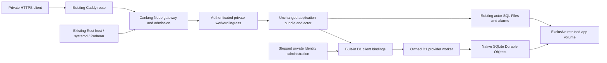

# Production workerd contract and integration recipes

This describes a proposed runtime replacement. [Remaining outcomes](../factory-remaining-tasks.md#consolidated-remaining-outcomes) tracks the unfinished work; the owner's current request determines what to implement.

Investigated 18 October 2026. This document owns the proposed runtime/provider,
process-lifetime and packaging contracts and their technical substeps. It does
not own a second queue. Historical Miniflare results retain their original scope
and do not qualify the replacement. Operator procedures live in the
[application guide](../../guides/canlang-applications.md).

## Application decisions and service boundary

| Decision | Current owner decision | Required by |
| --- | --- | --- |
| Production ownership | Appliance-managed application, independent of its Project | P01 and P20 |
| Production runtime replacement | Proposed direct-workerd/provider closure from the 18 October investigation; historical Miniflare implementation retained as baseline until qualified cutover | P14–P16 and affected P25–P29 |
| Artifact packaging | Admitted generic runtime base plus exact app image | P01 and P02 |
| Required service set | D1/auth/MCP/browser plus files and durable scheduled work for the first complete app; other requirements explicit | P01 and P04 |
| App owner and identity | Explicit Canlang owner bootstrap; no automatic Forgejo principal substitution | P01 and P07 |
| Private endpoint and TLS | Separate app hostnames, existing Caddy internal/supplied TLS; operator DNS/client trust, real LAN/Tailnet qualification open | P01 and P22 |
| Maintenance and recovery targets | Explicit stopped backups adopted; automatic frequency, tolerated data loss and recovery objectives unset | P01 and P25 |
| Retained Project tooling | Explicit maintenance in the same root, never installation on Open | P18 and P28 |
| Optional remote providers | Required providers without qualified adapters are rejected; eventual Cloudflare breadth remains unresolved | Future provider work |

First-app choices are settled by the owner's replies. No additional approval is
required for authorized local work. Eventual service coverage, automatic backup
policy and recovery objectives remain choices for their dependent future scope.
Native appliance and installed release qualification are evidence gaps, not
unanswered requests to adopt the first-app proposals.

## Runtime and environment requirements

The requested outcome is one Canlang application model targeting workerd, usable
on Cloudflare Workers, in a Soda development environment, and in a self-hosted
container on CoreOS. Each environment must supply the application's declared
runtime capabilities and service bindings. The owner's phrase "all the cloudflare
services" leaves the intended breadth unresolved. A defined supported subset is
the adopted first-app scope, without limiting eventual coverage. Unsupported
required services are explicitly rejected by the target. These
are acceptance requirements for implementation and qualification. The
production scope and operating choices under [application decisions](#application-decisions-and-service-boundary)
and [remaining choices](#application-decisions-and-service-boundary)
remain proposals where explicitly marked.

| Environment | Execution and services | Packaging and lifetime |
| --- | --- | --- |
| Cloudflare deployment | Compiled Worker on Cloudflare; declared bindings connect to managed resources. | Preserve Canlang's Cloudflare deployment target and compatibility configuration. |
| Soda development | Actual local workerd with Miniflare supplying supported local bindings; separately declared remote bindings where supported. | Extend the existing Rocky Project OS with Canlang tools and a working preview/test command. Development state belongs to the Project. |
| Soda production | workerd with implementations qualified for the application's required bindings. | Adopted separate Rocky runtime base and app image, supervised by host Podman/systemd; production data and lifetime are independent of the Project. |

CoreOS supplies the host kernel and container infrastructure. Rocky supplies
container userspace. A runtime base may bundle local providers or connect to
separately operated services; a binding's availability and behavior matter more
than whether its provider runs in the same container.

| ID | Requirement | Acceptance and existing task owners |
| --- | --- | --- |
| R01 | **One application contract across targets.** Reuse Canlang's emitted application, deployment descriptor and portable worker bundle. Target adapters supply configuration and providers without changing application semantics. | The same compiled application can be packaged for Cloudflare and Soda without target-specific application source edits, provided its requirements are supported by both. Validate the claimed common subset on both targets. P04, P14, P17. |
| R02 | **Declare and check capabilities.** Reuse the existing Canlang compatibility descriptor for required capabilities, bindings, secrets and schedules. Describe each environment's actual provider support in machine-readable form. | Build/preflight explains unsupported requirements; installation/activation refuses them before application effects. Diagnostics name the requirement and target. A configuration declaration or success stub is not proof of a provider. P04, P12, P13. |
| R03 | **Record execution compatibility.** Pin workerd, Node, Canlang producer and provider versions; development also pins Miniflare. Preserve the application's compatibility date and flags separately from provider settings. Cloudflare manages its own runtime binary. | Production uses the separately inventoried direct-workerd closure proposed in the replacement chapter; its native G1 evidence is required. Development retains its own Miniflare closure. Node owns host tooling while workerd executes the application. P02, P03, P14. |
| R04 | **Ship a complete developer environment.** Package the compiler, matching platform tools, runtime dependencies and local providers in the existing Project OS. | A fresh Project can compile, start an HTTP preview and run actual application examples without a Canlang source checkout or startup dependency downloads. Preview data persists across preview restart; test fixtures are isolated. Existing Projects use explicit same-root maintenance. P05, P17, P18. |
| R05 | **Define production execution separately.** Specify the runtime entrypoint, permissions, app payload, providers, storage and credentials independently of development. Distinct final images and appliance-managed lifetime are adopted. | The app starts from installed artifacts without building or downloading dependencies and does not acquire developer privileges, homes, engine access or credentials. It must remain available when its Project stops. P16, P21, P26. |
| R06 | **Separate and preserve state.** Give development, tests and production distinct writable storage and resource identities. Follow [application recovery procedures](../../guides/canlang-applications.md) for production data. | Acknowledged database/file/work state survives the promised restart and replacement operations. Missing required storage refuses startup instead of silently becoming ephemeral. Backup/restore and migration behavior pass G2/G3. P09, P11, P15, P25, P26. |
| R07 | **Make external dependencies explicit.** Local and remote providers are deliberate target configuration with scoped credentials and declared network requirements. | Local preview does not silently access production resources. An offline profile rejects remote-only requirements. Development remote-binding support alone does not qualify a self-hosted production adapter. P04, P12, P14. |
| R08 | **Qualify each claimed service.** Use the [provider inventory](#provider-support-boundaries) as the initial candidate inventory, then prove only the subset the selected app needs. | D1 is the initial database; Files uses the qualified native SQLite DO adapter, not R2. Other bindings are conditional. Durable named queues need durable delivery evidence. Local simulations are not Cloudflare-equivalent production guarantees merely because API calls succeed. P01, P03, P11, P12, P15. |

These requirements refine the existing tasks below rather than create a second
execution queue. The first implementation proof is a compiled app, one callable
HTTP path and persistent D1 on native Rocky; extend it with the selected app's
files and durable work before adding appliance administration or release builds.

## Provider support boundaries

The first app uses D1/auth/MCP/browser, native SQLite DO-backed Files and durable
scheduled work. R2 is a separately selected P08 adapter, not the accepted native
Files provider. Preserve one compiled application contract across Cloudflare and
Soda for their qualified common subset. Build, installation and activation consume
the machine-readable provider inventory and reject unsupported requirements before
effects; no provider declaration or success stub establishes support.

D1 needs real atomic batch rollback, revision fences and replay; DOs need stable
namespace identity, transactions, restart routing and alarms. Named queues require
durable delivery: the historical in-memory Miniflare broker is insufficient.
KV needs a deliberate resource mapping or refusal; caches remain reconstructible.
Service bindings admit declared destinations only. Analytics requires a real bounded
sink or refusal, never the no-op plugin as audit/business storage. Workflows,
Workers AI, Vectorize, email and payments need their own qualified adapters and
explicit scoped network/credential dependencies. Offline profiles reject remote-only
requirements; simulations do not establish managed Cloudflare guarantees.

Use native x86_64 Rocky on the actual CPU; the image cannot supply absent CPU
instructions. Keep production app data on the admitted /home filesystem, one writer
per storage identity, separate from preview/test data. Start/Stop preserves data;
opening a view does not deploy. Upgrade preflights compatibility, fences the old
writer and checks readiness before ingress. Image rollback does not reverse data
migration. Stopped complete-tree backups include WAL/alarm metadata; restore into
a fresh identity and state any loss of writes after the backup. Automatic backup
frequency/RPO/RTO remain unset. Never inherit Forgejo cookies or broker credentials;
app-owner bootstrap and private-client routing/TLS proof remain distinct boundaries.

## Recommendation and bounded outcome

Use **workerd directly**, its built-in D1 client binding, a small
Canlang-owned D1 backend adapted from the pinned upstream implementation, and
the existing SQLite Durable Object application actor. Keep Node for Canlang's
existing command and HTTP gateway responsibilities. Remove Miniflare from
production serving **and** owner/member provisioning and from the production
image's dependency closure. Project preview and tests retain their own Miniflare
installation.

Keep Soda's existing Go administration, Rust lifecycle/recovery/release owners,
systemd/Podman supervision, private Caddy ingress and per-app isolation. A new
database daemon, general Cloudflare emulator, workerd fork or language port is
not justified by the inspected requirements.

This is the preferred implementation candidate, conditional on native storage
and process-lifetime qualification. Workerd's standalone disk storage remains
experimental upstream. Removing Miniflare does not change that fact. If the
first native gate fails, investigate the concrete failure before committing to
the broader storage redesign described under alternatives.

The supported application remains the current private, single-appliance,
single-team profile: separate Identity/State D1 databases, browser/MCP access,
Files and durable scheduled Canlang work. No new R2, arbitrary DO, KV, queue,
external-provider, migration, replication or high-availability claim is added.

## Source baseline, scope and evidence

| Input | Inspected identity |
| --- | --- |
| Canlang checkout | `/home/vince/Projects/canlang`, clean at `2f3adfea7a7e8275500ebc1c7f37522e10cab1b0` |
| Soda checkout | `/home/vince/Projects/sodaos`, `cf68711666c4e70723007f8ea121d8607b268ca7`, with existing unrelated and overlapping uncommitted refactors |
| Admitted tools | `system/project/canlang-release.json`: archive SHA-256 `aa33db44a9f38342fbf5fe7a77ad113da0e21bc99e90a2304be8fe2d9927608f`, Node `v24.22.0`, Bun `1.4.2` |
| Pinned workerd | `1.20260730.1`, upstream commit `26b5461b7dcc640bb16072f1ba6f2c6df82572ba` |
| Pinned Miniflare | `4.20260730.0`, workers-sdk commit `96fd16f0e06e82eb99001c70e4935e992e69cb87` |
| Current upstream comparison | workerd `2c34e935cea3c8c81412b3ff7a08285db551d6e4`; workers-sdk `0d826c6aa3ae5d3db1c539c78ddca0ac42df5001`; comparison only, not an upgrade selection |

Scope is the production runtime and its actual configuration, storage,
administration, packaging, installation and verification joins in both repos.
This is not a fresh whole-repository semantic audit. The defining source map
below specifies the inspected scope; unrelated compiler, UI, business engines,
other release roles and other repositories retain their existing owners.

The 18 October investigation read these then-dirty Soda preimages:

| Path | SHA-256 of inspected working file |
| --- | --- |
| `lib/host/src/application/runtime.rs` | `0d8d317a6aa21d6066e0f5dc82883f886f1799b0da865e3a5a3784e8a2a187b7` |
| `lib/host/src/application/wire.rs` | `b859d6e6141ab8680b8ea03edb42d145f47b6ab11f1ae81c878399d7334e0eb9` |
| `cmd/soda-project-maintain/src/canlang.rs` | `ceb3f7d2add321d9978ba1704ee57ea11f6f17e337417b41c7f64447561322e0` |
| `tools/release-assets/src/fetch/canlang.rs` | `0c17bc8af89bc18ac0a1654c6dcdce52f90cacd781b03978faf86ce07853f0f9` |
| `lib/release-inputs/src/payload.rs` | `224fbdea7f9dc3aa56dae7f08316a543619aaea8bbb8fd9c92b4ae86b9886e83` |

These hashes preserve the investigation inputs, not current dirty-file or writer
status. Start future implementation from the actual current source and preserve
any unrelated edits; these historical observations are not overwrite authority.

The local retained results were inspected at
`.artifacts/canlang-soda-full-v4-20261014/{results,recovery-results}.json`,
`.artifacts/canlang-production-images-v3-20261014/results.json`,
`.artifacts/canlang-enospc-20261014/results.json`, and
`.artifacts/canlang-g3-vm-20261014/results.json`. They record successful
Miniflare-baseline CRUD/conflicts, Files authorization/bytes, missed-work replay,
graceful and abrupt replacement, stopped restoration and component VM reboots.
The ENOSPC receipt records HTTP 502 with the attempted write absent, preserved
prior data and successful retry after freeing the fixture filesystem. The VM
receipt explicitly excludes a complete matching-source release. These are
existing result records, not tests rerun or independently reproduced here.

## Findings that determine the design

| ID | Finding and consequence |
| --- | --- |
| F01 | `cli/soda.ts` → `soda-run.ts` → `startLocalDev()` constructs Miniflare for both serve and provisioning. Replacing only the container entrypoint or only serving leaves a production Miniflare dependency. |
| F02 | Bare workerd exposes the D1 API wrapper but does not provide the SQL backend used by this app. Miniflare currently supplies it as a SQLite DO worker. A real provider is required. |
| F03 | Files uses synchronous SQL callback transactions, `transactionSync()` and in-isolate authority. A Go HTTP database cannot transparently replace this adapter. Retain the existing actor while qualifying native persistence. |
| F04 | Pinned workerd persists alarm schedules in each namespace's `metadata.sqlite` and reloads them when constructing the scheduler. A replacement scheduler is unnecessary. Recovery without a user HTTP request still needs an executable test. |
| F05 | `localDisk` is explicitly experimental; native SQLite WAL/VFS source supports a credible local durability model, but the actual binary's sync/acknowledgment behavior has not been measured here. Process-crash evidence is distinct from power-loss evidence. |
| F06 | Namespace keys, resource-ID inputs, actor-name inputs and disk roots are physical storage identity. Changing them can silently create empty databases. Same-state compatibility requires all of them plus native auxiliary metadata. |
| F07 | Soda permits runtime-only replacement only with identical artifact and bundle SHA-256. Keep the admitted bundle unchanged and place provider/admin/gateway modules outside it. Rebuilding unchanged `.can` source is not proof of byte-identical bundles. |
| F08 | Direct HTTP replaces Miniflare's privileged dispatch transport. Default redirect-following, lost duplicate cookies, wrong HTTPS origin or an unauthenticated private listener would change auth and Files behavior. |
| F09 | Node death does not inherently kill a workerd child. The current flock helper can exit on parent pipe closure. Writer exclusion and parent-death handling must cover the actual workerd process, including startup races. |
| F10 | Pinned workerd uses `NullIsolateLimitEnforcer`; it does not supply Cloudflare's per-request/isolate limits. Existing container limits and application admission must remain. |
| F11 | The production recipe copies the full development `lib/` closure. CLI static imports also reach build/dev modules. A runtime-only subtree needs a distinct dependency graph, not just fewer copied executable wrappers. |
| F12 | Current release and asset fetch require Node `v24.22.0`; retained Project maintenance still requires `v24.21.0`. This source mismatch rejects the current manifest. Reconcile all admission consumers with the new release pins. |

The current system already isolates app containers with UID 10000, read-only
root, dropped capabilities, no-new-privileges, 128 PIDs, 1 GiB memory, two CPUs,
an exclusive data directory and a host-loopback published port. The application
runtime withholds public traffic until mounted-store activation succeeds.
Soda's health check then probes `/auth/login`, with bounded startup and generation
checks. Preserve this chain; a workerd listening notification is insufficient.

## Proposed runtime and storage contract

Use `workerd serve` with generated Cap'n Proto configuration. A separately
compiled workerd executable is unnecessary for the initial cutover. Stage
verified module/Wasm bytes and configuration privately under the existing
excluded `tmp` area. No compiler, dependency installation or module bundling
runs at application startup. Static provider/admin bundles are produced when
packaging the runtime. Runtime settings and private values are bound separately
from the immutable application artifact.

The config renderer admits module names/paths, escapes text without allowing
Cap'n Proto injection, refuses path traversal/duplicates, verifies the portable
bundle identity, and maps text/JavaScript/Wasm explicitly. Use the pinned
schema. Application compatibility date/flags remain exact; provider settings
are a separate pinned profile. The baseline D1 provider uses date `2023-07-24`
and `nodejs_compat`/`experimental`; qualify which flags the adapted provider
actually needs. Source inspection found no experimental guard on the wrapped
D1 binding itself. Do not enable inspector/debug ports or generic test routes.

### D1 provider

Bind `DB` and `STATE_DB` to workerd's existing
`cloudflare-internal:d1-api`, each with an explicit backend service. Adapt the
small SQL worker from the pinned MIT-licensed source; retain its attribution.
Remove its dependency on `MiniflareDurableObject`, `miniflare:shared`, Zod/test
control plumbing, request `cf.miniflare` metadata and loopback development
services. Keep finite input validation and the semantics below. This is an
owned provider leaf, not a fork of the full Miniflare platform.

Required caller surface is `prepare().bind().first()/all()/run()`, `exec()` and
ordered atomic `batch()`. The source scan found no production use of `raw`,
`dump` or `withSession`; do not claim those APIs or managed D1 replication.

| Contract | Required implementation and regression subject |
| --- | --- |
| Atomic writes | State fence, data, history, receipt and outbox writes succeed or roll back together; a failure after an earlier mutation rolls back the whole batch. |
| Consistent reads | The eight-statement State inspection batch observes one transaction snapshot, preserving SQL ordering and result shapes. |
| Identity guards | Preserve exact zero/one `meta.changes` for owner protection, OAuth consumption and conditional publication. |
| SQL behavior | Bound null/string/number/BLOB values, empty results, `RETURNING` through `first`, JSON SQL functions, schema/index inspection, constraints and autoincrement work through the actual built-in client. |
| Error behavior | Preserve errors used by `fence_log`, `unique_claims`, `outbox`, `receipts` and duplicate-column classifiers; never expose SQL arguments or credentials to public logs. |
| Empty-store admission | Do not inject new arbitrary application tables; State's owner router ignores only its explicitly recognized `_cf_METADATA` table. |
| Outcome uncertainty | No automatic replay on transport loss. Existing receipts and bootstrap claims own reconciliation. A rejected request after savepoint release/bookmark failure is not proof of rollback. |
| Bounds | Enforce finite private request/body/batch bounds consistent with the largest real owning operation; derive thresholds from existing contracts and qualification fixtures, not arbitrary lower limits. |

The pinned backend uses `transactionSync()` then obtains a bookmark. Native
`transactionSync()` releases a savepoint inside an outer implicit transaction;
this is not proof that the disk commit already completed. Native bookmarks are
persisted local counters, not replication acknowledgments. Inspect and qualify
commit/output-gate ordering and fault points around savepoint release, bookmark
creation and response delivery. The workerd internal D1 module/protocol is
pinned infrastructure, not a separately stable public backend API. Every runtime
upgrade reruns its focused provider contract tests.

### Files, scheduling and storage identity

Retain the existing Files implementation: native DO SQL, synchronous atomic
operations, 64 KiB chunks and the current 10 MiB file policy. Preserve
`fileStoreId`, State's physical owner/store pins and file-retirement authority.
Do not move authority-bearing observations across a new HTTP boundary.

Canlang State remains the source of scheduled occurrences and receipts. Native
actor alarms only wake its existing scans. Keep the current actor's startup
admission and alarm behavior in the unchanged bundle. Test an overdue alarm
without public requests or manual wake calls, and test repeated wakeups against
the same durable occurrence.

| Retained input | Exact baseline mapping to preserve and verify |
| --- | --- |
| Identity and State D1 | Distinct declared resource IDs; D1 namespace key `miniflare-D1DatabaseObject`; each object is `idFromName(resourceId)` |
| D1 disk root | Existing `dataDir/d1` and its full namespace files |
| Application actor | Namespace key `${appName}-SodaApplication`; instance `idFromName(appName)` |
| Actor disk root | Existing `dataDir/objects`, including alarm `metadata.sqlite` and related WAL/SHM files |
| Application ownership | Original `storage.json`, exact artifact/resource assignment, owner team, retained `form-key`, State/Files identity records |

The historical `miniflare-` namespace string is a data identity, not a runtime
dependency. Do not rename it cosmetically. Verify actual generated baseline
paths rather than assuming that these high-level inputs describe every file.

The first retained-state experiment uses a stopped **copy** of a representative
baseline fixture. Verify users, memberships, sessions, grants, records,
revisions, receipts, File bytes and pending scheduled work; perform new writes,
restart and restore. A fresh-empty-store test does not establish compatibility.

If exact layout compatibility fails, runtime-only replacement is blocked. Do
not rewrite `storage.json`, relax Soda's bundle fence or silently allocate new
IDs. An explicit export/import or semantic upgrade design is separate work
requiring a new specification and evidence. Until then the old admitted runtime
remains manageable through existing Inspect/Start/Stop operations.
The new CLI's producer/runtime-version admission must also accept that exact
bundle legitimately. A release-version bump that fails the existing gate is
not permission to skip it; qualify a compatible runtime release or use the
separate upgrade path. Byte-identical modules alone do not bypass activation.

Stopped backup/restore retains the complete authoritative tree and the existing
writer lock. Rollback after the new runtime has accepted writes must either
prove reverse storage compatibility or restore the untouched pre-cutover copy
with its explicitly understood loss of subsequent writes. An old image alone
is not a database rollback. Automatic backup frequency and RPO/RTO remain unset
as in the existing owner decision; no distributed availability is promised.

### Transport, administration and process lifetime

Keep the public gateway's configured HTTPS origin, request-cookie filtering,
internal-route rejection, readiness admission and response handling. The direct
transport must use manual redirects, preserve status/body and multiple
`Set-Cookie` values, and reconstruct the canonical application URL correctly.
An unguessable authenticated private ingress or suitably protected Unix socket
must enforce the same boundary as Miniflare dispatch. Strip caller-supplied
internal headers before injecting trusted values. Give every runtime worker
only its required service/storage bindings and explicit denied external egress.

Move stopped bootstrap/member operations into an image-owned private admin
worker calling the existing Identity `bootstrapD1Owner`/`addD1TeamMember`
functions. Bind only Identity D1. Carry credentials in the bounded private
request body, never argv, generated module text or public responses. Use the
existing safe error policy. Worker staging must select Identity's
`#identity-byte-compare` Worker implementation and include `@scure/base`;
ordinary Node module resolution selects an unsuitable `node:crypto` branch.
Test first claim, matching retry, mismatched/populated/incomplete refusal,
ordinary-member non-elevation and lost-acknowledgment recovery.

The direct subprocess owner must close admission on child failure, propagate a
failed exit to systemd, bound startup/drain and wait for termination before
unlocking. Preserve the existing 15-second internal, 20-second Podman and
40-second systemd shutdown ordering unless measured changes require otherwise.
`--control-fd` is output-only readiness reporting; it has no parent-EOF shutdown
protocol. A plain `setpriv --pdeathsig KILL` also leaves a startup race because
it does not verify that the expected parent survived until the signal was armed.

Use a small unprivileged Linux Rust **exec guard**, packaged with Canlang:

1. Keep the checked, exclusively flocked file's open-file description alive in
   Node and pass the same description to the child as a dedicated inherited FD.
   The current `flock` acquisition helper may remain, but closing its pipe must
   no longer be the only thing protecting the database. Refactor
   `soda-run.ts`'s current acquire/release-only API: it presently closes Node's
   FD after launching the helper. Return an owned lock handle usable by the
   exec guard, without reopening the pathname, and still lock before preparing
   storage or generating writable runtime state.
2. The guard sets `PR_SET_PDEATHSIG` to `SIGKILL`, then checks `getppid()` against
   Node's expected PID. Failure or mismatch refuses before starting workerd.
3. Validate the required lock/control descriptors, preserve them across exec,
   and directly exec the fixed pinned workerd binary. No intervening shell,
   fork, setuid/file-capability binary or credential change may clear the
   parent-death signal. No root privilege is required.
4. Workerd retains the locked description until it actually exits. Never issue
   `LOCK_UN` while a writer can still exist; close the owning references only
   after termination. Node death triggers workerd termination, while the
   inherited lock prevents another writer during the interval before death.

This guard becomes workerd through exec; it is not a second running supervisor
or network daemon. Verify the shipping workerd retains the lock FD rather than
assuming it preserves all inherited descriptors. The native lifetime gate
covers parent SIGKILL before arming, between arming/exec and while serving,
death of the flock acquisition helper, child failure, startup cancellation and
forced termination. A competing lock attempt must fail until the writer has
actually exited, including delayed termination. Whole-container death alone
does not establish this standalone command contract.

### Packaging and release admission

Extend the existing admitted Canlang tools archive with an explicit production
subtree. Project tools keep their full closure. The production subtree contains
the pinned Node/workerd binaries, production command, prebuilt provider/admin/
gateway modules, runtime validation dependencies and applicable notices. The
runtime image copies only that subtree to the existing `/opt/canlang` interface.
The app image continues to add the exact admitted `bundle.json`.

Separate build commands from the production command's static import graph.
`cli/soda.ts` currently imports the bundler, and its compatibility default comes
from a dev module. Reuse pure validation definitions by extraction where needed;
do not copy their logic into an independently maintained validator. Production
bootstrap/member/serve/help/inventory must work with Miniflare, Wrangler,
compiler and testkit absent. Build remains in the Project tool environment.

Keep the archive SHA and existing `io.canlang.tools` image association as the
cross-repo provenance identity. Add the runtime-subtree file/license inventory
to the existing tool manifest, with producer and readers updated together.
Avoid inventing a parallel release authority or extra image role. Workerd must
be a directly pinned production dependency; resolving it through Miniflare is
no longer acceptable in that closure.

Soda's runtime content readers currently require Bun/compiler license paths from
the full tools archive. Update those expectations to the production inventory
without stripping required Node/workerd/adapted-provider notices. Reconcile
asset fetch and retained-Project maintenance Node pins with the same admitted
release. Verify the runtime image itself, not just source imports, is free of
Miniflare development packages and endpoints.

## Alternatives considered

| Alternative | Assessment for this scope |
| --- | --- |
| Keep/fork Miniflare for production | Retains the dependency the user wants addressed and ownership of development orchestration. Existing finite evidence remains useful as baseline, but this is not the recommended target. |
| Direct workerd plus adapted native D1 provider | Preferred: same SQLite engine, Files actor and storage identity; minimal app/control-plane change. Own protocol compatibility and native qualification explicitly. |
| Direct workerd plus Go SQLite D1 service | Viable if a demonstrated D1 requirement defeats native storage. Adds transport/auth/transaction/error parity and data conversion, while Files still requires native synchronous DO SQL. It does not by itself solve all persistence risks. |
| Move all storage out of workerd | Broader redesign of Files transaction/authority interfaces and scheduler behavior. Reopen only if native qualification fails; do not disguise it as a launcher change. |
| Adopt WDL | Real Apache-2.0 project with releases, inspected at `0effc6f949bf23f2853fb0f46a8829e96ae3be86`. Adds seven services, Redis/Valkey and S3; still uses localDisk and documents partial D1/DO semantics. No operational maturity was established here. Useful reference, disproportionate platform replacement. |
| Adopt workerd-faas | Its own README calls it a prototype unsuitable for production; no established replacement candidate. |
| Use managed Cloudflare providers | Different deployment contract; does not meet the current offline appliance profile. |

## Defining source map and target allocation

Paths below are relative to their named repo. Existing files retain their
owners; proposed files are not implemented. This map covers the replacement's
defining duties and joins, not every transitive business-engine source.
The [scoped target tree](proposed-tree.md) expands retained and proposed source
leaves, including verification and native build joins.

| Repo / existing source | Duties and target disposition |
| --- | --- |
| Canlang `packages/cloudflare/src/cli/soda.ts` | Preserve developer build entry; share validation/option logic with a focused production entry `src/cli/soda-runtime.ts`. Route stopped administration through the direct runtime. |
| Canlang `packages/cloudflare/src/deploy/soda.ts` | Retain scope, inventory and app bundle producer. Extract validation/inventory into `deploy/soda-contract.ts` only to separate runtime imports from build-time assembly; original exports consume that single owner. |
| Canlang `packages/cloudflare/src/deploy/soda-run.ts` | Retain mount/writer/storage marker, gateway and activation responsibilities; replace `LocalDev`/Miniflare calls with the direct runtime interface. |
| Canlang `packages/cloudflare/src/deploy/soda-lifetime.ts` | Replace Miniflare exit-hook workaround with the direct process owner and exec-guard invocation; no second competing shutdown controller. Update all real native-script/test consumers. |
| Canlang new `packages/cloudflare/host/{Cargo.toml,Cargo.lock,rust-toolchain.toml,src/main.rs,tests/lifetime.rs}` | Linux-only `can-workerd-exec` crate/binary: parent-death arming, expected-parent check, descriptor preservation and direct exec. Pin the existing native toolchain and syscall dependency; no compiler or policy responsibility. |
| Canlang new `packages/cloudflare/scripts/build-workerd-exec.mjs` | Native release producer stages `dist/soda-host/linux-x64-gnu/can-workerd-exec` plus its existing-style `manifest.json`; verify host architecture and producer identity. `pack-tools` consumes these built bytes, never compiles them implicitly. |
| Canlang new `packages/cloudflare/src/deploy/workerd-config.ts` | Safe pinned configuration, host-worker/module staging and explicit resource/network bindings. |
| Canlang new `packages/cloudflare/src/runtime/soda-d1.ts` | Narrow D1 provider worker, input/SQL result/error contract and adapted upstream attribution. |
| Canlang new `packages/cloudflare/src/runtime/soda-admin.ts` | Private stopped Identity command worker; reuse existing Identity authority. |
| Canlang new `packages/cloudflare/src/runtime/soda-gateway.ts` | Private dispatch authentication and canonical URL forwarding, separately packaged from app modules. |
| Canlang `packages/cloudflare/src/dev/local-run.ts` | Retain development/test owner. Production must have no import edge to it. |
| Canlang `packages/cloudflare/src/{deploy/bundle.ts,deploy/producer-files.ts,distribution.ts}` | Retain portable bundle identity and installed producer rules. Any pure validation extraction has one owner. Host-worker staging does not require adding modules to existing app bundles. |
| Canlang `packages/cloudflare/src/{runtime/soda-application.ts,worker/main.ts,runtime/env-assembly.ts}` | Retain actor, activation and work dispatch in the existing admitted bundle. Reuse source-defined contracts for acceptance. |
| Canlang `packages/cloudflare/src/runtime/{auth-rate-limiter,page-preferences,export-downloads}.ts` | Retain real D1 `RETURNING` and change-count consumers; exercise through replacement provider. |
| Canlang `packages/identity/src/{storage/d1.ts,storage/bootstrap.ts,accounts/passwords.ts,sessions/comparison.ts,sessions/comparison-worker.ts}`, `packages/identity/package.json` | Retain schema/transaction/identity semantics and worker-specific password comparison resolution. |
| Canlang `packages/state/src/storage/{d1,schema,owner-router,sqlite-codecs}.ts` | Retain batch fences/read snapshots, physical ownership, SQL/error codecs and receipts; no new storage authority. |
| Canlang `packages/files/src/host/{durable-sqlite,sqlite-core,sqlite}.ts` | Retain native actor adapter, synchronous file transaction core and development adapter; only native durable adapter participates in the production worker. |
| Canlang `packages/cloudflare/package.json`, `bun.lock`, `scripts/{pack-tools,pack-install,verify-install,build-package,pack-release,verify-turbo-cache}.mjs`, `package.json`, `turbo.json` | Direct runtime pin, prebuilt production closure, existing installed binary selection and release checks. Preserve separately produced `dist/soda-host` leaves through TypeScript cleanup and exclude them from the wrong cache owner, following the existing preparation-binary ownership pattern. No incidental dependency upgrade. |
| Canlang `scripts/distribution/licenses/workerd-LICENSE`, new `miniflare-provider-LICENSE` beside it | Preserve binary notices; add provenance/license for adapted backend source. Development licenses remain separately complete. |
| Canlang `docs/soda-runtime.md`, `docs/specification/DECISIONS.md`, `docs/ideal-filetree-plan.md` | Update implemented procedures/decisions and bounded source allocation after cutover, without advancing unrelated whole-repo acceptance. |
| Soda `system/containers/canlang/{Containerfile,Application.Containerfile,verify-runtime-image.mjs}` | Copy/verify production subtree; preserve UID, bundle and image identity contracts. |
| Soda `system/project/{Containerfile,canlang-release.json}` | Retain full developer image; admit exact revised archive and tool versions. |
| Soda `tools/release-assets/src/fetch/canlang.rs`, `cmd/soda-project-maintain/src/canlang.rs` | Joint archive validation and consistent Node pins; preserve dirty helper refactors. |
| Soda `lib/host/src/application/{runtime,wire,ingress,snapshot,tests}.rs`, `lib/host/src/bin/soda-canlang-storage.rs`, `system/host/services/soda-canlang@.service` | Retain lifecycle/route/data/generation and snapshot owners; extend only proven changed interfaces and focused tests. |
| Soda `lib/soda-release-build/src/{production_assets,production_images,production_inputs}.rs` | Retain seventh image role and frozen producer joins. |
| Soda `lib/soda-release-image/src/{canlang,record,payload_stage}.rs` | Production subtree inventory, exact image-content/attribution joins. |
| Soda `lib/release-inputs/src/{payload.rs,reader/candidate.rs}` | Admit new manifest/inventory shape coherently, remove obsolete production Bun/compiler assumptions. |
| Soda `docs/guides/canlang-applications.md`, parent plan and this chapter | One operating guide and one implementation task hierarchy; keep historical evidence distinct. |

Languages follow current ownership: Canlang TypeScript produces runtime workers
and Node tooling; workerd remains upstream C++; Soda system/release code remains
Rust and administration remains Go. The native Linux exec guard is Rust because
the required parent-death/descriptor sequence is an OS primitive unavailable in
the Node child-process API. Reusing `setpriv` plus shell process checks introduces
an additional process/exec assumption; a focused guard makes the exact sequence
testable. This is a proposed small native addition, not a port of the launcher.

## Guided application setup and recovery

The handbook blocker resolutions select the following final-product experience.
These are new implementation requirements within P14/P25/P26, not existing
controls or acceptance of the replacement runtime. The current
[application guide](../../guides/canlang-applications.md) remains authoritative
for commands that actually exist.

### Prepared application and first owner

Applications provides an operator-guided flow for an exact locally admitted
application image/bundle, matching runtime/tools/storage identities, fresh data,
private origin and assigned application administrator. It previews those
identities and consequences before effects; no arbitrary image upload, implicit
build/deploy, password in a Soda record or invented provider integration.

Normal browser onboarding uses a distinct provisional owner-setup record and
an explicitly launched setup-only generation. This is necessary because normal
registration, runtime validation and Install require an existing `owner_team`.
Keep that invariant for normal applications. The setup generation exposes only
Canlang-owned first-owner setup at the private HTTPS app origin; ordinary app
and MCP routes remain unavailable until provisioning completes.

The assigned administrator/operator receives a short-lived single-use setup
capability. Canlang accepts the account credentials directly and atomically
claims only an empty Identity store under exclusive writer ownership. Soda
never collects those credentials. Bind the capability to the exact app/data
and intended administrator, protect origin/CSRF and retries, and keep secret
material out of logs, URLs and retained operation records. Only a confirmed
owner-team receipt advances the provisional record to normal registration.
Close setup access, stop the setup generation and enable normal Install, which
leaves the application stopped until explicit Start.

Concurrent claims have one winner. Lost replies, partial state or already
provisioned storage require inspecting the existing claim/signing in, never
resetting identity or creating another owner. Setup expiry/reissue must preserve
that rule. Retain private-file CLI bootstrap/member administration for offline
and recovery use, with the existing exclusive-writer and no-silent-reset
constraints. Browser first-owner setup does not imply configured invitation,
verification or password-reset email delivery.

P14.4 owns Canlang provisioning and its narrow receipt/admission contract;
P26 owns Soda's provisional records, authorized API, host generation and
Applications UI joins. They release implemented component behavior before
P27/R54/R51. P15/P26 qualify the native failure cases; P30 exercises the composed
installed browser journey.

### Restore the same application to fresh data

Add a separate operator-only **Restore** operation; normal **Replace** keeps
its prohibition on changing data identity. Choose a host-inventoried snapshot
by opaque identity, not a client-supplied filesystem path. Show its timestamp,
application/bundle and expected loss of writes after the snapshot before
confirmation.

1. Stop the original application and confirm exclusive writer retirement.
2. Restore into a fresh data identity; verify checksums, matching bundle/storage,
   owner team and origin without exposing a second writable app.
3. Advance the same logical application's immutable revision using the expected
   current revision. Preserve its app ID, name, administrator, origin and port;
   retain the old revision and data. Only this explicit restore operation may
   change the data binding.
4. Install the new generation stopped, inspect the result, then explicitly Start.

Failed copy or validation leaves the old binding intact. Unknown copy, rebind
or native outcomes preserve both data trees, keep writes disabled and expose
an inspectable pending/unknown operation; reconcile before retry. A prior
snapshot can be selected again only by another fresh-data restore, never by
overwriting retained data or treating an image rollback as database recovery.
P25 owns the Go application-record/API and Rust snapshot/host operation;
P26 adds its Applications control and native journey; P29/P30 own instructions
and the installed same-address recovery result.

**HB13 source finding (20 October):** P25 must reconcile the snapshot helper
with the actual producer's retained-storage identity before claiming this
backup/restore path. Canlang
`packages/cloudflare/src/deploy/soda-run.ts::prepareStorage` writes
`canlang.soda.storage.v2` and promotes only the exact matching legacy identity.
Soda `lib/host/src/application/snapshot.rs::backup` currently admits only
`canlang.soda.storage.v1`, so current v2 storage is refused as an invalid
identity before copying. Preserve the producer's fingerprint, resource and
legacy-admission rules; do not repair a backup by editing its marker or
weakening checks. Qualify a real current-image stopped backup and fresh reopen,
including refusal of incompatible identities, under P25.1.

The current snapshot manifest contains file/directory checksums, not the
trusted timestamp/application/bundle inventory required for browser selection.
P25/P26 must bind that inventory to the selected snapshot and complete the
durable Restore operation and revision transition; the current application
identity guard forbids changing `data_id`, and ordinary Replace retains it.
Keep the selected same-address behavior in the handbook while these producers
and the P30 installed witness remain open. A successful unbound directory copy
does not establish this operation.

### Fixed initial runtime envelope

Adopt the existing normal-app limits: **1 GiB RAM, two CPUs' worth of CPU time,
and 128 processes/threads**, with a read-only root and explicit persistent data.
Expose these as fixed limits in Applications and the guide, not configurable
fields or dedicated CPU reservations. Preserve any distinct bounded bootstrap
helper constraints; a setup command is not a normal running app.

P26 measures actual memory/process exhaustion, CPU contention, readiness,
restart and retained-write behavior; P29 documents the observed outcomes and
diagnostics. P30/R52 verify the changed installed join. Per-app caps do not
reserve aggregate host capacity. Tunable resource plans need a separate
host-capacity/admission design; they are not required for this first envelope.

## Implementation packets and dependencies

These are substeps of existing canonical tasks. Their outputs replace only
affected Miniflare-era portions; they do not reopen completed app semantics,
UI, administration or unrelated release work. M = placement/import wiring,
C = required behavior, V = real verification. No implementation starts as part
of this investigation.

| Packet / exclusive writer | Inputs, concrete work and completion |
| --- | --- |
| **P14.1 Native decision gate — runtime lead** | Freeze actual binary/schema/provider profile and baseline-generated storage configuration. Prepare the smallest disposable native fixture using the real built-in D1 client, DO SQL and alarm. Own the specified `host/` exec-guard files and native producer, with shared build/cache edits handed to integration. **C/V:** establish effective sync/commit behavior, atomic failed batch, acknowledged write after kill, no-request alarm recovery, and inherited-lock/parent-death behavior including startup race. Release proven configuration/provider/lifetime contracts. Failure blocks only dependent runtime/storage adoption; investigate observed failure before selecting fallback architecture. |
| **P14.2 D1 provider — provider lane** | After P14.1's native provider interface: own `runtime/soda-d1.ts`, focused provider test and notice. **C:** implement the finite D1 contract above, preserving error/unknown-outcome distinctions and storage IDs. **V:** actual pinned client → provider → disk, rollback after partial batch, coherent read batch, binds/BLOB/RETURNING/changes, one-winner revision guard and separate DBs. No generic emulator or business-rule copy. |
| **P14.3 Configuration, transport and lifetime — runtime lane** | After P14.1's process/config contract: own `workerd-config.ts`, `soda-lifetime.ts`, `soda-gateway.ts`, `soda-run.ts`. **M/C:** stage immutable app plus host modules, deny network, private transport, admission, direct child supervision and retained lock. **V:** app/Wasm load, invalid paths/config refusal, HTTPS URL/manual redirects/cookies/body handling, child crash, parent kill, startup cancellation, timeout and orderly/forced shutdown. Hand off stable direct-runtime interface to P14.4. |
| **P14.4 Production CLI and provisioning — runtime lane after handoff** | Uses P14.2 and P14.3; owns `cli/soda-runtime.ts`, `cli/soda.ts`, `soda-contract.ts`, `runtime/soda-admin.ts` and final `soda-run.ts` join, plus the existing Identity owner for app-local first-run setup. **M:** one validation owner and build/runtime import separation. **C/V:** real Worker Identity bootstrap/member and protected browser first-owner claim with exact setup admission/receipt, private credentials, exclusive writer and retry/refusal semantics; no Miniflare Node proxy. |
| **P15.1 Native application acceptance — verification lead** | After P14.2–P14.4. Extend current native drivers and original app fixture; exercise provider/process/application portions of the matrix through real routes. **V:** new-runtime native G1/G2 scope with exact binaries/config/module inputs; P16.2 and P25.1 own final-image and retained-data subjects. Failure returns to its defining owner. Report remaining power/storage/performance limits explicitly. |
| **P16.1 Production archive closure — packaging lane** | Can start graph analysis after P14.1; executable closure waits for P14.4. Own `scripts/pack-tools.mjs`, necessary existing pack/build/install selectors and new `scripts/verify-soda-runtime-closure.mjs`. Shared package/lock edits go through integration owner. **M/C/V:** one archive with verified production subtree, prebuilt host workers, direct binary pin and frozen exec guard with executable permissions/native ABI, complete inventory/licenses; offline commands with development dependencies absent. Reuse existing archive format where possible and version incompatible schema edits with all readers. |
| **P16.2 Production image — Soda integration lane** | After P16.1, own Canlang Containerfile recipes and image driver. **M/C/V:** copy only runtime closure; preserve UID/read-only/data/network/command contract, exact admitted app bytes and runtime/tools labels. Prove real production commands and absence of Miniflare/dev packages and debug surfaces. |
| **P25.1 Retained-data cutover and restoration — Go application + Rust snapshot owners** | After P15.1 and P16.2. **C:** separate authorized Restore operation/revision for verified fresh data, preserving normal Replace and immutable old data/spec. **V:** stopped baseline snapshot → disposable clone → direct runtime with identical app bundle; check every retained identity/state/File/work class, mutate/restart and restore the same logical app. Validate complete tree/WAL/alarm metadata, lost-reply reconciliation and second-writer exclusion; no automatic migration or relaxed artifact fence. |
| **P26.1 / P29 application setup, native lifecycle and procedures — integration owners** | After P25.1, using explicit qualified runtime/tools fixture admission as in the existing G3 component workflow. **C:** Soda provisional setup/API/host/UI joins consuming P14.4, prepared-app wizard and explicit Restore UI consuming P25.1. **V:** actual first-owner browser setup, host/Caddy/browser/MCP/Files/work, fixed resource envelope, Project-stop independence, boot/stopped intent, same-bundle replacement and fresh restore. Update existing guides to measured behavior; release implemented producers before P27/R54/R51 and preserve distinction from installed full release. |
| **P27.1 / P28 admission refresh — exclusive release integration owner** | Qualification follows P26.1, preserving the parent P26 → P27 gate. Source reader/pin preparation may proceed earlier against the fixed schema. Own `fetch/canlang.rs`, maintenance pin, release JSON, runtime inventory/candidate readers and affected release producer joins. **M/C/V:** exact archive/image attribution and checksums, corrected Node pin agreement, runtime/tools mismatch refusal, old admitted generation still inspectable/startable/stoppable. |
| **P30 → P31 → P32 — existing integration/release owner** | Remain open. Use the matching complete release for the actual installed UI/API/private-client journey and G4; then absorb completed design into owning guides and reconcile living plans. Publication is not implied. |

Critical path: P14.1 → {P14.2, P14.3} → P14.4 → {P15.1,
P16.1 → P16.2} → P25.1 → P26.1/P29 → P27.1/P28 → P30/P31.
Reader/schema design and pin correction can run beside runtime work; they do
not justify early release qualification. These are responsibility boundaries,
not a requirement to launch workers. Coordinate actual shared edits to
`soda-run.ts`, CLI composition and manifests; keep each native fixture under one
owner. The canonical second pass releases P27/P28's producer/source outputs to
R54/R51 before the matching-release Project Create/boot subcriterion. P30 and
R52/P31/G4 consume that one candidate; they do not precede its build. P22's real
client input holds the corresponding physical-access case, not local component
work. P08/P10 remain separately selected service outcomes and do not expand the
adopted first-app runtime gate implicitly.

## Verification subjects and production acceptance

Extend existing `packages/cloudflare/test/{soda-bundle,soda-lifetime,
soda-writer.integration,durable-files-sqlite.integration,worker-boundary}.test.ts`
where those subjects already exist. Add focused
`packages/cloudflare/test/workerd-config.test.ts`,
`soda-d1.integration.test.ts` and `soda-transport.integration.test.ts` for newly
introduced behavior. Reuse owning Identity/State assertions through the new
provider; do not copy business engines into fixtures.

Use existing `scripts/verify-native-runtime.mjs`, `verify-soda-runtime.mjs`,
`verify-soda-host.mjs`, `verify-soda-recovery.mjs`, the original
`scripts/fixtures/{native-runtime,soda-runtime}.can`, Soda's image driver and
existing host/snapshot/release tests. Their orchestration is evidence tooling,
not a runtime dependency. Keep task data, caches, artifacts and mounts under
`/home`; never exhaust a shared filesystem for a fault test.

| Boundary | Evidence required for replacement acceptance |
| --- | --- |
| Provider correctness | Real D1 binding/client, whole-write rollback, coherent read batch, exact guards/results/errors, loss-of-response uncertainty without replay |
| App behavior | Original compiled app, two users, browser login redirects/cookies, MCP, unauthorized operations, concurrent one-winner/stale writes |
| Files | Full policy-size upload/read, digest, retry and authorization, transactional failure, retention identity and restart persistence |
| Scheduled work | Persisted overdue occurrence executes after restart without traffic, repeated alarms/wakes preserve a single application outcome |
| Lifecycle | Graceful drain, bounded forced stop, parent SIGKILL/startup race, child exit, no live writer after lock availability, actual container/host restart |
| Storage faults | Missing/read-only/full mount refuses visibly; failed batch leaves no partial change; prior acknowledged data retained; corruption refuses without empty-store fallback |
| Durability | Measure effective shipping SQLite sync/commit behavior. Process SIGKILL is one result; VM power interruption and physical storage claims are separately scoped. Do not infer hardware guarantees from a process test. |
| Recovery/cutover | Original bundle and data identities reopen, full stopped snapshot restores, unchanged owner/session/grant/File/work facts, explicit rollback boundary |
| Isolation | No public admin/debug/test routes, denied app egress, scoped bindings, forged internal headers refused, existing container limits retained |
| Packaging | No runtime Miniflare imports/files, no startup download/build, direct pinned workerd, correct native ABI/CPU, complete licenses and manifest readers |
| Operations | Child failure reaches systemd; bounded readiness and useful secret-free errors; representative bounded concurrency/load reports latency/memory without claiming unmeasured capacity |
| Release | Exact image/archive/app identities through existing seven-role pipeline and matching installed journey, not a component overlay labeled as full release |

No performance target or new availability SLA was supplied. Preserve current
resource ceilings, record representative load results and avoid making capacity
claims until measured. Multi-host writers and replicated D1 remain outside the
contract; sharing a volume between runtime replicas is not a scaling strategy.

## Independent challenge and readiness

Three research owners inspected runtime/storage, Soda integration and upstream
respectively, then challenged consequential conclusions across those boundaries.
The integration challenger identified redirect/cookie regressions, provider
compatibility-profile drift and the orphan-writer startup race. The runtime
challenger corrected the assumption that `transactionSync()` had already
durably committed before bookmark acquisition and identified the Identity
Worker import-condition requirement. The upstream challenger confirmed that
separate host workers can preserve the portable bundle and identified all
namespace/ID inputs needed for retained data. These corrections are incorporated
above; independent agreement is not executable qualification.

| Dimension | Status at this planning baseline |
| --- | --- |
| Responsibility/source coverage | Complete for the scoped defining runtime/storage/packaging/lifecycle paths and consumer contracts above; no whole-repo review claim |
| Established workflow tracing | Serving, provisioning, storage ownership, Files/work, replacement, backup and release admission traced in source; old result records inspected |
| Independent consequential challenge | Completed across the three scopes; objections and revisions recorded above |
| Target allocation | TypeScript, Worker, native Rust exec guard, Soda integration and release owners specified; executable gates limit acceptance rather than leaving the defining owner unspecified |
| Executable replacement proof | Not performed; all new-runtime/provider/image/native gates remain open |

The remaining engineering questions are effective native durability, the actual
binary's inherited-lock/parent-death behavior, minimal provider flags, Worker admin closure and
same-state reopen. These are finite implementation experiments with explicit
release conditions, not unanswered product permission requests. A failed native
storage result blocks only the candidate that depends on it. Backup frequency,
RPO/RTO and eventual broader Cloudflare coverage retain their previous separate
owner-decision status.

Planning checks: the artifact checker passed for both chapter files, three local
links/anchors and 95 unique scoped target leaves, with no collisions. Existing
paths in the defining source map were checked against the canonical checkouts;
the parent-plan diff passed whitespace validation. These checks validate the
documents only. Canlang remained clean at the investigation pin. No fresh
runtime, image, filesystem-fault or appliance result is claimed.

## Primary upstream evidence

- [Pinned workerd production serving/configuration](https://github.com/cloudflare/workerd/blob/26b5461b7dcc640bb16072f1ba6f2c6df82572ba/README.md), [schema and experimental disk storage](https://github.com/cloudflare/workerd/blob/26b5461b7dcc640bb16072f1ba6f2c6df82572ba/src/workerd/server/workerd.capnp).
- [Pinned D1 binding/plugin](https://github.com/cloudflare/workers-sdk/blob/96fd16f0e06e82eb99001c70e4935e992e69cb87/packages/miniflare/src/plugins/d1/index.ts), [SQL provider](https://github.com/cloudflare/workers-sdk/blob/96fd16f0e06e82eb99001c70e4935e992e69cb87/packages/miniflare/src/workers/d1/database.worker.ts), [development base class](https://github.com/cloudflare/workers-sdk/blob/96fd16f0e06e82eb99001c70e4935e992e69cb87/packages/miniflare/src/workers/shared/object.worker.ts).
- [Namespace derivation](https://github.com/cloudflare/workers-sdk/blob/96fd16f0e06e82eb99001c70e4935e992e69cb87/packages/miniflare/src/plugins/do/index.ts#L94), [object-name routing](https://github.com/cloudflare/workers-sdk/blob/96fd16f0e06e82eb99001c70e4935e992e69cb87/packages/miniflare/src/workers/shared/object-entry.worker.ts#L27).
- [Native alarm recovery](https://github.com/cloudflare/workerd/blob/26b5461b7dcc640bb16072f1ba6f2c6df82572ba/src/workerd/server/alarm-scheduler.c%2B%2B#L31), [restart test](https://github.com/cloudflare/workerd/blob/26b5461b7dcc640bb16072f1ba6f2c6df82572ba/src/workerd/server/alarm-scheduler-test.c%2B%2B#L171).
- [Native actor creation and runtime limits](https://github.com/cloudflare/workerd/blob/26b5461b7dcc640bb16072f1ba6f2c6df82572ba/src/workerd/server/server.c%2B%2B), [native SQLite VFS](https://github.com/cloudflare/workerd/blob/26b5461b7dcc640bb16072f1ba6f2c6df82572ba/src/workerd/util/sqlite.c%2B%2B#L1774), [SQLite build settings](https://github.com/cloudflare/workerd/blob/26b5461b7dcc640bb16072f1ba6f2c6df82572ba/build/BUILD.sqlite3).
- [Native transaction implementation](https://github.com/cloudflare/workerd/blob/26b5461b7dcc640bb16072f1ba6f2c6df82572ba/src/workerd/api/actor-state.c%2B%2B), [local bookmark semantics](https://github.com/cloudflare/workerd/blob/26b5461b7dcc640bb16072f1ba6f2c6df82572ba/src/workerd/io/actor-sqlite.c%2B%2B#L1149), [D1 client](https://github.com/cloudflare/workerd/blob/26b5461b7dcc640bb16072f1ba6f2c6df82572ba/src/cloudflare/internal/d1-api.ts).
- [CLI control/debug/drain implementation](https://github.com/cloudflare/workerd/blob/26b5461b7dcc640bb16072f1ba6f2c6df82572ba/src/workerd/server/workerd.c%2B%2B), [SQLite WAL](https://sqlite.org/wal.html), [synchronous setting](https://sqlite.org/pragma.html#pragma_synchronous).
- [Output-only control FD](https://github.com/cloudflare/workerd/blob/26b5461b7dcc640bb16072f1ba6f2c6df82572ba/src/workerd/server/server.h#L68), [setpriv's parent-death setup](https://github.com/util-linux/util-linux/blob/d427f58b7a22b960ccc8d02ce30c58bdbe4286d8/sys-utils/setpriv.c#L1248), [Linux parent-death semantics](https://man7.org/linux/man-pages/man2/PR_SET_PDEATHSIG.2const.html), [inherited flock lifetime](https://man7.org/linux/man-pages/man2/flock.2.html).
- [WDL architecture](https://github.com/wdl-dev/wdl/blob/0effc6f949bf23f2853fb0f46a8829e96ae3be86/docs/architecture.md), [WDL compatibility](https://github.com/wdl-dev/wdl/blob/0effc6f949bf23f2853fb0f46a8829e96ae3be86/docs/compatibility.md), [workerd-faas's stated prototype scope](https://github.com/YouXam/workerd-faas).
- [Adapted-provider MIT notice](https://github.com/cloudflare/workers-sdk/blob/96fd16f0e06e82eb99001c70e4935e992e69cb87/LICENSE-MIT), [workerd Apache-2.0 notice](https://github.com/cloudflare/workerd/blob/26b5461b7dcc640bb16072f1ba6f2c6df82572ba/LICENSE).
