# Native frontend correction tasks and parallel lanes

## Current disposition — 18 October 2026

The later October 13 completion/repair-continuation evidence below supersedes the old 23-accepted/34-open snapshot and its individual stale remainder rows. Accepted NFX source, natural-link, real-browser history/terminal and installed refresh scopes are retained. This is no longer a live 57-task queue. Changed joins/new role feed and current matching-candidate qualification are counted once as R03/R43/R52/R54 in the [canonical remaining outcomes](factory-remaining-tasks.md#consolidated-remaining-outcomes--execution-stopped). Full new factory acceptance is not inferred from those historical NFX results. Execution and supervision are stopped.

This is the executable decomposition of the
[native frontend correction](factory-implementation-plan.md#native-frontend-responsibility-and-correction):
Fountain supplies extensions through Forgejo's native frontend, with a reusable
persistent lifecycle; Soda supplies product content and local resources.
The scope remains **57 correction tasks**. The 2026-10-12 snapshot accepted
23 tasks and left 34 for continuation; that historical count is not a current
completion claim.
They refine NF-01–NF-05 and the reopened UX tasks rather than replacing the
complete factory backlog. Original task IDs and finish conditions are retained;
accepted tasks are summarized below instead of remaining in active queues.

The current scoped source reconciliation covers the accumulated delta from
Soda `5d2817604b49a16c7fb0b4b85e7513328884cf4f` to
`1bb1a27cb946f5c825bd5e2786b479ae649b355a` and Fountain
`6abafdb4092018de6eca3fb8994b2a88f08c2396` to
`695986487355053334c4163ebb85e384a1290437` on 2026-10-13.
The native cutover, lifecycle, branded controls and host-owned intent navigation
are committed on canonical main.

**Status (2026-10-13, corrected by independent completion review; this
paragraph supersedes the remaining-work counts below and retracts the
earlier "all 57 complete" claim, which outran its evidence).** Source pins
at the last completed pass are Soda `81de3c2d` and Fountain `f3407f812f`:
Fountain suite 468 tests green, Soda frontend suite 514 tests green.
Closed in that pass: NFX-A01 (receipts accepted), A04–A06, B03–B07
(468-test mapped lifecycle map `f3407f812f`; dirty-form departure guard
`5b324422b2`), C03–C07, D01–D06, E04, F05 and F06 (natural-link layout
qualification 10/10 at 100% and 400%, receipts in
`.artifacts/codex-i07-refresh-20261013/`), H03–H05, and I02–I07 (refreshed
Forgejo image `sha256:3e2a40ad…`, Extension image `sha256:20ce23f3…`,
Dashboard image retained `sha256:6df94a8f…`, all byte/mode readback-verified).
The refreshed outputs were activated on the existing VM in one guarded
operation: live preflight passed, Forgejo/Dashboard/Identity quiesced, fresh
backup taken (`/var/lib/soda/backups/native-refresh2-20261013/`), Store
transitioned 46→47. Preservation evidence: 60 preserved tables observed
(62 public tables minus the 2 observer-excluded tables), 59/60 digests
identical to baseline, `factory_lifecycle_capabilities` intentionally
refreshed on the new extension handshake; no quiesced after-transition
table receipt was retained, so no byte-identical-table claim is made.
All preserved Project/terminal processes were unchanged before and after.
Repair continuation (2026-10-13, this coordinator): the host
dirty/history correction is complete — Fountain `163c102d9b` plus
`124907625d` (native history-write coordination and repeat-GET
preservation; 57 host unit tests) — and proved on the installed VM in
real Chromium: dirty middle entry with forward tip, refused Back and
Forward restoring the exact position (draft, element, history length),
accepted Forward reaching the tip. B03–B07 real native-page controls
pass 13/13 on stock and `/forge` fixtures, including the admin class
through the fixture administrator's real native login. The installed
terminal proof asserts exact terminal element, xterm instance and OPEN
WebSocket object identity (single binding), fresh reload objects bound
to the original account/repository/Project/session, and independent
operator-observer PID/start confirmation; it passes for Terminal 3
(bash 1558/start 9519761, left alive). Refresh3 images (Forgejo
`sha256:37c307b35f…`, Extension `sha256:1e771d1fe5…`; Dashboard and
identity reused) were built from Soda `f639e78b` / Fountain
`124907625d`, readback-verified (375/375 payload files, served bundle
hashes equal) and activated scoped on the existing VM; protected
Projects and Terminal 1 are unchanged. The installed capture was
finished at 293 records / 287 images with no unvisited bound and a
narrow native fetch-redirect allowance at login/logout; native logout
lands on the signed-out page and the protected Workspace then returns
401, with remaining non-observed records limited to legitimate
denials, missing units, archive downloads and truthful Tailnet 503
states. The Factory sidebar now shows human-readable status instead of
raw wire codes. Development artifacts remain unsigned and unpublished.
The original planning pair was Soda `8df756f1bc7f410b694004f2133af046fecc44f4`
and Fountain `87ec92d4f0101071a734b2f790f3bb1fb1d3366e`; it is historical input,
not the current source or installed revision. Recheck heads and dirty work before
future implementation; preserve unrelated work, files, Projects and processes.

**Historical repair continuation 2026-10-13 (see scoped evidence above).**
The native implementation and existing-VM delivery authorization remain in scope.
This document records actual source handoffs and unmet finish conditions; worker
goals and percentages do not supply acceptance. The released coordinator no longer owns live work. Current matching-native and
installed finish conditions are owned by the consolidated outcomes.

The generic target belongs to Fountain's `contrib/extensions/README.md`, **Native
frontend correction target**. Product/security guarantees remain in
[Spaces](../product/spaces.md), [trust](../architecture/trust.md#frontend-and-session-boundary)
and the [consumer integration contract](../reference/forgejo.md). Ordinary native
navigation retains the same terminal owner, element, renderer and socket; reload
may restore a fresh browser attachment to the exact admitted process. No task
substitutes a wrapper, consumer host adapter or reconnect semantics for that
ordinary-navigation guarantee.

## Retained accepted snapshot and current evidence

Acceptance here records each task's source/fixture finish scope. It does not
mean the remaining composition or existing-VM acceptance has passed.

| Lane | Accepted task IDs | Accepted scope |
| --- | --- | --- |
| A | NFX-A02, NFX-A03 | Native region/retained-home mechanism and generic native-template persistence proof: 124 browser checks passed at Fountain `c81b933d`, with no browser errors. |
| B | NFX-B01, NFX-B02 | Native feature/configuration map and first real user-list control after both entry orders, with current configuration and one action per interaction. |
| C | NFX-C01, NFX-C02 | Minimum public semantics and runnable retained owner/lifecycle/scoped stream prototype. Final consumption/registration remains in C03–C07. |
| D | None | Consumer migration is prepared, not accepted. |
| E | NFX-E01, NFX-E02, NFX-E03 | Demonstrated emitted-color failure corrected; scoped tokens and native light/dark output checks pass. Final entry graphs remain E04. |
| F | NFX-F01, NFX-F02, NFX-F03, NFX-F04 | Settings, creation and dialog corrections with local browser geometry/keyboard checks. Thirty additional geometry cases cover reduced viewport/allocation; they do not prove actual browser zoom or final native containers. |
| G | NFX-G01, NFX-G02, NFX-G03, NFX-G04, NFX-G05, NFX-G06, NFX-G07 | Exact private saved-review provenance, atomic Store/API reads and browser restoration pass their source/PostgreSQL/fixture joins. Installed restoration and Store transition belong to I07/I08. |
| H | NFX-H01, NFX-H02 | Override responsibility inventory and configured-operator Tailnet admission/refusal checks. Branded native composition remains open. |
| I | NFX-I01 | Shared writer, fixture, output and target reservations and acceptance inventory. |

H-P is released by the scoped A03 proof. That proof includes natural native
navigation, both entry orders, exact document/root/socket retention, real admin
controls and polling retirement, repository/account context, history, scroll,
fragment traversal, session-generation mismatch and native logout. It does not
prove every native route, a pushed focusable-fragment target, Soda xterm identity,
human process continuity or installed behavior.

A01's diagnostic reconciliation is committed in Fountain `92b2554144`.
Its retained failing subjects remain distinct from the later passing A03 proof;
acceptance must use those original subjects, without reconstructing broken code
or adding a prerequisite to already proved work.

C03's definition and host initial-hidden-presentation join are committed.
C04 defines linked owner identity, one entry/API base, declared subroutes and
public navigation in `a9ba2ce0ba`. `04f2d81b2d` adds explicit history intent:
extension navigation pushes by default and may replace a saved draft entry.
Soda's byte-identical type mirror records `04f2d81b2d` and its body hash.
H-N, H-OWNER and H-ROUTE are callable source handoffs consumed by Soda.
The independently built generic example now has its scoped native-prefix
API/stream/owner receipt; that receipt does not establish whole-site or installed
qualification. A04 placement is committed in `8bffb18713`;
its native-rendered geometry/control finish condition remains distinct from the
transcribed-container fixtures.

| Task scope | Current committed result and actual evidence | Remaining finish condition |
| --- | --- | --- |
| A01 | Diagnostic reconciliation names the original two native template shapes and existing failure/proof subjects. | Coordinator acceptance of the retained diagnostic receipt. |
| A04–A06 | Native cutover and shared-owner admission are committed in `b9045c7ae6`; `e273447c78` fixes duplicate native element registration. Native controls and generic URL-prefix checks pass. | Complete natural-link Soda navigation and the remaining native feature/geometry finish checks; old injected-anchor proof cannot close I04. |
| B03–B07 | Native feature registration/retirement and declarative page data are committed through `b9045c7ae6`. Five real native control representatives pass at root and `/forge` prefixes; all 385 native frontend unit tests pass. | Each remaining mapped class's native check and repeated-entry coverage. Investigate the inferred native dirty-form departure gap; no actual loss has yet been demonstrated. |
| C03–C05, C07 | Canonical browser contract, owner/routes, revalidation and admission are implemented. Independently built generic example passes actual native `/forge` scoped API/stream/context and retained-owner checks. | Reconcile remaining authority/composition cases with I05 and final native feature coverage; installed proof remains separate. |
| C06 | `72673ea722`: focused proxy/callback/WebSocket checks and actual native HTTP/WS routes through the manager/SDK pass. Original repeated-slash suffixes are refused before admission; exact path/query forwarding and stalled backend cancellation pass. | Bounded C06 source/real-handler finish scope is verified; installed authority/process proof remains I05/I08. |
| D01–D06 | One canonical host contract/entry and public lifecycle replace consumer adapters. `1bb1a27c` removes consumer history/popstate routing, sends native push/replace intent and restores the retained view on host base entry. 57 focused route/setup checks and consumer typechecks pass. | Complete current natural-link native route/history/reload/identity joins; I04/I06 remain open at their full finish scopes. |
| E04 | Package, font/notices and emitted-color checks pass. Final navigation graph changes only the Workspace entry among 21 extension files; image readback verifies the complete branded payload and extension resources. | Recheck only changed graph inputs after pending fixes; installed byte identity remains I08. |
| F05 | `ac22514b`: all ten existing keyboard/settings/creation/dialog/compact cases pass using Chromium `tabs.setZoom/getZoom` at 200%/400%, with explicit per-tab isolation. Both default driver smoke checks, tests typecheck and scoped lint/format pass. | F05's authored actual-browser-zoom finish scope is verified. |
| F06 | Current natural-link native run passes 8 of 10 subjects, including 100% creation/return/dialog and 400% global/repository/settings allocation. | At 400%, diagnose Create project return waiting for the retained terminal; fix rename dialog top clipping (y=-8.25 in a 360×250 viewport). Keep strict reachability bounds. Compact and installed qualification remain separate. |
| H03–H05 | Native custom-element leaf controls, declarative data and handler ownership are committed; account/switcher/clone native representatives pass, and Tailnet consumes public lifecycle. | Remaining native history/operator cases and I08 installed branded controls/Tailnet admission and refusal. |
| I02/I03 | Page/state inventory, mandatory renderer/socket assertions and affected task-scoped checks are implemented. An inert terminal boundary is explicitly skipped. | Complete actual-subject inventory/check reconciliation; skipped paths supply no positive preservation proof. |
| I04–I09 | Current native fixtures, isolated compiled component images and image byte/mode readbacks are available. Updated images are imported on the VM without activation. Store transition, backup and process observers are prepared. | Resolve native failures, complete natural-link/authority proof, take fresh quiesced backup, perform guarded preserving Store46→47 and identity/component activation, verify installed pages and exact process continuity, then reconcile acceptance/docs. |

The ten F05 cases and three F06 callers passed together after the per-tab
isolation correction. C06's earlier failing real-handler cases and the initial
zoom-isolation failure remain separate diagnostic evidence. Local source,
authored browser fixtures, native-rendered subjects and installed behavior retain
their separate scopes. No new aggregate completion count follows from merges,
or from the historical 23-task snapshot alone.

## Scheduling and completion rules

**Execution allocation at handoff:** No Muse session is active. The
owner's retained ceiling is two live Muse CLI sessions in total, including a
Muse coordinator if used. That ceiling does not describe the current Codex
worker count. The nine lane letters describe ownership and queued outputs;
The continuing coordinator allocates acknowledged whole-file leases in the
canonical checkouts. Keep one heavy-build/VM operator.

**Start** names the smallest input needed to begin that task's implementation.
**Finish** names the behavior and evidence required to close it. A callable handoff
can release consumers before its producer lane finishes. A proposed signature or
fixture that substitutes the missing capability cannot release production wiring.
Paths below are relative to the named repository. New defining files stay in the
listed existing owner; A/C/B select exact native/browser definition paths at their
first seam handoff, before concurrent writes. No language port, new service,
compatibility layer or independent orchestration framework is part of this plan.

Each task closes with its necessary patches committed, if any, and its required
checks/evidence recorded against exact input commits. Verification/build/observation
tasks need no artificial edit or empty commit. Diagnostic A01/E01/F01 may release
controlled expected-failure evidence; fixes and qualification still require their
applicable checks to pass. Commit a new regression with its verified fix rather
than leaving canonical checks red. Source tests, real native
template fixtures, installed interactions and process observations remain distinct.
Failing or skipped checks are not completion. Existing useful evidence may be
reused only for unchanged subjects/bindings. A worker percentage does not close a
task; count accepted task IDs against this list, with unmet installed conditions
visible. Planning completion does not count as implementation completion.

Prioritize the native proof and the next artifact that unlocks dependent work.
After each coherent patch, run its smallest decisive checks, review the exact
staged diff and commit early. Integrate small ready changes without waiting for an
entire lane. Apply the owning guide's post-merge reconciliation when a merge occurs.
All build/cache/temp outputs stay under `/home`; task receipts/generated outputs
stay ignored. Resource-heavy builds and the VM have one operator.

## Lane follow-up after the committed handoffs

| Lane | Repository and responsibility | Tasks from the historical continuation | Current useful action |
| --- | --- | --- | --- |
| A | Fountain native layout and cutover | NFX-A01, NFX-A04, NFX-A05, NFX-A06 | Reconcile original diagnostics, finish the pending native content/cutover patches and qualify the registered owner in actual templates. |
| B | Fountain native feature lifetimes | NFX-B03, NFX-B04, NFX-B05, NFX-B06, NFX-B07 | Finish leased feature/widget retirement gaps and real native class checks; merge titles do not close the map. |
| C | Fountain public contract, registration and authority | NFX-C03, NFX-C04, NFX-C05, NFX-C06, NFX-C07 | Reuse callable H-N/H-OWNER/H-ROUTE and verified C06; qualify the current independent example and applicable native lifecycle joins. |
| D | Soda content and terminal integration | NFX-D01, NFX-D02, NFX-D03, NFX-D04, NFX-D05, NFX-D06 | Reuse committed transport/entry/route/lifecycle and adapter removal; finish actual registered-owner/native composition evidence. |
| E | Soda final CSS and package graphs | NFX-E04 | Reuse the checked current graph; refresh only changed D/H/F imports/styles and return exact output identities. |
| F | Soda responsive/accessibility acceptance | NFX-F05, NFX-F06 | F05 actual-zoom evidence is verified; complete F06 in native-rendered branded containers, including creation/dialogs. |
| G | Saved-review support | None (0) | Preserve accepted source behavior; supply D/I's exact restoration examples or leased joins, without repeating the backend implementation. |
| H | Soda native branding and Tailnet composition | NFX-H03, NFX-H04, NFX-H05 | Finish pending customization registration/removal against actual callable providers, then verify branded native controls/history and operator refusal. |
| I | Shared evidence, build and existing-VM delivery | NFX-I02, NFX-I03, NFX-I04, NFX-I05, NFX-I06, NFX-I07, NFX-I08, NFX-I09 | Use the corrected mandatory terminal assertions and page/state inventory for actual native composition; preserve exact output/Store/process bindings through delivery. |

Nine logical owners remain, but equal-sized or permanently occupied queues are
not the objective. B03, B04, B05 and B06 can use separate workers on explicitly
leased class files; B keeps the only writer for `index.js` and shared native
widgets. Spare G/E capacity can assist those classes or D/I verification only
after an exact repository/file handoff, while their defining files retain owners.
Do not create more source splits, worktrees or coordinators merely to occupy panes.

With four execution slots, keep the coordinator available for integration and
prioritize remaining native lifecycle/cutover gaps plus the current independent
example and terminal proof. H-N/H-OWNER/H-ROUTE consumption is already committed;
do not redispatch their implementation merely because this plan retained old
queue entries. Run disjoint feature fixes alongside scoped evidence/docs work. Keep one heavy
build/VM operator; do not invent elapsed-time estimates from task counts.

## Priority and progressive release

These are output priorities, not global waves that every lane must await.

| Priority | Concrete work | Output and immediate use |
| --- | --- | --- |
| Reuse callable source | C03/C04 types, owner/routes and hidden-presentation join are committed; Soda's a9ba2ce0ba mirror and consumers are joined. Qualify the independently built example against the current native fixture. A reconciles its original diagnostic receipt independently. | Preserve available H-N/H-OWNER/H-ROUTE instead of rebuilding their source handoffs. Native example evidence remains a separate C03 finish gate. |
| Parallel now | Finish individually leased B-class retirements; I02/I03 actual-subject/check reconciliation and F06 native-container interactions. Reuse the verified C06 and F05 checks. | Each checked class or fixture releases its consumer without waiting for the whole lane. Native table sorting preserves its original replace-history semantics. |
| Registered owner/layout | A04 placement and D02's one-entry registration are implemented. Exercise actual native page/panel geometry and controls rather than treating transcribed HTML as native rendering. | Source owner/layout handoffs are available; actual H-C qualification keeps its rendering/geometry/control gate. |
| Independently released routes | C04/D03 generic subroutes and public navigation are implemented. Verify canonical route/history/reload and drawer success through actual native composition; keep product-ID interpretation in Soda. | Source H-ROUTE is available; remaining route evidence does not require reimplementing declaration or owner identity. |
| Compose each callable slice | A04, D02/D04/D05, C05/C06, H03/H04, changed E04 graphs and F06. H supplies its Tailnet lifecycle join; F/G apply D's exact component callbacks in their files. | H-C supplies native containers; graph and authority checks use actual component inputs. Preserve the available G restoration contract. |
| Close source cutover | B07 and C07 close their maps from qualified slices; D06 joins consumer/product changes; A05 removes obsolete callers and A06 completes native navigation acceptance. | H-NATIVE and composed source evidence. B07/C07 must not wait for A05/A06, which consume their outputs. |
| Produce and deliver | I07 prepares each coherent changed component at checked pins; I04/I05/I06 complete composition, authority and actual terminal identities; I08 activates matching outputs and verifies installed pages/processes; I09 closes the ledger. | Component output preparation can overlap composed checks. Activation waits for matching outputs, applicable checks and the preserving Store transition. |

Split C04 into owner and route checklists, D04 into adapter removal and final
geometry, and I07 into actual component outputs. These are partial handoffs within
the original task IDs, not additional tasks or completion credit. Initial mount
presentation belongs to the host; settle it through C/A's public lifecycle, not
Soda ancestor inspection. If a native class or final graph changes after an
earlier check, refresh the affected binding rather than repeating unrelated work.

C owns the defining declaration; D is the physical writer for Soda's
`frontend/spaces/fountain-browser-contract.d.ts` and
`tests/frontend/host-contract-pin.test.ts`. The committed mirror/pin consumes
C's a9ba2ce0ba bytes/revision/hash/version; future changes re-pin that definition.
A's initial-presentation runtime join is committed in `extensions.js`; source
ownership does not move to the consumer.

The original three fresh JEV consultations used independently reworded, equivalent
sanitized source summaries and advised early callable seams alongside independent
product repairs over larger milestone batches, serial work or deferring those
repairs. The current allocation reuses that advice with the accepted work removed.
Requests, actual responses and the wording/privacy audit are retained privately in
`.artifacts/native-frontend-lanes-20261012/`. Agreement is scheduling advice, not
proof of native feasibility, elapsed time or implementation completion.

## Callable handoffs

H-0, H-P and H-FLOW retain their recorded scopes. H-N, H-OWNER and H-ROUTE are
callable committed source handoffs already consumed by Soda. H-ASSET includes
the checked entry graph from merged `aee8b048`; later changed graph inputs require
refresh. A04 supplies H-C's source layout, but its native-rendered checks and
final H-NATIVE remain open. Availability does not replace a task's Finish gate.

| Handoff | Producer | Required artifact and immediate consumers |
| --- | --- | --- |
| H-0 | A01/B01/C01 | Small agreed native transition/configuration/mount seam, exact physical writers and first real route/control/stream fixture. Releases A02/B02/C02; this is a prototype contract, not capability proof. |
| H-P | A03 | Passing native-template/browser proof of the critical persistence mechanism with a generic extension. Releases reusable contract finalization, native feature breadth and native placement. |
| H-N | C03 | Callable canonical browser mount/context/presentation/suspend/resume/retire and scoped transport contract, with example and build/type consumption. Releases D01/D02/D04/D05. |
| H-OWNER | C04 shared-owner slice | Callable linked page/panel declaration and registration, released before unrelated route breadth. Releases A04 and D02's declaration/registration join. |
| H-ROUTE | C04 route slice | Admitted generic content routes, refusal cases and actual registered route examples. Releases D03 and H's declaration-dependent customization. |
| H-C | A04 | Native shared-template contribution placement and usable responsive container behavior, without a vacant competing mount. Releases D04 and branded-composition checks. |
| H-FLOW | G01 | Exact bounded saved-review wire examples with basis/result revision identity, provenance and current/stale/missing semantics. Releases Store, API and browser work independently. |
| H-ASSET | E03/E04 | Valid emitted stylesheet/import/font/token outputs with checked native light/dark semantics. Releases affected local UI/composed checks; rebuild only when graph inputs change. |
| H-NATIVE | B07/C07/A06 | Qualified native feature classes, native authority handling and wrapper-free navigation. Releases complete composed source acceptance; individual classes release earlier. |

## A Native proof and composition

**Owner files:** Fountain `web_src/js/features/extensions.js`,
`routers/web/extensions/extensions.go`, `services/context/context_response.go`,
`templates/extensions/{page,content,panels}.tmpl`,
`templates/base/{head,head_script,head_style,head_navbar,footer,footer_content}.tmpl`,
`templates/repo/header.tmpl`,
`web_src/css/features/extensions.css`, and generic example integration. A applies
route/mount patches supplied by C and registration/layout changes supplied by B;
there is no concurrent hunk editing of these mixed files.

| Task | Remaining result and decisive check | Start | Finish |
| --- | --- | --- | --- |
| NFX-A01 | Reuse the retained failures to extend existing drivers with the actual two native template shapes, native → contribution → native and reverse order. Name the first real native control, configuration and admitted stream case. Reproduce the failure without injected links or flattened markup; publish H-0 with B01/C01. | Current source/evidence | Actual failing subject identified; exact seam/fixture writers allocated |
| NFX-A04 | Compose global/repository contributions and page/panel mode through the native shell. Host selects one declared shared owner and supplies reachable responsive space. Remove the vacant competing mount; native navbar/account/repository context and notices remain current. | H-P, H-N; owner join at H-OWNER, route-dependent work at H-ROUTE | Native rendering/geometry/control checks with registered owner release H-C |
| NFX-A05 | Complete native cutover and remove alternate-body wrapper selection, iframe/history router, selective full-document copying and wrapper-only chrome hiding. Replace their callers/tests with the proved native implementation. No unsupported ordinary route silently reloads to evade object retention. | H-P; join each B/C/D handoff as ready | B07, C07 and D02–D05 integrated; obsolete implementation/callers removed and affected checks pass |
| NFX-A06 | Verify canonical prefixes/URLs/query/fragment/title/history, Back/Forward/reload, native account/repository controls, native authentication/install/error layouts and single-owner mounting against actual native composition. | Each applicable A/B/C capability | A05 and B07/C07; native navigation receipt contributes to H-NATIVE |

The first proof is a capability spike, not whole-site qualification. Do not build
large scheduling/qualification machinery or repeat full appliance builds while
that mechanism is unresolved.

## B Native feature lifecycle

**Owner files:** Fountain `web_src/js/index.js`, native feature modules other than
the A-owned extension bridge, `web_src/js/htmx.js`, relevant
`web_src/js/modules/{dropdown.ts,tippy.js,modal.ts,fomantic.js,fomantic/*}` and
their focused tests. B owns native
initialization/cleanup registration. Lease concrete feature files per subtask;
disjoint feature classes can be delegated after the seam is stable. A receives
small registration requirements rather than consumer initialization adapters.

| Task | Remaining result and decisive check | Start | Finish |
| --- | --- | --- | --- |
| NFX-B03 | Integrate common native controls, navbar/repository context, dropdowns/tooltips/modal/form helpers and HTMX handling into their proper global or page lifetimes. Global handlers stay single; changed nodes get needed native enhancement. | H-P and B02 seam | Real native controls survive repeated transitions with no duplicate action/handler |
| NFX-B04 | Migrate affected code/tree/editor/diff/wiki feature classes and conditional assets/configuration. Preserve native content, editors, scroll/focus and async retirement; split work by leased feature files. | H-P; individual class contracts | Each mapped class's real page check and existing focused checks pass |
| NFX-B05 | Migrate affected issue/PR/comment and collaboration/form classes, including dirty-form behavior and current repository context. Preserve native submission/validation and authoritative handlers. | H-P; individual class contracts | Real native form/control checks and source guards pass without stale configuration |
| NFX-B06 | Cover remaining mapped ordinary account/organization/admin and common native feature classes. Authentication/credential/install/error flows retain their appropriate native document handling. | H-P; class-specific inputs | All required mapped classes pass; unresolved required capabilities keep B06 open |
| NFX-B07 | Close the B01 feature/configuration map: native startup, teardown, assets and registration are joined for every affected class. Confirm repeated entry does not leak native listeners/workers or restore retired state. | Each class result independently | B03–B06 coverage and affected native checks; release B's H-NATIVE portion |

## C Generic host contract and authority

**Owner files:** Fountain `sdk/manifest.go`, its tests and new SDK-owned browser
definitions selected at C01; `services/extensions/manager.go` and related
validation, `modules/extensions/{install,installation}.go`; new native mount
implementation `web_src/js/features/extension-mount.js` and browser definitions
`sdk/browser/{extension-contract.d.ts,tsconfig.json}`; `routers/web/extensions/{proxy,callback,websocket}.go`
and their focused tests. C submits changes in A-owned `extensions.js`, routes and
mount templates to A. C owns generic contract semantics, not consumer DTOs.
Use the smallest proved independent distribution mechanism; generic consumption
does not by itself require another package or component framework. H-0 releases
from the first route/control/mount slice before B01's complete map closes.

| Task | Remaining result and decisive check | Start | Finish |
| --- | --- | --- | --- |
| NFX-C03 | Finish the retained checked packet: canonical type-only definition consumption, consumer expected-version refusal before effects, public mount/lifecycle/scoped helpers and example. A applies any needed initial host-presentation join; consumers never infer it from host markup. C commits the reviewed definition and supplies bytes/revision/hash/version; D updates its mirror/pin preparatory slice before handoff. | H-P and committed definition/example/initial-presentation packet available; Soda mirror is joined | Independently built generic consumer example plus host build/type checks and applicable native example check; release H-N before Soda migration or whole cutover |
| NFX-C04 | Deliver separately: explicit linked page/panel owner with one canonical entry/API identity, then bounded declared subroutes and public programmatic native navigation for D's actual drawer caller. Replace host-coded Soda request paths/ID rules. Preserve public URLs, permissions, route conflicts and reserved native/account namespaces; backend product-ID validation stays in Soda. | C01/H-P available; shared-owner identity selection follows three fresh source-grounded JEV consultations, without permission union | Release H-OWNER after actual registration/refusal cases before unrelated route breadth; H-ROUTE follows its own route/navigation cases. A applies mixed joins |
| NFX-C05 | Join host suspension, hidden private cached state, native revalidation, verified resumption and retirement/account-change handling. Reuse existing native admission/session-generation and live authority checks. Consumers receive one lifecycle; they do not independently interpret browser cache events as authority. | C01 refusal cases now; C02/C03 for browser wiring | Real component lifecycle/native stream checks; no stale private state or operation after revocation |
| NFX-C06 | Complete guarded HTTP/stream helpers, URL scoping, request cancellation and resource retirement. Preserve existing origin, session, repository and contribution checks; application payload/protocol and additional policy remain consumer-owned. | Existing server boundary review now; C03 for callable joins | Focused proxy/callback/WebSocket checks and consumer helper use; no parallel authentication implementation |
| NFX-C07 | Verify contribution admission, unavailable/denied mounts, native auth/install/error/partial/download handling and SDK/package consumption in the real native lifecycle. Reconcile generic docs/example and remove superseded contract copies/callers. | Each C capability and native composition | C03–C06 joined with A02/A04 and applicable B-class slices; no wait for A05/A06 closure. Release C's H-NATIVE portion |

## D Soda consumer and terminal integration

**Owner files:** Soda `frontend/spaces/{soda-extension,soda-native-paths,soda-spaces-entry,sodaspaces-page,sodaspaces-workspace,sodaspaces-workspace-setup,sodaspaces-workspace-drawer,sodaspaces-workspace-navigation,sodaspaces-workspace-factory,sodaspaces-factory,sodaspaces-terminal}.ts`
and related terminal resource modules. D owns root/setup integration and the
extension manifest/entry imports. F owns `sodaspaces-workspace.css`; G owns
`sodaspaces-intent.ts`. They apply D's precise removals/callback joins in their files.
Project component lifecycle belongs to F's `sodaspaces-project.ts` writer; H owns
`frontend/tailnet/{soda-tailnet-entry,soda-tailnet-page}.ts`. D supplies their exact
shared transport/lifecycle migrations; local guards/state remain with those owners.
Factory watch renderer/stream lifecycle belongs to D; Factory domain and execution
policy remain with their existing owners.
E owns build-map/parser changes when entry import structure changes.

| Task | Remaining result and decisive check | Start | Finish |
| --- | --- | --- | --- |
| NFX-D01 | Map the existing consumer shell/lifecycle/transport adapters, including the shared native-prefix/context helper, then consume H-N's canonical types/helpers. Remove duplicate generic URL/session transport rules; retain Soda protocol parsing and domain validation. | Removal map now; H-N for code | Actual consumer build and scoped transport fixtures pass; one canonical host contract |
| NFX-D02 | Declare and mount one shared Workspace owner through Fountain. Remove frame/competing-panel detection and page-entry no-op ownership workarounds. Entry, styles and manifest remain packaged through one graph. | Browser wiring at H-N; declaration join at H-OWNER | Registered host selects one Soda owner; applicable mount/persistence/package checks |
| NFX-D03 | Drive global/repository/new/saved content from declared routes and supplied context. Replace successful drawer document navigation with the host's native transition. Canonical URL/history/reload, Back/Cancel and exact request selection work without provisioning or terminal retargeting. | H-N, H-ROUTE; G wire examples only for restoration UI | Actual supported routes and drawer success path work with A04 composition |
| NFX-D04 | Remove host-ancestor visibility/dataset inspection, native navbar/footer sizing and undocumented event coupling. Consume public presentation/context/container updates; retain internal content and terminal cell sizing. | H-N; finish geometry at H-C | No consumer host-DOM adapter; existing content/terminal stays connected in native page/panel mode |
| NFX-D05 | Consume host lifecycle in Workspace/Terminal, Factory watch renderer/stream and all actual Project/Tailnet callers. F/H apply their component migrations, retaining local dirty guards, secret clearing and operator/domain policy. Ordinary navigation keeps xterm/socket; retirement releases browser resources without End. Reload restores exact admitted attachments. | H-N; C05 lifecycle examples | Focused actual-component/native-mechanism retention and refusal checks, including F/H joins; complete composed preservation belongs I06, which is not a D05 prerequisite |
| NFX-D06 | Join migrated content callbacks, G restoration, F local layout, E emitted assets and H declarations/customization. Remove retired consumer adapters/callers/fixtures. Qualify real one-owner navigation and content behavior without injected native links or conditional renderer passes. | Each callable feature patch | D01–D05 and relevant product patches; composed source receipt for I04 |

## E Emitted CSS and assets

**Owner files:** Soda `scripts/build-soda-extension.ts`, its existing test, product
token portions of `assets/branding/forgejo/components.css`, extension style/import
build maps and scoped asset tests. H sends native-branding edits in mixed
`components.css` to E. D supplies entry-import changes; E keeps builder parsing
and package closure correct. Native scheme selection belongs to Fountain.

| Task | Remaining result and decisive check | Start | Finish |
| --- | --- | --- | --- |
| NFX-E04 | Join changed entry/style graphs and package outputs with D/H. Verify fonts/icons/notices/import closure and valid colors after graph changes; publish exact affected output identities for reuse. | Each entry/style change | Package checks and graph-specific color checks; release callable H-ASSET outputs |

## F Content geometry and accessibility

**Owner files:** Soda `frontend/spaces/`: `sodaspaces-project.css`, `sodaspaces-project.ts` and
`sodaspaces-project-settings-view.ts`, `sodaspaces-workspace.css`, `sodaspaces.css`,
`sodaspaces-intent-view.ts`, `sodaspaces-repository-picker-view.ts`,
`sodaspaces-project-journey-view.ts` and `sodaspaces-terminal-dialog-view.ts`.
F owns local geometry and applies D's Project lifecycle/obsolete-shell CSS joins;
D applies root/setup/terminal lifecycle changes. G owns `sodaspaces-intent-walkthrough.ts`
and applies F's exact view geometry and inline style/dialog changes in
`sodaspaces-intent.ts`.
Changing local layout must not grow another consumer shell.

| Task | Remaining result and decisive check | Start | Finish |
| --- | --- | --- | --- |
| NFX-F05 | Verify keyboard, zoom, compact and short-height content across settings/creation/dialogs. Focused controls and actions remain reachable with honest inner scrolling and useful empty/terminal-selection content. | Each F patch; H-ASSET where colors matter | Existing responsive/focus drivers pass actual local composition; no new parallel UI framework |
| NFX-F06 | Requalify changed local geometry inside Fountain's final native containers and actual branded templates. Supply observed dimensions and interactions to I; do not repair missing host space inside Soda. | H-C, D04 and applicable F/H patches | Settings/creation/dialog/compact composed receipt; installed scope belongs I08 |

## G Saved review restoration

**Owner files:** Soda existing intent/proposal/consolidation types and tests in
`internal/factory/`; `internal/store/factory_intents.go` and exact new Store read
files; `internal/web/api/{factory_intent_explore,factory_intents}.go` and tests;
`frontend/spaces/{sodaspaces-intent,sodaspaces-intent-response,sodaspaces-intent-walkthrough}.ts`.
One G writer owns each defining domain/Store/API/browser-state file. I integrates
schema/version/mirror registration, H integrates central API route changes, and D
integrates root/setup callbacks. G's backend and parser/view tasks may be delegated
on disjoint files after H-FLOW.

There are no remaining G implementation tasks: G01–G07 are accepted at their
recorded source/fixture scopes. G retains the physical writers above for D's
callback/F's geometry joins and I's exact restoration cases. Installed review
restoration is I08; repeating G's backend work is not a new lane assignment.

Historic reviews without exact stored presentation remain honestly missing/stale.
Existing durable receipt evidence is preserved; a global receipt search or model
call on GET cannot establish what an exact private revision previously showed.

## H Native customization and contribution policy

**Owner files:** Soda `frontend/forgejo/templates/{repo/header,custom/header,custom/footer}.tmpl`,
`frontend/forgejo/payload.json`, applicable native customization assets including
`repository-switcher.ts`; `frontend/tailnet/{soda-tailnet-entry,soda-tailnet-page}.ts`;
`cmd/soda-extension/main.go` and its tests,
`internal/web/auth/extension.go`, and `internal/web/api/extension_native.go` central
registration. H owns native customization and narrow product policy, not core
Forgejo initialization. D applies manifest edits; E applies mixed branding/token
CSS and build-map edits; A/B supply generic placement/initializer capabilities.

| Task | Remaining result and decisive check | Start | Finish |
| --- | --- | --- | --- |
| NFX-H03 | Simplify obsolete native template/script overrides once the corresponding host capability is callable. Keep approved extension tabs discoverable and account/repository controls native; preserve legitimate brand payload/fonts/attribution. | H01; relevant H-ROUTE/H-C/B class handoffs | Actual branded native header/control/asset composition; no consumer initializer adapter |
| NFX-H04 | Join central native-service API/read registration requested by G/D and narrow policy declarations. Preserve native web/session authority and existing product guards; remove superseded hardcoded bridge callers. | Each exact handler/declaration patch | Affected native bridge/private-read/operator tests; no duplicated DTO/router owner |
| NFX-H05 | Verify native tabs/switcher/account controls after both entry orders and history in the actual branded composition, plus read-only Tailnet availability for the admitted operator and refusal for others. | Relevant A/B/C/D/H changes | Native/source composition cases pass; installed page/control evidence follows I08 |

## I Verification and delivery

**Owner files/resources:** Existing shared frontend/native fixtures and installed
drivers, source-check/build/schema registration roots, owning documentation and
private receipts. I owns `internal/store/schema.go`/mirrors/version joins, shared
test models, Fountain's `soda_extension_terminal_live_test.go` positive handshake,
generated output/stage reservations and the existing VM. Features own focused
checks in their files; they submit shared fixture cases to I's writer. No new
acceptance framework or independent deployment service is required.

| Task | Remaining result and decisive check | Start | Finish |
| --- | --- | --- | --- |
| NFX-I02 | Prepare isolated native/browser/Store subjects and the complete native/Soda page-and-state inventory, with exact owners and secret/content masking. Remove flattened DOM/forced-height/raw-CSS qualification assumptions. Correct the obsolete positive terminal handshake and mandatory actual renderer/socket assertions before reuse. | I01 accepted; exact feature cases as ready | Actual-subject fixtures and page inventory ready independently; skipped/inert terminal paths cannot pass preservation |
| NFX-I03 | Run each affected source/type/asset/auth/Store check when its coherent patch is ready. Integrate schema/build/import/type joins with that patch; cache outputs only by their real graph inputs. | Each feature patch | Task-scoped checked commits and reusable outputs; no whole-lane or full-suite barrier |
| NFX-I04 | Exercise actual native + Soda source composition: both entry orders, global/repository/new/request routes, initialized controls, canonical URL/history/reload, one owner and no navigation provisioning. No injected navigation or conditional absent-renderer success. | H-N releases preparation; each route as callable | H-NATIVE, D06 and relevant E/F/G/H changes; composed native/browser receipt |
| NFX-I05 | Prove native/consumer suspension, revalidation and retirement with actual lifecycle callbacks: matching cached return where exercised, expiry, logout, actor switch and permission loss. Stale private state/input/effects cannot resume, and transport retirement does not End human execution. | Callable C05/D05; existing authority subjects | Actual composed authority/refusal cases; source-only cache evidence labeled accurately |
| NFX-I06 | Prove actual Soda terminal element/xterm/socket identities through both ordinary native sequences using an admitted synthetic attachment. Prove reload's exact locator/account/Project binding with fresh browser objects; prepare the process observer and mandatory positive assertions. | Native lifecycle plus D05; shared positive fixture ready | Actual component/native stream/binding proof; no nullable renderer pass. Actual installed process incarnation/PID/start continuity belongs I08 |
| NFX-I07 | Produce admitted changed outputs per coherent component pin: Fountain frontend/binary, image-owned branding, extension/backend and Store. Reuse unchanged outputs; verify source identity/package closure and bind the existing isolated preserving 46→47 Store-transition evidence to unchanged transition code. No full appliance rebuild for a frontend correction. | H-P available and each component's own checked source joins; unrelated composed cases need not finish | Matching outputs and stage/readback checks; tested preserving Store transition for G02's changed format, with any changed subject rechecked |
| NFX-I08 | Activate matching outputs on the existing VM with one operator, a fresh consistent backup and the tested preserving Store transition. Account for the oneshot installer and read back actual component bytes. Exercise native/content/color/geometry/restoration/security, exact synthetic terminal element/renderer/socket identities and process incarnation/PID/start across reload. Capture every available page/state in I02's native/Soda inventory with secrets/terminal content masked. Preserve human files, dirty work, Projects, containers/services/volumes and processes. | Relevant I07 outputs, applicable I04–I06/product proof and tested preserving Store transition | Installed behavior/bytes, complete screenshot coverage and exact process/state continuity recorded; unavailable states and evidence limits explicit |
| NFX-I09 | Reconcile owning docs/SDK/examples, task coverage and affected living-plan entries; report task IDs with exact commits/checks/installed outcomes. Close all 57 tasks only on their finish conditions. Preserve private/generated receipts as ignored data. | Incremental checked changes | All applicable task conditions and I08 satisfied; no unsupported aggregate completion claim |

Installed evidence is development verification of this frontend correction.
Execution-provider and production release qualification are distinct scopes;
neither is replaced by these checks or required to diagnose a native layout bug.
Private data and protected human sessions are not verification fixtures.

## Single writers and resource handoffs

| Shared surface | Physical writer | Other lanes' handoff |
| --- | --- | --- |
| Fountain `extensions.js`, route/presentation integration and shared extension/base/repo templates | A | C provides generic mount/route patches; B provides native lifecycle hooks. A releases exact seams after the proof, then records any ownership transfer. |
| Fountain `index.js`, native configuration/feature lifecycle registration and native common widgets | B | A/C provide typed lifecycle calls; class workers submit registrations rather than edit index concurrently. |
| Fountain SDK/browser definitions, manifest validation, manager/install joins | C | A/D provide actual caller/route requirements; A applies mixed route/template changes. |
| Generic example and shared native fixture cases | A for the proof; I for shared verification after explicit release | B/C provide focused cases; do not edit the example or shared fixture simultaneously. |
| Soda Workspace root/setup, entries and extension manifest | D | F/G provide callbacks/state examples; H provides exact declaration changes; E receives entry/import requirements. |
| Soda `sodaspaces-workspace.css`, `sodaspaces.css`, Project component and local creation/view geometry | F | D supplies obsolete host selectors and Project lifecycle joins; G supplies restoration layout needs. |
| Soda `sodaspaces-intent.ts` and response/state definitions | G | F supplies inline CSS/dialog patches; D supplies host-context/lifecycle callbacks. |
| Soda `components.css` and extension builder/maps | E | H supplies legitimate native-brand sections; D supplies entry graph changes. |
| Soda native overrides/payload/central API bridge and Tailnet entry/component | H | A/B supply native behavior; G supplies exact read/route joins when needed; D supplies Tailnet transport/lifecycle migration. |
| Store schema/version/mirrors and shared fixture models | I | G supplies exact atomic storage/DDL/read requirements, tests and upgrade effect. |
| Generated native/extension assets, heavyweight native tests and VM | One I-coordinated operator per resource | Separate explicit task output/fixture directories can run independently; no concurrent writes into shared output or target. |

No concurrent writes to different hunks of one shared file. A whole-file handoff
temporarily pauses its previous writer until return. Each lane keeps focused
checks with its own code; I integrates only shared fixture/registration changes.
Release a real defining seam when it materially enables parallel work, rather
than moving code solely to manufacture more agents.

## Dependency graph and limiting path

Arrows require the named callable output, not the entire upstream lane. The
graph begins at accepted H-P; the closed diagnostic/product tasks are reuse
inputs. C04 prioritizes H-OWNER before H-ROUTE, without making the entire owner
or route backlog a global barrier. I03 and I09 run incrementally alongside every
coherent patch; I02 prepares actual fixtures and I07 uses checked component pins.

```mermaid
flowchart LR
  P[H-P accepted native proof] --> N[C03 H-N contract]
  P --> O[C04 H-OWNER slice]
  P --> R[C04 H-ROUTE slice]
  P --> B3[B03 common controls]
  P --> B4[B04 browsing and editors]
  P --> B5[B05 issues PRs and forms]
  P --> B6[B06 account org admin]
  N --> D1[D01 canonical consumption]
  N --> D2[D02 one-owner wiring]
  O --> D2
  N --> D3[D03 content routes]
  R --> D3
  N --> D4[D04 adapter removal]
  N --> D5[D05 consumer lifetimes]
  N --> L[C05 authority lifecycle]
  N --> T[C06 scoped transport]
  L --> D5
  N --> A4[A04 H-C native placement]
  O --> A4
  A4 --> D4G[D04 native geometry]
  D4 --> D4G
  E4[E04 affected asset graph] --> F6[F06 final local composition]
  F5[F05 actual zoom and keyboard] --> F6
  A4 --> F6
  D4G --> F6
  R --> H3[H03 branded native joins]
  A4 --> H3
  B3 -->|needed header slice| H3
  H3 --> H5[H05 branded controls and Tailnet]
  H4[H04 remaining exact bridge joins] --> H5
  D3 --> H5
  D5 --> H5
  D1 --> D6[D06 consumer source join]
  D2 --> D6
  D3 --> D6
  D4G --> D6
  D5 --> D6
  E4 --> D6
  F6 --> D6
  H5 --> D6
  B3 --> B7[B07 native class-map closure]
  B4 --> B7
  B5 --> B7
  B6 --> B7
  N --> C7[C07 contribution qualification]
  O --> C7
  R --> C7
  L --> C7
  T --> C7
  A4 --> C7
  B3 -->|applicable native controls| C7
  B7 --> A5[A05 obsolete-caller cutover]
  C7 --> A5
  D2 --> A5
  D3 --> A5
  D4G --> A5
  D5 --> A5
  A5 --> A6[A06 final native navigation]
  A6 --> I4[I04 native and Soda composition]
  D6 --> I4
  L --> I5[I05 composed authority cases]
  D5 --> I5
  I2[I02 actual positive fixtures] --> I6[I06 terminal identities and reload binding]
  D5 --> I6
  PIN[Each checked component pin] --> I7[I07 matching component outputs]
  P --> I7
  I4 --> I8[I08 existing VM bytes pages and process continuity]
  I5 --> I8
  I6 --> I8
  I7 --> I8
  DB[Fresh backup and preserving Store transition] --> I8
  I8 --> I9[I09 complete task closure]
```

The current critical sequence is **C03/H-N → C04/H-OWNER → A04/H-C and
D02/D04/D05 → final native/consumer joins → installed acceptance**. C04's
route/navigation handoff and B's native feature classes run alongside it.
F05, fixture preparation and receipt reconciliation do not wait for that chain.
Build component outputs as their inputs stabilize; final activation joins all
applicable evidence. Keep A01's receipt gap visible without rebuilding obsolete
code or delaying already accepted H-P. Reassign released capacity rather than
asking finished source lanes to create artificial work.

## Failure coverage and plan reconciliation

This original requirement/failure allocation remains in place. Accepted tasks
reuse their recorded evidence; their presence here creates no new completion
credit or repeat implementation. The remaining rows above carry the active work.

| Demonstrated mistake or required boundary | Primary closure tasks |
| --- | --- |
| Alternate shell, stuck native → Workspace → Issues and incomplete native initialization/configuration | A01–A06, B01–B07, C02/C07, I04 |
| Consumer host DOM/geometry/visibility/duplicate mount and undocumented lifecycle adapters | C01–C03, A04, D01/D02/D04/D05 |
| Host-coded Soda paths/IDs; native contribution namespace/authorization | C04/C06/C07, D03, H02/H04 |
| Hidden repository switcher/tab overflow and branded native control initialization | B03/B05, A04, H01/H03/H05, I04/I08 |
| Invalid emitted scheme colors and transparent dialog/control styling | E01–E04, F04, I08 |
| Blank content mount, collapsed settings, creation/dialog/compact reachability and empty panel content | A04, D04/D06, F01–F06, I08 |
| Tailnet declared-scope/operator mismatch | H02/H05, C07, I08 |
| Missing saved-review read and input/result revision ambiguity | G01–G07, D03/D06, I08 |
| Terminal/browser cache lifecycle mismatch, drawer reload, stale positive fixture and unproved exact object/process lifetimes | C05/C06, D03/D05, I02/I05/I06/I08 |
| Simplified fixtures, stale asset/install assumptions and overstated completion | A01/A03, E01, I01–I09 |

NF-01 maps to A01–A03/B02/C02; NF-02 to C03–C06/A04; NF-03 to A05/A06 and
native class coverage; NF-04 to D plus H's obsolete customization removal;
NF-05 to E/F/G/H and I's actual composed/installed evidence. Existing UX-C02–C07,
UX-U03, UX-W05/UX-W07 and UX-Q03/UX-Q08 retain their owning product finish
conditions. Record affected work there without claiming the unrelated factory
backlog has been reimplemented or newly qualified.

This task document is H06 documentation upkeep entered in the living desired
tree. Its addition does not refresh historical structural/catalog/review counts.
