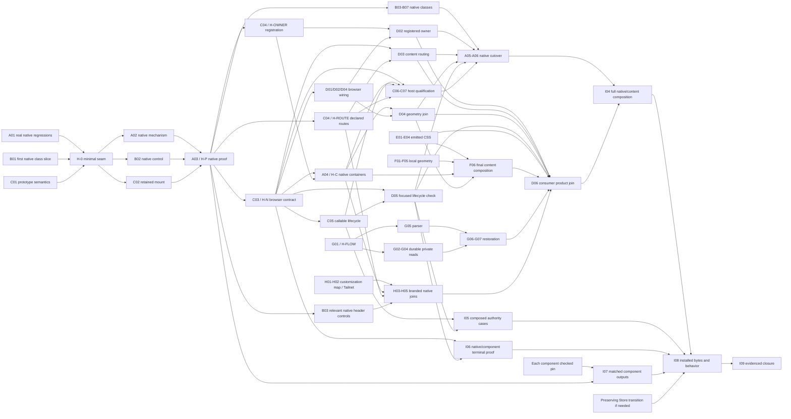

# Native frontend correction tasks and parallel lanes

This is the executable decomposition of the
[native frontend correction](factory-implementation-plan.md#native-frontend-responsibility-and-correction):
Fountain supplies extensions through Forgejo's native frontend, with a reusable
persistent lifecycle; Soda supplies product content and local resources.
The scope is **57 correction tasks in nine logical lanes**. They refine NF-01–NF-05
and the reopened UX tasks rather than replacing the complete factory backlog.
All implementation completion remains pending at this planning baseline.

Planning inputs are Soda `8df756f1bc7f410b694004f2133af046fecc44f4` and Fountain
`87ec92d4f0101071a734b2f790f3bb1fb1d3366e`, both clean at inspection. Their latest
changes are documentation; installed runtime evidence remains bound to its
actual shipping revisions. Recheck heads and dirty work before implementation.
Preserve unrelated changes and existing worktrees, files, Projects and processes.

The generic target belongs to Fountain's `contrib/extensions/README.md`, **Native
frontend correction target**. Product/security guarantees remain in
[Spaces](../product/spaces.md), [trust](../architecture/trust.md#frontend-and-session-boundary)
and the [consumer integration contract](../reference/forgejo.md). Ordinary native
navigation retains the same terminal owner, element, renderer and socket; reload
may restore a fresh browser attachment to the exact admitted process. No task
substitutes a wrapper, consumer host adapter or reconnect semantics for that
ordinary-navigation guarantee.

## Scheduling and completion rules

**Start** names the smallest input needed to begin that task's implementation.
**Finish** names the behavior and evidence required to close it. A callable handoff
can release consumers before its producer lane finishes. A proposed signature or
fixture that substitutes the missing capability cannot release production wiring.
Paths below are relative to the named repository. New defining files stay in the
listed existing owner; A/C/B select exact native/browser definition paths at their
first seam handoff, before concurrent writes. No language port, new service,
compatibility layer or independent orchestration framework is part of this plan.

Each task closes with its necessary patches committed, if any, and its required
checks/evidence recorded against exact input commits. Verification/build/observation
tasks need no artificial edit or empty commit. Diagnostic A01/E01/F01 may release
controlled expected-failure evidence; fixes and qualification still require their
applicable checks to pass. Commit a new regression with its verified fix rather
than leaving canonical checks red. Source tests, real native
template fixtures, installed interactions and process observations remain distinct.
Failing or skipped checks are not completion. Existing useful evidence may be
reused only for unchanged subjects/bindings. A worker percentage does not close a
task; count accepted task IDs against this list, with unmet installed conditions
visible. Planning completion does not count as implementation completion.

Prioritize the native proof and the next artifact that unlocks dependent work.
After each coherent patch, run its smallest decisive checks, review the exact
staged diff and commit early. Integrate small ready changes without waiting for an
entire lane. Apply the owning guide's post-merge reconciliation when a merge occurs.
All build/cache/temp outputs stay under `/home`; task receipts/generated outputs
stay ignored. Resource-heavy builds and the VM have one operator.

## Lanes and first ready work

| Lane | Repository and responsibility | Tasks | First ready work |
| --- | --- | --- | --- |
| A | Fountain native proof, native composition and cutover integrator | NFX-A01–A06 | Real regression composition and native transition seam |
| B | Fountain native feature initialization, cleanup and page configuration | NFX-B01–B07 | Feature/configuration map and first native control |
| C | Fountain generic contribution declarations, browser SDK, mounts and authority lifecycle | NFX-C01–C07 | Minimal public semantics, declaration/refusal and authority cases |
| D | Soda consumer migration and terminal/browser integration | NFX-D01–D06 | Adapter/removal map now; implementation at callable H-N |
| E | Soda emitted CSS, scoped tokens and asset build correctness | NFX-E01–E04 | Actual emitted-color regression and build correction |
| F | Soda settings, creation/dialog geometry and accessibility | NFX-F01–F06 | Measured settings collapse and local content corrections |
| G | Soda durable saved-review contract, Store/API and browser restoration | NFX-G01–G07 | Basis/result revision contract; release H-FLOW early |
| H | Soda native customization alignment and Tailnet contribution policy | NFX-H01–H05 | Override responsibility map and Tailnet scope correction |
| I | Shared verification, resource coordination, documentation and installed delivery | NFX-I01–I09 | Existing-driver cases, writer reservations and target/output map |

Nine lanes are independent queues, not nine mandatory simultaneous agents. With
four execution slots, the coordinator/integrator leads A's initial proof and
shared composition. Assign the three workers to B's smallest native control, C's
generic mount/contract, and E's independent asset correction. After E's decisive
correction, move that capacity
to G's backend/UI handoff or F/H while native breadth proceeds. With more workers,
E, F, G and H start together; D prepares removals before H-N. Reassign workers when
files or handoffs release. Do not invent duration estimates from task counts.

Three fresh JEV consultations using independently reworded, equivalent sanitized
source summaries selected this scheduling policy over larger milestone batches,
serial work and a native-focused cohort that defers independent product repairs.
Requests, actual responses and the wording/privacy audit are retained privately in
`.artifacts/native-frontend-lanes-20261012/`. Agreement is scheduling advice, not
proof of native feasibility, elapsed time or implementation completion.

## Callable handoffs

| Handoff | Producer | Required artifact and immediate consumers |
| --- | --- | --- |
| H-0 | A01/B01/C01 | Small agreed native transition/configuration/mount seam, exact physical writers and first real route/control/stream fixture. Releases A02/B02/C02; this is a prototype contract, not capability proof. |
| H-P | A03 | Passing native-template/browser proof of the critical persistence mechanism with a generic extension. Releases reusable contract finalization, native feature breadth and native placement. |
| H-N | C03 | Callable canonical browser mount/context/presentation/suspend/resume/retire and scoped transport contract, with example and build/type consumption. Releases D01/D02/D04/D05. |
| H-OWNER | C04 shared-owner slice | Callable linked page/panel declaration and registration, released before unrelated route breadth. Releases A04 and D02's declaration/registration join. |
| H-ROUTE | C04 route slice | Admitted generic content routes, refusal cases and actual registered route examples. Releases D03 and H's declaration-dependent customization. |
| H-C | A04 | Native shared-template contribution placement and usable responsive container behavior, without a vacant competing mount. Releases D04 and branded-composition checks. |
| H-FLOW | G01 | Exact bounded saved-review wire examples with basis/result revision identity, provenance and current/stale/missing semantics. Releases Store, API and browser work independently. |
| H-ASSET | E03/E04 | Valid emitted stylesheet/import/font/token outputs with checked native light/dark semantics. Releases affected local UI/composed checks; rebuild only when graph inputs change. |
| H-NATIVE | B07/C07/A06 | Qualified native feature classes, native authority handling and wrapper-free navigation. Releases complete composed source acceptance; individual classes release earlier. |

## A Native proof and composition

**Owner files:** Fountain `web_src/js/features/extensions.js`,
`routers/web/extensions/extensions.go`, `services/context/context_response.go`,
`templates/extensions/{workspace,workspace_page,content,panels}.tmpl`,
`templates/base/{head,head_script,head_style,head_navbar,footer,footer_content}.tmpl`,
`templates/repo/header.tmpl`,
`web_src/css/features/extensions.css`, and generic example integration. A applies
route/mount patches supplied by C and registration/layout changes supplied by B;
there is no concurrent hunk editing of these mixed files.

| Task | Implemented result and decisive check | Start | Finish |
| --- | --- | --- | --- |
| NFX-A01 | Reuse the retained failures to extend existing drivers with the actual two native template shapes, native → contribution → native and reverse order. Name the first real native control, configuration and admitted stream case. Reproduce the failure without injected links or flattened markup; publish H-0 with B01/C01. | Current source/evidence | Actual failing subject identified; exact seam/fixture writers allocated |
| NFX-A02 | Implement the smallest transition/composition mechanism inside the native frontend and native handler/template path. Keep one native shell and connected contribution region; refresh the native page envelope/configuration with native feature lifecycle hooks. Preserve handlers/guards and meaningful native notices. | H-0 | Real native route mechanism joined to B02/C02; affected server/template checks |
| NFX-A03 | Prove the native mechanism with the existing generic notes example and an added/reused admitted test stream. Both entry sequences keep identical root/resource/socket; native controls, repository context, URL/title/history/query/fragment, focus/scroll and invalidation work. No Soda imports or host-DOM adapter in the example. | A02, B02, C02 | Actual native-template/browser receipt releases H-P; a failure triggers reassessment before broad conversion |
| NFX-A04 | Compose global/repository contributions and page/panel mode through the native shell. Host selects one declared shared owner and supplies reachable responsive space. Remove the vacant competing mount; native navbar/account/repository context and notices remain current. | H-P, H-N; owner join at H-OWNER, route-dependent work at H-ROUTE | Native rendering/geometry/control checks with registered owner release H-C |
| NFX-A05 | Complete native cutover and remove alternate-body wrapper selection, iframe/history router, selective full-document copying and wrapper-only chrome hiding. Replace their callers/tests with the proved native implementation. No unsupported ordinary route silently reloads to evade object retention. | H-P; join each B/C/D handoff as ready | B07, C07 and D02–D05 integrated; obsolete implementation/callers removed and affected checks pass |
| NFX-A06 | Verify canonical prefixes/URLs/query/fragment/title/history, Back/Forward/reload, native account/repository controls, native authentication/install/error layouts and single-owner mounting against actual native composition. | Each applicable A/B/C capability | A05 and B07/C07; native navigation receipt contributes to H-NATIVE |

The first proof is a capability spike, not whole-site qualification. Do not build
large scheduling/qualification machinery or repeat full appliance builds while
that mechanism is unresolved.

## B Native feature lifecycle

**Owner files:** Fountain `web_src/js/index.js`, native feature modules other than
the A-owned extension bridge, `web_src/js/htmx.js`, relevant
`web_src/js/modules/{dropdown.ts,tippy.js,modal.ts,fomantic.js,fomantic/*}` and
their focused tests. B owns native
initialization/cleanup registration. Lease concrete feature files per subtask;
disjoint feature classes can be delegated after the seam is stable. A receives
small registration requirements rather than consumer initialization adapters.

| Task | Implemented result and decisive check | Start | Finish |
| --- | --- | --- | --- |
| NFX-B01 | Trace actual native initializer imports, captured page configuration, conditional assets, global listeners/workers and async callbacks into feature classes. Identify affected ordinary routes and native exclusions; publish the smallest first-class seam in H-0. | Current native frontend | Source-grounded class/caller/configuration map and precise file leases |
| NFX-B02 | Make the first real native control initialize and retire through the native transition seam. Refresh its actual page configuration; prevent duplicate listeners and stale async work. Supply A03's representative native capability. | H-0 | Actual native control works after both entry sequences, with correct cleanup |
| NFX-B03 | Integrate common native controls, navbar/repository context, dropdowns/tooltips/modal/form helpers and HTMX handling into their proper global or page lifetimes. Global handlers stay single; changed nodes get needed native enhancement. | H-P and B02 seam | Real native controls survive repeated transitions with no duplicate action/handler |
| NFX-B04 | Migrate affected code/tree/editor/diff/wiki feature classes and conditional assets/configuration. Preserve native content, editors, scroll/focus and async retirement; split work by leased feature files. | H-P; individual class contracts | Each mapped class's real page check and existing focused checks pass |
| NFX-B05 | Migrate affected issue/PR/comment and collaboration/form classes, including dirty-form behavior and current repository context. Preserve native submission/validation and authoritative handlers. | H-P; individual class contracts | Real native form/control checks and source guards pass without stale configuration |
| NFX-B06 | Cover remaining mapped ordinary account/organization/admin and common native feature classes. Authentication/credential/install/error flows retain their appropriate native document handling. | H-P; class-specific inputs | All required mapped classes pass; unresolved required capabilities keep B06 open |
| NFX-B07 | Close the B01 feature/configuration map: native startup, teardown, assets and registration are joined for every affected class. Confirm repeated entry does not leak native listeners/workers or restore retired state. | Each class result independently | B03–B06 coverage and affected native checks; release B's H-NATIVE portion |

## C Generic host contract and authority

**Owner files:** Fountain `sdk/manifest.go`, its tests and new SDK-owned browser
definitions selected at C01; `services/extensions/manager.go` and related
validation, `modules/extensions/{install,installation}.go`; new native mount
implementation files at the C01 seam; `routers/web/extensions/{proxy,callback,websocket}.go`
and their focused tests. C submits changes in A-owned `extensions.js`, routes and
mount templates to A. C owns generic contract semantics, not consumer DTOs.
Use the smallest proved independent distribution mechanism; generic consumption
does not by itself require another package or component framework. H-0 releases
from the first route/control/mount slice before B01's complete map closes.

| Task | Implemented result and decisive check | Start | Finish |
| --- | --- | --- | --- |
| NFX-C01 | Specify minimum shared-owner, route, context/presentation, suspend/resume/retire and transport semantics for H-0. Name exact canonical browser definition/implementation paths and build recipients. Browser display context conveys no operation authority. | Current target/native source | Narrow prototype API, exact physical writers and example inputs/refusals |
| NFX-C02 | Implement one generic retained contribution owner and ordered presentation/context/lifecycle updates for the A03 proof. The example receives only its root and public contract; host chooses visibility/placement and connected lifetime. | H-0 | Focused runnable generic mount/resource/stream check releases A03's input; A03 owns complete native proof. Retirement is separate from product End |
| NFX-C03 | Publish one reusable canonical browser definition and callable mount/lifecycle/scoped transport implementation. Consumers can build/typecheck against the independently consumable contract and use native UI/container behavior without reading host markup. | H-P | Independently built generic consumer example plus host build/type checks; release H-N before Soda migration or whole cutover |
| NFX-C04 | Add bounded declared content subroutes and linked page/panel ownership, replacing host-coded Soda request paths/ID rules. Preserve current public URLs, permissions, route conflicts and reserved native/account namespaces. Consumer backends retain product-ID validation. | C01 for validation/examples; H-P for finalized runtime shape | Release H-OWNER after its actual registration/refusal cases, then H-ROUTE independently after its route cases; A applies mixed joins |
| NFX-C05 | Join host suspension, hidden private cached state, native revalidation, verified resumption and retirement/account-change handling. Reuse existing native admission/session-generation and live authority checks. Consumers receive one lifecycle; they do not independently interpret browser cache events as authority. | C01 refusal cases now; C02/C03 for browser wiring | Real component lifecycle/native stream checks; no stale private state or operation after revocation |
| NFX-C06 | Complete guarded HTTP/stream helpers, URL scoping, request cancellation and resource retirement. Preserve existing origin, session, repository and contribution checks; application payload/protocol and additional policy remain consumer-owned. | Existing server boundary review now; C03 for callable joins | Focused proxy/callback/WebSocket checks and consumer helper use; no parallel authentication implementation |
| NFX-C07 | Verify contribution admission, unavailable/denied mounts, native auth/install/error/partial/download handling and SDK/package consumption in the real native lifecycle. Reconcile generic docs/example and remove superseded contract copies/callers. | Each C capability and native composition | C03–C06 joined with A02/A04 and applicable B-class slices; no wait for A05/A06 closure. Release C's H-NATIVE portion |

## D Soda consumer and terminal integration

**Owner files:** Soda `frontend/spaces/{soda-extension,soda-native-paths,soda-spaces-entry,soda-workspace-panel-entry,sodaspaces-page,sodaspaces-workspace,sodaspaces-workspace-setup,sodaspaces-workspace-drawer,sodaspaces-workspace-navigation,sodaspaces-workspace-factory,sodaspaces-factory,sodaspaces-terminal}.ts`
and related terminal resource modules. D owns root/setup integration and the
extension manifest/entry imports. F owns `sodaspaces-workspace.css`; G owns
`sodaspaces-intent.ts`. They apply D's precise removals/callback joins in their files.
Project component lifecycle belongs to F's `sodaspaces-project.ts` writer; H owns
`frontend/tailnet/{soda-tailnet-entry,soda-tailnet-page}.ts`. D supplies their exact
shared transport/lifecycle migrations; local guards/state remain with those owners.
Factory watch renderer/stream lifecycle belongs to D; Factory domain and execution
policy remain with their existing owners.
E owns build-map/parser changes when entry import structure changes.

| Task | Implemented result and decisive check | Start | Finish |
| --- | --- | --- | --- |
| NFX-D01 | Map the existing consumer shell/lifecycle/transport adapters, including the shared native-prefix/context helper, then consume H-N's canonical types/helpers. Remove duplicate generic URL/session transport rules; retain Soda protocol parsing and domain validation. | Removal map now; H-N for code | Actual consumer build and scoped transport fixtures pass; one canonical host contract |
| NFX-D02 | Declare and mount one shared Workspace owner through Fountain. Remove frame/competing-panel detection and page-entry no-op ownership workarounds. Entry, styles and manifest remain packaged through one graph. | Browser wiring at H-N; declaration join at H-OWNER | Registered host selects one Soda owner; applicable mount/persistence/package checks |
| NFX-D03 | Drive global/repository/new/saved content from declared routes and supplied context. Replace successful drawer document navigation with the host's native transition. Canonical URL/history/reload, Back/Cancel and exact request selection work without provisioning or terminal retargeting. | H-N, H-ROUTE; G wire examples only for restoration UI | Actual supported routes and drawer success path work with A04 composition |
| NFX-D04 | Remove host-ancestor visibility/dataset inspection, native navbar/footer sizing and undocumented event coupling. Consume public presentation/context/container updates; retain internal content and terminal cell sizing. | H-N; finish geometry at H-C | No consumer host-DOM adapter; existing content/terminal stays connected in native page/panel mode |
| NFX-D05 | Consume host lifecycle in Workspace/Terminal, Factory watch renderer/stream and all actual Project/Tailnet callers. F/H apply their component migrations, retaining local dirty guards, secret clearing and operator/domain policy. Ordinary navigation keeps xterm/socket; retirement releases browser resources without End. Reload restores exact admitted attachments. | H-N; C05 lifecycle examples | Focused actual-component/native-mechanism retention and refusal checks, including F/H joins; complete composed preservation belongs I06, which is not a D05 prerequisite |
| NFX-D06 | Join migrated content callbacks, G restoration, F local layout, E emitted assets and H declarations/customization. Remove retired consumer adapters/callers/fixtures. Qualify real one-owner navigation and content behavior without injected native links or conditional renderer passes. | Each callable feature patch | D01–D05 and relevant product patches; composed source receipt for I04 |

## E Emitted CSS and assets

**Owner files:** Soda `scripts/build-soda-extension.ts`, its existing test, product
token portions of `assets/branding/forgejo/components.css`, extension style/import
build maps and scoped asset tests. H sends native-branding edits in mixed
`components.css` to E. D supplies entry-import changes; E keeps builder parsing
and package closure correct. Native scheme selection belongs to Fountain.

| Task | Implemented result and decisive check | Start | Finish |
| --- | --- | --- | --- |
| NFX-E01 | Add the demonstrated failure to the existing compiled-payload checks: emitted extension CSS consumed with external native light/dark selection. Surface/border/action colors must be valid; reproduce concatenated fallback tokens. | Retained source/reproduction | Meaningful emitted-output regression; raw source CSS is not the subject |
| NFX-E02 | Correct production CSS composition/lowering so the selected native scheme yields one valid color. Preserve native selection and legitimate fonts/icons/tokens. Do not patch one dialog white or add another theme selector. | E01 | Emitted-color regression passes for native light/dark; actual builder/import closure checked |
| NFX-E03 | Scope product tokens/styles to their proper consumer/native-branding responsibility. Prevent extension mounting from invalidating document-level native colors; preserve needed native component semantics. | E01/E02; H's reviewed mixed-file requirements as available | Actual emitted surface/border/text/action/dialog colors pass; release H-ASSET color portion |
| NFX-E04 | Join changed entry/style graphs and package outputs with D/H. Verify fonts/icons/notices/import closure and valid colors after graph changes; publish exact affected output identities for reuse. | Each entry/style change | Package checks and graph-specific color checks; release callable H-ASSET outputs |

## F Content geometry and accessibility

**Owner files:** Soda `frontend/spaces/`: `sodaspaces-project.css`, `sodaspaces-project.ts` and
`sodaspaces-project-settings-view.ts`, `sodaspaces-workspace.css`, `sodaspaces.css`,
`sodaspaces-intent-view.ts`, `sodaspaces-repository-picker-view.ts`,
`sodaspaces-project-journey-view.ts` and `sodaspaces-terminal-dialog-view.ts`.
F owns local geometry and applies D's Project lifecycle/obsolete-shell CSS joins;
D applies root/setup/terminal lifecycle changes. G owns `sodaspaces-intent-walkthrough.ts`
and applies F's exact view geometry and inline style/dialog changes in
`sodaspaces-intent.ts`.
Changing local layout must not grow another consumer shell.

| Task | Implemented result and decisive check | Start | Finish |
| --- | --- | --- | --- |
| NFX-F01 | Reproduce the installed settings allocation in existing fixtures with actual CSS and Identity sibling. Use measured viewport/content/scroll/focus, not presence alone, to catch the 32 px selected body. | Retained settings evidence | Actual composed layout regression for each selected tab |
| NFX-F02 | Correct Overview/Access/Network/Factory allocation alongside Identity connections. Give selected content usable bounded space and reachable controls; preserve tab state/action guards and no-write selection. | F01 | Wide/compact/short-height selected-tab geometry and actual scrolling checks |
| NFX-F03 | Correct local new-request/repository/setup geometry so context and primary actions are reachable. Remove obsolete native-gutter selectors supplied by D; preserve draft and Back/Cancel behavior. | Current measured layout; H-N only for callback changes | Actual local geometry/reachable-action checks; no permanent-inaccessibility claim from initial clipping |
| NFX-F04 | Correct Department/terminal dialog sizing, scroll containment, dismissal and focus for compact/short viewports. Consume valid H-ASSET colors; keep product state and destructive-action guards with their owners. | Local measurements now; G/D apply mixed-file joins | Real dialog/keyboard checks with emitted CSS and no background bleed |
| NFX-F05 | Verify keyboard, zoom, compact and short-height content across settings/creation/dialogs. Focused controls and actions remain reachable with honest inner scrolling and useful empty/terminal-selection content. | Each F patch; H-ASSET where colors matter | Existing responsive/focus drivers pass actual local composition; no new parallel UI framework |
| NFX-F06 | Requalify changed local geometry inside Fountain's final native containers and actual branded templates. Supply observed dimensions and interactions to I; do not repair missing host space inside Soda. | H-C, D04 and applicable F/H patches | Settings/creation/dialog/compact composed receipt; installed scope belongs I08 |

## G Saved review restoration

**Owner files:** Soda existing intent/proposal/consolidation types and tests in
`internal/factory/`; `internal/store/factory_intents.go` and exact new Store read
files; `internal/web/api/{factory_intent_explore,factory_intents}.go` and tests;
`frontend/spaces/{sodaspaces-intent,sodaspaces-intent-response,sodaspaces-intent-walkthrough}.ts`.
One G writer owns each defining domain/Store/API/browser-state file. I integrates
schema/version/mirror registration, H integrates central API route changes, and D
integrates root/setup callbacks. G's backend and parser/view tasks may be delegated
on disjoint files after H-FLOW.

| Task | Implemented result and decisive check | Start | Finish |
| --- | --- | --- | --- |
| NFX-G01 | Define bounded owner-private review presentation using current product types. Resolve input/basis versus saved result revision and advice provenance: Explore currently composes from the old revision, saves a new one and returns old-bound content. Define current/stale/missing semantics without granting authority or changing authorization digests. | Current producer/read/browser source | Publish H-FLOW invariants and strict JSON examples; exact storage/consumer owners selected |
| NFX-G02 | Save revision and actual review presentation atomically under existing owner/CAS rules. Exact replay preserves immutable data; conflicting/stale or interrupted saves refuse without partial success. Publish schema/deployment effect to I immediately. | H-FLOW | Real PostgreSQL persistence/replay/CAS/privacy/atomicity checks; no global-journal fallback |
| NFX-G03 | Persist the actual proposal/steps/challenges/recommendation/consistency produced by Explore with exact basis/result provenance. Preserve charged failures and cached-advice meaning; do not relabel a judgment as evaluating different facts. | H-FLOW for code; G02 for join | Actual Explore producer and persisted response agree under existing injected-judgment checks |
| NFX-G04 | Provide bounded owner-private exact-revision review reads through existing intent/current/history surfaces where sufficient. GET returns current/stale/missing and performs no judgments, funding mutation, generation or provisioning. | H-FLOW for DTO/API work; G02 for join | Actual private API read/other-actor/stale/missing tests; H integrates registration only if the chosen contract changes admission/routes, without waiting for whole H04 |
| NFX-G05 | Parse H-FLOW with strict intent/revision/bounds checks and explicit unsupported/missing states. Reject substituted identities and preserve the original proposal ordering/provenance. | H-FLOW | Browser parser/example checks; can finish before Store work |
| NFX-G06 | Restore the illustrated flow, ordered text, recommendation and needed challenges on fresh resume without Explore. Preserve unsaved corrections on failed/superseded loads; changed direction marks old review stale, unrelated allowance changes do not. | G05 for fixtures/code; G04 for completion | Actual read-to-view restoration and stale/account-switch guards; no effect replay |
| NFX-G07 | Prove Explore → atomic save → fresh private read → browser restoration, including lost response, stale head, missing historical presentation and another actor. Count unchanged judgment consumption and absence of generation/effect replay. | G03, G04, G06 | Existing domain/Store/API/frontend join with injected answers; installed content join is I08 |

Historic reviews without exact stored presentation remain honestly missing/stale.
Existing durable receipt evidence is preserved; a global receipt search or model
call on GET cannot establish what an exact private revision previously showed.

## H Native customization and contribution policy

**Owner files:** Soda `frontend/forgejo/templates/{repo/header,custom/header,custom/footer}.tmpl`,
`frontend/forgejo/payload.json`, applicable native customization assets including
`repository-switcher.ts`; `frontend/tailnet/{soda-tailnet-entry,soda-tailnet-page}.ts`;
`cmd/soda-extension/main.go` and its tests,
`internal/web/auth/extension.go`, and `internal/web/api/extension_native.go` central
registration. H owns native customization and narrow product policy, not core
Forgejo initialization. D applies manifest edits; E applies mixed branding/token
CSS and build-map edits; A/B supply generic placement/initializer capabilities.

| Task | Implemented result and decisive check | Start | Finish |
| --- | --- | --- | --- |
| NFX-H01 | Use the existing 264-file inventory to identify actual overrides implementing host mechanics, conditional script assumptions or incompatible native contribution placement. Separate legitimate appliance branding; map each needed retention/removal to A/B/D. | Retained inventory/current native contracts | Reviewed exact affected paths and payload consequences; no blanket deletion |
| NFX-H02 | Align Tailnet manifest/bridge/authorizer scope with the existing configured-operator policy. Reuse the actual manifest-loaded failing test; preserve nonoperator denial and native admission. D applies any manifest edit. | Current mismatch/evidence | Existing operator/nonoperator/API refusal checks pass; no enrollment/network change |
| NFX-H03 | Simplify obsolete native template/script overrides once the corresponding host capability is callable. Keep approved extension tabs discoverable and account/repository controls native; preserve legitimate brand payload/fonts/attribution. | H01; relevant H-ROUTE/H-C/B class handoffs | Actual branded native header/control/asset composition; no consumer initializer adapter |
| NFX-H04 | Join central native-service API/read registration requested by G/D and narrow policy declarations. Preserve native web/session authority and existing product guards; remove superseded hardcoded bridge callers. | Each exact handler/declaration patch | Affected native bridge/private-read/operator tests; no duplicated DTO/router owner |
| NFX-H05 | Verify native tabs/switcher/account controls after both entry orders and history in the actual branded composition, plus read-only Tailnet availability for the admitted operator and refusal for others. | Relevant A/B/C/D/H changes | Native/source composition cases pass; installed page/control evidence follows I08 |

## I Verification and delivery

**Owner files/resources:** Existing shared frontend/native fixtures and installed
drivers, source-check/build/schema registration roots, owning documentation and
private receipts. I owns `internal/store/schema.go`/mirrors/version joins, shared
test models, Fountain's `soda_extension_terminal_live_test.go` positive handshake,
generated output/stage reservations and the existing VM. Features own focused
checks in their files; they submit shared fixture cases to I's writer. No new
acceptance framework or independent deployment service is required.

| Task | Implemented result and decisive check | Start | Finish |
| --- | --- | --- | --- |
| NFX-I01 | Reserve exact physical writers, shared fixture/build/VM resources and an acceptance inventory tied to demonstrated failures. Reuse retained captures/drivers; define evidence classes and task closure records. | Current plans/source | Source/driver/resource map and task-to-case coverage available to all lanes |
| NFX-I02 | Prepare isolated native/browser/Store subjects and integrate shared fixture cases. Remove misleading flattened DOM/forced heights/raw CSS assumptions where those assertions qualify the new behavior. Correct the obsolete positive terminal handshake before reuse. | I01; exact feature cases as ready | Actual-subject fixtures ready independently; skipped/inert terminal paths cannot pass preservation |
| NFX-I03 | Run each affected source/type/asset/auth/Store check when its coherent patch is ready. Integrate schema/build/import/type joins with that patch; cache outputs only by their real graph inputs. | Each feature patch | Task-scoped checked commits and reusable outputs; no whole-lane or full-suite barrier |
| NFX-I04 | Exercise actual native + Soda source composition: both entry orders, global/repository/new/request routes, initialized controls, canonical URL/history/reload, one owner and no navigation provisioning. No injected navigation or conditional absent-renderer success. | H-N releases preparation; each route as callable | H-NATIVE, D06 and relevant E/F/G/H changes; composed native/browser receipt |
| NFX-I05 | Prove native/consumer suspension, revalidation and retirement with actual lifecycle callbacks: matching cached return where exercised, expiry, logout, actor switch and permission loss. Stale private state/input/effects cannot resume, and transport retirement does not End human execution. | Callable C05/D05; existing authority subjects | Actual composed authority/refusal cases; source-only cache evidence labeled accurately |
| NFX-I06 | Prove actual Soda terminal element/xterm/socket identities through both ordinary native sequences using an admitted synthetic attachment. Prove reload's exact locator/account/Project binding with fresh browser objects; prepare the process observer and mandatory positive assertions. | Native lifecycle plus D05; shared positive fixture ready | Actual component/native stream/binding proof; no nullable renderer pass. Actual installed process incarnation/PID/start continuity belongs I08 |
| NFX-I07 | Produce admitted changed outputs at coherent pins: Fountain frontend/binary, image-owned branding, extension/backend and any Store update. Reuse unchanged outputs; verify source identity, package closure and any preserving Store-format transition needed by G02. | H-P and each component's own checked source joins; unrelated composed cases need not finish | Matching changed outputs and stage/readback checks; any changed Store format has a tested preserving transition. No format-change dependency when none is needed |
| NFX-I08 | Activate the matching outputs on the existing VM with one operator; account for the oneshot installer and verify actual bytes for each component. Exercise affected native/content/color/geometry/restoration/security cases and exact synthetic terminal/browser identities plus process incarnation/PID/start across reload; capture available states with secrets/terminal content masked. Preserve human files, dirty work, Projects, services and processes. | Relevant I07 outputs, applicable I04–I06/product proof and tested preserving Store transition if required | Installed behavior/bytes and exact process/state preservation observations recorded; exclusions and evidence limits explicit |
| NFX-I09 | Reconcile owning docs/SDK/examples, task coverage and affected living-plan entries; report task IDs with exact commits/checks/installed outcomes. Close all 57 tasks only on their finish conditions. Preserve private/generated receipts as ignored data. | Incremental checked changes | All applicable task conditions and I08 satisfied; no unsupported aggregate completion claim |

Installed evidence is development verification of this frontend correction.
Execution-provider and production release qualification are distinct scopes;
neither is replaced by these checks or required to diagnose a native layout bug.
Private data and protected human sessions are not verification fixtures.

## Single writers and resource handoffs

| Shared surface | Physical writer | Other lanes' handoff |
| --- | --- | --- |
| Fountain `extensions.js`, route/presentation integration and shared extension/base/repo templates | A | C provides generic mount/route patches; B provides native lifecycle hooks. A releases exact seams after the proof, then records any ownership transfer. |
| Fountain `index.js`, native configuration/feature lifecycle registration and native common widgets | B | A/C provide typed lifecycle calls; class workers submit registrations rather than edit index concurrently. |
| Fountain SDK/browser definitions, manifest validation, manager/install joins | C | A/D provide actual caller/route requirements; A applies mixed route/template changes. |
| Generic example and shared native fixture cases | A for the proof; I for shared verification after explicit release | B/C provide focused cases; do not edit the example or shared fixture simultaneously. |
| Soda Workspace root/setup, entries and extension manifest | D | F/G provide callbacks/state examples; H provides exact declaration changes; E receives entry/import requirements. |
| Soda `sodaspaces-workspace.css`, `sodaspaces.css`, Project component and local creation/view geometry | F | D supplies obsolete host selectors and Project lifecycle joins; G supplies restoration layout needs. |
| Soda `sodaspaces-intent.ts` and response/state definitions | G | F supplies inline CSS/dialog patches; D supplies host-context/lifecycle callbacks. |
| Soda `components.css` and extension builder/maps | E | H supplies legitimate native-brand sections; D supplies entry graph changes. |
| Soda native overrides/payload/central API bridge and Tailnet entry/component | H | A/B supply native behavior; G supplies exact read/route joins when needed; D supplies Tailnet transport/lifecycle migration. |
| Store schema/version/mirrors and shared fixture models | I | G supplies exact atomic storage/DDL/read requirements, tests and upgrade effect. |
| Generated native/extension assets, heavyweight native tests and VM | One I-coordinated operator per resource | Separate explicit task output/fixture directories can run independently; no concurrent writes into shared output or target. |

No concurrent writes to different hunks of one shared file. A whole-file handoff
temporarily pauses its previous writer until return. Each lane keeps focused
checks with its own code; I integrates only shared fixture/registration changes.
Release a real defining seam when it materially enables parallel work, rather
than moving code solely to manufacture more agents.

## Dependency graph and limiting path

Solid arrows are required callable/proved inputs into the named task slice.
Independent product branches qualify their own checks while native work proceeds.
The output-preparation branch uses each component's checked pin; final activation
joins applicable composed proof and any required preserving Store transition.

The likely limiting dependency is **H-0 → A03 native proof → H-N → native class
coverage plus consumer migration → composed checks → matched installed outputs**.
It is a priority estimate from dependencies, not a measured duration guarantee.
E/F/G/H never wait for that whole chain to begin. G05 and view preparation start at
H-FLOW while Store/API joins continue. D starts each callable route/lifecycle
slice without waiting for every C/B task; final acceptance still needs the actual
native replacement. I prepares drivers/joins incrementally and reserves expensive
builds for decisive integrated inputs.

## Failure coverage and plan reconciliation

| Demonstrated mistake or required boundary | Primary closure tasks |
| --- | --- |
| Alternate shell, stuck native → Workspace → Issues and incomplete native initialization/configuration | A01–A06, B01–B07, C02/C07, I04 |
| Consumer host DOM/geometry/visibility/duplicate mount and undocumented lifecycle adapters | C01–C03, A04, D01/D02/D04/D05 |
| Host-coded Soda paths/IDs; native contribution namespace/authorization | C04/C06/C07, D03, H02/H04 |
| Hidden repository switcher/tab overflow and branded native control initialization | B03/B05, A04, H01/H03/H05, I04/I08 |
| Invalid emitted scheme colors and transparent dialog/control styling | E01–E04, F04, I08 |
| Blank content mount, collapsed settings, creation/dialog/compact reachability and empty panel content | A04, D04/D06, F01–F06, I08 |
| Tailnet declared-scope/operator mismatch | H02/H05, C07, I08 |
| Missing saved-review read and input/result revision ambiguity | G01–G07, D03/D06, I08 |
| Terminal/browser cache lifecycle mismatch, drawer reload, stale positive fixture and unproved exact object/process lifetimes | C05/C06, D03/D05, I02/I05/I06/I08 |
| Simplified fixtures, stale asset/install assumptions and overstated completion | A01/A03, E01, I01–I09 |

NF-01 maps to A01–A03/B02/C02; NF-02 to C03–C06/A04; NF-03 to A05/A06 and
native class coverage; NF-04 to D plus H's obsolete customization removal;
NF-05 to E/F/G/H and I's actual composed/installed evidence. Existing UX-C02–C07,
UX-U03, UX-W05/UX-W07 and UX-Q03/UX-Q08 retain their owning product finish
conditions. Record affected work there without claiming the unrelated factory
backlog has been reimplemented or newly qualified.

This task document is H06 documentation upkeep entered in the living desired
tree. Its addition does not refresh historical structural/catalog/review counts.
