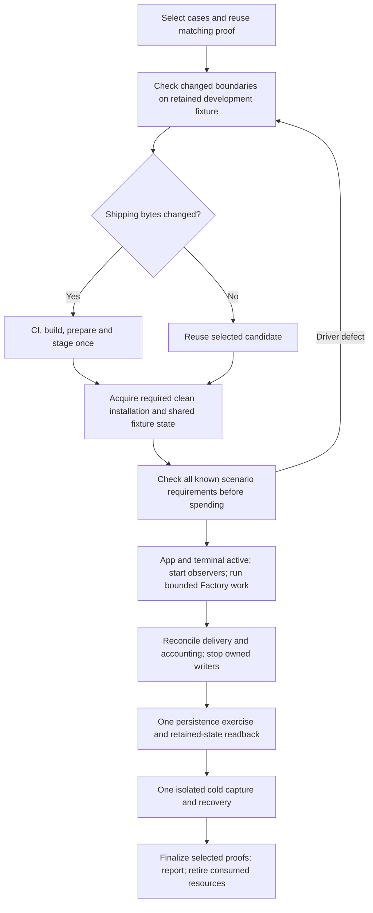

# Release workflow

How developers produce and qualify release candidates. Durable model:
[Release architecture](../architecture/release.md). Tool contracts:
[Native support](native-support.md).

The [25 October RC6/RC7 qualification record](rc6-qualification-2026-10-25.md)
retains the selected revisions, actual installed results, failed collector
attempts, local evidence locations and remaining work. It records one attempt's
history; the workflow below owns the reusable procedure.

Payload v4 separates the host, application images and native extension packages.
Fountain owns package acquisition and requested enablement; Soda supplies its
packages and restricted host operations. See the
[component contract](../architecture/release.md#public-distribution) and
[Tailnet lifecycle](../architecture/networking.md#tailnet-model).

Retained-Project transitions follow the
[release maintenance contract](../architecture/release.md#host-update-ownership)
and [operator procedure](../guides/operator-setup.md#explicit-release-maintenance).
Each source-to-target pair requires its own native qualification receipt.

## Pipeline map

| Symptom or task | Open first | Then |
| --- | --- | --- |
| Candidate will not build | `lib/soda-release-build`, `lib/soda-release-tools` (`soda-build`) | `lib/soda-release-image` |
| Media/assemble wrong | `lib/soda-release-image` | `cmd/soda-install` |
| Guest/fixture behavior | `tools/acceptance` | `tests/installed` |
| Publish/promote | `lib/soda-release-deliver` | `soda-release` in `lib/soda-release-tools` |

## Normalize the qualification procedure

The maintained readiness/admission path and phase composition are implemented;
bounded recovery and the full measured live journey remain in the task list.
Execution is held while the owner reviews it. The owner's first priority is **compute, model usage and
storage**, ahead of elapsed time or fewer interruptions. The existing
[RC6/RC7 record](rc6-qualification-2026-10-25.md) owns historical results;
this section owns the replacement procedure.

### Optimize for accepted proof

The useful output is an accepted, precisely scoped result. A short failed run,
a smaller timeout that prevents completion, or an extra snapshot that never gets
used can increase the total resources needed to obtain that result.

| Observed cost or defect | Consequence for the redesign |
| --- | --- |
| RC7 production build took 23m11s; consumed media scratch later reclaimed 25.19 GiB of actual filesystem space. | Avoid unnecessary candidate builds; serialize them and release consumed scratch promptly. |
| The RC7 Docker attempt recorded 10 sponsorship minutes without completing review or producing a qualification seal. | Find deterministic downstream failures before funding or starting another run. These minutes are local accounting, not a measurement of provider token billing. |
| Admission accepts two retained Projects, but the current private persistence function expects only the witness/Factory Project, which are the same Project. | Check the entire scenario against one inventory. A green admission stage is insufficient. |
| Native App-only and Docker Factory-only resource windows were measured separately. | Compose the real App, member terminal and Factory workload in one interval instead of buying another run to repair missing coverage. |
| Current Docker cold preparation binds an App-free protected-state snapshot. | Create the selected App and its retained record before the final persistence/cold baseline. |
| The existing Docker connection is Ready at generation 3. | Reuse it; generation changes after credential return are not a reason for another sign-in. |

"Unpaid setup" in older records means no sponsored Codex execution. Requirements,
preview or acceptance operations may still invoke TypeSafe/JEV. Record those
calls separately; reuse canonical accepted judgments when their bound inputs are
unchanged. Do not invent total provider costs from incomplete historical records.

### Alternatives considered

| Approach | Benefit | Cost or limitation | Decision |
| --- | --- | --- | --- |
| Continue patching private per-attempt scripts | Smallest immediate edit | Fixture assumptions drift between phases; repeated model failures remain likely | Use existing code as the migration input, then maintain one implementation |
| One shared scenario and durable phase results over existing tools | Reuses media, accounts, setup and useful proof; exposes downstream mismatches before spending | Requires consolidating the demonstrated driver behavior and explicit reuse rules | Recommended |
| Snapshots and disposable overlays for every attempt | Could reduce repeated installation work | Physical savings are unmeasured; backing chains, secrets and external accounting complicate reuse | Optional later experiment if installation remains a measured bottleneck |
| A general workflow service, scheduler and artifact database | Could automate a broad workload | Large implementation and qualification cost before the present scenario works | Exclude from the initial implementation |
| Qualify everything privately before publication | Could reduce failed public candidate churn | Current contracts require public download/install observations; doing the live journey twice increases model use | Keep model-free development checks before publication and the qualifying live journey afterward |

Use stable development fixtures to debug changed boundaries. For a candidate,
reuse its actual installed fixture through the remaining cases. After its required
proof and retention obligations are complete, that fixture can become the next
development fixture instead of retaining another permanent pair.

Native ISO acceptance requires a real installation onto the selected fresh disk.
The Docker contract requires a fresh deployment with new runtime volumes on a
supported disposable host or VM; it does not require reinstalling Linux for every
candidate. Reusing that host must follow the supported installer and preserve
any retained deployment. Freshness is a proof requirement, not a default reaction
to any failed script.

The [current installer](../../system/docker/install-docker.sh) fixes the Compose
project name to sodaos, refuses retained runtime volumes and cross-version
adoption, and has no reset/project-isolation option. Host reuse therefore needs
explicit, proven retirement of the prior disposable deployment; it is not an
available installer switch. A new instance from a clean supported host image is
the conservative alternative while that retirement path is unimplemented.

### One shared scenario

Keep one scenario input and one actual result index alongside the existing
workflow request and observation journals. Each phase consumes the same typed
bindings. Per-attempt directories contain data and evidence, not another driver
implementation.

The scenario contains:

- Selected acceptance cases, immutable candidate/payload/artifact identities and
  the independently identified driver/verifier revision.
- Actual target, trust and installation identity; returned repository, Project,
  actor, preparation, issue, App and terminal identities as they become known.
- The complete retained inventory, the subset owned by this test, permitted
  lifecycle actions and state that must remain untouched. Historical work is
  distinct from live custody; expected counts are derived from these identities.
- Existing authorization, sponsored and rolling limits, deadlines, concurrency
  and allowed owner context actions. Paid limits are not inferred from setup.
- Required phase results and their dependencies, including the intended final
  App/Project/Factory state for persistence and cold recovery.

Unknown future candidate heads, PRs, run IDs, reviewer preparations and measurements
remain unknown until canonical operations return them. The plan can check the
shape and compatibility of those transitions; it cannot predict model success.
Private values remain in protected files and canonical stores; the scenario uses
references and selected metadata.

The current two-Project mismatch is a concrete acceptance case for this design:
admission, terminal ownership, Project stop, native snapshot, recreation and cold
capture must agree about both retained Projects. Merely relaxing an equality check
would not establish that the extra Project is safely stopped and preserved.

### The replacement flow



1. **Select and reuse.** Choose the distribution and exact claims. Reuse passing
   results whose actual dependencies still match. Preserve explicit deferred
   cases; an all-backlog goal must not silently expand this campaign.
2. **Develop cheaply.** Fix source/driver problems on a retained native or Docker
   fixture. Exercise real Git, filesystem, native APIs and saved request/receipt
   boundaries as appropriate. Replayed requests prove parser/transport behavior,
   not real provider execution or independent review. Commit reusable fixes.
3. **Produce only when necessary.** Use exact-source CI and the existing canonical
   build/prepare/stage path for changed shipping bytes. Driver-only changes have
   their own revision/digest and reuse the unchanged candidate. Use existing
   input-aware caches; do not create an alternate build engine.
4. **Prepare the whole scenario.** Establish trusted access and ordinary owner
   setup; save generated private owner credentials before fragile assertions.
   Create or adopt the intended App/record, Project/member/terminal, accepted
   issue and role preparations. Reconcile an uncertain POST before repeating it.
   Check every known later-stage assumption, action permit and output contract.
   Inspect existing account state; enroll only a genuinely missing connection,
   with the human present. This phase avoids sponsored execution, not necessarily
   every TypeSafe call.
5. **Spend once for several useful observations.** Leave the App and genuine
   member terminal active, start the resource/response observers, then run the
   approved Factory lifecycle. Use per-run canonical context actions for both
   implementation and review while eligible. Reuse the recorded judgment and
   exact digests. Observe native execution, actual CI, independent review,
   integration, delivery and accounting; record partial results honestly.
6. **Persist and recover the final state.** After intended mutations finish,
   retire owned model/terminal/App/Project writers through normal controls and
   capture current protected state. Exercise native reboot or Docker same-image
   recreation as selected, reopen the same App owner/record and Project witness,
   and verify Factory history. Quiesce again, then perform one consistent isolated
   cold restore with this combined state. Preserve the original and retire the
   clone/network according to the agreed retention policy.
7. **Close at the actual scope.** Finalize and qualify the successful component
   observations; report every open selected case. Promotion remains a separate
   decision. Derive the result report from recorded facts and commit the useful
   source/reproduction changes without copying private data into the repository.

The existing Docker canonical receipt validates four ordered kinds:
installation, browser_project, factory and persistence. It does not automatically
validate App, capacity or cold-recovery claims. A maintained scenario must preserve
those core contracts and explicitly validate supplemental cases through their
existing owners. Extra files or one overall green label cannot add coverage.

### Plan live work to avoid extra model runs

Use one small real issue to obtain the necessary end-to-end Factory result and
basic App/terminal/Factory measurement together. Do not start an extra coding task
solely because the observer was missing during the first run.

For two-issue support, choose before spending whether the claim requires execution
overlap, two completed lifecycles, or both. Two distinct Ready connections permit
two concurrent runs; they need not be two different provider accounts. Start
observers first and use genuine independent issues. Where the driver is already
proven and the exact scope permits it, one of those two issues can supply the
primary delivery proof. Otherwise prove the basic route first and retain the
additional two-issue case as a separate explicit extension.

Two short tasks do not guarantee overlapping native execution. Do not pad tasks,
add artificial sleeps or automatically buy another trial to manufacture overlap.
Record actual PIDs, leases, Project/container/invocation joins, App/terminal
responsiveness and the measured interval. Partial windows remain partial.

Choose finite time limits from observed durations and the intended task. The
retained attempt used seven sponsorship minutes for investigation and implementation
before review; that does not support assuming a five-minute complete journey.
Review duration and the next task's behavior remain uncertain. Distinguish the
rolling usage clock, held reservations, root deadline and sponsorship rounding.
A sufficient ceiling permits completion without requiring its full consumption.

### Reuse and invalidation rules

| Change or failure | Preserve | Repeat or reconcile |
| --- | --- | --- |
| Driver selector, request, binding or observer defect | Candidate, usable installation/account, matching prior phase facts | Affected driver integration and eligible downstream observation; create a new admitted attempt where required |
| Lost or uncertain owner response | Original command/resource identity and history | Canonical readback before any duplicate mutation |
| Same preparation only partly ready | Existing ready role and preparation IDs | Supported same-ID continuation for the missing work |
| Pending unexpired context attention | Same run, recorded judgment and allowance | Only its canonical available owner action with exact current bindings |
| Expired/retired review | Code/PR, account, setup, failed result and all charges | A genuinely new authorized attempt; current product has no same-review continuation after expiry |
| Shipping source/image/pin change | Unaffected component evidence at its original scope | New candidate and affected installed proof |
| App/configuration/record changes after a snapshot | Earlier proof as historical evidence | Fresh current protected-state baseline before persistence/cold claims |
| Changed workload or resource allocation | Prior measured profile | The changed profile's actual measurement; peak samples do not establish a smaller supported minimum |

Reuse preserves original invocation, source, target and outcome. It never edits a
failed protected attempt into a pass or patches an active admitted binary.
Sealed phase composition and supported continuation belong to the canonical
qualification owners; do not assume today's private monolith already supports
arbitrary resume.

### Resource and artifact lifecycle

- Default to one heavy build or one measured guest workload at a time. Parallelize
  independent diagnosis only when it avoids rework; keep one writer per guest and
  one owner per observer/caller. Two paid workers run together only for a selected
  concurrency case or another explicit resource-justified scope.
- Keep reusable compiler/package/image caches separate from disposable scratch.
  Release consumed assembler work after successful check/prepare and provenance
  preservation. After a failed attempt's diagnosis closes, retain decisive logs,
  source identity and needed state rather than every generated disk forever.
- Keep current release inputs, necessary support/upgrade baselines and unique
  retained data. Historical public artifacts can be reacquired by immutable
  identity when offline retention is not required. Private data, credentials and
  unique source are never treated as recoverable public downloads.
- Keep a cold clone only for its recovery exercise and explicitly chosen retention.
  Do not retain original, clone, archive and successive full copies by default.
  Preserve backing dependencies if overlays are used. Measure actual filesystem
  space, not summed shared/reflink directory allocations.
- Never roll back a funded database to erase local usage, and never duplicate OAuth
  directories as an enrollment shortcut. Snapshot reuse needs a measured benefit
  and correct identity/external-work isolation before becoming part of the path.

### Minimal implementation and current rollout

The first implementation is a shared scenario input, one maintained journey
implementation and a derived next-action/result view over existing journals.
Reuse tests/installed for browser journeys, tools/acceptance for execution/support,
lib/soda-release-tools for protected execution/sealing and
lib/soda-release-deliver for qualification. Existing Factory control owns lifecycle
and context semantics. This design needs no new service, scheduler or database.

#### Implementation plan

The 26 tasks below are the living implementation task list. Group headings
name dependencies; the ownership table names the code homes. Complete J01–J08
first for the read-only readiness milestone. J21–J23 are live acceptance tasks
and remain held until execution resumes. Checked tasks have the recorded evidence;
the remaining tasks are pending. Local implementation is now authorized. It does
not resume the held trial, change its budget, rebuild RC7, publish source/assets
or remove retained fixtures. The implementation target is the existing RC7 Docker
fixture first, then the native distribution through the same scenario contract.

**Operator interface:** `soda-release journey check`, `status`, `run` and `report` now exist.
`check` reads selected target state and writes a local readiness result without
guest mutation or provider inference; `status` derives blockers, accounting and
the next supported action from that saved check without remote reads. `run`
performs semantic admission and calls the existing protected collector only for
an eligible, released scope. Holds, revoked/missing authority and readiness
blockers return a saved admission without dispatch.
Build, stage, collect, finalize and qualify retain their existing owners.
The arguments are `check --scenario FILE --out RUN_DIR` and
`status|run|report --run RUN_DIR`; report can select a current tool with `--build
BUILD_JSON`. Secret values are never command-line arguments.

**Build the maintained driver:** from a clean committed checkout with the
installed Bun/Go tools, dependencies installed from `bun.lock`, and the SDK at
the local replacement path selected by `go.mod`, run:

```sh
bun scripts/build-qualification.ts --out /home/soda-tester/journey-build
```

Use a fresh output directory with an existing canonical parent outside the
checkout. The script builds `soda-qualification-journey`, the importable
`phases.js` composition, `soda-installed-probes` and protected
`soda-qualification-collector`. `build.json` records their
hashes/sizes, clean full source revision, actual clean SDK subtree/revision,
package/module lock hashes and build recipe. It reuses installed tools and warm
caches; it does not install dependencies, copy predecessor scripts, read private
keys or contact an appliance. The native probe embeds this same full driver
revision; installed candidate source remains a separate input. This support
build does not rebuild release media or deploy the probe.

Set the scenario's `driver.source_revision` and `driver.executable` from this
receipt. Keep candidate, target, trust, credentials-as-paths, retained resource
scope and authority unchanged. Invoke the existing `soda-release journey check`
and `status` commands with that scenario; `check` performs read-only target
observations and `status` reuses its saved result. Fixture SSH/trust/private
access remains an explicit external prerequisite.

The maintained offline request integration takes the built module and a public
saved current-context request as explicit data:

```sh
bun tests/installed/qualification/check-browser.ts \
  --module /home/soda-tester/journey-build/phases.js \
  --retained-request /home/soda-tester/bridge-request.public.json \
  --out /home/soda-tester/browser-check
```

It uses the repository's installed Playwright/Chromium dependency and native
browser bridge. Keep both the fresh `/home` output and private `TMPDIR` short
enough for Unix sockets. Every request is fulfilled locally with Chromium
offline. Its result binds module/request hashes and exact-once action/refusal observations; it does
not claim backend eligibility, context resumption or a paid outcome.

For retained history on the Docker fixture, run the built native observer through
the scenario's pinned SSH transport with an explicitly selected historical
repository/issue:

```sh
bun tests/installed/qualification/check-native.ts \
  --module /home/soda-tester/journey-build/phases.js \
  --scenario /home/soda-tester/scenario.json --repository 1 --issue 1 \
  --out /home/soda-tester/native-check
```

This check requires both succeeded and unsuccessful retired runs, with successful
recorded generations older than the selected Ready connection. It compares real
native metadata with database outcome/lease/generation bindings and verifies
history, charges and connection metadata remain identical before/after. It uses
read-only SQL and native Inspect; no provider output leaves the guest. Those
fixture history prerequisites are not automatically created or repaired.

**Run admission:** `soda-release journey run --run RUN_DIR` verifies the saved
scenario/executable, writes `run-admission.json`, and reuses `collect` for a
released matching scope. `authority.held` is independent of approval state.
`ScopeReceipt` in `tests/installed/qualification/run.ts` records `format: 1`,
`state: approved|revoked`, a nonempty `approval_reference` and the result of
`approvalScope(scenario)`. Record actual existing authority; a prepared document
or a non-null path is insufficient. Candidate/target, cases, managed resources,
effects, exact Factory subjects/operation/connections and finite limits must
match. Driver rebuilds, file paths and current credential generations do not
revoke unchanged approval. The scope comparison normalizes set ordering.

The optional scenario `collection` supplies only existing `authority_file`,
`candidate_directory`, fresh `output_directory` and `build_receipt_file` paths,
plus optional `prior_attempts` canonical receipt references. Collector identity
comes from the build receipt; no executable hash is transcribed into a phase
configuration. The maintained projection derives phase flags/IDs/limits from
the shared scenario and actual observation. The current supported collector
case order is installation, browser_project, factory, persistence on Docker.

An unheld matching scope refreshes actual read-only readiness before dispatch.
Root invocation requires a root-controlled run and driver; approval/build
receipts must also be root-owned private files under trusted ancestors. Reuse
the existing root collector authority, runtime inventory and credential sources.
The runtime supplies `details.json` (`DockerPhaseDetails`), `public-docker/`,
`trust/{known_hosts,appliance-ca.crt}`, `playwright/` data files and `chromium/chrome`; package inputs come
from the candidate snapshot. The adapter checks the scope, source and fixed
mounts before credential reads or transport. It uses the two fixed systemd
credentials plus exactly one `application-owner-APP_ID` credential for each
selected App. It imports no per-attempt implementation.
The build receipt identifies the installed Playwright data source and its
bundle/package/browser metadata hashes. Its bundled data root is the fixed
runtime path; unused optional BiDi modules stay external to the Chromium route.
Playwright initializes only after admission, when opening the actual browser.
The worker loads the admitted appliance CA through `NODE_EXTRA_CA_CERTS` as
well as the browser's NSS database: Playwright's `route.fetch` uses a separate
HTTP client. Browser trust alone does not authorize that client's TLS connection.

The driver derives a private resolved source with approval/build pins; `collect`
freezes its exact bytes as the existing read-only worker snapshot, retaining
request/executed/sealed receipt ownership. No authority-file hash edit is needed.
An existing fixed `resolved_input` authority must still match; it is never
silently replaced. A hold or unknown/revoked approval does no remote refresh,
funding, enrollment or model launch. Status retains that admission separately
from its original readiness observation. Repeating a held/blocked admission
returns its original result. An interrupted admission is preserved; it is never
overwritten to reconstruct a launch. This command does not buy another attempt.

**Durable effects and target ownership:** before protected collection,
`collector-intent.json` retains the exact scenario, approval, build, resolved
input and output binding. The returned `collector-binding.json` records the
canonical collector request hash and transient unit, including an uncertain
controller reply when that request exists. All resolved collector entrypoints
share a root-controlled flock keyed by distribution/actual target UUID under
`/home/.soda-qualification-targets`. Before worker dispatch an immutable claim
binds its output/request/unit. A different output cannot start while a prior
claim lacks confirmed exact local worker retirement; releasing the process lock
alone does not clear uncertainty. Local collector retirement never settles guest
leases, accounting or provider work: a new admission must independently observe
the guest idle and match actual finite authority. Claims and failed data remain.
Existing collector outputs continue to finalize rather than redispatch.

Factory commands persist their request through the existing permit before
transport. A lost or unusable reply reads only `factory/commands/ID`; type,
target, session principal, normalized payload/digest and finished outcome must
match before another mutation. Pending, absent or conflicting records stop;
there is no automatic POST/PUT replay. CI reads its exact remote journal after
an uncertain SSH reply. Resource retirement reads the same native incarnation
after an uncertain stop, and Docker recreation reads its protected attempt/result
journal. Explicit command denials do not become permission through observation.
Terminal reservation replies retain their returned identity before reaching the
browser's native-TTY handshake.

`setup.ts` adopts the selected Project/member, exact preparations and current
Ready Codex generation through the normal owner APIs; matching ready state sends
no create/join/enrollment/preparation request. The supported preparation helper
can continue only the same approved/waiting IDs with explicitly admitted unpaid
inputs: durable intent precedes the request, and the exact preparation read
follows even a lost reply. Failed/stopped/interrupted or ambiguous state does not
create replacements. Whole-run admission may pass an unready preparation check
only for these exact approved/waiting IDs with identical source, heads and setup
digest and explicit `fixture_setup` scope. The protected runtime supplies the
continuation inputs. The normal-owner helper must confirm both preparations
ready before any Factory command; pending/unconfirmed setup ends the collector.

**Supported recovery:** repeat `journey status --run RUN_DIR` to inspect saved
readiness or the exact retained collector. Repeat `journey run` only to reconcile
that existing attempt: it never re-enters an admitted collector, even after
failure. Root recovery can inspect the retained collector when the original
driver is unavailable; it does not select a replacement executable. Its recovery
report distinguishes pending, uncertain, retired-incomplete and complete. Only
the existing successful protected execution receipt can be finalized. A retained
dispatch intent without a collector request, or a ready admission without an
intent, remains uncertain rather than launching again. A per-run flock prevents
two initial callers from passing this boundary together.

| Observed condition | Supported next action |
| --- | --- |
| Pending operation/custody | Read the exact recorded operation through its existing owner and wait for confirmed settlement. |
| Uncertain response | Look up its original command/preparation/recreation identity; never resend the effect or change its ID. |
| Partial setup | Adopt ready state or continue the same explicitly scoped approved/waiting preparations once; preserve failed/interrupted work. |
| Driver defect/interrupted admission | Preserve receipts and native custody, repair the affected driver, then make a fresh read-only check. Never re-enter the failed collector. |
| Missing authentication | Inspect and repair the selected Identity connection through its supported owner flow; never automatically enroll a replacement. |
| Expired run | Reconcile that same run through Factory/Identity. A passed deadline does not prove retirement or authorize extension. |
| Closed/exhausted allowance | Preserve charged usage; wait for the rolling window or obtain finite authority for canonical explicit Retry/additional allowance. No automatic retry/refill. |
| User hold | Wait with the original approval, accounts, data and charges preserved. |

Saved readiness reports derive `supported_recovery` from selected native
connection/preparation/run-deadline/allowance/accounting fields at the recorded
observation time. They read no raw Factory run bodies or provider logs and grant
no authority. Collector failures retain a bounded reason and repair category.
J16 records local real-API interruption and native worker cancellation evidence;
installed guest and provider outcomes remain separate live acceptance.

Reproduce command reconciliation with `check-command.ts --module BUILT_PHASES
--scenario ACTUAL_SCENARIO --out FRESH_HOME_DIRECTORY`: it reads a real retained
canonical command via pinned SSH and uses a local non-dispatching lost-reply
callback, without claiming normal HTTP mutation acceptance. For the actual
cross-directory process lock, run `check-target.ts --operator ABS_SODA_RELEASE
--out FRESH_DIRECT_HOME_CHILD` as root. Its isolated development fixture uses
an incomplete candidate and a real flock holder to prove both callers stop
before worker/output allocation. These checks never launch a model or touch
an appliance's logical state. The normal-HTTP and native cancellation checks
below cover different boundaries.

`tests/installed/qualification/check-run.ts` reproduces guarded admission using
the built driver and Rust operator. Supply `--operator ABSOLUTE_SODA_RELEASE`,
`--build BUILD_JSON`, `--scenario ACTUAL_SCENARIO`, `--readiness ACTUAL_READINESS`
and `--out FRESH_HOME_DIRECTORY`. It performs one actual read-only check and a
held run/status, then isolated local receipt fixtures for changed scope and
revocation. It never invokes a released approved scope. Its fixture receipts
are explicitly non-operative and user-owned; they cannot establish protected
owner authority or qualify a release.
Optional `--application-fixture PUBLIC_APPLICATION_JSON` adds a real read-only
supplemental check using the publisher's candidate-bound metadata and an explicitly
absent App selection. It verifies that source route support coexists with blocked
App adoption/resource closure, unknown capacity and null future outcomes. No App
response is fabricated, no owner file is created/read, and no handoff or resolved
execution input may be produced. This negative selection grants no lifecycle scope.
The same check repeats retained admissions and interrupts a local admission
between saved observation and result; neither boundary permits dispatch/replay.
Run `check-recovery.ts --operator ABSOLUTE_SODA_RELEASE --out
FRESH_DIRECT_HOME_CHILD` as root for actual retained-intent/driver-loss and
per-run process-lock checks without a worker, guest effect or provider call.

For real normal-API lost-response integration, use the existing disposable
[PostgreSQL fixture](../../tools/pg-fixture/README.md) with its `SODA_PG_*`
environment and an existing `/home` temporary directory:

```sh
export TMPDIR=/home/soda-tester/tmp
export SODA_QUALIFICATION_HTTP_RUNNER="$PWD/tests/installed/qualification/check-command-http.ts"
export SODA_QUALIFICATION_HTTP_MODULE=/home/soda-tester/journey-build/phases.js
export SODA_QUALIFICATION_HTTP_OUT=/home/soda-tester/fresh-http-check
go test -count=1 -run '^TestQualificationJourneyLostHTTPResponse$' -v ./internal/web/api
```

The Go integration serves the registered product handlers on loopback and
uses its existing test-only native authentication callback. It closes the
selected TCP socket only after a real pause command and dispatch withdrawal
commit in PostgreSQL. The maintained client persists intent, reads the original
command through the normal API, and refuses re-entry before another send.
`result.json` binds the module/runner and recovered command; `server-result.json`
records actual mutation, database and zero-paid-work counts. The database is
ephemeral; no appliance/provider authority or installed Forgejo journey is claimed.

For actual worker cancellation, compile the existing CLI integration target
with `cargo test --offline --release -p soda-release-tools --test cli --no-run`.
Use the resulting integration executable path from Cargo's output:

```sh
sudo env TMPDIR=/home/root-owned-test-tmp \
  SODA_NATIVE_WORKER_CANCELLATION_DIRECTORY=/home/fresh-worker-cancellation \
  /ABS/PATH/TO/cli-HASH \
  --exact soda_build::build_admission_matrix_preserves_release_boundaries --nocapture
```

The temporary directory must already exist; the cancellation directory must be
a fresh direct child of `/home`. This optional integration requires the normal
root/systemd worker prerequisites and existing `soda-qualifier` identity. It
runs only the trusted installed `sleep` executable through `run_worker`, observes
its exact transient unit alive before requesting cancellation, then records
the returned custody and actual native state in `result.json`. Cancellation
stops the exact unit before killing its launcher and draining pipes; the final
existing native inspection decides custody. No candidate build, guest, provider
or credentials are involved, and no model attempt becomes resumable.

**App fixture and owner handoff:** optional scenario `applications` selections
reuse a managed `application_id`, a public `fixture` metadata reference, one
`owner_credentials_file` already listed in `credentials.application_owner_files`,
and an exact record `{operation_id, label}`. The operation uses a UUIDv7.
Approval binds the selected App, fixture digest and record operation/input;
omitting App selections preserves an unchanged Factory-only scope. Adding an App
case is not permission to alter the held trial or install/start anything.

`application.ts` adopts the existing normal App API record using the canonical
response parser and selected native inventory. It checks the fixture's candidate,
image, semantic bundle/artifact/tools identities, Canlang owner team, data and
container generation. Its handoff keeps the Forgejo administrator separate from
the Canlang owner and marks credential paths as controller-local. No password is
read during adoption. A missing App or pending Restore remains a blocker; this
helper never substitutes registration, first-owner setup or a new data directory.

Native data paths are in the appliance namespace. Docker data paths are in its
Soda container namespace, reached through the pinned SSH host and the exact
observed outer container ID/image. `applicationNativeProbe` checks the host UUID,
installed source/payload and selected App labels/generation before returning
read-only metadata. It never treats the Docker host's `/home` as inner storage.

`application-owner.ts` uses Canlang's normal owner login/team selection and MCP
grant, with HTTPS verification and an optional explicit public CA. It journals
one create intent before sending. Re-entry reads the original operation's record
without another create; uncertain responses are reconciled only by exact generated
record ID, selected label and unchanged prior records. The pinned CRUD fixture
uses its operation UUID as record ID. Readback alone does not manufacture a
committed mutation receipt. Credentials, cookies and tokens stay out of evidence.

For a provider-free native check, reuse the qualified extracted RC7 tools and
readable public bundle, and bundle the maintained phase entrypoint (no image,
release media, Go probe or dependency installation is needed):

```sh
bun build tests/installed/qualification/phases/index.ts --target=bun \
  --outfile=/home/soda-tester/inputs/phases.js
bun tests/installed/qualification/check-application.ts \
  --runtime /home/soda-tester/qualified-canlang/bin/can-soda \
  --bundle /home/soda-tester/inputs/bundle.json \
  --module /home/soda-tester/inputs/phases.js \
  --out /home/soda-tester/fresh-app-check
```

The runner requires the exact RC7 fixture bundle and qualified tools source.
It durably saves `private/owner.json` outside App data before bootstrap, creates
one local owner/record, verifies normal read/render and anonymous denial, then
reopens the same data/team/credentials after native restart. Both actual process
exits and writer-lock release are recorded. Failed state and credentials remain
available; do not bootstrap over them. This local check proves no guest install
or release qualification. Installed supplemental collector composition is
implemented. Readiness's `app_route` describes source support only; `app_selection`,
complete resource closure and the protected collector's owner/record/tool checks
remain separate prerequisites. An absent installed App cannot produce a handoff.

`phases/journey-measurements.ts` coordinates an already authenticated App owner
and record with the Project phase's retained real terminal probe. Its measured
Factory wrapper first reads the record/rendered page and original TTY, then
subscribes to Factory's existing native baseline and progress reads. The baseline
must pass before policy opening. Later probe failures are recorded and deferred
until Factory returns, allowing its normal pause/accounting work to finish.
There is no extra polling timer, SSH sampler or background evidence writer.
`finish()` disposes the wire observer once; it does not stop the retained TTY or
App writer (their lifecycle owners remain responsible).

Each `measurements/sample-NNN.json` contains separate App/terminal request windows,
monotonic elapsed milliseconds and success flags, plus a bounded projection of
the existing native observation: timestamp, Project container, custody counts,
active unit identity/PIDs and verified live run bindings. Samples do not contain
provider bodies, terminal bytes or owner credentials. `measurements/result.json`
summarizes this window independently from `factory/` CI/review/delivery evidence.
No response-time threshold or CPU/memory capacity is claimed (`capacity: null`).
These supplemental files do not become canonical Docker observation kinds.

To extend the native App check with a real local persistent PTY and live remote
read-only Factory/native observations, append:

```sh
  --native-config /home/soda-tester/public-consumer-config.json \
  --ssh-config /home/soda-tester/private/ssh-config \
  --ssh-host admitted-appliance-alias
```

The config supplies only existing repository/Project/issue/connection/branch
identities to the maintained fixed snapshot reader; its paid flags and funding
are unused. The SSH configuration must pin the admitted host/key. This optional
check performs two native reads while the App and PTY remain live, then retires
the local PTY before the App restart/readback check. Its
`measurement-scope.json` explicitly leaves Factory CI/review/delivery null. It
neither drives Factory nor proves an installed App/browser terminal route.
The protected collector still emits only four canonical observation kinds. Its
optional supplemental route selects one App and cold recovery after those four
cases, optionally with `basic_capacity`. Admission and composition share the same
route predicate. `basic_capacity_route` stays unknown while no capacity threshold
has been accepted, even though its supplemental probe code can run. Source support
does not imply an installed pass or release the execution hold.

### Native appliance transport

The shared `collectInstalledPhases` composition reuses the Project, terminal,
Factory, CI/current-context and resource-retirement owners on a native appliance.
The initial native route selects exactly `installation`, `browser_project`,
`factory`, `persistence` and one eligible Factory subject. It uses direct pinned
root SSH with an actual DMI UUID check; it never addresses a Docker outer.
Native App/cold/capacity and two-issue extensions remain unimplemented and refuse
admission. Existing Apps remain in the complete retirement inventory, but an App
record/rendered-page result is not inferred from that inventory or a reboot.

`AppliancePhaseDetails` uses the common public Project/Factory/helper inputs and
replaces Docker host/download identities with `installation`: five public
references (`candidate`, `payload`, `media`, `console`, `release`), each `{path,
sha256}`. In the protected worker, stage those files under its admitted runtime
or candidate mounts; the original controller paths are not available there.
The staged release copy must retain the scenario's original manifest hash.
`public_download_directory` is `/run/soda-qualification-runtime/public-appliance`
and `package_directory` remains `/run/soda-qualification-candidate/packages`.

Installation joins the retained original console/first-boot record to the current
XFS root PARTUUID, disk size, locked OSTree deployment, payload and all six image
configs. The current boot need not be the first boot. The shared state reader
also measures candidate-pinned running Dashboard and host/helper bytes, complete
resource identities and custody. Existing verified media metadata is reused;
neither a new public media download nor a fresh installation is claimed.

Native persistence requires the explicit `permitted_effects.native_reboot: true`
in the exact approved scope; omission is no permission. After the shared normal
owner retirement and a fresh stopped snapshot, one exclusive root journal binds
the operation, UUID, old boot and protected hash before requesting reboot. A lost
reply permits observation only. A different actual kernel boot, same root,
deployment/images, exact journal and protected state are required afterward.
This implements reboot, not physical power-off or isolated cold recovery. Its
four selected phase observations do not create appliance application coverage
or a release qualification seal.

Provider-free observation of an existing native fixture uses the same scenario
and those five public references, without Factory selection or lifecycle scope:

```sh
bun tests/installed/qualification/check-appliance.ts \
  --scenario /home/soda-tester/held-native-scenario.json \
  --installation /home/soda-tester/public-installation-references.json \
  --out /home/soda-tester/fresh-native-check
```

It checks real installed state, canonical inventory projections, candidate byte
pins, staged-manifest use without the controller path and wrong-UUID refusal.
It never requests reboot, installs an App, signs in a provider or changes scope.
Private key/password paths stay references and are never hashed as evidence.

### Receipt reports and resource retirement

`soda-release journey report --run RUN` derives a stdout-only report from saved
receipts, with no target read, reconciliation or mutation. Use `--build BUILD_JSON`
to select a current report tool for an old immutable run; its original driver,
scenario and history remain unchanged. The report binds collector intent,
request, resolved bytes and executed/sealed file identities before projecting
selected phase/supplemental results. It does not read private work, credential
files or provider bodies, infer missing outcomes or make a qualification decision.

Worker scratch now has an original-inode receipt and moves from `attempt/.work`
to private `COLLECTION/consumed-work` only after exact native worker retirement.
It remains outside sealed evidence. Failed or incomplete work is retained.
Successful finalized work is removed automatically only when the exact frozen
scope includes `retire_consumed_scratch: true`. The default preserves it without
another process/storage scan. `journey retire-scratch --out COLLECTION` inspects
the bounded selection; `--execute` cannot bypass that frozen permission or the
completion, identity, live-reference and dependency guards. No input artifact,
cache, credential, backing VM or failed attempt is a generic cleanup target.

Final cold recovery saves its validated result and confirms the clone stopped
before retirement. With `retire_temporary_clone: true`, the existing Rust cold
owner checks the original capture, clone identity/isolation, all Docker container
dependencies and active mounts before removing only that stopped clone and its
three copied trees. Source data, settings/environment and provenance remain.
Without permission, collection records retention locally; it does not rehash a
large cold set just to keep it. Explicit inspection uses `journey cold retire
--restored DIR --result-sha256 SHA`; adding `--execute` is an actual deletion.

Intent precedes removal. A missing outcome after intent stays uncertain and is
never an automatic retry. Resource outcomes distinguish requested, retained,
confirmed native stop and recorded removal; absence or unit retirement alone
does not prove deletion. Selected allocation and observed filesystem free-space
change stay separate, including when reflinks share physical blocks.

Reproduce provider-free reporting with `check-report.ts --run HELD_RUN --out
FRESH_HOME_DIRECTORY`. Reproduce native retirement guards as root with
`check-retirement.ts --operator ABS_SODA_RELEASE --cold-restored EXISTING_LOCAL_CLONE
--cold-result ACTUAL_LOCAL_RESULT --out FRESH_DIRECT_HOME_CHILD`. It creates only
a small incomplete scratch fixture and an unpaid true unit, refuses held/incomplete,
live-referenced and unrecognized work, and plans the existing clone. It deletes
no retained resources and creates no model/Factory outcome.

### Final retained state and cold recovery

`phases/final-state-recovery.ts` uses the existing complete resource inventory
and writer retirement before same-image persistence. It reads the same App owner,
record and rendered page after recreation, then stops the App again and takes a
fresh native baseline. The old whole hash is not reused after App observation
updates. Factory history, policy and accounting ledgers must remain unchanged.
The adopted App is rebound to the verified new Docker outer ID. After cold
restore, the same Project witness, protected business state and owner record
must match; copied inode numbers are excluded from the portable comparison.

The concrete protected adapter is `phases/prepare-final-recovery.ts`. It adopts
an existing running App through normal APIs and fresh native evidence, without
installation or first-owner setup. Public fixture bytes come from
`/run/soda-qualification-runtime/applications/APP_ID.json` and retain the selected
publisher hash. App credentials arrive as systemd credential
`application-owner-APP_ID`, alongside the fixed SSH/workspace pair. Root derives
exact permitted names from the hash-bound selected scenario; controller-local
credential references are never opened by the worker. The runtime's optional
`details.cold` selects a root-owned pinned operator executable plus fresh private
capture and restore directories. Its presence/identity is checked before Factory.

`soda-release journey cold` owns complete stopped Docker storage. `capture`
requires the exact cleanly exited Compose container/image and exactly three
owned local named volumes at `/etc`, `/home` and `/var`; it refuses other running
containers holding any of those paths and refuses external mounts. It copies the
three full trees and original `compose.yaml`, protected `.env`, `identity.json`
and `docker.json`, preserving and verifying bytes, ownership, permissions,
timestamps, links and extended attributes. Outputs stay private under `/home`;
their parent and ancestors must be root controlled. Copies use reflinks when
available and sparse copies otherwise. An incomplete output stays incomplete.

```sh
sudo soda-release journey cold capture \
  --container EXACT_STOPPED_CONTAINER_ID --project sodaos \
  --image ghcr.io/levitateos/sodaos@sha256:EXACT_MANIFEST \
  --settings /home/sodaos --out /home/private-recovery/final-cold
sudo soda-release journey cold restore \
  --source /home/private-recovery/final-cold \
  --out /home/private-recovery/fresh-restore
```

`restore` verifies the completed set, copies into fresh storage and creates a
separate stopped container with network `none`, private cgroups and fresh
`/run`/`/tmp`. It preserves the selected image and private execution environment;
it does not pull or start anything. The maintained composition explicitly boots
that container, adds the original private browser address only to its isolated
loopback and checks services before reading retained state. Ordinary browser
owner requests and App-local HTTP/MCP requests cross the existing protected SSH
transport into that namespace, preserving TLS origin/CA and command permits.
There is no host port, provider network or replacement sign-in. HTTP bodies,
cookies and credentials are not evidence; bounded request metadata is saved.
The isolated container is stopped afterward, including on failure, with all
source/copy data preserved. Lost capture/restore replies are reconciled from
their exact journals without repeating an effect.

App/capacity/cold results live under `supplemental/`; they never acquire a fifth
canonical Docker kind or imply unobserved CI/review/delivery/capacity results.
The main caller retains the canonical persistence result separately. Complete
installed boot/readback and root selected-App credential delivery remain unverified
on the retained target: it has no installed App and execution is held. J20 checks
available real-system prerequisites; J21–J23 retain these actual installed outcomes
when their scope and target prerequisites are supplied.

Provider-free checks reuse the qualified App runtime and existing owner/data:

```sh
bun tests/installed/qualification/check-application-recovery.ts \
  --storage /home/source/sodaos/target/release/soda-canlang-storage \
  --runtime /home/qualified-canlang/bin/can-soda \
  --bundle /home/inputs/bundle.json --module /home/inputs/phases.js \
  --proof /home/retained-app-check --out /home/fresh-app-recovery-check
sudo bun tests/installed/qualification/check-cold.ts \
  --operator /home/source/sodaos/target/release/soda-release \
  --app-proof /home/retained-app-check --out /home/fresh-docker-cold-check
```

The first uses the actual fixed curl transport for normal owner login, MCP and
rendered readback, refuses a live writer, restores stopped data to a fresh
loopback runtime and rechecks the original. It never bootstraps another owner.
The second imports only a tiny local executable fixture, creates independent
local volumes containing retained App storage and nonsecret witnesses, verifies
active-writer refusal, complete copy/restore and an actual isolated container
exit. It pulls no image and builds no Soda media. These are distinct real local
checks; neither is a complete installed Soda recovery claim.

`soda-acceptance` remains a generic execution/evidence tool. Its driver explicitly
does not own product scenarios; do not move Factory orchestration into it.

| Responsibility | Existing owner / proposed implementation home |
| --- | --- |
| Operator command, scope admission, invoking protected collection | `lib/soda-release-tools/src/release_cli.rs`; a small new `journey.rs` module, split only when actual responsibilities need it |
| Shared scenario/inventory, installed phase implementation and read-only readiness | New maintained modules under `tests/installed/qualification/`, reusing `sodaspaces-controls.ts`, `sodaspaces-input.ts`, `sodaspaces-journey-evidence.ts` and `native-browser.ts` |
| Cancellation, pinned remote execution, evidence/redaction and VM support | Existing `tools/acceptance/src/driver`, `process`, `evidence`, `remote` and `vm`; extend only a missing generic primitive |
| Protected runtime, credentials, collector custody and sealing | `lib/soda-release-tools/src/qualification.rs` and `worker/` |
| Canonical observation validation and promotion eligibility | `lib/soda-release-deliver/src/publish/qualification.rs` |
| Factory meanings, read-only context projection and lifecycle actions | Existing `internal/factory/control/context_resolution.go`, `publication_children.go`, `lifecycle_retry.go` and canonical Store types; no alternate Factory state machine |

**1. Define the shared scenario and result boundary.**

- [x] **J01.** Establish one typed fixture/scenario definition in the maintained installed
  driver: candidate/tool references, actual target, selected cases, retained and
  owned resources, protected credential references, permitted effects and paid
  limits. Reuse canonical domain identities instead of conflating publication,
  assignment, root and run IDs.
  Implemented in `tests/installed/qualification/scenario.ts`: readonly candidate,
  driver, target, case, retained/managed resource, credential-reference, effect and
  model-limit types. `PublicationReference` preserves canonical `id`,
  `assignment_id` and `run` separately. Strict focused TypeScript checking passed
  with `tsc --ignoreConfig --noEmit --strict --noUncheckedIndexedAccess
  --exactOptionalPropertyTypes --target ES2022 --module ESNext
  --moduleResolution Bundler --types bun,node --skipLibCheck` against this file.
  This is the type contract only; discovery and runtime validation remain J02/J05.
- [x] **J02.** Keep requested intent separate from returned runtime facts. Discover actual
  IDs/current connection generation; leave future run/head/PR values unknown.
  The Rust operator owns its admission envelope, not a second manually maintained
  copy of every business-state field.
  Implemented in `tests/installed/qualification/{scenario,facts}.ts`: requested
  target/Factory pins remain input; inventory and resolved bindings are separate
  returned observations. Fixed read-only Store/Identity and Forgejo projections
  select identities without raw run bodies, issue prose or credentials. Missing
  bindings and unobserved terminals remain unknown; discovery never infers future
  run, candidate head, PR or publication. No Rust business-state mirror was added.
  On 2026-10-25 at 21:18:56Z, one pinned read of RC7 Docker `.165` returned both
  retained Projects, App0, native issue3 and the existing Ready connection at
  generation3. The three old runs and ten charged minutes remain recorded. The
  integration confirmed stale requested IDs do not override returned facts,
  missing bindings stay null and unsafe numeric IDs are refused. Guest mutations
  and model calls: zero. Strict focused TypeScript checking and formatting passed.
  Reproduce the fixed projections through the existing pinned native transport;
  pass their arrays plus `issues`, `observed_at` and genuine `terminals` (or null)
  to `discoverFixture`. Local invocation/evidence:
  `/home/vince/Projects/.sodaos-rc-20261023/journey-j02/check.ts`,
  `selected.json`, `observation.json` and `result.json` in the same directory.
  This checks identity discovery only; whole-scenario readiness remains J05–J08.
- [x] **J03.** Reuse existing request/receipt formats and observation paths. Before each
  admitted attempt, snapshot its resolved input immutably; never mutate active
  admitted inputs. Preserve old attempts and reference their provenance.
  The existing protected collector now accepts an exact-bound `resolved_input`
  document, snapshots it before dispatch, records it in its canonical request and
  mounts it read-only. Recovery verifies the retained copy; it never refreshes it
  from the producer. `ResolvedQualificationInput` references prior canonical
  requests/executed/sealed receipts without copying them or their runtime. The
  Rust controller owns only file binding, leaving the scenario/facts schema in
  the installed driver. See the release-tools guide for paths and format.
  Provider-free filesystem integration used J02's actual RC7 observation: exact
  bytes and prior references survived, overwrite/stale-pin/tamper were refused,
  and the first attempt remained unchanged after a new input/snapshot. Accepted
  snapshots totalled 2,228 bytes; no collector dispatch, guest mutation or model
  call occurred. `cargo check --offline --release -p soda-release-tools --lib`,
  focused Rust/TypeScript formatting and strict TypeScript checking passed.
  Invocation and evidence:
  `/home/vince/Projects/.sodaos-rc-20261023/journey-j03/Cargo.toml`, `src/main.rs`
  and `result.json`. Run that manifest with `cargo run --offline --release` and
  a reused target cache; use a fresh evidence directory when repeating it.
  Journey command admission/dispatch is still J05/J13; this check launched none.
- [x] **J04.** Verify that a saved actual fresh-install record and the current retained
  two-Project RC7 fixture can be represented without changing driver source,
  creating another VM or clearing history.
  Verified the saved `.165` owner-handoff/native-idle receipts from 19:20:20Z
  on 2026-10-25 (Project0/App0/connection0/run0), including the handoff's linked
  evidence hashes, against one fresh pinned metadata read at 21:30:18Z. The
  retained fixture returned Project2/App0/connection1, Ready generation3, three
  retained runs and ten charged minutes. Both records use the unchanged
  `QualificationScenario`, `FixtureObservation`, `ResolvedQualificationInput` and
  `discoverFixture`; both serialized and round-tripped. The old Project remains
  in inventory outside the selected managed Project. Unread terminals and future
  execution/publication values remain unknown. These representations are not
  readiness, paid authority or qualification claims; both scenarios remain held.
  Strict focused TypeScript checking passed. No driver edit, VM creation, history
  clearing, guest mutation or model call occurred. Reproduction:
  `bun /home/vince/Projects/.sodaos-rc-20261023/journey-j04/check.ts NEW_EMPTY_OUTPUT_DIR`
  with a fresh child directory under `journey-j04/`. The existing `evidence/`
  directory contains both resolved records, fresh retained metadata, a hashed
  source manifest and `result.json`. This uses the saved J02 fixed native read;
  migration into the maintained command remains J05/J09.

**2. Implement whole-scenario read-only readiness and status. Depends on 1.**

- [x] **J05.** Add `journey check/status` wiring and the shared validator. Check source/trust,
  actual inventory and custody, current account, standing preparations, accepted
  inputs, command permits and the known persistence/cold resource closure.
  Implemented the thin Rust `journey.rs` operator and maintained installed
  `qualification/{main,validate,native,readiness}.ts` modules. The operator freezes
  the scenario and verifies the exact driver; the driver validates inputs, pinned
  TLS/SSH trust, installed source/payload/six images, selected identities, eight
  custody counters/native units, accepted decisions/source/check bytes, standing
  preparations, actual actor bindings and effect subsets. It checks persistence
  and cold lifecycle scope without issuing any command permit or effect request.
  App/capacity/cold route implementations and paid admission remain unknown until
  their owning tasks implement them. Status performs only local reads.
  On 2026-10-25 at 21:45:08Z, the maintained CLI checked RC7 `.165`: identity,
  trust, custody, account generation3, accepted inputs and both preparations
  passed; persistence resource scope and the user hold blocked readiness. Paid
  authority remained unknown. Three old runs and ten charged minutes remain.
  CLI integration also refused reused output, a stale executable pin, an inline
  unknown credential field and a changed snapshot, preserving the original run.
  No collector dispatch, guest mutation, model call or spending occurred.
  Focused Rust compile/build, strict TypeScript and changed-file formatting passed.
  Reproduction/build instructions are in `lib/soda-release-tools/README.md`.
  Local inputs/receipts and CLI integration:
  `/home/vince/Projects/.sodaos-rc-20261023/journey-j05/scenario-v5.json`,
  `run-5/`, `check-cli.ts` and `result.json`. The input records the source base
  commit; its pinned driver was built from this working change. Earlier failed
  read-only checks and their exact binaries remain available for diagnosis.
- [x] **J06.** Move the current two-Project/one-Project contradiction into an explicit
  pre-execution diagnostic. Distinguish historical resources from live work and
  state which owned terminals/Projects must be retired before a snapshot.
  Added `qualification/closure.ts` and exposed its diagnostic in check/status.
  The native read now includes Project unit state/MainPID/ControlPID alongside
  container state and terminal record IDs; Apps use the corresponding unit read.
  The diagnostic distinguishes configured route coverage, requested management
  and lifecycle scope, stopped/unknown resources, required retirement and live
  custody. Settled run counts/charged minutes remain preserved history.
  At 21:56:05Z on 2026-10-25, one read-only RC7 check found both Projects active.
  Selected `p683bc93a2341173ca414e578` has a configured stop path before snapshot;
  retained `pdf46bf52e38d8e2e0bb06c1f` is outside that route and stop scope.
  Its terminal record `9e835706f492aa5530e16975f4fe5995` is outside retirement
  scope and lacks a confirmed actor binding: observe/resolve it, never infer
  ownership or issue an end request. The diagnostic names all four blockers.
  Three retained runs/ten charged minutes coexist with all eight custody counters
  zero; history itself is not a blocker. Older J05 evidence without unit/PID
  fields correctly remains insufficient to prove stopped Projects. Status
  returned the same diagnostic without remote reads or changes to saved files.
  Strict focused TypeScript, standalone driver build, CLI integration and
  formatting passed. Guest mutations, lifecycle actions and model calls: zero.
  Inputs/build/evidence:
  `/home/vince/Projects/.sodaos-rc-20261023/journey-j06/{scenario.json,run,check-cli.ts,result.json}`.
  This diagnoses the current route assumption; J09/J10 still replace the phase's
  independent inventory/stop scope. No equality was relaxed or resource adopted.
- [x] **J07.** Return blockers, unknown future observations, last confirmed phase, accounting
  fields and the next supported action. Missing paid authority reports a wait;
  it does not cause a sign-in, funding request or model launch.
  Added the pure `qualification/status.ts` projection used by both check and
  status over the existing frozen scenario/readiness paths. It returns named
  blockers, separate local repairs, the last confirmed read-only observation,
  explicitly unknown qualification/model/CI/review/delivery/persistence results,
  requested versus observed accounting and a supported wait/repair/inspect action.
  No new workflow journal or effect dispatcher was added.
  At 22:03:24Z on 2026-10-25 the real RC7 read retained three runs/ten charged
  minutes. New repository usage is zero, sponsorship is absent, the observed
  rolling limit is 15 versus requested 25, and settled rolling usage is 472550938
  microseconds. These fields are not authority or provider token billing.
  The settled-window query follows Store's microsecond accounting; if held
  reservations exist, total charge stays unknown rather than duplicating Store's
  conservative admission calculation. The current next action is wait/user_hold.
  CLI status integration returned the same saved facts without remote reads or
  file changes. A clearly separate local reporting fixture, using the real
  native/accounting observations with a varied hold input, returned
  wait/paid_authority_missing; no operational hold or guest state changed.
  All automatic action flags remained false. Strict TypeScript, standalone build,
  CLI integration, formatting and diff checks passed; zero model calls, funding,
  enrollment or guest mutations. Reproduction/evidence:
  `/home/vince/Projects/.sodaos-rc-20261023/journey-j07/{scenario.json,run,check-cli.ts,result.json}`.
- [x] **J08.** Verify that the real current fixture reports the known persistence blocker with
  zero guest mutations, sponsored executions, JEV calls or budget changes. The
  affected real-request permit bridge must still refuse mismatched path/body/run
  identities and accept its exact once-only request.
  At 22:12:47Z on 2026-10-25, the unchanged maintained driver performed one new
  read-only RC7 check. It still names retained Project
  `pdf46bf52e38d8e2e0bb06c1f` and its unowned/unconfirmed terminal as the persistence
  blockers. Ready generation3, all eight zero custody counters, three retained
  runs, ten charged minutes and every selected budget/usage observation match
  J07. No shipping/tool rebuild or replacement sign-in was needed.
  Separately, a fresh offline native Chromium context replayed the actual saved
  run-action request through real Playwright Request objects and the affected
  `FactoryPermits` source. Every request was locally fulfilled; none continued to
  a server. Altered path, run, body, command ID and method were refused; a
  mismatched run label was refused before journaling. The exact request was
  accepted once, then replay/rearming were refused, with one journal record.
  Historical source and request hashes remained unchanged. This proves client
  request identity/once-only filtering, not backend context eligibility or a
  resume of that retired historical run. The live trial remains held.
  Guest mutations, sponsored executions, JEV/model calls, budget changes and
  action requests to the appliance: zero. Local scripts and evidence:
  `/home/vince/Projects/.sodaos-rc-20261023/journey-j08/{run,check-browser-bridge.ts,browser-bridge-result.json,check-readiness.ts,result.json}`.
  The browser script uses the installed Playwright/Chromium and existing native
  browser helper. Its historical guard import is a migration input for J09,
  not an import of the maintained readiness driver.

**3. Consolidate the proven phase modules and fix inventory closure. Depends on 1–2.**

- [x] **J09.** Migrate the selected RC7 private driver behavior into the maintained source
  owner: installation readback, browser/TTY witness, canonical Factory observer,
  CI measurement, both role-context paths, persistence and relevant native reads.
  Parameterize target/tag/paths/IDs; eliminate active imports from per-attempt
  implementation copies. Keep historical binaries/evidence immutable.

  Implemented in `tests/installed/qualification/phases/`: `docker-phases.ts`
  composes installation, browser/member TTY and retained file, Factory, and
  same-image persistence using repository-owned helpers. The selected native
  readers, CI measurement and implement/review current-context paths are maintained
  beside it. No maintained import resolves to an attempt directory or absolute
  checkout. Release tag/image identities come from the hash-bound public metadata;
  host installation/fixture paths, witness filename and helper/scope pins are
  explicit inputs. The CI script path is explicit and distinct from its status
  context. Contractual Docker Compose names and protected credential locations
  remain fixed.

  `dockerPhaseConfiguration` derives target/source/IDs/generation/limits from the
  shared resolved scenario and actual discovery; `DockerPhaseDetails` supplies only
  additional public phase dependencies. Importing the composition performs no
  action. A held input refuses before reading phase files or invoking runtime
  callbacks. This is a library migration, not `journey run` admission: J13 still
  owns pinning these additional dependencies into the protected request, runtime
  construction, canonical observation envelopes and dispatch. Runtime saves must
  retain the existing no-clobber/fsync guarantees. J10 still owns the unchanged
  retained-Project/global snapshot contradiction; J11/J12 own the remaining
  lineage and composed integration acceptance. No live result is claimed here.

  Verification: all test/installed TypeScript passed `tsc -p tsconfig.tests.json
  --noEmit`; focused strict TypeScript, formatting, Oxlint and the composed Bun
  bundle passed (18 repository modules, 151.46 kB). The migrated installation observer ran once over pinned SSH against
  `192.168.2.165`, confirming shipping source `9842e527`, candidate/payload,
  manifest/config, stock vendor bytes, six application images, installer execution
  and the retained outer container. An offline real Chromium session exercised
  seven requests through the maintained Factory guard: the saved exact action
  admitted once, altered path/run/body/command/method and replay/rearm refused.
  A held composed input called zero runtime callbacks. Guest mutations, provider
  actions/model calls and paid admission: zero. Historical source/evidence was
  preserved. Evidence and reproduction commands/scripts:
  `/home/vince/Projects/.sodaos-rc-20261023/journey-j09/{check-migration.ts,migration-result.json,installation,check-browser-bridge.ts,browser-bridge-result.json,bundle}`.

- [x] **J10.** Replace independent global Project/App count assumptions with the same explicit
  inventory. Normal stop must cover every authorized resource required for a
  stopped snapshot and preserve unrelated state. Fixing the count alone is not
  sufficient. Keep strict unknown-resource and active-custody refusals.

  Implemented one fixed `resource-runtime.ts` projection for readiness and Docker
  collection: registered identities, all labeled/named Project and App containers,
  unit/PID state, terminal directories, and protected terminal actor/account and
  subscription bindings. Unknown native resources and unconfirmed ownership fail
  closed. Running Apps are observable during idle; stopped snapshots still require
  every retained Project/App inactive with both PIDs zero and no running container.

  `diagnoseClosure` now plans the full explicit inventory rather than treating
  another retained Project as an omitted route. Any unknown resource, active
  custody, missing permission or unsupported subscription terminal suppresses the
  entire action list. Stopped unrelated resources are preserved. Normal retirement
  ends permitted owner terminals, stops Apps with their current normal-API
  revision/container binding, then stops every permitted Project. It preflights
  App bindings before the first effect, retains once-only requests/acknowledgments,
  rechecks inventory/incarnations/history and native retirement after each action,
  and uses the same scope for snapshot and recreation. The composed browser phase
  adds only its exact returned new terminal; existing resources gain no authority.

  Verification: strict installed TypeScript, Oxlint, formatting and both readiness
  and composed-driver Bun bundles passed. Two pinned read-only RC7 observations
  agreed on both Projects and the retained terminal; its protected binding now
  proves actor `1`. The actual requested scope remains blocked for the extra
  Project/terminal, with zero planned actions. A local scope comparison, still
  held and never executed, plans that terminal followed by both actual Projects;
  readiness and phase collection return the same plan. History remains three runs
  and ten charged minutes; the existing Ready connection remains generation 3.
  Offline Chromium used actual retained IDs and the maintained App UI fixture:
  four exact End/Stop requests admitted once, nine changed-body/generation or
  replay requests refused. This proves source/request integration, not actual
  native retirement, App persistence or paid qualification; those remain held and
  belong to later acceptance tasks. No guest mutation, provider call or spending.
  Evidence/reproduction scripts:
  `/home/vince/Projects/.sodaos-rc-20261023/journey-j10/{check-native-scope.ts,native-result.json,native.json,phase-idle.json,actual-closure.json,local-what-if-plan.json,check-browser-retirement.ts,browser-result.json,browser-requests.json,bundle,readiness-bundle}`.

- [x] **J11.** Preserve canonical publication versus owner identity, current-generation rules,
  native-success/retirement guards and exact per-run current-context eligibility.

  Preserved the canonical publication ID versus publication-owner assignment,
  and tightened the owner join to the succeeded root's self-bound publication
  assignment. Standing preparation checks now bind the exact selected coder and
  reviewer IDs. Active native observations require the current Ready connection
  generation and matching live execution/lease/binding. Retired success uses the
  recorded generation and canonical native completed/exit-zero, delivered,
  credential-returned and confirmed-retirement metadata, with the same
  container/unit/invocation/lease; a later connection generation does not
  invalidate historical success. Database success alone is insufficient.

  The maintained `soda-installed-probes factory-context-status SCOPE_FILE`
  observation now consumes canonical Store/control logic in
  `internal/acceptance/factory_context_status.go`. Both implementation and review
  retain exact root/parent, preparation, publication/candidate and staged,
  unexpired context eligibility. Scope binds the actual opening policy command
  ID: the retired RC7 helper's different command-label salt cannot reject the
  maintained operation. The caller checks the helper's current generation against
  the current native observation and permits only the canonical recorded
  `can_use_current` action. Tool and installed source/payload pins are independent;
  generic errors expose no database or credential details. Native Inspect replies
  are reduced to an allowlist inside the guest before SSH output; provider output
  and reasons are not retained. The probe's CLI/build/scope contract is documented
  in `tools/soda-installed-probes/README.md`.

  Verification: focused strict and installed TypeScript, Oxlint, formatting,
  composed Bun bundle and Go probe build passed. Actual read-only native inspection
  of the three retained RC7 runs accepted the completed investigation and
  implementation (exit zero, retirement confirmed) and refused the cancelled,
  stopped review with no exit code. Historical generations 1/2 remain distinct
  from the Ready connection's current generation 3. History and ten charged
  minutes were unchanged. Offline real Chromium exercised eight requests through
  the maintained guard: exact action once; changed path/run/body/command/method/
  query and replay/rearm refused. The local unqualified probe compile also passed
  CLI dispatch and unpinned/unprivileged refusal checks. Its local build is not an
  admitted clean-source artifact; J12 owns that build integration. No helper
  deployment, eligible live context action, model call, guest logical mutation or
  qualification occurred. Those live claims remain unobserved under the hold.
  Evidence/reproduction scripts:
  `/home/vince/Projects/.sodaos-rc-20261023/journey-j11/{check-native-execution.ts,native-observations.json,native-result.json,check-browser-bridge.ts,browser-bridge-result.json,check-probe-cli.ts,probe-result.json,bundle}`.

- [x] **J12.** Verify that affected native/browser/request integrations work with retained
  history and the selected driver builds from repository source plus explicit
  dependencies, without copying a predecessor's scripts or credentials.
  `scripts/build-qualification.ts` now builds the standalone read-only driver,
  importable phase composition and correctly source-pinned native probe. The
  clean-source build passed at `f59e8b7c87aea2ef076c0e1df178ec0171686954` with the
  explicit clean SDK subtree at `a70dbdd46322342d8b91b451f54fee798898dd06`;
  its receipt records lock/input and output hashes. The first build's missing
  module output was corrected by using Bun's actual `outdir`/`naming` boundary;
  that incomplete attempt remains preserved. No dependency installation,
  predecessor script/credential copy, candidate/media rebuild or deployment ran.

  Maintained `check-browser.ts` passed against the built module using eight real
  offline Chromium requests and the saved public request: exact action once;
  changed owner path/run/body/command/method/query and replay/rearm refused.
  Maintained `check-native.ts` read the three actual retired runs through pinned
  SSH using the built native observer: two completed exit-zero successes at
  recorded generations 1/2 accepted; the cancelled/stopped review refused.
  Ready generation 3, all three runs and ten charged minutes were unchanged.
  The existing Rust operator invoked the newly pinned driver for actual
  `journey check/status`; both views matched and preserved the extra retained
  Project/actor-1 terminal scope blockers, owner hold and unknown paid authority.
  Built probe CLI dispatch and missing-protected-scope refusal also passed.
  Strict installed/focused TypeScript, Oxlint and formatting passed. These are
  provider-free integrations, not eligible context resumption or qualification.
  No guest mutation, new enrollment or model call ran.

  Reproduction commands are above. Actual receipts:
  `/home/vince/Projects/.sodaos-rc-20261023/journey-j12-build-r2/build.json`,
  `/home/vince/Projects/.sodaos-rc-20261023/j12-browser/result.json`, and
  `/home/vince/Projects/.sodaos-rc-20261023/journey-j12/{result.json,scenario-input.json,native,readiness,check-status.json,saved-status.json}`.

**4. Add bounded execution and reconciliation. Depends on 2–3.**

- [x] **J13.** Wire `journey run` to existing protected collection. Reuse the approved scope
  when target, paid actions and bounds match; record a user hold separately from
  revoked authority. Do not require manual phase-flag edits or hash transcription.
  The Rust operator now verifies the retained invocation, runs semantic admission
  and directly reuses `qualification::collect_journey`/the existing protected
  collector. Root invocation refuses user-controlled runs/drivers. Exact public
  approval/build pins accompany the derived resolved input; existing authority,
  runtime, fixed credentials, worker custody and request/executed/sealed receipts
  retain their owners. Collector identity comes from `build.json`; the maintained
  Docker projection derives phase flags and bindings. Existing fixed resolved
  authority inputs must still match rather than being overwritten.

  `run.ts` matches normalized target/candidate, cases/resources/effects, exact
  Factory subjects and finite bounds independently from the hold and driver
  revision. `collector.ts` supplies the maintained composition's protected worker
  adapter, canonical observations and durable evidence. Its Playwright data root
  uses the admitted runtime and initializes after admission. The first clean
  build exposed absent optional BiDi dependencies; the demonstrated Chromium
  bundle/data-root arrangement corrected that build without installing packages.
  The failed attempt remains preserved.

  Verification: clean support build at
  `9f84c71f1a68c43af850c3e09f2d3532cdf867c3`, offline Rust operator build, strict
  TypeScript, formatting and Oxlint passed. Maintained `check-run.ts` exercised
  actual Rust check → held run → status and seven built-driver scope/hold/revoked
  cases with explicitly non-operative local receipt fixtures. Matching scope
  survived the tool rebuild/hold; target, allowance and lifecycle changes refused;
  revoked authority stayed distinct from a hold. Repeated admissions refused
  without overwriting their receipts. No guarded case created a resolved execution
  input. The compiled collector also started/refused invalid arguments before
  requiring browser runtime, and actual root invocation refused the user-owned
  run before invoking its driver. The existing Ready generation 3, three retained
  runs and ten charged minutes were unchanged. No released approved scope,
  collector worker, guest mutation, credential transport, model call or release
  qualification was exercised. Durable effect/reconciliation work remains J14–J16.

  Reproduce with the documented `check-run.ts` inputs. Receipts:
  `/home/vince/Projects/.sodaos-rc-20261023/journey-j13-build-r2/build.json` and
  `/home/vince/Projects/.sodaos-rc-20261023/journey-j13-check/{result.json,collector-cli.json,root-boundary.json,operator-check}`.
- [x] **J14.** Persist command intent before a side effect, record returned bindings and own
  one caller per target. On an uncertain response, reconcile its exact operation
  before another mutation. Adopt ready setup, use same-ID preparation continuation
  and reuse Ready connections through normal APIs.
  Journey dispatch retains immutable intent and returned collector request/unit
  bindings. All resolved collector entrypoints now share the target UUID flock
  and append-only exact request/unit claims before worker dispatch; unknown
  retirement fences a different output. Existing collector outputs still only
  finalize. `factory-command.ts` uses the existing normal command receipt/parser
  and exact lookup after a lost response, checking principal/type/target,
  normalized request fields/digest and finished outcome before continuing.
  Pending/missing/conflicting outcomes never resend. CI and recreation inspect
  their original remote journals; stop actions confirm the same native resource,
  and terminal reservation bindings are saved before the browser receives them.
  Post-recreation readback now carries the same explicit resource scope.

  `setup.ts` is wired into the maintained composition before Project/Factory
  effects. It adopts the selected existing Project/member, exact preparations
  and Ready Codex generation with normal reads. Explicit unpaid continuation
  uses only the same approved/waiting preparation IDs, persists its exact intent
  and reads that retained operation after an uncertain reply. It creates no
  replacement resource or sign-in. Whole-run admission for incomplete setup and
  broader supported recovery remain J15; the ready-adoption path is wired now.

  Verification: offline Rust check/operator build, strict installed TypeScript,
  formatting, Oxlint and clean support build
  `47d4449b75a66594aaa817e4be774acf9b607921` passed. Actual local root/process
  integration held one flock and refused two distinct collector outputs for the
  same synthetic target before allocation. After release, the deliberately
  incomplete candidate refused before any worker. The copied admitted operator
  was unshared; the runner was corrected to accept Cargo's normal hard-linked
  source binary. Built command integration durably wrote intent before its
  non-dispatching lost-reply callback, then recovered actual repository-2 policy
  command `87346cc7f238aab0788d555aa8c400ae` via fresh fixed native reads.
  Existing intent refused before another send; changed request, pending and 404
  local variants stopped without retry. Three retained runs, ten charged minutes
  and Ready generation 3 were unchanged. No guest mutation, live POST, preparation
  continuation, collector worker, model call or live normal-API acceptance was
  exercised. J16 retains actual API interruption/custody acceptance.

  Reproduce with the two maintained checks above. Receipts:
  `/home/vince/Projects/.sodaos-rc-20261023/journey-j14-build/build.json`,
  `/home/vince/Projects/.sodaos-rc-20261023/journey-j14-command/result.json`, and
  root-private `/home/soda-j14-target-check-20261026/result.json`.
- [x] **J15.** Implement only existing supported recovery: pending operation, uncertain
  response, partial setup, driver defect, missing authentication, expired attempt,
  exhausted allowance and user hold. A second invocation must not replay paid
  work or re-enter an admitted collector merely because its earlier result failed.

  Implemented in `cda47347e777bb87fa0a3ebe01bb6f0f417b5213`: retained
  admissions are returned unchanged; partial admission writes stop without
  overwrite. Rust serializes initial callers and uses inspect/finalize-only
  recovery for retained collector intents, independently of driver availability.
  Missing request/intent stays uncertain. Exact local worker retirement can
  release the host concurrency fence for a separately admitted output while
  retaining its claim; it proves no guest settlement or paid authority.
  Native selected preparation phases/digests, run deadlines and allowance fields
  support the documented recovery advice. Only explicitly scoped same-ID
  approved/waiting setup may continue, and ready readback gates Factory work.

  Verification: warm offline Rust release build, strict installed/focused
  TypeScript, formatting, Oxlint and clean committed-source support build passed.
  Actual root process integration covered ready admission without intent,
  unavailable driver, retained intent without request (run and status), and
  concurrent caller refusal under a live flock. Built driver/operator integration
  repeated the actual held admission plus seven local scope/revocation fixtures
  without changes or dispatch; an interrupted local admission preserved its
  saved bytes and refused replay. Fresh pinned native reads observed both exact
  ready preparation phases/digests. Three retained runs, ten charged minutes and
  Ready generation 3 remained unchanged. There was no worker launch, guest
  mutation, provider call, live setup continuation, successful finalization or
  normal-API interruption acceptance; those unobserved outcomes are not claimed.

  Reproduce with the maintained `check-run.ts` and `check-recovery.ts` commands
  above. Receipts:
  `/home/vince/Projects/.sodaos-rc-20261023/journey-j15-build/build.json`,
  `/home/vince/Projects/.sodaos-rc-20261023/journey-j15-check/result.json`, and
  root-private `/home/soda-j15-recovery-check-20261026/result.json`.
- [x] **J16.** Verify that interruption/lost-response integration against actual normal APIs
  produces no duplicate resource or paid launch, and cancellation reports real
  remaining custody. Use non-sponsored effects for this check; retired model
  attempts are not made resumable by the runner.

  The maintained `check-command-http.ts` caller and existing allowlisted Go
  HTTP/PG journey integration now exercise a genuine dropped response after the
  normal pause effect commits. Actual command
  `3c90ab0379124cb29d90c8055ca315dc` was recovered through its canonical GET:
  one POST, one lookup, one command and dispatch revision 1 (closed). Re-entry
  refused before another send. The real disposable database contained zero
  Projects, runs, reservations, usage rows and attempt allowances. The unchanged
  phase bundle `8cd940b032af8f93932e425cfc6ba32e608218f187d919139a04b32451b27713`
  was reused from the J15 support build; no new appliance or support build was needed.

  Actual local native cancellation exposed and fixed an owner bug: killing the
  launcher before its unit left the worker's pipes open and misreported a drain
  failure. The worker now stops its exact unit first and keeps existing final
  inspection as the custody authority. The existing Rust CLI integration's
  optional native branch observed `soda-qualify-cancel-231020.service` active
  with PID 231034, then returned `Cancelled` and `ExactUnitTerminal` with
  `MainPID=0`, inactive/not-found state. The original failed attempt remains.

  Verification: focused real HTTP/PG integration, warm offline Rust integration
  build and actual root/systemd cancellation integration passed, as did strict
  TypeScript, formatting, Oxlint, no-unit-tests and diff checks. Reproduce using
  the commands above. Client/server receipts:
  `/home/vince/Projects/.sodaos-rc-20261023/journey-j16-http-r1/{result,server-result}.json`.
  Native passing receipt:
  `/home/soda-j16-worker-cancel-r2-20261026/result.json`; preserved failure:
  `/home/soda-j16-worker-cancel-20261026/result.json`.
  These are local normal-API/native-process checks, not installed guest lifecycle,
  paid delivery or release qualification. No guest, account, provider, OS/media
  build, publication or retained usage was changed.

**5. Compose the measured App/terminal/Factory and final-state recovery route.
Depends on 3–4.**

- [x] **J17.** Reuse the RC7-compatible App fixture and existing App owner/record behavior.
  Make Docker transport/owner handoff explicit; native helpers must not silently
  assume the same filesystem/container topology.

  Added shared App selections, canonical normal-API adoption/handoff and explicit
  native/Docker read-only transport. The maintained owner client reuses ordinary
  Canlang authentication and exact journaled record operations. Controller
  credential paths, inner App data, Forgejo administration and app-local owner
  identity stay distinct. Fixture metadata binds RC7 source/payload and the
  prepared image/bundle/tools; no image build or guest installation was attempted.

  The public fixture was available on native `.164`; Docker `.165` had no
  installed App. J24's later actual native read confirms the retained native
  registration rather than treating image preload as its full inventory.
  The old local proof removed owner credentials,
  so retained data was preserved rather than treated as an accessible account.
  The existing qualified tools archive matched
  `e9c042c053eecc1c24542b2e8afc1963fc05665121a957d6834bddc90a230a49`
  (source `228f83d47b8462dc6949143ebf619a7d81b8a8e0`). A readable snapshot of
  the public bundle matched
  `268d567e4d55575273d156f3f14a7f7ba14a7883384162a4cd4490896ed765e5`;
  no source/image/tool rebuild was required.

  Verification: strict installed/focused TypeScript, formatting, Oxlint, diff
  check and phase bundling passed. Real local native runtime integration used
  built module `58452f30b6f9b4e3ceb4cd013de4d3b0bb8470608dd9aebc84c7d60b3d68eb2c`.
  It observed owner login, a confirmed create, record read/render, anonymous 403,
  then the same owner and record `01a17592-3d0e-797c-bc04-b293c1f93fb4` version 1
  after restart. Journal re-entry used readback without creating another record.
  Both actual runtime exits were zero and the writer lock was available after
  each. Credentials were saved privately before bootstrap and remain outside
  App data and public receipts. Earlier local checks are retained; no guest, provider, account
  enrollment, media build or publication was changed. Installed normal-API App
  adoption and the target-native probe are implemented/typechecked but were not
  exercised against a deployed App; J18–J20 retain composed-route integration.

  Reproduce using the maintained check above. Final receipt:
  `/home/vince/Projects/.sodaos-rc-20261023/journey-j17-application-r3/result.json`.
  Public fixture metadata:
  `/home/vince/Projects/.sodaos-rc-20261023/r57-appliance-app-fixture/application.json`.
  Input snapshot/module: `/home/vince/Projects/.sodaos-rc-20261023/journey-j17-inputs/`.
- [x] **J18.** Implement coordinated startup of genuine App/terminal probes and one
  existing resource/native observer before Factory work. Record live CI/review/delivery separately
  from sampled resource/response results.

  Accepted at the authorized local implementation scope. The measured Factory
  wrapper starts genuine owner record/render and retained browser TTY probes;
  its existing native baseline callback gates policy opening and later callbacks
  reuse progress snapshots without duplicate SSH/polling. The Project phase can
  retain its wire observer, and Factory preserves that mounted workspace. Fixed
  native projections and paired request windows are supplemental; canonical
  lifecycle evidence stays with Factory. Later measurement failures cannot
  interrupt its normal accounting cleanup. Observer disposal is idempotent.

  Actual provider-free integration reused the qualified RC7 runtime/bundle,
  a real local shell PTY using the maintained marker command, and two live
  read-only fixed native snapshots from Docker `.165`. Three paired App/PTY
  samples passed with the same TTY PID/start and owner record. Both snapshots
  observed zero global custody and no native Factory units/bound runs; no live
  run was invented. The App restarted with its same record/owner, both native
  exits released the writer lock and the PTY exited zero. No guest mutations,
  model calls, image/media builds or dependency changes occurred. CPU/memory,
  Factory CI/review/delivery and the installed App/browser composition remain
  unobserved. Full/focused strict TS and affected lint/format checks passed.

  Reproduce with `check-application.ts` above and its optional native arguments.
  Final receipts and preserved local owner/data:
  `/home/vince/Projects/.sodaos-rc-20261023/journey-j18-application-r1/`;
  paired/native evidence: `measurements/`, exact scope: `measurement-scope.json`.
  Phase module: `/home/vince/Projects/.sodaos-rc-20261023/journey-j18-inputs/phases.js`.
  Public read scope came from
  `/home/vince/Projects/.sodaos-rc-20261023/r57-public-factory-fixture-corrected/docker/consumer-config.prepared.json`;
  no per-attempt implementation was imported/executed. Protected App credential
  delivery and full collector composition remain J19–J20; the four-case route
  and `app_route` admission are unchanged.
- [x] **J19.** Implement the final-state persistence/recovery sequence: after accounting
  settles, stop owned writers, take current protected state, perform the selected
  persistence operation, read back the same owner/record,
  Project witness and Factory history, then take one final cold set and restore
  it in isolation. Keep supplemental App/capacity/cold validation distinct from
  the four canonical Docker observation kinds.

  Accepted at the authorized local implementation scope. The maintained Docker
  composition now wires J18 probes to App adoption, selected protected
  credentials and the ordered final-state owner above. Its concrete normal-owner
  transport performs App readback/retirement before the final cold baseline;
  the Rust executor owns complete stopped three-volume copies and fresh isolated
  storage. Cold boot/readback uses the same inner native reader and normal
  authenticated App/browser protocol. Unknown outcomes preserve exact journals
  instead of repeating stop/copy/create/start. The source and Ready provider
  connection are preserved. Existing four-case operation remains supported;
  supplemental admission remains held for J20's actual route checks.

  Real local Docker integration passed with three actual named volumes,
  retained qualified App storage, file/link witnesses and a separate network-none
  container. It refused an active holder, verified copied bytes/metadata, left
  source stopped and restored the executable fixture to exit zero. An actual
  regular-file inventory failure was fixed; failed fixtures remain preserved.
  Receipt: `/home/soda-journey-j19-cold-r3/result.json` (root private).
  The explicit stock Compose user-namespace setting was then checked against
  that same completed set without rebuilding/reimporting its fixture:
  `/home/soda-journey-j19-cold-r3/userns-restoration-check.json`.

  Real App integration reused J18's existing owner, credentials, record and data;
  no new bootstrap. Live-writer backup was refused; a stopped snapshot restored
  to fresh data, the same owner/record rendered through the fixed curl protocol,
  and the original reopened successfully. All three native exits were zero and
  released their writer locks. Receipt:
  `/home/vince/Projects/.sodaos-rc-20261023/journey-j19-app-recovery-r2/result.json`.
  Module/input directory:
  `/home/vince/Projects/.sodaos-rc-20261023/journey-j19-inputs/`.
  Warm Rust release builds, full/focused strict TS and affected lint/format checks
  passed. No model calls, image pulls, appliance changes, source pushes or
  release/media builds ran. Selected-App systemd delivery and the complete
  installed composition are implemented/compiled, not live-qualified by those
  two narrower checks; they remain J20. CPU/memory and new Factory outcomes
  remain unobserved.
- [x] **J20.** Before any sponsored demonstration, verify known route assumptions,
  App handoff, owned-resource closure and evidence shapes
  using available real-system checks. Future model/review/concurrency outcomes
  remain explicitly unobserved. No fake provider result substitutes for them.

  Accepted for the available provider-free/read-only checks, not installed route
  qualification. Found and removed a deterministic contradiction: run admission
  still rejected the implemented supplemental App/cold route as unimplemented.
  Admission, readiness and composition now share `route.ts`; source capability
  is separate from installed App selection, complete resource closure, private
  owner/record/tool validation and paid authority. Capacity remains unknown.

  Clean committed-source support build `0af97141bbb46b6217529adb15d3acba23693dff`
  passed with the existing SDK/cache and no dependency installation or media
  build. Maintained `check-run.ts` exercised the actual Rust check/held run/status,
  retained/repeated/interrupted admissions and seven non-operative local scope
  fixtures. Its optional public App fixture check read the real appliance again:
  supplemental source support passed, but the explicitly absent App blocked
  managed inventory, selection and handoff before any API callback or credential
  read. No handoff, owner file or resolved execution input was produced. Future
  model/CI/review/delivery/publication and case completions/measurements stayed
  null. Full installed TypeScript, affected lint/format and diff checks passed.

  Actual target prerequisites remain precise: Docker `.165` has no installed
  App; retained Project `pdf46bf52e38d8e2e0bb06c1f` and actor-1 terminal
  `9e835706f492aa5530e16975f4fe5995` are outside the configured lifecycle scope.
  Existing Ready generation 3, three retained runs and ten charged minutes were
  unchanged. J19's real local App/PTY/storage/cold results remain accepted at
  their recorded scope; no unchanged checks were rerun. Root selected-App
  credential delivery, complete installed cold boot/browser readback and new
  Factory/concurrency outcomes remain unobserved for held J21–J23 acceptance.
  Zero provider calls, guest mutations, funding, enrollment, deploys or pushes.

  Reproduce with the maintained build and `check-run.ts` command above, adding
  `--application-fixture` with the retained public metadata. Exact build/input
  and outcome references:
  `/home/vince/Projects/.sodaos-rc-20261023/journey-j20-build-r2/build.json`,
  `/home/vince/Projects/.sodaos-rc-20261023/journey-j20-check/{scenario,readiness}.json`,
  `/home/vince/Projects/.sodaos-rc-20261023/journey-j20-run-check-r2/result.json`.
  The first build/read attempts were blocked by sandbox cache/network access;
  incomplete outputs remain preserved. Authorized warm-cache/read-only access
  completed the checks without changing their scope.

**6. Demonstrate the maintained path on the retained RC7 fixture. Depends on 1–5.**

- [x] **J21.** Once the owner resumes execution, compare the resolved paid
  target/actions/bounds with the existing approval before dispatch.
  Reuse unchanged authority; require actual authority for any added paid trial,
  increased allowance or concurrency. Never silently change the frozen approval.

  Comparison completed after the owner resumed the original goal on 2026-10-26.
  The actual response `Approve this one corrected trial` to
  `call_e9870a713cfd4550819f536222fb1907` approved the exact corrected RC7
  proposal with SHA-256
  `6c703c528e1adb38232ec42dace08f5dc908841311a1b6ce0d990785e62d1fb3`.
  Its earlier prepared `approved: false` flags are a pre-response snapshot, not
  revocation. Recorded that existing consent separately without rewriting the
  proposal or reusing the already consumed first trial's different approval.

  The maintained scenario matches the appliance UUID/source, repository 2,
  Project, issue/native acceptance, source/preparations, operation and connection.
  All finite limits match: 15 sponsorship minutes, rolling ceiling 25 (the
  approved change from 15), one active run, 900 seconds, intent 5/attempt 10,
  no automatic retry/refill/extra inquiry. Normal current-context actions retain
  their exact eligible-run guards for implementation and review. No additional
  paid trial, allowance increase beyond that consent or replacement sign-in is
  needed solely because the driver was rebuilt.

  Fresh pinned read-only observation confirms this corrected trial is unused:
  repository 2 has zero runs, allowances and charges, no sponsorship or held
  reservation; connection generation 3 remains Ready and both preparations are
  ready. The observed rolling limit is still 15, with 472,550,938 settled
  microseconds; all three historical runs/ten charged minutes remain intact.
  No funding, model call, guest mutation, enrollment or build occurred.

  This completes the paid-scope comparison, not whole-route admission. The
  saved scenario remains held and has no complete collector inputs/scope
  receipt. Its extra retained Project/TTY still requires resolved lifecycle
  scope. App/cold/concurrency effects gain no authority from a paid Factory
  approval. J22 must resolve the actual selected route and freeze its complete
  scope before spending. Evidence and original-consent reference:
  `/home/vince/Projects/.sodaos-rc-20261023/journey-j21-approval-comparison/result.json`.
- [ ] **J22.** Use the existing Ready connection. Run one eligible bounded journey, observe
  the actual result and produce its canonical qualification plus separately
  validated supplemental results. Preserve failed outcomes and every charge.
  Before sponsorship, resolve J20's actual missing App/owner/tool inputs and
  retained-resource lifecycle scope for the selected route. Verify root selected-App
  credential delivery and installed recovery on that actual path; local source
  capability and J19's narrower fixtures do not establish these outcomes.

  Scoped execution approved on 2026-10-26 in
  `call_9ac842a92aa44a149b23fa38f0f29fa6`. The maintained prerequisite client is
  `bun tests/installed/qualification/prepare-fixture.ts --scenario SCENARIO
  --authorization AUTHORIZATION --action application|funding --out PRIVATE_HOME_DIR`.
  It validates the recorded consent and actual target before using normal owner
  APIs. Its exclusive journals preserve returned identities and uncertain
  mutations; it never opens dispatch or launches a model. Application setup saves
  its private owner before claiming the pinned existing image. Funding adopts the
  existing Ready connection and applies only the approved sponsorship/rolling
  limits. Neither action is a second journey runner.

  Actual unpaid preparation installed App `a628fd7aaaa04f4dc8d951f6b` and created
  grant `19c04050ba8b9573a0acf4e93846b425`: sponsorship 15 minutes, rolling
  ceiling 25, max one. Dispatch remains paused and the corrected trial remains
  unused. A dropped App begin response was reconciled against that same pending
  setup/native generation, then completed without creating another App. Cold
  preflight found CoreOS's `/home` symlink to `/var/home`; cold paths now accept
  its explicit canonical home-storage path while retaining ancestor, ownership
  and symlink checks. Capture canonicalizes the existing settings directory;
  installation evidence retains its original `/home/sodaos` argument spelling.
  Preparation evidence is under
  `/home/vince/Projects/.sodaos-rc-20261023/journey-j22-preparation`, with actual
  App/funding results in sibling `j22app/result.json` and `j22fund/result.json`.
  These prerequisites do not complete J22's live qualification.

  The first launched collector confirmed installed identity, normal App adoption,
  selected-owner credential delivery and a real App record, then stopped before
  Factory when the terminal reservation transport lacked the appliance CA.
  Native reconciliation confirmed no new terminal, run, allowance or charge;
  the original three runs/ten minutes remain. A credential-free real HTTPS check
  reproduced the certificate failure and passed with the admitted CA. The worker
  now loads that CA at startup. The failed collector remains intact at
  `/home/soda-journey-j22/outputs/j22-live-r3`; it is never re-entered.
  A separately admitted collector adopts the same App operation by exact record
  ID and label through normal owner readback, without another create POST.
  Retained target claims validate their original protected authority/executable
  hashes without demanding that a repaired reader equal the old dispatcher.
  New dispatch still requires exact controller equality; a terminal old worker
  releases only its local target fence, never guest custody or paid authority.
- [ ] **J23.** Verify that the intended journey passes or reports its precise genuine blocker
  without a known deterministic driver contradiction, duplicate mutation, blind
  retry, erased history, unnecessary rebuild or replacement sign-in. A reported
  blocker is a correct runner result, not a passing product qualification.

**7. Extend the working path to native and two-issue cases; automate retirement.
Depends on the basic driver working.**

- [ ] **J24.** Reuse the contract for native transport and the retained native fixture. Add
  the explicitly selected two-issue extension only with two Ready connections
  and finite authority. Require real overlap/joins and preserve a no-overlap
  result honestly; do not buy another attempt automatically.
  Local native transport implementation/read-only checks can proceed after
  J20 independently of held J21–J23. Actual native mutations, two-issue selection,
  overlap and sponsored execution retain their existing prerequisites and holds.

  Native source portion implemented: the shared collector now selects direct
  native transport and the same Project/Factory/retirement functions, with
  separately bound installation/current-boot checks and a once-only native
  reboot journal. Native permission is explicit and included in approval scope;
  Docker recreation grants no reboot authority. The implementation retains all
  actual Projects/Apps and removes the old native collector's zero-Project and
  current-boot-equals-first-boot assumptions. Worker manifest reads use the
  admitted public copy, not an unavailable controller path. No historical
  per-attempt implementation is imported or executed.

  Actual provider-free integration on `.164` confirmed the original installed
  root/deployment/six images and measured candidate-pinned binaries. Both
  native inventory readers agreed on two Projects, one retained registered App
  `aba31fc21ab6e4473a27cc277`, one actor-1 ordinary terminal and **zero provider
  connections**; history remains zero runs/zero charged minutes. The current
  boot differs from the recorded first boot, as expected. Another DMI UUID
  refused before interpreting its program. No resource lifecycle scope was
  added: both Projects, the terminal and App correctly block the stopped
  snapshot. Zero guest mutations, provider calls, enrollment, reboots or builds
  of OS/media. Full/focused TypeScript and affected lint/format checks passed.

  Reproduce with the maintained native check above. Inputs:
  `/home/vince/Projects/.sodaos-rc-20261023/journey-j24-inputs/scenario.json` and
  `installation-worker-paths.json`; final real receipt:
  `/home/vince/Projects/.sodaos-rc-20261023/journey-j24-native-check-r4/result.json`.
  The first integration's projection mismatch was corrected without changing
  actual native data. Earlier receipts remain preserved.
  Clean-source support build `b351ba7a0404e08d202d1ed3fd9b4b2230ae1fe7`
  also passed using the unchanged SDK and warm caches, with no dependency
  installation or appliance access. Exact driver/collector/phase/probe hashes:
  `/home/vince/Projects/.sodaos-rc-20261023/journey-j24-build/build.json`.

  **Acceptance remains pending; checkbox stays open.** Actual native
  Project/Factory/retirement/reboot execution is held, and no eligible native
  Ready connection exists. Two-issue extension/overlap requires two actual Ready
  connections, independent selected issues and finite authority; none was
  invented or enrolled. Native App-owner/cold/capacity composition is explicitly
  unsupported. No paid/reboot/App-readback outcome or release qualification is
  claimed. Next independently eligible local source task: J25.
- [x] **J25.** Derive the report from existing receipts. Add consumed-scratch and temporary
  clone retirement at actual completion points, preserving provenance, active
  reservations, unique data and backing dependencies. Generic cache resets or
  broad pruning are not an automatic consequence of a failed run.

  Accepted at the authorized local implementation/provider-free guard scope.
  Added the maintained receipt-only report and Rust CLI; an optional current
  build receipt supports old immutable runs without changing their driver pins.
  Fixed canonical evidence identity consumption to use Rust's `SHA256`/`Bytes`
  wire fields. Reports project bounded actual outcomes and preserve unknown
  qualification/provider results, failed history and charges.

  Corrected the controller's previous unconditional private-work removal after
  worker retirement: original scratch now moves out of evidence and remains
  private on failure. Finalization/recovery consumes it only after successful
  matching completion and explicit frozen permission. Cold cleanup is wired
  after actual validation/native stop, preserves source/settings/provenance and
  checks stopped containers as well as active mount dependencies. Both owners
  persist intent before effect, retain uncertainty and never blindly repeat a
  removal. Omitted permissions retain resources without expensive rescans.

  Real saved-file reporting passed deterministic replay, unchanged source hashes
  and altered-binding refusal on the retained J20 held run: Ready generation 3,
  three retained runs and ten charged minutes. Real local root/native integration
  completed one unpaid true unit, retained incomplete scratch, refused execute
  under the frozen hold, and refused an actual live file reference and an
  unrecognized resource. It also verified a plan for J19's real stopped isolated
  clone/copies, preserving its source and every tree. Selected allocation was
  5,865,472 bytes; **resources deleted: zero**, with no physical reclamation claim.
  The first local fixture's readonly mode was corrected under its private umask;
  failed fixture state remains preserved. No provider call, guest change,
  enrollment, source push or media build occurred.

  Warm Rust build, full/focused TypeScript, affected lint/format and diff checks
  passed. Reproduction entrypoints are above. Actual evidence:
  `/home/vince/Projects/.sodaos-rc-20261023/journey-j25-report-check-r3/result.json`
  and root-private `/home/soda-j25-retirement-check-r2-20261026/result.json`.
  Genuine completed-journey report projections, actual scratch/clone deletion
  and the full collector preservation/finalization path remain operationally
  unobserved under the execution/cleanup holds; local guard checks are not a
  live deletion, provider or release qualification claim. Existing root/native
  collector integration assertions now require retained scratch outside the seal.
  J21–J24 remain pending at their recorded scope; next local task is J26.
  Final clean-source support/operator builds at
  `fefc1df68f6693841b1dcc8c1bbe6b6d7c29ae78` passed. Exact public tool receipts:
  `/home/vince/Projects/.sodaos-rc-20261023/journey-j25-build/build.json` and
  `journey-j25-operator/build.json`. The actual Rust CLI reported the historical
  held run twice via `--build`, producing the same deterministic report without
  replacing its old driver or changing its request. Receipt:
  `/home/vince/Projects/.sodaos-rc-20261023/journey-j25-cli-check/result.json`.
  Native guard checks against that frozen operator also passed at
  `/home/soda-j25-retirement-check-r3-20261026/result.json`, with zero deletions.
- [x] **J26.** Verify that a new source checkout can build/invoke the maintained path using
  documented fixture/access inputs, resource release records report actual
  outcomes, and active per-attempt driver copies/READY controls are unnecessary.
  Private appliance state and human enrollment remain external prerequisites.

  Accepted at the fresh-source/provider-free scope. A clean local shared clone
  at `f9fa2118ed7f95c91bc4956532830145bf3a14aa` rebuilt the Rust operator and all
  four maintained support outputs from tracked source, reusing installed
  dependencies and warm compiler/browser caches. No dependency installation,
  private implementation copy or READY gate was needed. The operator guide's
  [fresh-checkout recipe](../../lib/soda-release-tools/README.md#reproduce-from-a-fresh-source-checkout)
  records the explicit dependency symlinks, SDK input and cache assumptions;
  this is not an uncached-build claim.

  The fresh operator completed actual Docker read-only check/status, held run
  refusal and receipt-only reporting on the supported four-case selection.
  Ready generation 3, three retained runs and ten charged minutes remain
  preserved; qualification and future model outcomes remain null. Fresh-source
  native reads confirmed the retained deployment, two Projects, one App and
  terminal, with zero provider connections. The offline browser guard passed
  eight real locally fulfilled requests. Its initial browser attachment failure
  with a long temporary path is preserved; the same module/input passed with a
  short private `/home` TMPDIR. Socket path length is the suspected cause.

  Real local retirement integration completed an unpaid native unit, refused
  incomplete/held scratch execution, actual live-file references and unknown
  children, and inspected only a plan for the retained stopped clone. Resource
  records report **zero deletions**, without claiming reclaimed space or live
  completion. Zero model/provider calls, guest mutations or OS/media builds.
  Exact commands, build identities, dependency inputs and nine receipt hashes:
  `/home/vince/Projects/.sodaos-rc-20261023/journey-j26-reproduction/result.json`.
  Root guard receipt: `/home/soda-j26-retirement-check-20261026/result.json`.
  Successful deletion/full live finalization remains unobserved under the holds.

**Validation and delivery discipline.** Check each changed boundary in its own
step using the smallest meaningful integration. Do not defer all verification to
step 6, add unit tests, rerun unrelated passing suites or use another paid model
task to test JSON/ID/permit logic. Update the operator guide and reproduction
instructions alongside the implementation. Each implementation commit should
contain one working boundary and its relevant check; no remote push is implied.

**Parallel work.** After step 1 fixes the shared input boundary, Rust CLI/status
wiring and TypeScript inventory/phase consolidation can proceed independently.
Merge at step 2/3 integration. Browser/fixture operations have one writer; heavy
builds and measured workloads are serialized. Keep live spending behind whole-route
readiness rather than launching several trials against the same unresolved defect.

**Goal continuation.** Complete one eligible task per turn, record its evidence
and checked state, commit the focused change, then end the turn. Keep the overall
goal active for the next task. Read the current list before each selection;
review the complete list after every five completed tasks, at milestone boundaries
or immediately after a finding changes a dependency. Refresh actual obsolete
assumptions without adding speculative work. Preserve the operational holds and
use the goal's blocked/completion rules when no eligible work remains.

List reviewed at the step 1 boundary on 2026-10-25 after J04: J01–J04 are complete;
J05 is next. The complete J01–J26 dependency order still applies. Identity
representation is proven; semantic readiness, command wiring, phase migration
and actual live outcomes remain pending in their existing tasks. J21–J23 and
paid/native extensions remain subject to the recorded execution holds. The
existing Ready connection needs no replacement enrollment for the next read-only
milestone. No new tasks or scope were added.

Full list reviewed after the fifth completed task, J05: J06 is next; J07/J08
still own actionable diagnostics and the exact real-request permit integration.
J09–J20 still own phase composition/execution and its checks; J21–J23 remain held.
The concrete J05 finding adds public trust pins and an explicit
`check_script_path`: required CI status names are not repository paths. Missing
pins/path cannot prove readiness; saved J04 representations remain historical
input examples, not accepted current readiness. The existing dependency order
and scope are unchanged, and unchanged accepted checks were not reopened.

Full list reviewed at the J01–J08 readiness/permit milestone on 2026-10-25:
those eight tasks are accepted; J09 is next. The known resource blocker is
correctly reported, not repaired or qualified. J09–J12 still own phase migration,
shared inventory/retirement and its integration. J13–J20 still own admitted
execution, recovery and supplemental composition. J21–J23 and live native/paid
extensions remain held. Existing dependencies and all task IDs are preserved;
no new scope or additional trial/enrollment was introduced.

Full list reviewed after the tenth completed task, J10, on 2026-10-25:
J01–J10 are accepted at their recorded scope. J11 is next, followed by the retained
integration/build check in J12. Shared inventory now removes the source-level
one-Project contradiction; the current fixture's extra Project and terminal
still need actual lifecycle scope before execution. Terminal actor discovery is
now proven rather than unconfirmed. This changes the required observation/scope
repair, not the execution hold or paid approval. J13–J20 retain admitted runtime,
reconciliation and App/measurement/recovery composition; J21–J23 remain held live
acceptance; J24–J26 keep their existing dependencies. No task IDs, scope, trial
limits, source-push/publication authority or provider enrollments were added.

Full list reviewed at the step 3 boundary after J12 on 2026-10-26:
J01–J12 are accepted at their recorded local/read-only scopes. J13 is next;
J13–J16 still own protected execution, durable effect intent and reconciliation;
J17–J20 retain App/measurement/recovery composition and whole-route readiness.
J21–J23 and paid/native extensions remain held. Clean-source support builds and
maintained native/browser integration entrypoints now remove the dependency on
per-attempt implementation copies for this boundary. Resource lifecycle scope
still needs explicit resolution before execution; the existing Ready account
and historical results remain usable. J24–J26 retain their dependencies. No
task IDs, limits, authority or acceptance scope changed, and accepted unchanged
checks were not reopened.

Full list reviewed after the fifteenth completed task, J15, on 2026-10-26:
J01–J15 are accepted at their recorded local/read-only scopes. J16 is next and
retains actual normal-API interruption/custody acceptance using non-sponsored
effects; the local receipt/process checks do not substitute for that integration.
J17–J20 still own App handoff, coordinated measurement, final-state recovery and
whole-route checks. J21–J23 remain held for actual paid acceptance, and J24–J26
retain native/concurrency, retirement and checkout-reproduction responsibilities.
The extra retained Project/TTY still needs explicit lifecycle scope before a
live journey. No task IDs, finite limits, execution holds or authority changed;
unchanged accepted checks remain accepted. No provider enrollment, guest
mutation, media build, publication, source push or destructive cleanup resumed.

Full list reviewed at the step 4 boundary after J16 on 2026-10-26:
J01–J16 are accepted at their documented local/read-only scopes. J17 is next;
J17–J20 retain App handoff, coordinated probes, final-state recovery and the
whole-route check. Local interruption/cancellation acceptance closes no installed
guest/provider outcome: J21–J23 remain held, and J24–J26 retain their existing
native/concurrency, retirement and fresh-checkout responsibilities. The additional
retained Project/TTY still needs explicit lifecycle scope before live execution.
No task IDs, limits, authority, holds or accepted unchanged checks were changed.

Full list reviewed after the twentieth completed task and step 5 milestone on
2026-10-26: J01–J20 are accepted only at their recorded local/read-only scopes.
J20 corrected source admission rather than relaxing missing-App or closure
checks. J21–J23 remain held; their installed App/credential/recovery outcomes
remain explicit prerequisites, not deferred claims of success. The next eligible
source work is J24's native transport portion; its live/two-issue acceptance still
needs the retained fixture, two Ready connections and finite authority. J25's
receipt-derived reporting/retirement implementation remains independently local
work; actual destructive retirement stays held. J26 follows the implemented
source boundaries and does not require buying a trial. All task IDs, previous
evidence, budgets and operational holds are preserved; no accepted unchanged
checks were reopened and no new scope was added.

Dependency review after J24's native read on 2026-10-26: the retained native
fixture has an installed App as well as two Projects and a terminal; it has no
Ready provider connections. This corrects the earlier image-only assumption.
J24's native source/transport work is recorded, but J24 remains unchecked with
its live and two-issue prerequisites outstanding. J21–J23 remain held. J25's
local receipt/report/retirement implementation is the next eligible work; it
does not require guest changes or an enrollment. J26 retains fresh-source
reproduction after implemented boundaries. Task IDs, unchanged evidence,
operational holds and finite authority remain intact.

Full list reviewed at J26's fresh-source milestone on 2026-10-26: J01–J20,
J25 and J26 are accepted at their recorded local/read-only scopes. J21–J24
remain open. J21's authority comparison and J22–J23's actual installed journey
require released execution and resolved fixture/runtime/lifecycle inputs; the
Docker fixture still has an extra Project/TTY outside configured stop scope.
An App-selected route also needs its actual App/owner/tool inputs. The current
Docker Ready connection is preserved and needs no replacement sign-in.
J24's native source portion works, but actual native Project/Factory/reboot
execution is held and the fixture has no Ready connection. The conditional
two-issue extension still requires two Ready connections, selected issues and
finite authority; native App/cold/capacity composition remains unsupported and
unselected. No new task, trial, authority or scope was invented. Accepted checks
were not reopened. Next selection must audit these remaining prerequisites;
fresh-source success does not complete the overall goal or qualify RC7.

Dependency refresh after resumed J21 on 2026-10-26: J21's comparison is complete;
J22 is next. The corrected trial's existing paid consent is valid and unused,
so a missing machine-readable whole-route receipt must not be described as
missing or revoked user consent for that same paid trial. J22–J23 still require
the actual complete route/runtime and resource-lifecycle inputs and live
results. J24's native/two-issue prerequisites remain outstanding. All finite
bounds, failed evidence and charges remain preserved; no task scope was added.

**First milestone:** `journey check/status` inspects the existing RC7 fixture,
identifies the persistence inventory contradiction and exposes the exact next
repair with no provider invocation or target mutation. After the fix it confirms
the known inventory/closure requirements while still listing live outcomes as
unobserved. This milestone is useful before `run` or general phase composition
exists.

The currently approved RC7 one-trial scope remains valid for its unchanged bounds
and remains **held**. This redesign authorizes no spending or operational resume.
A materially changed paid scope or concurrency still needs its actual authority;
standing setup/key transport/cleanup authority should not prompt again. Public
publication and promotion retain their existing separate holds.

Measure the redesign on subsequent selected work: sponsored minutes and TypeSafe
calls per accepted case, paid failures caused by deterministic driver defects,
rebuilds without changed shipping inputs, new fixtures/sign-ins, actual peak disk
allocation and consumed scratch retained after completion. Seed the baseline from
available receipts and mark unknown totals. Do not reconstruct every historical
log or promise a percentage reduction before measuring it. The immediate check is
concrete: a known two-Project/one-Project contradiction must be found before a
model run can consume the approved allowance.

## Guided release operator flow

Select the release commit after its intended integration is complete. That commit,
the Fountain pin, version and distribution set define this release; later source
work does not silently change a running attempt. Run the current admitted tools'
preflight before starting production work.

When promotion is intended, establish the native qualification target, collector
commands and required access/funding first. Docker's evidence verifier consumes
finalized observations; it does not supply the missing collector commands.
Prove those commands with component/development checks before producing final
bytes. Debugging a collector does not require rebuilding unchanged shipping bytes.

Production collection uses a root-admitted runtime inventory and the fixed
`guest-ssh-key` and `workspace-owner-password` systemd credentials, plus exactly
the selected `application-owner-APP_ID` credentials when an App is requested. Its browser
runtime and public target trust are read-only; private browser state stays in
the attempt's `.work/` directory until confirmed unit retirement and removal
before sealing. Never mount a developer checkout or credential directory into
the collector. The exact configuration and recovery boundary live in the
[release tools guide](../../lib/soda-release-tools/README.md).

An active workflow reserves the paths in its `request.json`: build output, prepared
bundle and required worker caches. Cleanup must inspect that request and preserve
these inputs while building, awaiting publication or qualification, or awaiting
operator approval. A lack of open file descriptors does not make prepared media
disposable. Release the reservation after promotion or explicit abandonment;
failed experiments do not require indefinite retention. Keep Go, Cargo and Podman
caches separate from disposable attempt scratch, and remove them only through an
explicit cache-reset decision. Removing them makes the next build cold.

The same prepared release carries its selected `appliance`, `docker` or
`all` targets through build, stage, qualification and promotion. The
[release architecture](../architecture/release.md#distribution-targets) owns
artifact identities and required native qualification; the
[Docker installation guide](../guides/docker.md) owns the user path.

### 1. Select and preflight

Run `soda-release start` from the clean committed checkout or admitted worktree.
The guided overview shows distribution, exact version, restricted worker config,
notes and fresh workflow output together; edit a field by number and use `go`.
Flags preseed the same flow. `--non-interactive` requires every input.

The admitted worker identifies its source, Fountain checkout, controller, cache,
tools and output parent. The selected Source must be the current checkout, with
workflow and build output below its `.artifacts/`. Build home and runtime stay
inside the admitted private storage root; linked worktrees additionally require
those paths below their own `.artifacts/`. Admission
and worker setup follow [native support](native-support.md#local-host-content-image-candidate);
start does not install accounts, grant sudo or admit an executable.
Run `start` with sudo: the admitted controller and restricted worker configuration
require root. Keep GitHub authentication outside the worker. Set `GH_CONFIG_DIR`
to the existing operator GitHub configuration directory and `TMPDIR` to a private
temporary directory on the workspace disk, then preserve those two variables
through sudo; never move credentials into build inputs.
The prepared directory is private and root-owned, so use the same sudo context
for its subsequent commands and a root-owned registry auth file. The examples
below preserve that ownership consistently.

Before building, start checks committed source and Fountain pin, supported native
architecture, the locked offline Canlang archive, valid notes, fresh paths, Podman
and (for Docker) Skopeo,
exact-source main CI, immutable-release settings and existing tag/release conflicts.
It reports missing/private GHCR visibility prerequisites and workspace capacity.
Appliance/all preflight reserves at least 75 GiB of media scratch plus the native
OSTree import's 3% workspace free-space margin; cold compiler/image caches can
require additional capacity. Docker-only does not reserve appliance media scratch.
The admitted controller's `--preflight` checks its own revision, byte identity
and restricted worker configuration without dispatching a build. Missing prerequisites
fail before compilation. `start --preflight` performs these checks without building
or creating an attempt. Build failures remain failed, with retained diagnostics.

```sh
sudo --preserve-env=GH_CONFIG_DIR,TMPDIR /ADMITTED/soda-release start \
  --distribution docker --tag v0.1.2-rc.1 \
  --worker-config /home/BUILD/worker.json \
  --notes /home/BUILD/notes.md \
  --out /home/BUILD/WORKTREE/.artifacts/releases/workflow \
  --non-interactive
```

### 2. Build and prepare once

Start delegates to the admitted `soda-build`, reusing its progress display.
Docker requires an explicit release tag and skips media; all derives the same
tag's GitHub rootfs URL and packages both targets from one common candidate.
There is no partial-host, resume or skip-tests build path.

The workflow's private `request.json` records selected inputs, source identities
and actual output paths. The build lives under the worker OutputParent with a
fresh workflow-derived name; its prepared directory is `WORKFLOW/release`.
Preparation requires the successful completed production build and verifies the
source archives, exact target artifacts and generated checksums. Docker public
assets are `docker.json`, `docker-packages.txt`, `sodaos-docker-compose.yaml`
and `install-docker.sh`, beside shared provenance and both source archives.
Preparation renders the installer from this candidate's archived source with its
exact release tag, source revision and Docker metadata hash/size. The installer
enters the same immutable inventory and checksums; verification reconstructs it
from the archived template to reject a substituted script.
Appliance/all add media metadata, ISO and hash-named rootfs. All GitHub assets must
fit the existing per-asset limit. The large Docker OCI archive stays local;
private `operator.json` points to its verified candidate and is never uploaded.

Start stops with an **unqualified local prepared release**. It never publishes or
deploys. Manual `prepare --candidate ... --distribution ... --tag ... --notes ...
--out ...` uses the same preparation for an existing production candidate.
Use the prepared directory as the input to every subsequent command.

```sh
sudo --preserve-env=GH_CONFIG_DIR,TMPDIR /ADMITTED/soda-release status \
  --input /home/BUILD/WORKFLOW/release
```

Status rechecks local asset bytes, original downloads and retained observations,
and reports source CI, observed remote release, registry identity, qualification
blockers, promotion attempt state and next action. Drafts, mutable releases and
failed remote reads cannot authorize the next publication or promotion step.
It makes no registry, GitHub or installation mutation. A missing observation is
reported as a blocker, never as qualification.

### 3. Stage the complete unqualified candidate

Keep publication credentials outside the worker. Supply a restricted registry auth
file for every distribution. An existing authenticated gh account with package write access
can create one without putting the token in argv or logs:

```sh
set +x
umask 077
gh auth token | sudo --preserve-env=TMPDIR skopeo login --username "$(gh api user --jq .login)" \
  --password-stdin --authfile /home/BUILD/registry-auth.json ghcr.io
sudo --preserve-env=GH_CONFIG_DIR,TMPDIR /ADMITTED/soda-release stage \
  --input /home/BUILD/WORKFLOW/release \
  --auth-file /home/BUILD/registry-auth.json
```

Stage rechecks exact-source main CI, tag, remote release conflicts and all local
hashes before publication. Every distribution uses Skopeo's digest-preserving
upload for `sodaos-dashboard`, `sodaos-forgejo`, `sodaos-project-os` and
`sodaos-canlang-runtime` under `ghcr.io/levitateos`, with the exact release tag.
Anonymous readback binds each tag and digest to Payload v4's manifest/config and
native platform. Proxy, PostgreSQL, the independent Fountain release and optional
Tailscale are checked anonymously at their upstream digests and are never republished.
The `components/public.json` receipt records successful readback; a partial attempt
requires inspection and `verify-images` rather than another upload.
Docker also uploads to
`ghcr.io/levitateos/sodaos:VERSION`, then reads the raw version manifest and
its digest-selected config anonymously. Only matching source/base/platform and
manifest/config identities produce the local `registry/registry.json` receipt.
Stage publishes the complete asset set as one immutable unqualified GitHub prerelease.
It does not move either recommendation pointer.

First-time GHCR packages default to private. If upload succeeds but public readback
fails, inspect the uploaded version and change its package visibility in GitHub.
Then finish readback without another upload:

```sh
sudo --preserve-env=GH_CONFIG_DIR,TMPDIR /ADMITTED/soda-release verify-images \
  --input /home/BUILD/WORKFLOW/release
sudo --preserve-env=GH_CONFIG_DIR,TMPDIR /ADMITTED/soda-release status \
  --input /home/BUILD/WORKFLOW/release
```

Verification can be repeated: matching public bytes complete interrupted local
verification records without uploading again. A conflicting local record is refused.
After successful registry verification, stage can publish the still-absent GitHub
release using that same public version. Existing GitHub releases are refused;
failed/uncertain draft or promotion writes require inspection, not blind replay.

### 4. Exercise the actual public installation bytes

Use a fresh disposable supported Linux host or VM. Run the versioned release's
public streamed `install-docker.sh` with `bash -s -- --qualification` against its
immutable prerelease. This explicit release-operator mode permits testing before
promotion while retaining all hash, platform and host checks. The normal command
accepts only a promoted release with the exact Docker qualification marker.
Follow [Docker installation](../guides/docker.md) and retain the installer execution
transcript. Keep qualification downloads under `EVIDENCE/downloads/` with public asset
names: `docker.json`, `sodaos-docker-compose.yaml`, `candidate.json`,
`payload.json`, `install-docker.sh`. A cached development image or repository Compose file cannot
substitute. Preserve original downloads, installed readbacks and observation files.

Collect the four required phases using native/installed checks:
installation/setup/HTTPS; browser login, Project/join/terminal/nested service;
bounded funded factory execution; and shutdown/restart/same-image recreation.
Use [soda-acceptance](../../tools/acceptance/README.md#collect-an-observation) to
finalize each phase as `installation/observation.json`,
`browser_project/observation.json`, `factory/observation.json` and
`persistence/observation.json` below the evidence directory. Bind all five public
downloads with `--artifact-file`. All observations identify the same native target
and selected Soda revision; failed, skipped, dirty-tool or missing records refuse
qualification. Credentials and raw provider responses remain private.

The verifier consumes operator-owned check outputs. It does not provide an
end-to-end Docker qualification runner: the existing installed browser checks and
runtime probes need check commands that collect the required native readbacks;
factory proposal UI checks alone do not prove completed provider execution and
merge. Establish those commands against the real runtime before beginning a
qualification attempt. Missing collectors or access block qualification.

The installation check must emit `installation/native.json` as retained, hashed
observation output. It records the actual pulled manifest/config, installed
Soda/Fountain revisions, candidate/payload/Compose hashes, acquired application
config IDs, native Linux/x86_64 rootful/cgroup-v2/host-network/fresh-volume facts,
and the initial outer container ID. `installer_sha256` binds the downloaded
script and `installer_execution_sha256` identifies its separately retained
execution transcript in that finalized observation. Prove installer reruns retain
existing work and that failed/truncated downloads, invalid metadata and checksum
mismatches stop before deployment changes; source fixtures alone do not qualify
the installation path. The persistence check must later emit its own
`persistence/native.json`, binding the same target/image and initial container ID
to before/after outer and Project IDs and protected-state hashes. Outer identity
must change on recreation; Project identity and protected state must remain equal.
The factory check must similarly capture `factory/native.json` with provider execution
hash, repository/issue/PR and distinct coder/reviewer IDs, reviewed/merged candidate
heads, nonempty successful required checks and actual elapsed/finite funding limits.
Its provider execution hash must identify an actual retained observation file.
All phases record the real check invocation and clean tool revision, complete in
installation/browser/factory/persistence order, and start after immutable publication.
`qualify` validates these observations; it does not run installation, browser or
factory checks. These files must come from native readbacks. Exact strict
field names live in [the qualification reader](../../lib/soda-release-deliver/src/publish/qualification.rs).

Appliance/all also download the actual staged ISO, perform the existing fresh
native disk install/reboot/image smoke and retain its independently read Soda revision.
Missing provider, target or installation prerequisites are blockers.

### 5. Qualify without moving recommendations

```sh
sudo --preserve-env=GH_CONFIG_DIR,TMPDIR /ADMITTED/soda-release qualify \
  --input /home/BUILD/WORKFLOW/release \
  --evidence /home/BUILD/finalized-docker-evidence
```

Docker qualification verifies immutable remote inventory, anonymous image identity,
GitHub verification of the exact downloaded assets, native readbacks and finalized
observation hashes. It creates a bound local `docker-qualification.json` receipt;
it never deploys or replaces failed observations. Repeating qualification verifies
the same retained evidence; changed evidence requires investigation. Every target
requires the root-controlled collector's sealed `release-evidence.json` inventory
bound to these production bytes. Appliance/all also supply `--downloaded-iso`;
their native receipt comes from sealed `appliance/native.json`. All requires both.

### 6. Promote the unchanged qualified digest

```sh
sudo --preserve-env=GH_CONFIG_DIR,TMPDIR /ADMITTED/soda-release status \
  --input /home/BUILD/WORKFLOW/release
sudo --preserve-env=GH_CONFIG_DIR,TMPDIR /ADMITTED/soda-release promote \
  --input /home/BUILD/WORKFLOW/release \
  --auth-file /home/BUILD/registry-auth.json
```

Promotion rechecks current CI, immutable remote assets, version digest, original
qualification observations and every selected target before changing anything.
It copies the existing public digest to GHCR latest with preserved bytes and verifies
anonymous latest readback. Docker-only uses `--latest=false` for GitHub and confirms
the existing appliance latest pointer is unchanged. Appliance/all may update the ISO
recommendation only after their required qualification. No rebuild or re-encoding occurs.

After every selected qualification gate passes, promotion also emits the exact
line `<!-- soda-docker-qualified: TAG SOURCE_SHA IMAGE_DIGEST -->` for Docker.
The installer requires this tag/source/digest-bound marker and a non-prerelease,
immutable GitHub release. Re-run the normal streamed command after promotion to
verify the final public path preserves the existing qualified installation.

Only safe qualification summaries enter editable release notes; private evidence
paths/captures never become release assets. Docker-only promotion also preserves
an absent appliance recommendation. GitHub and GHCR mutations are not atomic.
Promotion records its attempt before the first recommendation change and completion
after readback. A failure retains partial state and instructs the operator to use
status; the command refuses replay and never rolls recommendations back automatically.

## Development vs qualification

- Use the smallest applicable development target while iterating.
- Do not relabel a failed release run as successful.
- Retained artifacts may support explicitly non-qualifying development checks.
- Use the bounded first-install qualification defined in the
  [release architecture](../architecture/release.md#public-distribution).

Private registry mirrors and fixture package origins prove development behavior,
not public availability. Public qualification requires the selected independent
Fountain image, its release metadata and corresponding source archives, the four
Soda application images, and both native packages at their immutable anonymous
download locations. Build and admit production-bound payload/media for those
locations, then exercise the actual public ISO and Docker installation bytes.
Unpublished components leave this gate pending; local native checks cannot
authorize staging, publication or promotion.

`project-terminal` is compiled once during production asset staging. Host assembly
copies that artifact to its runtime and maintenance paths and checks its digest
against the selected built Project image. The release payload's `ProjectSupport`
binding follows the same candidate through media and GitHub delivery; delivery
also inspects the helper content in the host and Project OCI archives. Source CI
runs the focused artifact staging regression with the existing Rust workspace
tests. Retained-Project repair and native upgrade qualification remain separate
from fresh-install qualification. `--upgrade-from SOURCE_RELEASE_ID` records one
prospective source before building; this declaration grants no activation or
publication authority.

After the actual native journey has emitted its transition, interrupted recovery
and stopped-Project observations, stamp the unchanged candidate:

```sh
soda-release qualify-upgrade --input /PRIVATE/prepared-release --evidence /PRIVATE/native-upgrade-evidence
```

The evidence directory contains `transition.json`, `interrupted_recovery.json`
and `stopped_project.json` using the shared `NativeEvidence` contract in
`lib/soda-release-deliver/src/upgrade.rs`. Stamping checks concrete source/target
deployment identities, the native finalization lock, closed admission, preserved
container and protected-state identities, observed support and stopped state.
The public qualification journey must also record
`authentication: "github_immutable_prerelease"`; development fixture observations
cannot satisfy it. Stamping hashes those files and writes a new
`upgrade-qualification.json` beside the candidate.
Keep that receipt and its private collector locator locally; neither is a staged
asset. Promotion rechecks the protected production observations and places the
typed receipt in the authenticated release promotion summary.
The interrupted checkpoint is `support_verified_host_locked`, after support
readback and before releasing native finalization. Matching support is a no-op;
its evidence records verification without claiming a file replacement.
Missing evidence, same-commit feasibility experiments or an unbound target cannot
produce this receipt. Retain the original observations locally.

Prepare the source fixture with its candidate's destination service enablement
and verify that the native operator socket is ready. A candidate-only source
fixture does not qualify first install; the target requires complete production
media. Task-owned development executables or manual native metadata repairs
produce development evidence, not a qualifying journey.

Staging a declared prospective upgrade source does not require a receipt for a
journey that has not run. Qualify the exact immutable prerelease through the
explicit `soda-project-maintain release --qualification-public` mode, then collect
the native observations and stamp the receipt before promotion. That mode authenticates the selected public
assets and retains native source checks; it makes no supported-upgrade claim.
The development fixture path remains non-qualifying. Normal maintenance requires
the promoted release's exact typed receipt from its authenticated promotion
summary. Fresh-install promotion retains its separate smoke receipt.
Operator maintenance selects one complete downloaded release directory;
the existing hash-named rootfs carries the host, component metadata and maintenance
support. Project images are acquired separately from the payload's immutable
references. Its `DeploymentCommit` is read back during media assembly together with
the embedded payload and support hashes. It must not be replaced with the
assembler's separate import commit.

## Build once, stage, install, promote

### Offline Canlang input

Before the candidate producer takes its Git source snapshot, select and commit
`system/project/canlang-release.json` and supply its exact public
`canlang-tools-linux-x86_64.tar.gz` beneath the canonical source checkout's
`.artifacts/canlang/`. The Canlang producer owns the compiler/platform/dependency
archive, internal inventory and release lock; Soda owns selection and checksum
admission. Archive bytes stay a generated public build input, not a second app
manifest or an untracked source/credential exception.

The snapshot owner copies that one file using the committed snapshot lock and
rejects missing, linked, oversized or checksum-mismatched input. The asset owner
then invokes `soda-stage-canlang` before the Project and runtime images consume the staged
tools, and includes the same public lock/archive in the host maintenance
payload. Exact commands and refusals belong to
[release assets](../../tools/release-assets/README.md#admit-offline-canlang-tools).
Existing retained Projects receive tools only through
[explicit Canlang maintenance](../../cmd/soda-project-maintain/README.md#canlang-tools).

This handoff does not authorize a build, installation or publication. Native
development evidence for the offline runtime is distinct from G3 appliance and
production qualification. The named runtime image follows the existing image
catalog, OCI export and offline import owners described in
[release architecture](../architecture/release.md#public-distribution).
Complete appliance delivery still requires matching source and release
qualification; application images remain separately assembled artifacts.

Use clean committed Soda and Fountain sources and the admitted native build worker.
The Fountain checkout must match `fountain-source.json` in that Soda revision.
Push Soda to `main` and wait for its `CI` workflow to pass before the expensive
native build. `soda-release` independently checks the latest push run for that
exact commit and the Fountain pin before staging and again before promotion.
Missing, pending, skipped, cancelled or failed CI cannot authorize delivery;
a PR's synthetic merge commit cannot qualify a different release commit.

Protected-main qualification tags use `ci/soda-main-FULL_COMMIT_SHA`, created by
`bash scripts/push.sh` as documented in [GitHub CI](testing.md#github-ci). The tag runs all source suites. Its
subsequent first main-push run reuses only the latest successful push run of that
exact tag, commit and CI workflow. The main CI gate still runs and is the receipt
checked by release admission. Missing, failed or pending prior checks execute the
suites normally. PRs, tag runs and explicit CI reruns always execute the suites.
Only the controller crate's environment/TCP fixtures serialize Rust test threads;
the rest of the workspace tests run in parallel.

GitHub Free hosts source CI. The existing local native builder owns OS builds and
the guided installation smoke; no self-hosted Actions agent or custom download
server is required. GitHub credentials remain with the operator running
`soda-release`, outside the isolated build worker. CI has read-only repository
access and receives no release keys or publication credentials.

The required `CI` result includes the Docker packaging job. It runs
`bash scripts/check-docker-packaging.sh`: checksum-pinned [Hadolint](https://github.com/hadolint/hadolint)
checks the Dockerfile, and Compose's parser verifies the supported platform,
runtime settings and persistent volumes. The Rust workspace job covers Docker
metadata/provenance, candidate reuse, development/publication refusal and worker
and CLI admission. New release components add their checks to these gates as
they land. These source/fixture checks build no OS image and do not replace
native qualification of the published image.

Choose the release tag before building: the installer embeds the exact versioned
GitHub rootfs URL. For example, with tag `v0.1.0`:

```sh
sudo /ADMITTED/soda-build --worker-config /RESTRICTED/worker.json \
  --arch x86_64 --out /OUTPUT_PARENT/fresh-release \
  --forgejo-source /CANONICAL/FORGEJO-CHECKOUT \
  --rootfs-base-url https://github.com/LevitateOS/sodaos/releases/download/v0.1.0
```

The build emits an unqualified media candidate. It never publishes or silently
installs on the builder. Omit the development `fast` compression mode for releases.
Staging enforces the 2 GiB per-asset limit before upload.
The isolated worker uses a local artifact-signing key for authenticated packaging;
GitHub authenticates distribution separately.

For local release preparation without publication, supply release notes and a
new output directory:

```sh
soda-release prepare --candidate /BUILD/artifacts \
  --tag v0.1.0 \
  --notes /PRIVATE/candidate-notes.md --out /PRIVATE/new-release
```

This checks and copies the complete bound asset set using the same preparation
as `stage`, including asset limits. A prospective upgrade source stays unqualified
until its separate native receipt passes promotion checks.
It does not contact GitHub, create a tag, publish, or qualify the release.

To publish, enable immutable releases once in the repository settings. With the
installed `gh` client authenticated for this repository, stage the prepared directory:

```sh
soda-release stage --input /PRIVATE/new-release
```

Preparation binds the media and hashes the complete release asset set. Staging
rechecks those prepared bytes and source CI. It creates a missing tag at the exact built
commit, refuses a tag pointing elsewhere, then uploads a draft, checks the remote
inventory and publishes a prerelease. Notes automatically identify it as unqualified.
It refuses an existing release or changed/oversize files; it never uses upload
clobbering. Preserve a failed attempt and inspect GitHub's actual state before
retrying. Uploaded source archives include both repositories, not just GitHub's
automatically generated Soda archive. `fountain-source.tar` comes from the separate
Fountain repository selected by `fountain-source.json`, at the exact revision used
to compile Fountain. Hosting that corresponding-source archive beside the SodaOS
binary does not change Fountain's source ownership.

Download `sodaos-x86_64.iso` from that release and use those bytes for one fresh
native KVM installation into a disposable disk. Exercise the guided disk installer,
reboot without installation media, read the installed Soda revision and verify all
image identities in the candidate are locally available. Keep temporary files and
VM storage on the workspace disk. Do not substitute a retained appliance or an
injected preinstalled disk for this installation.

After that smoke passes, the admitted native collector records the actual installed
revision, installation, boot and image observations in `appliance/native.json`.
The protected controller binds those files to the completed candidate and seals
them only after exit zero and confirmed native retirement. See the
[collector contract](../../lib/soda-release-tools/README.md) for root-owned input
admission and exact executed-receipt recovery. Caller-written observations and
pass flags cannot substitute. Qualification writes `appliance-qualification.json`
in the prepared release directory from that sealed native result.

```sh
soda-release qualify --input /PRIVATE/new-release \
  --downloaded-iso /PRIVATE/sodaos-x86_64.iso \
  --evidence /home/RELEASE-AUTHORITY/OBSERVATIONS/observations
soda-release promote --input /PRIVATE/new-release
```

Qualification checks the downloaded ISO using GitHub's attestation. Promotion
rechecks the bound receipt, original download and locked remote inventory. It records the CI run and receipt in
release notes and changes the same release to latest. This is the website download:
`https://github.com/LevitateOS/sodaos/releases/latest/download/sodaos-x86_64.iso`.
Use versioned URLs in the installer and latest only for the website's default CTA.
Source checks, artifact admission and the native smoke each cover a different
boundary; do not recursively rerun them after they pass without a relevant change.

<a id="fountain-upstream-maintenance"></a>

## Fountain upstream maintenance

The current Soda source pin selects [Fountain 15.0.10-fountain.3](https://github.com/veighnsche/forgejo-ext/releases/tag/v15.0.10-fountain.3),
revision `fd5d4db12daf291cdaa5cbde8cb9dee52a0e2b11`. Use its immutable
[`release.json`](https://github.com/veighnsche/forgejo-ext/releases/download/v15.0.10-fountain.3/release.json)
as `SODA_FOUNTAIN_RELEASE_URL` when preparing the builder. The existing input
resolver binds its image, corresponding sources and protocol declarations;
do not substitute the earlier local candidate image digest. This source update
does not update an admitted worker configuration or install the release on a VM.

Fountain follows Forgejo's maintained 15.0 LTS line. An update begins from an exact
reviewed upstream tag and a clean Fountain branch. Record the old upstream base, old
Fountain revision, new upstream tag and resulting Fountain revision. Review upstream
release/security notes, the complete base-to-base diff and migration implications
before replaying the attributable Fountain commits. Use `git range-diff` across the
old and new patch ranges to expose dropped, duplicated or unintentionally rewritten
changes. Do not mix a Forgejo major upgrade into an LTS maintenance update.

Refresh the Fountain source base and the matching Forgejo runtime-image base in the
same change. Reconcile dependency manifests and generated inputs from source; keep
the nested `sdk/` module independently buildable and retain the GPL root license and
all modified-vendor licenses/change notes. Run the affected upstream and Fountain
tests, the standalone SDK suite with workspace resolution disabled, and the real
package install/replace/start checks for changed session, capability, native-route
or lifecycle boundaries. A generator completing successfully is not source or
license verification.

Build the candidate from committed Soda source and the selected independent
Fountain release; local SDK bytes must match Soda's committed Fountain pin. Before
qualification, verify that `artifacts/forgejo-source.tar` is the archived Fountain
revision used to compile the executable and contains `LICENSE`, `sdk/go.mod`, SDK
source, `contrib/extensions/README.md`, and the vendored dependency licenses/change
notes. Verify separately that the SodaOS source archive contains the Soda extension
package/backend sources and that the host image carries `LICENSE` and
`NOTICE` under `/usr/share/licenses/soda/`. Bind both source archives, the runtime image and the separately built
package/image in the candidate inventory, then repeat the affected native installed
journeys on native `x86_64` under the [platform scope](../architecture/release.md#architectures).
The candidate also records the native architecture and hashes of the patched
Forgejo executable, separate package files and host service definitions. The host
image carries the same inventory at `/usr/share/soda/host-image/content.json` for
installed readback. The independent Fountain release metadata binds its image,
source and prepared source archives; Soda verifies those inputs rather than
compiling Fountain inside its own candidate build.

Local maintenance commits and development candidates do not publish anything.
Pushing a fork, publishing artifacts, signing a release or activating production
remains a separate explicitly authorized action.

## Commands

Follow the admitted interfaces in [Native support](native-support.md) for
candidate production, media, export and evidence. Carry out build, publication and
disposable-disk installation when the task authorizes those effects; a source-only
implementation task does not itself authorize remote publication.
