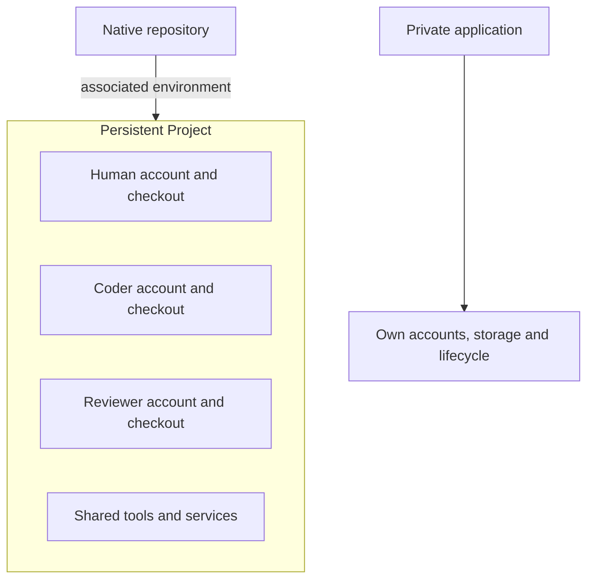

# Product model

SodaOS coordinates authorized Factory work on Forgejo repositories and provides persistent Projects for human and agent development within a trusted team's private appliance.

## The main parts

| Concept | What it means |
| --- | --- |
| Host | The machine running SodaOS: a Fedora CoreOS appliance or an operator-managed Linux host running Soda in Docker. Host administration covers services, storage and networking; Docker's outer host and Soda runtime have separate administration contexts. |
| [Native repository](../30-Projects-and-development/30-collaboration.md) | A Forgejo repository and its native issues, pull requests, reviews, checks and merge results. These records remain authoritative for collaboration and code delivery. |
| [Build request](../20-Factory/30-plan-new-work.md#describe-the-objective) | A person's saved direction for desired work, alternatives and decisions. It can exist before a repository is selected or any issue is created. |
| Accepted issue | Native repository work bound to authorized requirements and prerequisite outcomes. Qualifying human creation or validated generation from an accepted request can establish acceptance; other work needs explicit adoption. It can enter Factory readiness assessment under standing policy. |
| [Project](../30-Projects-and-development/10-projects-and-workspaces.md) | One persistent repository environment shared by joined humans and authorized Factory roles. It retains accounts, tools, files and services across ordinary stop/start. |
| Checkout or workspace | A person's or Factory assignment's working copy inside the Project. Sharing an environment does not mean sharing a writable checkout. |
| Attempt | A bounded effort to satisfy an accepted issue under recorded inputs, limits and outcomes. |
| Run | One supervised agent execution within an attempt, with its own identity, permitted work and recorded result. |
| [Session or view](../30-Projects-and-development/20-workspace-terminals.md#arrange-and-navigate-session-views) | A human terminal or Factory CLI execution is a session. Spaces is an authorized view of live sessions and work; it does not own the session's lifetime. |
| [Application](../50-Operate/40-private-applications.md) | A separately administered workload with its own identity and lifecycle. Developing or merging its source does not install or deploy it. |

## How the parts connect

A build request can be saved and revised before any issue or Project exists. Once exact native issue requirements and dependencies are accepted, Factory reassesses readiness and assigns eligible work inside the repository's persistent Project. A dependent issue waits for its declared prerequisite outcome: confirmed delivery to the stated branch for a code change, or the exact accepted result for research or content. Closing the prerequisite issue alone is not enough.

After confirmed delivery and original issue closure, Factory reassesses dependent work. For application outcomes, the Test Pilot checks the integrated version against approved outcomes and records its evidence. This verification answers a different question from whether an individual issue was delivered, and it does not install the application.

## How work is governed

Factory automation requires standing authorization from separate owners. A native repository owner or administrator controls repository policy, target branch, native actors and required checks. The configured Soda operator controls appliance capacity.

The owner of a supported provider account controls sponsorship and its allowance. Current native permissions still apply. One person may hold several responsibilities, but one grant does not imply another.

Once an issue's exact inputs are accepted through an authorized route, ready work proceeds automatically within those standing grants and limits. A material issue change, missing prerequisite, unavailable resource or changed permission can suspend affected work and trigger reassessment.

An agent can report a question or dependency; it cannot supply human authority, waive a blocker or grant itself additional access. See [Factory authorization](../40-Configure/20-factory-authorization.md) for grant ownership and [Issue work and dependencies](../20-Factory/40-issue-work-and-dependencies.md) for readiness and task outcomes.

Forgejo owns issue and pull-request records, reviews, native CI and merge. Soda records accepted inputs, coordinates production roles and reports observed effects. The roles include Product Lead, Architect, Builder, Inspector, Fixer, Strategist, Test Pilot and Researcher, plus a scoped Library Admin for reusable knowledge and decision records. Copywriting and other specialties guide expertise within these responsibilities. The Feed presents their reports and confirmed outcomes without replacing the native source records.

## Shared environment and trust boundary

Humans and Factory roles use the same persistent Project with separate accounts and checkouts. The Project is a development environment, not a disposable container created for each agent. Ending or cleaning up a run does not destroy or recreate the shared Project or remove unrelated work.

Projects have host-enforced boundaries but share the host Linux kernel. Soda is designed for a trusted private team, not hostile public multitenancy. Project membership, native repository access and host administration are separate permissions. Docker deployment has its own operator trust boundary; see [Docker](../60-Install/50-docker.md).

Project administrators with root or wheel access can read member files and
execution credentials inside that Project. Separate checkouts prevent accidental
working-tree overlap; they do not hide data from those administrators. Review
these grants when team ownership changes, using [People and access](../40-Configure/10-people-and-access.md).

Project Stop interrupts the shared development environment while retaining its state. A private application has its own lifecycle; it is outside the Project boundary shown here.

## CI and applications

Required verification comes from separately managed native Forgejo Actions capacity. Coding and review agents are not CI runners; a Builder checkpoint does not replace a required native check. See [CI runners](../40-Configure/40-ci-runners.md).

Factory can verify an integrated application version against approved outcomes, but verification does not install or deploy the application. An operator explicitly installs and administers a private application through its separate lifecycle. See [Application verification](../20-Factory/60-application-verification.md) and [Private applications](../50-Operate/40-private-applications.md).

For detailed human and provider identity, onboarding and credential custody, use [People and access](../40-Configure/10-people-and-access.md) and [Provider connections](50-provider-connections.md).
