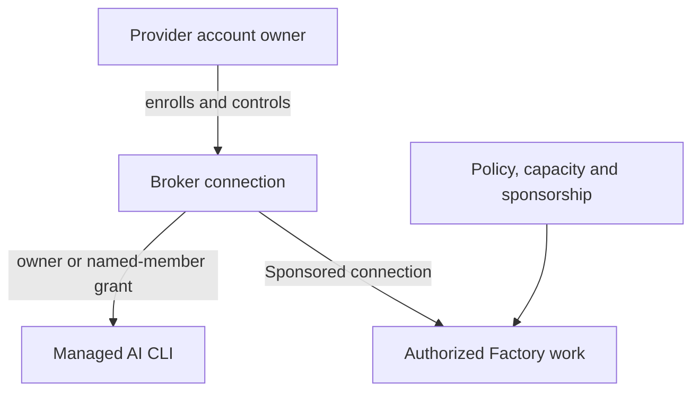

# Connect an AI provider account

Connect a supported subscription for managed AI tools, authorize named Project members when permitted, and inspect or end active use. Provider quota, delegation and Factory sponsorship have separate effects.

Provider connections are account-owned, encrypted broker records. Their owners control named-member delegation and Factory sponsorship; Forgejo sign-in, Project membership and the operator's appliance-capacity grant remain separate.

## Enroll or reconnect an account

Soda supports Codex ChatGPT and Muse Code subscription device sign-in. From a
signed-in page, choose **AI accounts** (the robot icon) in the navigation to
open the **AI accounts** dialog on the current page.
Choose the provider and complete its native device sign-in. Confirm its status
is **Connected**, rather than **Waiting for you**, before launching the
corresponding CLI.

When more than one authorized connection is available, select the intended connection for the run. If the provider rejects a credential or requires renewed sign-in, reconnect that account through the same controls.

```doc-visual
{
  "placeholder": "Connected provider status shown to its account owner without exposed sign-in material.",
  "caption": "The account owner checks provider connection status without displaying authentication details. Include a reconnect state only when it is present in the actual capture.",
  "alt": "Providers dialog showing the account owner’s provider connection status, with account identifiers and sign-in material obscured.",
  "production": {
    "method": "screenshot",
    "instructions": [
      "An authorized owner of the documentation test account opens the signed-in Project feed, uses the existing AI providers navigation control to open the actual Providers dialog, and reads status; use only accounts approved for documentation capture.",
      "Show one confirmed Connected provider and, only if present in the real test account, a previously enrolled provider that displays Reconnect. Do not start enrollment, click Connect, Reconnect, Disconnect, or expose a device code, sign-in URL, email, token, or provider profile detail.",
      "Capture at 1280x900 in the light theme and check status labels at narrow article width. Record the SodaOS and Fountain revisions and capture date in the asset notes; use the account owner’s approved test account and remove identifying account details from the final crop."
    ],
    "edits": [
      "Crop to the actual Providers dialog and its Connected or Reconnect status labels; obscure any displayed email, account label, sign-in URL, device code, or other identifying value without changing status wording.",
      "Keep the real provider names and controls intact, and do not add markers unless the caption explains each marker.",
      "Update the final caption and alt text to name only Connected and any Reconnect state actually visible in the finished image."
    ]
  }
}
```

## Delegate a subscription in one Project

Before delegating, confirm that the provider permits the selected member to use your subscription and that you trust code running under that member's Project account with the execution credential. Delegation is controlled credential exposure, not a provider-issued account for that member.

1. Open provider connection controls in the intended Project and select the connection you own.
2. Under **Delegate this subscription in this project**, select the named **Project member**.
3. Confirm both the provider-terms permission and credential-exposure acknowledgments, then choose **Authorize named member**.
4. Inspect the resulting grant for the intended user and Project. The member must also have current provisioned membership and repository execution authority; the grant does not create either.

The authorized member can use that subscription through managed tooling in the named Project. A grant for one member and Project does not authorize other members or other Projects. Follow [Connect and develop](../30-Projects-and-development/40-connect-and-develop.md) for personal CLI use and connection selection.

## Choose an account for personal Muse use

The connection owner is the person whose enrolled subscription supplies the credential. You can use your own authorized Muse connection or one explicitly delegated to you in the current Project. A connection's display label helps identify it; that label, the owner's name and the provider name are not its connection ID.

With exactly one ready, authorized Muse connection and no explicit selection, the normal `muse` command chooses that connection. Several eligible connections require an exact connection ID; Soda does not choose an arbitrary account. A selected connection must still be ready, belong to Muse and be authorized for your current Project account.

Use [Muse connection selection](../30-Projects-and-development/40-connect-and-develop.md#select-a-muse-connection-for-one-invocation) for the invocation syntax and [launch diagnostics](../30-Projects-and-development/40-connect-and-develop.md#diagnose-a-muse-launch-failure) to distinguish an ambiguous choice, denied authority, an unavailable launch service and rejected provider credentials.

## Understand subscription use and custody

Subscription limits and provider quota remain with the provider account. Soda-managed execution uses subscription authentication; an expired or rejected credential or exhausted subscription stops and explains the required action. Soda does not silently switch to API billing, another account, another provider or another authentication method. A managed CLI uses a connection and Project grant authorized for the requesting member.

The broker keeps credentials out of prompts and shared Project files, but the authorized tool receives the upstream account credential. Code running under that Project login can read or copy it; host administrators and Project root/wheel are also trusted. The provider sees the connected account. Soda cannot invalidate copied credentials, recall requests the provider already accepted, or restrict where authorized repository code sends data. Provider-side logout or revocation is a separate action.

Do not paste credentials into prompts, terminal transcripts, repositories or shared configuration. Ending one managed session does not terminate unrelated processes under the same Project account. Delegate only when these boundaries are acceptable.

| Provider | Active-use behavior | If a start cannot proceed |
| --- | --- | --- |
| Codex ChatGPT | One active stream per connection across enrollment and personal tools. Factory workers use Muse, not Codex. Detaching the browser leaves the managed session running. | A busy connection is temporarily unavailable; inspect active use and end the intended session before retrying. Busy does not mean rejected credentials. |
| Muse Code | Independent concurrent leases; ending one execution leaves other authorized executions running. | A rejected credential requires device reconnection. An ordinary tool failure alone does not establish an authentication failure. |

A Soda sponsorship allowance authorizes a bounded amount of Factory work; it does not increase upstream subscription quota. Provider limits can stop a run even when Soda allowance remains available.

An authorized connection supports the owner's or delegated member's managed CLI use. Factory work also requires repository policy, capacity granted by the configured Soda operator and sponsorship from the connection owner; enrollment alone does not authorize or fund it.



## Disconnect or revoke a connection

Select the connection and inspect its listed grants and active uses, including the actor and Project, before ending work. Use **Revoke delegate** for the named grant or **End active use** for the selected execution, then refresh and confirm the resulting state. Revoking a grant denies new use and retires its registered executions; ending active use alone does not revoke the member's grant.

If a connection needs attention, reconnect it using the provider's sign-in flow. To remove it, explicitly disconnect or revoke it in provider controls. Disconnect first denies new use and retires its managed executions; if retirement cannot be confirmed, the broker keeps the connection fenced from reuse until the outcome is reconciled.

Removing a grant can affect only the executions covered by that grant; it does not erase Project files. A rejected credential is a connection problem, while an ordinary CLI error is not proof that sign-in failed.

## Enable Factory use separately

Provider account enrollment does not authorize autonomous Factory work or pay its ongoing costs. The repository's Factory policy, appliance capacity and explicit sponsorship are configured separately in [Factory authorization](../40-Configure/20-factory-authorization.md). For human terminal and Project setup, provider connection is optional; see [First connection](40-first-connection.md).
