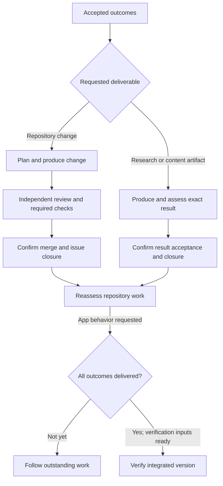
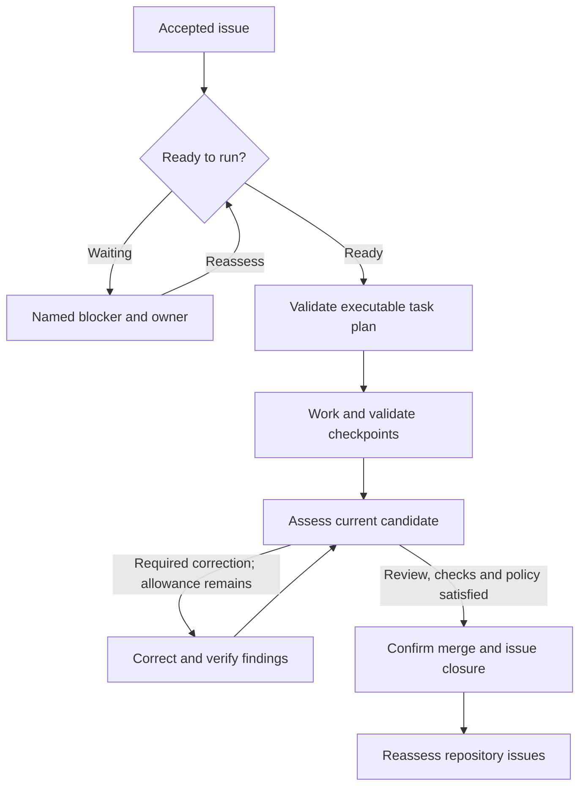

# Software factory

Soda Factory turns accepted objectives into code, copy, research and verified outcomes. Follow how work is planned, reviewed, delivered and checked against the original request.

## The complete work path

A Product Lead turns a request into outcomes, alternatives and the work needed
to deliver them. Work generated within an accepted intent keeps that intent's
exact scope and authority.

Verified native creation by a human with current code-write authority can
accept the original issue title and body under standing policy; imported,
outsider or otherwise unverified work needs explicit maintainer adoption.
[Factory authorization](../40-Configure/20-factory-authorization.md#authorize-repository-work)
explains these acceptance routes. Soda reads the native records, checks
readiness and reassesses work when accepted inputs, prerequisites or available
resources change.

[Plan new work](30-plan-new-work.md#compare-approaches-and-resolve-questions)
shows how to choose among existing work, already-satisfied outcomes, research,
clarification and a new approach before generating more work.

A missing requirement or prerequisite blocks only the affected work; waiting for a provider lease, Project preparation or capacity is reported as a resource wait. Eligible issues normally proceed under standing policy without manual per-issue admission or a required human merge.

Soda runs eligible work in the same persistent Project that joined humans use.
Assignments use separate coding or review checkouts and scoped credentials;
each role name does not require another Linux account. The Architect
investigates work that needs an executable plan, including task ownership,
lanes, checks and dependency relationships.

The Builder follows that plan, records outputs and submits them for trusted
observation and checks. Copywriting and documentation use the same production
and independent-review responsibilities, with expertise and checks matched to
the requested content. Independent ready tasks need not wait for an unrelated
prerequisite; a terminal task or checkpoint-check failure stops that run's
remaining children while preserving completed checkpoints. Researcher answers
bounded questions with sourced evidence; the exact accepted result returns to
dependent work for reassessment.

The Inspector reviews the exact candidate independently. If it finds a defect, the Fixer addresses the required findings and supplies evidence. The revised candidate receives a fresh review or an authorized assessment of the verified corrections.

Required native CI checks and repository protections apply to the exact current candidate. Changes to the candidate or accepted requirements invalidate evidence that no longer applies.

For repository changes, review, checks and policy permit the native merge and original issue closure. Standalone content and research use acceptance of their exact required result, without a synthetic pull request. Soda waits for confirmed effects: an uploaded artifact, pull request or worker report alone is not completion. Confirmed delivery triggers reassessment of current repository issues, including dependents, before new issue execution.

When the request includes integrated application behavior, Test Pilot checks the delivered version against the accepted outcomes and approved verification manifest. It records the exact version, fixtures and receipts, including uncovered or inconclusive outcomes. An empty queue or a set of merged issues does not establish that the whole requested behavior works. Plain content does not need an unrelated application test, and verified application completion remains separate from installing or deploying it.

The requested deliverable determines completion evidence. Repository copy needs an accepted source change; standalone text needs an accepted artifact; application behavior needs integrated verification. These outcomes do not authorize external publication or deployment.

One delivered issue can release a prerequisite without completing its whole
request. [Application verification](60-application-verification.md#verify-the-integrated-version)
waits for all accepted intent outcomes to have delivery evidence, reconciled
reassessment, current authority and the approved manifest, fixtures and resources.

## Follow one repository change

The path below follows an issue whose accepted outcome requires a source change.
The task plan and its checkpoints describe work inside the issue; independent
review and native delivery establish a later result.

At candidate assessment, an initial candidate needs an independent review.
A corrected candidate needs fresh review or permitted acceptance of its
verified corrections, plus current required checks. [Review and merge](50-review-and-merge.md)
owns those conditions and uncertain native effects; the correction loop cannot
spend beyond its remaining allowance.

[Issue work and dependencies](40-issue-work-and-dependencies.md) explains how
trusted task outputs release consumers. After delivery, reassessment includes
blocked and unaccepted repository issues as context, without granting them
execution authority. New issue execution waits for that reassessment to settle.
Use [Factory intervention](80-factory-intervention.md) for waits, pause/resume
and cancellation; these states preserve evidence and do not establish delivery.

## People and authority

Product Lead, Architect, Builder, Inspector, Fixer, Strategist, Test Pilot and Researcher carry distinct production responsibilities. Library Admin maintains reusable knowledge and decision records. Copywriting, frontend, security and other specialties guide expertise within those roles.

| Role | What to look for in its result |
| --- | --- |
| Product Lead | An assessable objective, alternatives, decisions and proposed work. |
| Architect | An executable plan with task ownership, prerequisites, outputs and checks. |
| Builder | The planned change or content, with task outputs and evidence. |
| Inspector | Independent findings or an explicit complete clear review. |
| Fixer | A disposition and supporting evidence for each required finding. |
| Researcher | Answers to the bounded questions, sources, limitations and unresolved evidence. |
| Strategist | A scoped reassessment or repair that preserves accepted outcomes and confirmed work. |
| Test Pilot | Observations covering the approved outcomes on one integrated application version. |
| Library Admin | Attributable maintenance of scoped knowledge and decision records. |

These are responsibilities used when the work needs them, not nine mandatory
stages for every request. A clean candidate needs no correction cycle; a
standalone writing task needs no unrelated application verification.

Role assignment does not add authority: repository policy controls native work and merge, the Soda operator controls appliance capacity, and the provider account owner controls sponsored model access. The people, credentials and limits behind those grants are described in [Factory authorization](../40-Configure/20-factory-authorization.md) and [provider connections](../10-Start-here/50-provider-connections.md).

The [Factory Feed](20-factory-feed.md) lets people follow activity, inspect evidence and answer questions. [Knowledge and decisions](70-knowledge-and-decisions.md) explains how to assess earlier evidence and authorized choices for reuse. [Intervention](80-factory-intervention.md) covers waits or interrupted runs that cannot safely continue automatically.

## Prepare the factory

Before work can run, a native repository owner or administrator enables its policy, the Soda operator makes bounded appliance capacity available, and a provider owner sponsors an eligible connection. Enroll provider accounts and set up the operator through [provider connections](../10-Start-here/50-provider-connections.md) and [operator setup](../60-Install/60-operator-setup.md).

Prepare the repository's persistent environment using [Prepare a Project](../40-Configure/30-prepare-project.md). Configure required checks through [CI runners](../40-Configure/40-ci-runners.md). These are separate responsibilities; success in one does not grant the others.
