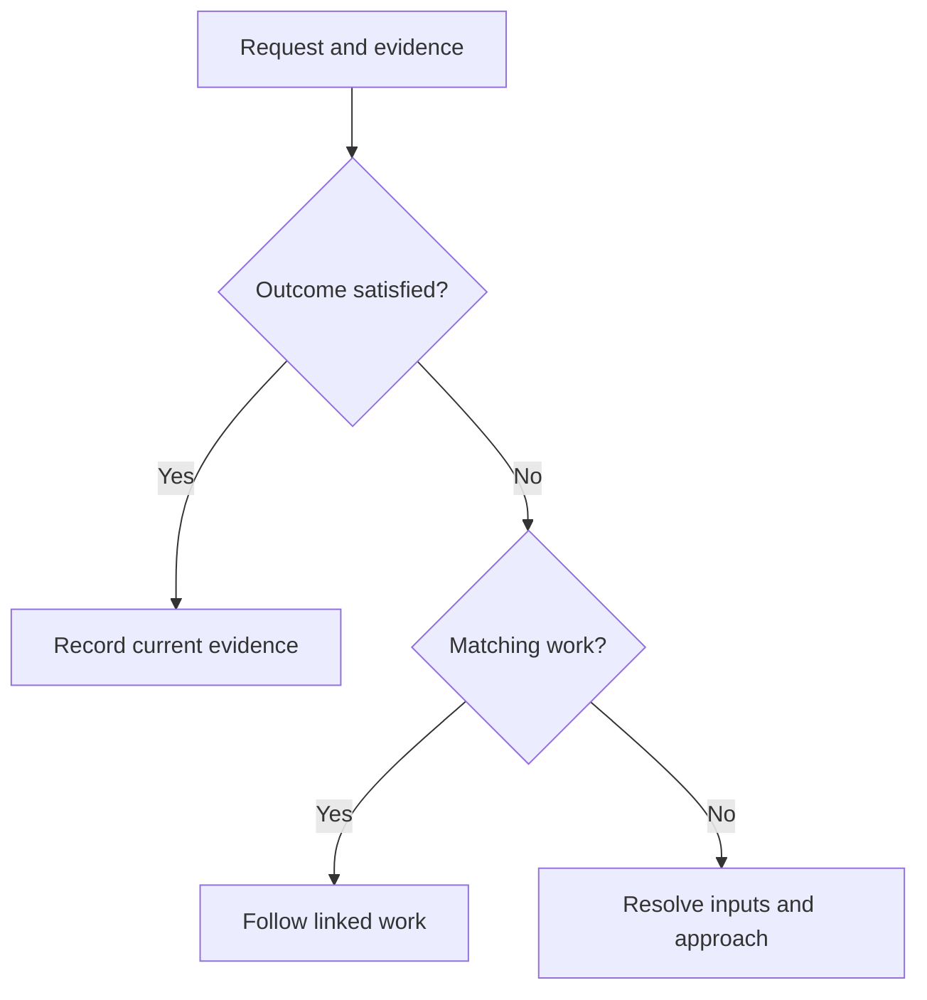
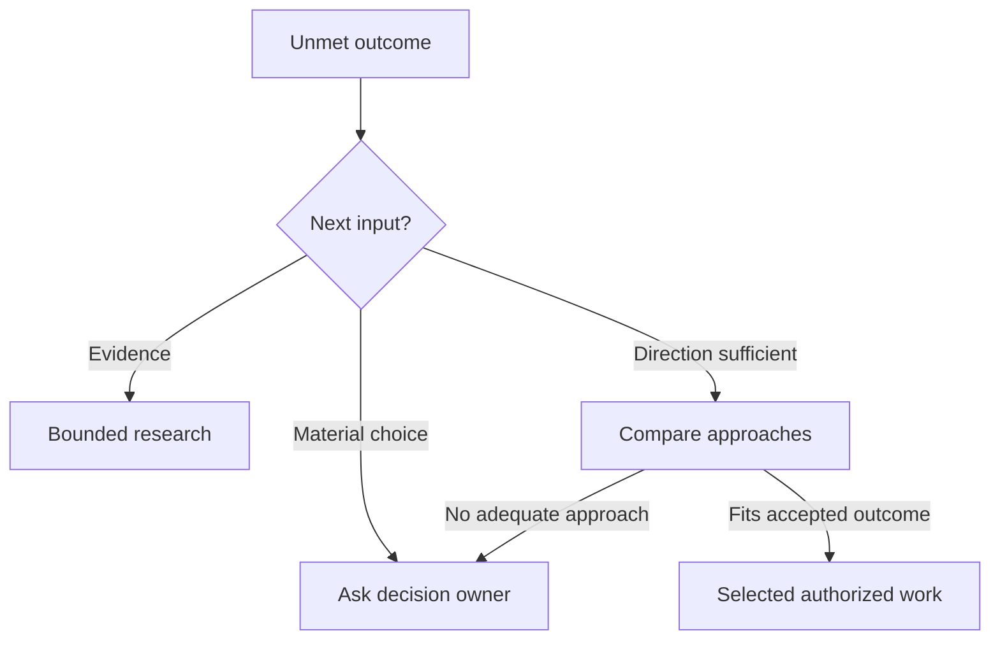

# Plan new work

Describe the outcome, resolve material questions and choose an approach before associating the request with a repository and generating native work.

## Before you begin

You can draft a direction before choosing a repository. To generate and run
repository work, use a repository with [Factory authorization](../40-Configure/20-factory-authorization.md),
a [prepared Project](../40-Configure/30-prepare-project.md), sponsored
provider access and the evidence required for its deliverable. Repository
changes need required [CI checks](../40-Configure/40-ci-runners.md); research and standalone
documents use their applicable evidence and acceptance route. The person
accepting the work needs current code-write authority.

If the selected repository has no Project yet, [create or reuse its
Project](../30-Projects-and-development/10-projects-and-workspaces.md#create-or-reuse-a-project)
and establish preparation before generated work can run. A setup or funding
wait leaves the saved request available; inspect that request's status instead
of starting another request for the same outcome.

## Describe the objective

Open **Workspace** and choose **New Project** to reach **What do you want to
build?** Enter the request there. This starts a direction; creating its Project
and joining remain separate actions.

Write the outcome in terms a teammate can assess: who needs what, why it matters and what observable behavior would satisfy the request. Add private department context only when it helps explain the request; that context belongs to its author and is not a repository policy or shared team instruction.

For a first request, use a small change in an existing application. This
fictional catalog example combines behavior and copy without adding a new
service:

> When a catalog search returns no matches, show a clear explanation and a
> Clear search button. Keep the entered query visible. Clear search removes
> only the search text; preserve other filters and existing access rules.

The accepted outcomes are observable: a no-match search retains its query and
shows useful text; clearing it restores the catalog under the other active
filters and the current user's access.
Include the existing page, relevant source or examples, and exclusions such as
“do not change search matching or permissions.” “Make search better” alone does
not identify a result the reviewer can assess.

Name the deliverable explicitly when you want something other than a repository
change. “Determine whether the existing behavior meets this condition” requests
a [sourced research answer](40-issue-work-and-dependencies.md#example-answer-a-research-question).
“Write a final tip for catalog readers” requests an
[accepted text artifact](40-issue-work-and-dependencies.md#example-deliver-a-standalone-catalog-tip).
Both need assessable criteria; neither request authorizes publication.

Use **Save draft** to keep the direction, or **Save and leave** to return later.
Only saved drafts survive reload; edits still in the form have not been saved.
Use **Saved requests → Resume** in the request view, or **Saved plans → Continue
planning** in Workspace, to reopen a draft. Accepted plans use **View progress**.
A saved request records its current alternatives and decisions; it does not
create accepted issues. If a submission response is uncertain, inspect the
original request and native effects before trying again.

Expand **Planning limits** to review **Maximum work items** and **Planning
calls**, then select **Explore ideas**. In **Review your product direction**,
read the proposed experience and answer the questions or work-linked choices
that need you. After changing the outcome or choices, select **Update proposal**
so the walkthrough and proposed work reflect the saved version.

The Product Lead can explore alternatives, compare tradeoffs and consolidate the experience into a recommended direction. A useful exploration preserves material questions, the evidence behind recommendations and choices attributed to their actual decision makers. Factual questions may be answered from accepted requirements or accessible repository evidence.

A consequential product choice requiring human intent or authority, a scope
change or a waiver remains with its authorized human decision owner. Routine
implementation choices within accepted direction and authority do not need
repeated human acceptance. Silence, confidence in a recommendation or a worker's
answer cannot supply missing authority.

Review the result before moving on. Confirm the intended audience, boundaries, success conditions and unresolved questions. If an answer changes the requested behavior or its authority, record the decision and revise the direction before generating work.

## Compare approaches and resolve questions

Alternatives compare materially different ways to satisfy the same objective.
Read their evidence, tradeoffs, required work and constraints together. Soda
retains the selected, rejected and deferred approaches with the decision and
any condition that would justify reconsidering it. It executes the selected
authorized work; comparing approaches does not start every implementation.

If none of the approaches fits, Soda records the missing clarification.
An unanswered question blocks its affected outcomes and their dependents,
while independent accepted work can continue. For example, choosing the
wording for a sign-up screen need not block an unrelated export fix; an
unsettled account-access rule does block copy and code that depend on that rule.

For the catalog example, compare an inline empty state with a separate results
page. Record the chosen approach and the evidence for it. The request already
settles the meaning of Clear search: remove only the search text and preserve
other filters. Without that decision, ask its owner before generating work
that depends on it.



Record an already-satisfied result only when current evidence establishes the
exact outcome. A link to matching open work shows where it will happen; it does
not establish delivery, so keep its outstanding outcomes visible. For a research
result, compare the accepted evidence with the exact required outcome: a
supported “no” can answer “is this possible?” but cannot meet a requirement for
the capability to exist. Inconclusive evidence leaves the outcome unresolved;
see [Issue work and dependencies](40-issue-work-and-dependencies.md) for the
full prerequisite distinctions.

Resolve missing evidence or material direction before selecting new work:



Use an accepted answer or research result to reassess the affected outcome and
its remaining work. Only selected work proceeds through normal readiness,
capacity and grant checks. Deferral, cancellation and supersession preserve their
existing effects and remaining unsatisfied outcomes rather than reporting
success.

Follow [Issue work and dependencies](40-issue-work-and-dependencies.md) for
research results, prerequisite reassessment and executable plans. Read the
[Factory Feed](20-factory-feed.md) for current evidence and questions, or use
[Factory intervention](80-factory-intervention.md) when a wait or explicit
recovery action needs an owner.

## Choose delivery and a repository

```doc-visual
{
  "placeholder": "Review a consolidated product direction and proposed outcomes before choosing a repository or creating work.",
  "caption": "The real product-direction review for a fictional public-safe sample request. Markers identify the desired outcome, decisions still needing attention, and proposed work; no repository or issues have been created.",
  "alt": "Product-direction review showing a sample request, its decisions and proposed outcomes before issue creation",
  "production": {
    "method": "screenshot",
    "instructions": [
      "On an approved Soda documentation instance, open the existing Workspace request and its actual Review your product direction stage. Use an already saved, attributable, fictional public-safe example about a small sample catalog; do not invent or render a substitute interface.",
      "Choose a review state with the desired outcome, settled decisions, any material unanswered question, and proposed work visible. Keep the repository unchosen and stop before Choose repository, issue generation, or any submission that creates native work.",
      "Use only an authorized documentation account and data approved for public release. Do not expose private department context, private URLs, personal details, credentials, tokens, device codes, cookies, or profile paths. If the approved instance has no suitable existing example, defer the capture rather than creating or exploring a paid request.",
      "Record the actual Soda and Fountain revisions and capture date in the asset notes. Capture the real screen at 1280 by 900 in the light theme, then check the labels at a mobile-width preview."
    ],
    "edits": [
      "Crop to the product-direction review while retaining enough Workspace context to identify the real screen, all relevant labels, and the visible proposed-work summary.",
      "Add at most three numbered rectangles to the outcome, decision/question state, and proposed-work summary. Keep markers sparse, preserve all interface text and control labels, and do not use color alone to distinguish states.",
      "Explain every marker in the caption and check the crop, contrast, labels, and alt text against the actual capture."
    ]
  }
}
```

Associate the request only when its direction is clear enough to assess against
the repository. [Factory authorization](../40-Configure/20-factory-authorization.md) owns its
standing policy and funding; [Prepare a Project](../40-Configure/30-prepare-project.md)
owns its shared environment and role readiness.

1. Review **Delivery approach**: **Complete first workflow** or **Verified milestones**. Correct it if needed. Soda settles routine implementation details within accepted scope; a consequential unresolved product choice goes to its owner.
2. Select **Choose repository**, search **Available repositories** and select the repository you own. The continuation control is **Continue**, **Open project** or **Inspect project**, depending on its Project state. Continuing saves the accepted direction to that repository and requests native work generation within its finite allowance. Project creation and Join remain explicit actions.
3. Inspect **Authorization and Factory work** for the saved direction's generation state; **Refresh status** rereads it. Read the proposed issues and confirmed native readback: titles and bodies, outcome coverage, dependencies and unresolved material decisions.

Confirmed native work is distinct from execution, which still needs its grants
and preparation. The native forge remains the editable source of issue content
and relationships; Soda records which exact revisions and decisions were
accepted.

## Confirm what was created

1. Confirm the issues and dependency relationships reported by the native readback. If submission times out or the reply is uncertain, inspect the original request and its native effects before trying again; the first operation may have succeeded without returning its response.
2. Ensure the exact objective has acceptance from current code-write authority through qualifying creation, validated intent generation or explicit adoption. An issue being present, reopened, labeled or merely commented on does not by itself authorize Factory work.

Changes to accepted title/body revisions, selected source comments or dependency
relationships require renewed acceptance and readiness assessment, subject to
the bounded generated-work rules in [Changes to accepted work](../40-Configure/20-factory-authorization.md#changes-to-accepted-work).
An unrelated discussion comment or reaction does not invalidate acceptance.
For how accepted issues become executable plans and dependencies are
reconsidered, see [Issue work and dependencies](40-issue-work-and-dependencies.md).

## Follow the example to completion

1. Open the generated native issue from the request's confirmed result. Check
   that it retains both catalog outcomes, the unchanged access rule and the
   chosen meaning of Clear search. Validated generated work inherits the exact
   accepted intent authority; it does not need another human approval per task.
2. Follow its [Feed](20-factory-feed.md). Open the executable plan to see the
   behavior, copy and integration tasks. A question shows what input is missing;
   a resource wait identifies its owner. Neither is a delivered result.
3. Inspect the linked pull request. Check its exact candidate, independent
   review and required check results as described in [Review and merge](50-review-and-merge.md).
   If an empty-state label is misleading, its correction remains tied to that
   candidate and accepted behavior.
4. Confirm the native merge and original issue closure. Then inspect the
   [integrated verification](60-application-verification.md#example-verify-a-catalog-empty-state)
   of the no-match and Clear search journeys. Both need evidence for the same
   delivered version.
5. Treat installation or deployment as a separate authorized action. A verified
   change does not start or replace a private application automatically.

Generated work has an initial aggregate allowance of 480 active minutes for the
originating intent, alongside tighter attempt and verification limits. Splitting
issues, revising the request or retrying does not refill it. If planning stops
for missing information or exhausted allowance, inspect the recorded result and
follow [Factory intervention](80-factory-intervention.md) before requesting more
work.
