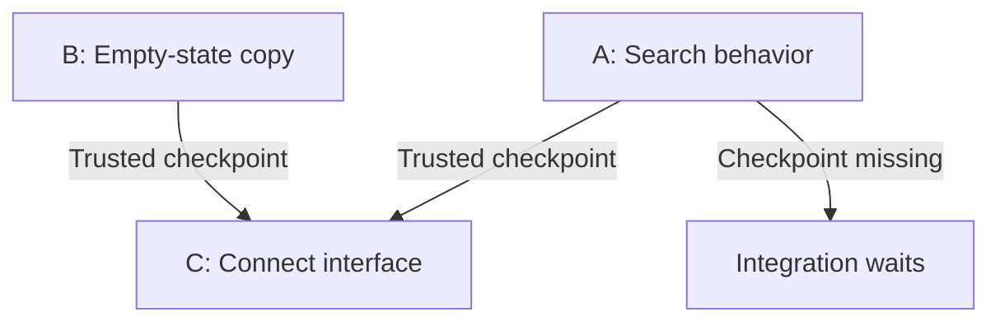
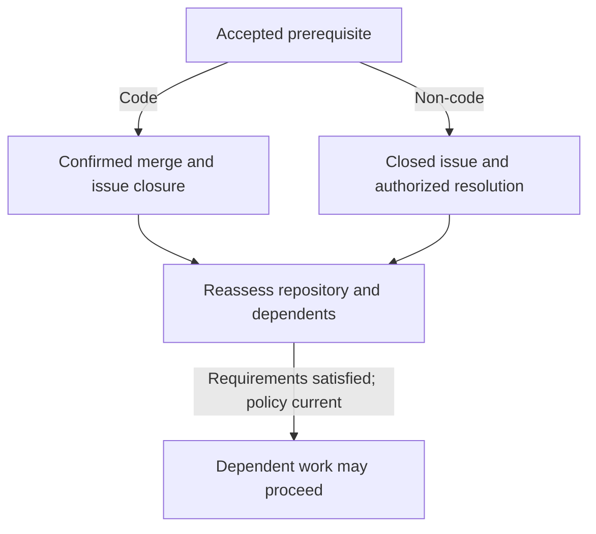

# Issue work and dependencies

Follow how accepted issues become code, content or research outcomes, how required evidence releases dependent work, and how changed inputs or unanswered questions affect progress.

## Match the issue to its outcome

An issue names what it must deliver, the expertise needed and how the result
will be accepted. Repository code, configuration and documentation use the
change-and-review route. Standalone copy uses an exact content artifact;
research uses a sourced report. Neither needs a synthetic commit or pull request.
A mixed issue retains each required outcome rather than treating its code
change as the whole result.

The acceptance route follows the deliverable. A submitted report or uploaded
artifact is available for assessment; it becomes completion evidence only after
the exact result is accepted under the issue's criteria and authority.

## From issue to executable plan

1. **Establish accepted issue inputs.** Qualifying human creation, validated generation from an accepted intent or explicit maintainer adoption establishes the exact authorized requirements. Labels, comments, agent confidence and reopening an issue do not supply acceptance.
2. **Plan the issue.** The Architect investigates accepted work and produces an executable task graph: work units and outcomes, responsible lanes, prerequisite edges, checks and expected outputs. It covers the accepted outcome without unrelated scope.
3. **Validate the plan.** The controller checks the graph against the issue and repository context before Builder execution. A submitted plan does not prove that tasks ran or outputs passed checks.
4. **Build and observe outputs.** The Builder works in the assigned checkout of the persistent Project and submits task outputs for trusted checkpointing. The controller validates the output and its planned checks before releasing dependent work; a worker's report alone is insufficient.

Changes to accepted title/body revisions, selected source comments or
dependency relationships suspend affected work until the changed input is
accepted and reassessed. [Factory authorization](../40-Configure/20-factory-authorization.md#changes-to-accepted-work)
owns the exact invalidation rules and bounded generated-work exception.

Independent ready tasks can progress without waiting for an unrelated
prerequisite; downstream tasks wait for the required result. A terminal task
failure or failed checkpoint verification stops new task admission and the
remaining children in that run, preserving completed checkpoints. Changed task
inputs, accepted requirements or prerequisite results require a fresh assessment.

### Example: two independent tasks and one consumer

For the [catalog request](30-plan-new-work.md#describe-the-objective), the plan
can separate behavior from wording, then join both outputs in the interface:

| Task | Required output | Waits for |
| --- | --- | --- |
| A — Handle no matching results | Search-state behavior preserves the query and restores the authorized catalog when cleared, with the planned checks. | Accepted behavior and access rules. |
| B — Write the empty-state copy | Final message and button text reviewed against the same accepted behavior. | The writing brief and product facts; not task A's implementation. |
| C — Connect the interface | The page uses A's state and B's text, with the approved interface checks. | The trusted task checkpoints for A and B. |



While A is still working, an independent ready B need not wait for it. C stays
blocked until trusted checkpoint evidence establishes both required outputs;
a worker's “done” message does not supply that evidence. If A reports terminal
failure or its exact output fails checkpoint verification, the run stops its
remaining children and preserves any completed B checkpoint for reassessment.
Task readiness does not promise simultaneous execution: available capacity and
the plan's ownership still apply.

Completing C establishes the planned task output. The issue still follows
independent review, required native checks and delivery; the whole request's
[application verification](60-application-verification.md) is a separate result.

### Provisional plans and queued work

An Architect can outline work before a prerequisite has produced its final
evidence. That provisional outline helps explain what is needed, but coding
requires a current executable plan with its necessary inputs resolved.

Eligible issues share the configured capacity. Priority considers the complete
eligible set, with a fairness preference for the oldest eligible candidate
waiting at least a day. This is not a start-time promise: missing authority,
preparation, prerequisites or capacity still prevents dispatch.

## Resolve prerequisites and research questions

Dependency edges name a required issue outcome. A code prerequisite needs the
required change confirmed merged to its stated target branch and the original
issue closed; merely closing the issue is insufficient.

For a non-code prerequisite, the issue must be closed, a maintainer must accept
the exact native resolution comment with supporting evidence, and the dependent
issue's approver must confirm that the result meets the declared prerequisite.
The Feed shows the blocker, owner and evidence needed; agents may identify
missing work but cannot waive or remove it.

Factory can route a question to bounded research rather than a code change. It creates or reuses follow-up work within the existing authorized allowance, releases or settles the blocked parent's execution slot, and returns accepted evidence to the parent for fresh context and reassessment.

| Research result | Meaning for the prerequisite |
| --- | --- |
| Supported positive answer | A supported “yes” can answer “does this service support export?” Accepted evidence must match the exact required outcome before dependent work is reassessed. |
| Negative | A supported “no” can complete a question such as “does this service support export?” It cannot supply a prerequisite that requires a working export capability. The dependent plan may need a different approach. |
| Inconclusive | Available evidence is insufficient to decide; the prerequisite remains unresolved. |

Submitting research and accepting its result are separate steps. Once the
required result is accepted, Factory reassesses the parent automatically;
there is no additional approval just to run that assessment.



Reassessment continues eligible dependent work under standing policy when its accepted requirements and prerequisites are satisfied. Research does not itself authorize a waiver or satisfy a declared outcome that remains unmet; a material decision goes to its authorized owner.

### Example: answer a research question

Use the fictional catalog from [Plan new work](30-plan-new-work.md#describe-the-objective).
Before requesting research, identify the source revision, the authorized
question and the available source and check evidence. This example uses an
existing check receipt for a supplied signed-in account and category fixture:

> At the named revision, does Clear search preserve the selected category in
> this supplied test case? Return the supporting sources, check receipt and
> limitations. Do not change the application.

1. **Inspect the evidence-bound report.** Researcher identifies the inspected
   revision, relevant source and matching fixture/check receipt. Confirm that
   these references support the reported observation; a general explanation or
   inaccessible source does not establish what this case did.
2. **Correct an overbroad conclusion.** “Clear search preserves every filter
   for every user” exceeds this evidence. The corrected report can say:
   “At the inspected revision, Clear search removed the query and preserved
   the selected category in the recorded fixture run. Other filters and
   account roles were not exercised.”
3. **Confirm the accepted result.** Inspect acceptance of the exact report and
   confirmed native issue closure. If another issue requires this answer as a
   prerequisite, its maintainer-accepted resolution comment must cite the
   evidence, and its dependent approver must confirm that the declared outcome
   is met. A submitted report or an issue closed without that acceptance is
   insufficient.

The accepted answer completes this bounded investigation. It does not implement
a missing capability or change the accepted product behavior. If the matching
receipt is unavailable, the report must identify that gap and remain
inconclusive for the runtime question; an assumption cannot replace observation.
Preserve a reusable finding with its scope and sources in
[Knowledge and decisions](70-knowledge-and-decisions.md#example-preserve-a-lesson-and-a-decision).

## Copywriting and documentation

Give a writing task an explicit brief: who will read it, what they need to
accomplish, where the text appears, the intended voice and terminology, and
which product facts must remain true. Include required sections, examples,
length or locale constraints when relevant. Copywriting is expertise applied
by the Builder and independent Inspector, rather than another approval role.

For example, “make setup friendlier” becomes an assessable task when it names
first-time operators, the existing setup page, the required permissions and
success check, and the commands whose behavior must be preserved. The Builder
rewrites the guide; the Inspector checks the exact changes, facts, links and
applicable examples. Repository delivery follows the normal review and merge
path.

For interface copy, check the affected rendered labels, accessible names and
error, empty or success states. For a requested standalone document, review
the final artifact against the brief. Neither route authorizes emailing,
publishing or deploying the result. See [Review and merge](50-review-and-merge.md)
for repository delivery and [Knowledge and decisions](70-knowledge-and-decisions.md)
for the source facts and decisions that writing must preserve.

### Example: deliver a standalone catalog tip

For the same fictional catalog, provide the accepted Clear search decision
and its supporting product facts before requesting final copy. The deliverable
is a Markdown artifact named `catalog-search-tip.md`, rather than an edit to a
repository file:

> Write a plain-language tip for catalog readers who see no matching results.
> Include a descriptive heading and 40–70 words of English body text. Explain
> what Clear search does, preserve the facts about other filters and account
> access, and give a useful next action. Return final Markdown; do not publish it.

A corrected final artifact could read:

```markdown
# Find catalog results

No matches means that no records visible to you match the current search and
filters. Select Clear search to remove the search text while keeping your other
filters. You still see only records your account can access. If the list remains
empty, review your remaining filters or try a different search.
```

1. **Follow production against the brief.** Builder applies writing expertise
   to the named audience, wording and accepted facts. Keep the exact brief and
   sources associated with the submitted artifact.
2. **Inspect independent review and correction.** Inspector checks the actual
   text for factual fidelity, required coverage, clarity and the word limit.
   An earlier draft saying “Clear search shows the entire catalog” needs
   correction because filters and permissions still apply. The final text
   above preserves those limits. A preference for a different heading is
   optional unless the accepted criteria require that change.
3. **Verify the final outcome.** Use the [Feed artifact](20-factory-feed.md#open-the-source-behind-a-post)
   to inspect the exact final version, its independent review and its recorded
   acceptance under the brief's authority. Confirm native issue closure.
   Previewing or downloading the file, an approving comment, or the review
   alone does not establish accepted delivery.

The result is an accepted piece of final copy. Routine wording needs no extra
human-editor gate; a changed product claim returns to its actual decision
owner. No synthetic commit, PR or application-verification run is needed for
this text artifact. Publishing or emailing it requires separate authority.
If the request instead names a repository handbook file, use the normal
[source review and merge route](50-review-and-merge.md).

## When work becomes stale or cannot proceed

An unreadable or incomplete prerequisite remains unresolved. A cycle stays
blocked until an authorized correction changes the native dependency graph.
Idle generated work may qualify for [bounded plan repair](80-factory-intervention.md#reconcile-uncertain-effects-and-bounded-repairs)
within its delegated scope; manually controlled or protected work remains with
its authorized owner. Agents cannot clear a blocker by declaring a dependency
waived.

If issue content or dependencies change during a run, Soda preserves the
observed work but stops publication and continuation that rely on stale inputs.

Reassessment determines which plans and evidence still apply. A failed task does not erase independent completed work, and it does not authorize a dependent task to use a missing result.

See [Review and merge](50-review-and-merge.md) for candidate evidence and delivery, and [Factory intervention](80-factory-intervention.md) when a run, allowance or external resource needs explicit action.
