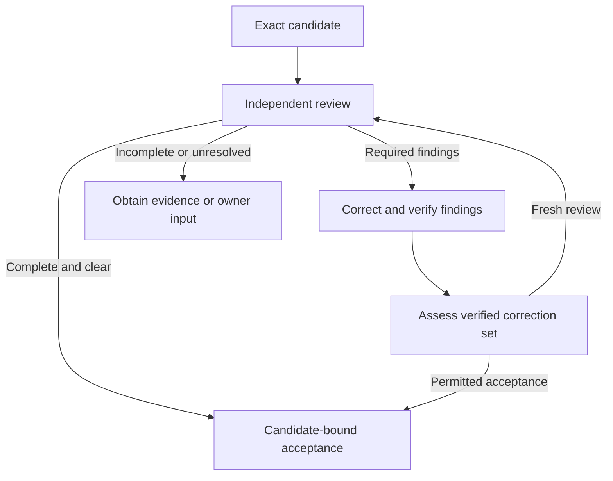

# Review and merge

Repository changes require current independent review, verified corrections, native checks and permission before Factory confirms merge and closure of the original issue.

## Inspect the candidate

Repository documentation and interface copy follow this source-change route.
For a report or final document delivered independently of repository files,
use the [research and standalone-content procedures](40-issue-work-and-dependencies.md#match-the-issue-to-its-outcome)
and their required acceptance evidence.

The Inspector receives the candidate and its relevant accepted requirements, changes, coverage obligations and existing findings. It reports concrete defects with impact and evidence, or explicitly records that the complete required review found no defects. An incomplete review does not count as clear. The Builder's own report is useful context but does not replace independent review.

```doc-visual
{
  "placeholder": "Inspect one native pull request with its exact candidate revision, independent review and required check evidence.",
  "caption": "A real native Forgejo pull request for a fictional public-safe sample repository. Markers connect the displayed head revision to its independent review and required check results; the screenshot does not imply that the pull request is merged.",
  "alt": "Forgejo pull request showing the head revision, independent review and required check results",
  "production": {
    "method": "screenshot",
    "instructions": [
      "In the approved Soda documentation instance, open Forgejo's native repository pull-request page for an existing fictional public-safe sample repository. Select a real, attributable candidate whose head revision, independent review and required check results are all visible; do not create a pull request or trigger a review or check for the screenshot.",
      "Use an authorized read-only documentation account. Capture a state before merge, with the exact head revision and target/base context, the independent review result or finding, and required native check evidence for that same candidate. Never merge, approve, rerun checks, or start paid Factory work to obtain the state.",
      "Use only public-safe sample code and repository data. Exclude private repository URLs, personal details, credentials, tokens, device codes, cookies, and profile paths. If no existing candidate shows the complete evidence, defer the capture rather than fabricating or changing a review state.",
      "Record the actual Soda and Fountain revisions and capture date in the asset notes. Capture the real screen at 1280 by 900 in the light theme, then check the labels at a mobile-width preview."
    ],
    "edits": [
      "Crop to the pull-request summary and the review/check evidence while retaining the native repository and pull-request context, exact head revision, and all relevant labels.",
      "Add at most three numbered rectangles linking the head revision, independent review, and required checks. Do not cover code, review text, status labels, or revision identifiers; do not use color alone to convey a result.",
      "Explain every marker in the caption and verify that the crop, label contrast, and alt text match the actual candidate shown."
    ]
  }
}
```

When required findings remain, a Fixer addresses the full required set and provides evidence for each disposition. A proposed fix is not accepted just because code changed. The revised candidate receives a fresh independent review, or an authorized assessment of verified corrections where policy permits.

Disputed findings remain visible until an independent decision resolves them. Optional advice can be declined with its rationale without disguising it as a required finding.

### Follow findings to their resolution

| Review result | What happens next |
| --- | --- |
| Complete independent review explicitly finds no defects | Its candidate-bound acceptance can proceed to required checks and native policy without another delivery judgment. Silence or an empty comment list is not this result. |
| Required defect, such as Clear search showing records the user cannot access | The Fixer addresses it and supplies evidence. Every required finding remains accounted for. |
| Corrected candidate | Fresh independent review or permitted System One acceptance of the verified correction set assesses the current head. A code change alone does not resolve the finding. |
| Optional wording suggestion | It can be accepted or declined with a reason. Preference does not become an invented requirement. |
| Disputed or repetitive feedback | The remaining risk and value of another pass are assessed within existing limits. A demonstrated unresolved defect cannot be waived. |

For the catalog example, “the message says the catalog is empty when only the
search has no matches” is a factual copy defect. “I prefer a shorter sentence”
can be optional if the accepted clarity and accessibility criteria already pass.
Keep that distinction visible in the finding and its disposition.



A clear review and an accepted correction set reach the same candidate-bound
acceptance; neither replaces required CI or native policy. All correction and
assessment remain within the existing limits. An actionable failed check can
also require correction, while missing runner capacity needs its resource
owner rather than a weaker check.

## Require current checks and policy

Inspect the candidate's exact head revision and target branch together with
the base against which it was verified. Required native Actions checks must
cover that same candidate and verified base. A changed candidate needs current
independent review or permitted verified-correction acceptance and fresh
required checks. A changed target base or required policy needs reassessment
and verification against the new state.

Changes to accepted requirements also suspend affected work until their
[acceptance is re-established](../40-Configure/20-factory-authorization.md#changes-to-accepted-work).
Earlier evidence remains historical; it cannot approve a different subject.

Repository protections remain effective. A Factory review cannot override a required check, current native permission, branch rule or merge restriction. The native repository owner or administrator controls these policies; external runner setup is described in [CI runners](../40-Configure/40-ci-runners.md).

If the branch requires an additional human approval, it still needs that
approval. A candidate cannot change the policy, credentials or verification
definitions used to approve itself through the automatic path; those changes
need separate administrator adoption.

```mermaid
stateDiagram-v2
    accTitle: Candidate eligibility and evidence freshness
    accDescr: This assessment ends at delivery eligibility, not confirmed delivery. Review and required checks apply to one exact candidate and target; relevant changes require reassessment and applicable fresh evidence before any native merge.
    state "Evidence current" as EvidenceCurrent
    state "Eligible for delivery" as DeliveryEligible
    [*] --> Candidate
    Candidate --> EvidenceCurrent: Review and checks current
    EvidenceCurrent --> Candidate: Relevant change
    EvidenceCurrent --> DeliveryEligible: Current policy permits delivery
    DeliveryEligible --> Candidate: Relevant change before merge
    DeliveryEligible --> [*]
```



The evidence-current state is tied to one candidate and target. This diagram
ends at eligibility for a native merge, not confirmed delivery. A relevant change
returns it for reassessment of the applicable evidence; delivery and any
uncertain native effect follow the confirmation rules below.

## Confirm delivery

When the evidence and policy permit, Factory performs the native merge using its authorized actor. It then confirms both the merged result and closure of the original issue through the native completion path. A created pull request, a submitted merge request, a closed issue without the required merged outcome, or a lost response is not confirmation. If an effect is uncertain, Factory reconciles that original operation before retrying so it does not duplicate native activity.

Confirmed delivery triggers reassessment of all current repository issues,
including dependents, before new issue execution. Reassessment does not grant
authority to unaccepted work. Whole-application verification remains separate:
the [Test Pilot](60-application-verification.md) checks an integrated intent
version once all its accepted outcomes have delivery evidence and its approved
verification inputs are ready.
