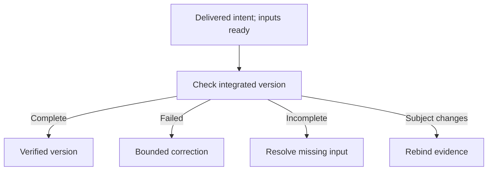

# Application verification

The Test Pilot verifies accepted outcomes against an approved manifest on the exact integrated application version, separately from issue delivery and deployment.

## Verify the integrated version

Verification begins when every accepted outcome for that intent has verified
delivery evidence, repository reassessment is reconciled, and the integrated
version, authority, approved manifest and required preparation are current.
Missing fixtures, resources or artifact identity leave an explicit wait.
Unrelated repository issues do not have to finish first.

1. **Inspect the verification subject.** Factory binds the integrated source or artifact identity, accepted outcome coverage, approved checks and journeys, prepared fixture identity and trusted check receipts for the requested intent.
2. **Read observations against that subject.** The Test Pilot records what each journey observed, which evidence supports the result and which accepted outcomes remain uncovered. Follow the linked [Feed evidence](20-factory-feed.md#open-the-source-behind-a-post) to inspect the result and its sources.

The result applies only to the tested version and conditions. If source, artifact, fixture or accepted outcomes change, earlier evidence remains historical and the changed subject needs applicable fresh evidence. A finished issue, merged pull request or empty queue cannot substitute for integrated verification. Likewise, passing a subset does not establish complete coverage.

## Example: verify a catalog empty state

Use the two outcomes from [Plan new work](30-plan-new-work.md#describe-the-objective).
The approved verification uses one integrated application version, a disposable
catalog fixture and an account with the fixture's declared access. The fixture
contains visible catalog records and a search query with no matches.

| Accepted outcome | Approved journey | Evidence to inspect |
| --- | --- | --- |
| A no-match search keeps the query and explains the empty result | Enter the declared no-match query and inspect the query field, result area and empty-state text. | The exact tested version and fixture, a successful check receipt, and observations covering the retained query and required text. |
| Clear search removes only the query, preserving other filters and access | Activate Clear search with another filter selected and inspect the returned records under the same account. | A successful check receipt and observations showing an empty query, the retained filter and only the permitted matching records. |

The checks and journeys belong to the approved manifest; this table is a
worked example, not a new manifest format. Test Pilot assesses their evidence
and outcome coverage. It does not improvise production data changes or weaken
the original request to make a check pass.

If the first journey passes but the second has no fixture or trusted receipt,
the request is incomplete. If the second runs and exposes a record the account
cannot access, it fails. Only current evidence for both outcomes supports a
verified result.

## Understand the outcome

| Result | What it establishes |
| --- | --- |
| Verified | Every required outcome has sufficient current evidence under the approved manifest. |
| Failed | The observed behavior and evidence identify an outcome for the responsible owner to assess for bounded correction. |
| Incomplete or inconclusive | Coverage, fixtures, infrastructure or evidence cannot support a conclusion; untested outcomes do not pass. |

A worker run marked **Succeeded** can still leave application verification
**Incomplete**. The worker finished its execution, but its report may identify
missing assertions or evidence. Read the application verification result and
outcome coverage before treating the accepted plan as verified.

After an authorized repair is delivered or missing inputs are restored, return
to the readiness check with current accepted inputs and the remaining shared
allowance. A changed pending subject needs applicable fresh evidence. If
correction or missing preparation cannot be resolved
within that authority, the result stays with its named owner; another pass is
not automatic permission to spend more. A verified result identifies one
integrated intent version and does not install or deploy it.

Missing preparation or an invalid fixture prevents a valid claim about the application behavior. A required check that fails before the Test Pilot can begin is reported as a Factory verification failure, not as an invented Test Pilot observation. Repairs and reruns remain bounded by their authorized allowances and must retain exact links to the failed outcome and tested delivery.

The initial verification allowance is two runs and 60 active minutes per stable
intent, with at most 30 active minutes per run. Retries and application-version changes share that allowance. A failure
can lead to a bounded funded repair and fresh verification; it does not reset
the allowance or make uncovered outcomes optional. If the allowance is
exhausted, follow the named owner and next action in [Factory intervention](80-factory-intervention.md).

To increase it, open **Project Work → My plans**, find the accepted plan and
expand **Verification limits**. The plan owner, with repository administrator
access, can change **Total verification runs** or **Total active minutes**, then
select **Increase verification limits**. Neither limit may decrease, and at
least one must increase. Existing usage stays charged: raising two runs to
three while keeping 60 minutes adds a run, not more time. Saving limits starts
no worker; an explicit Retry and current preparation, authority and funding
remain separate requirements. The per-run 30-minute cap still applies. See the
[verification contract](../../development/factory-workflow-contracts.md#d16--whole-app-verification-and-honest-completion)
for the owning limits and receipt rules.

Confirmed application completion is recorded separately from issue completion and from an application's installation or deployment. For candidate review and merge evidence, see [Review and merge](50-review-and-merge.md). For separately authorized private application administration, see [Private applications](../50-Operate/40-private-applications.md).
