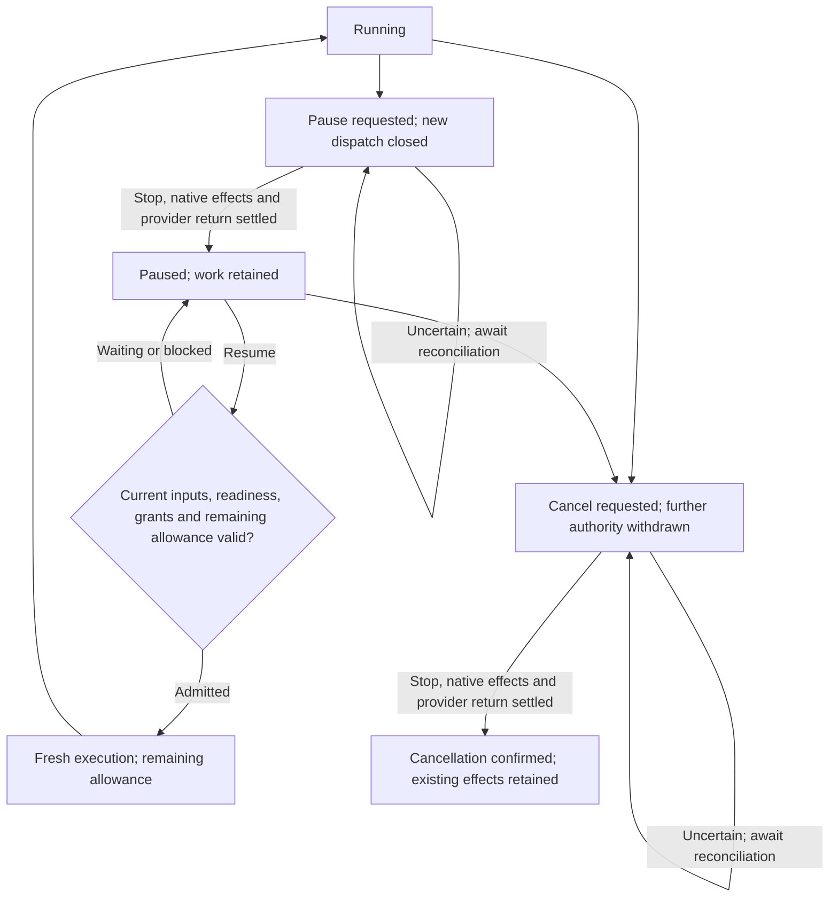

# Factory intervention

Factory intervention resolves blocked work, interrupted runs and uncertain effects through the responsible owner and a bounded explicit action, preserving shared Project state.

## Identify the actual blocker

Read the current work state and its owner before acting. A missing acceptance or unresolved requirement belongs with an authorized repository maintainer. A dependency needs its native prerequisite outcome or an authorized graph change.

An unprepared Project belongs with the Project preparation owner. Missing appliance capacity belongs with the Soda operator; an unavailable or exhausted sponsored account belongs with its provider owner. A required CI check that cannot run belongs with the repository's Forgejo Actions runner owner.

Factory distinguishes blocked objectives from resource waits and execution failures. The status identifies the observed cause, what is waiting, which limit remains and the next responsible owner. If evidence is stale or the cause is uncertain, reconcile or reassess the existing work before starting another attempt.

| Visible situation | Responsible owner | Next step |
| --- | --- | --- |
| Requirements or a consequential answer are unaccepted | Maintainer with current code-write authority or the actual product decision owner | Resolve the question and [accept the affected revisions](../40-Configure/20-factory-authorization.md#changes-to-accepted-work). Independent accepted outcomes can continue. |
| A required prerequisite result is missing | Prerequisite producer and the dependent issue's acceptance owner | Inspect the [named required outcome](40-issue-work-and-dependencies.md#resolve-prerequisites-and-research-questions). A closed issue without that result does not release the dependent. |
| Project preparation is unavailable or stale | Project preparation owner; administrator for shared prerequisites | [Restore the required tools/services and role readiness](../40-Configure/30-prepare-project.md#inspect-and-recover-preparation-failures) for the current inputs. |
| Provider connection is busy | Connection owner or current authorized user | Inspect active use; wait or end that use through its authorized control. Do not reconnect merely because the account is busy. |
| Provider quota or sponsored allowance is exhausted | Provider owner | Wait for the applicable window or an authorized allowance change. Rejected credentials require [reconnection](../10-Start-here/50-provider-connections.md#enroll-or-reconnect-an-account) instead. |
| Appliance capacity is unavailable | Soda operator | Wait for capacity or have the operator adjust the permitted allocation. |
| Required CI is missing or cannot run | Repository workflow or external runner owner | Inspect the native job and [restore its execution path](../40-Configure/40-ci-runners.md#read-check-results). A failed candidate check belongs to correction. |
| Attempt, intent, verification or repair allowance is exhausted | Owner of that allowance and work scope | Inspect consumed usage and the permitted retry or policy action; another issue or changed revision does not refill aggregate limits. |
| Merge, stop or another effect is uncertain | Factory reconciliation; authorized operator if intervention remains | Inspect the original operation and receipt before retrying. Preserve confirmed effects and retained work. |

Status and stop/reconcile commands support operator intervention; they are not required command steps in the normal automatic issue path.

## Choose the action that matches the situation

In **Workspace**, open **Saved plans** and select **View progress** for the
accepted plan. Find the affected issue's work details and intervention controls.
Read the target and scope printed beside each control before acting;
repository, run and whole-Project actions affect different work. **Refresh
detail** rereads the issue state. A disabled action's explanation identifies the
missing authority or unsettled condition.

| Visible control | Scope to confirm |
| --- | --- |
| **Pause Factory work** / **Resume Factory work** | The repository's Factory dispatch and outstanding runs. Human terminals remain separate. |
| **Stop run** | Only the named run. Stopping it does not by itself cancel all future work for its objective. |
| **Retry run** | An explicit retry of the named run's work after its previous execution settles. |
| **Take over run** | The named run's retained work into your own Project checkout; current Project membership is required. |
| **Stop Project for everyone** | The entire shared Project, including other people's services and terminals. Read the impact and activate it again only when you intend to confirm that shared stop. |

After an action, read its result beneath the control. **Requested; awaiting
confirmation** is pending. Confirmed retirement or takeover must be established
before replacement execution or human edits; an uncertain result keeps its
existing operation and resources fenced. Cancellation of the objective has the
broader authority effect described below and must be confirmed separately from
stopping one run or the shared Project.

| Action | Effect and required conditions |
| --- | --- |
| Pause | Closes further dispatch, stops assigned agents and preserves their work. |
| Resume | Revalidates accepted inputs, Project readiness and grants, then continues with the attempt's remaining allowance in fresh sessions. It does not resume an old CLI conversation. |
| Cancel | Withdraws further execution, publication and merge authority. |
| Retry | Starts a new bounded attempt only after the previous execution, native effects and credentials are accounted for. Its allowance does not erase earlier consumption or the provider's rolling usage. |
| Takeover | First stops assigned runs, settles credentials and establishes outstanding native operation outcomes. Once confirmed, an authorized maintainer who joined the Project receives retained work in a separate checkout and terminal. It never transfers a live agent terminal, credential home or provider lease. Returning work requires fresh assessment, review and checks. |

These actions have different consequences and should not be treated as synonyms. A provider grant withdrawal, repository permission change or operator stop can also prevent continuation. None of them removes already recorded evidence, authorizes an unverified merge or destroys the shared Project. Ordinary cleanup never recreates the Project to end a Factory run.

For example, pausing after 35 charged minutes of a 120-minute attempt leaves
85 minutes after confirmed stop. Resume uses that remainder in fresh sessions.
A permitted Retry creates a new attempt under current policy only after the old
execution is settled; earlier provider usage and applicable intent, verification
and repair consumption remain recorded.

Cancel requested and cancellation confirmed are different states. If a merge
committed before withdrawal took effect, that merge remains a confirmed effect.
Cancellation stops further authorized work; it does not undo delivery or mark
the remaining objective satisfied. Partial and superseded work retain their
outputs, unsatisfied outcomes and any replacement links.

The pending states below wait for confirmation of process retirement, native effects and provider return. Resume rechecks current eligibility; a readiness wait keeps the attempt paused and does not mark its objective complete.



## Reconcile uncertain effects and bounded repairs

When a response is lost or a process ends unexpectedly, Factory checks the original operation and its receipts to determine whether it committed, failed or remains uncertain. An uncertain native effect, process termination or provider lease return stays visible until reconciled; do not repeat the action or assume credentials have returned safely. Reconciliation settles the existing operation and does not revive the old execution or enlarge its allowance.

If a completed-work inventory reveals an unexplained stall, Factory can admit a bounded diagnosis and repair. The Strategist receives the affected dependency graph, protected work and remaining repair allowance, then proposes a scoped change for validation. A valid repair does not erase completed outcomes, active manual work or unrelated tasks.

New readiness is confirmed separately after the native effects are observed. If the diagnosis or repair allowance is exhausted, the Feed identifies the remaining owner and required decision.

Automatic stall recovery initially allows two cycles per progress episode,
with associated funding bounded at four investigations, four proposal judgments
and 120 active minutes in total. A split, retry or graph rewrite does not refill
those limits. Ordinary explained waits do not repeatedly launch diagnosis or
spend judgments merely because someone refreshes the Feed.

Whole-host service, storage or appliance recovery belongs to [Recovery](../50-Operate/80-recovery.md), not run intervention. For routine activity and evidence, see the [Factory Feed](20-factory-feed.md).

## Operator command support

An operator admitted by the private endpoint can inspect recorded runs, stop one
run or reconcile outstanding executions with the installed
`/usr/libexec/soda/soda-factory` command. On an appliance, run it from the root
host shell. For Docker, run it as root inside Soda's runtime, using the
[original Compose project's administration context](../50-Operate/20-administration.md#inspect-a-docker-deployment).
The configured Soda operator's Forgejo identity alone does not grant that OS
access. Replace `RUN_ID` with the recorded run and each command-ID placeholder
with a distinct identifier for that new action.

Status is a read. Stop retires the named run; reconcile retires outstanding executions and settles accounting, so it is a mutation rather than a passive refresh. These commands cannot admit, launch, retry or publish work, change policy or increase an allowance.

```sh
/usr/libexec/soda/soda-factory --socket /run/soda/operator/operator.sock status
/usr/libexec/soda/soda-factory --socket /run/soda/operator/operator.sock status RUN_ID
/usr/libexec/soda/soda-factory --socket /run/soda/operator/operator.sock \
  --command STOP_COMMAND_ID stop RUN_ID
/usr/libexec/soda/soda-factory --socket /run/soda/operator/operator.sock \
  --command RECONCILE_COMMAND_ID reconcile
```

Status returns recorded run metadata. Stop and reconcile report their recorded settlement outcome; unconfirmed process retirement, native effects or credential return remain fenced for intervention.

After a lost response, reuse the same command ID and payload to inspect its recorded outcome; do not create a new action to retry an uncertain one.
