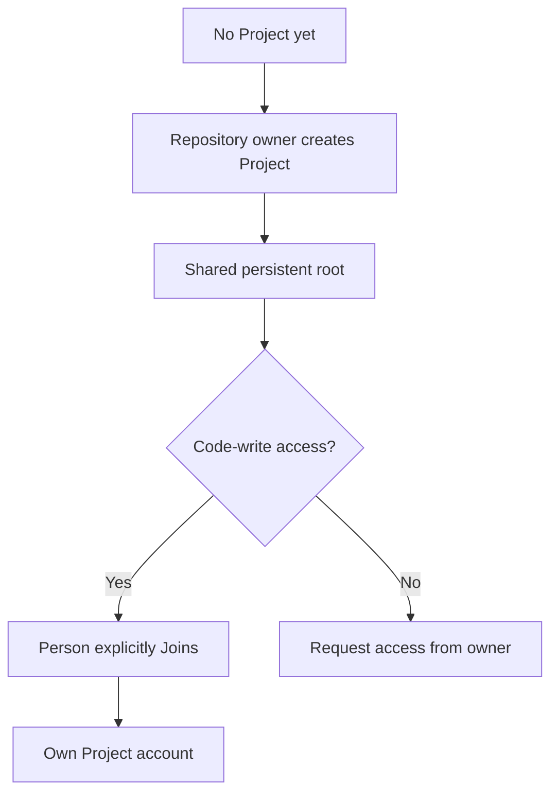

# Create and manage repository Projects

A Project is a repository's persistent shared development environment. People and Factory work use its Rocky headless root with separate Linux accounts, checkouts, and execution identities.

## Create or reuse a Project

The human owner of a repository creates its Project from that repository's settings. Organization-owned creation is unsupported. To create or confirm the environment:

1. Open settings for the intended repository and inspect its Project state.
2. If no Project exists, create one there. Creation reserves and starts the shared Rocky headless environment; it does not Join anyone, clone the repository, or enroll an AI provider.
3. If creation reports an uncertain result, return to the same repository settings and inspect the original reservation. Retry only after confirming no Project was created; do not create a second environment while the first result is unresolved.

When creation succeeds, the repository has one persistent Project available for explicit human Join and later Factory preparation.

## Join the Project

Each person joins with the native Forgejo account that will own their access. To join:

1. Sign in to Forgejo as that person and open the intended repository's Project. Confirm it is running; if stopped, ask its current owner or the configured Soda operator to [Start the retained Project](#start-and-stop-the-retained-root) before joining. Your account needs current native code-write permission.
2. Review access before submitting Join. For browser-only access, leave **Also install my saved public keys for external SSH** unchecked when it is shown. Select it only when you intend to install your saved public keys in this Project; no keys are installed when none are saved. A private key is never requested.
3. Choose **Join environment**, then confirm the resulting Project login and membership.

On success, the Project provisions that person's Linux account and records membership only after the native account operation succeeds. Account-only Join is supported, so browser development does not require SSH setup.



The diagram separates creating the shared root from granting each person access. [Start and Stop](#start-and-stop-the-retained-root) act on that same root; Start does not revive interrupted terminals or Factory work.

```doc-visual
{
  "placeholder": "Project Overview shows its running identity and the browser-only Join action for a write-authorized account.",
  "caption": "handbook-demo Overview: 1 the Rocky Project identity, 2 the Running state, and 3 Access: Not joined beside Join environment for the write-authorized account. Browser-only Join requires no SSH key.",
  "alt": "handbook-demo Project overview showing a running Rocky environment and visible Join environment action",
  "production": {
    "method": "screenshot",
    "instructions": [
      "Use an approved documentation instance with a real sample repository named handbook-demo and its already-created, running Rocky headless Project.",
      "Use the seeded sample account guide-writer with native repository code-write permission and no Project membership; keep its SSH-key selection empty and do not connect a provider.",
      "In Forgejo, navigate through the visible handbook-demo repository settings into Soda Project settings, then select the Overview tab; do not guess or type a deep route.",
      "Show the actual repository and Project identity, Running state, Access: Not joined status, and Join environment button; do not click Join or alter Project state.",
      "Record the actual SodaOS release, Fountain revision, and capture date in the repository asset notes without including host IDs or private instance details.",
      "Capture at 1280 by 900 in the light theme, then check that every label remains readable at a narrow viewport."
    ],
    "edits": [
      "Crop to retain the repository context, Project identity and state, Access status, and Join environment button; remove unrelated browser chrome only.",
      "Add at most three numbered markers: 1 for Project identity, 2 for Running state, and 3 for Not joined plus Join environment; explain all markers in the caption.",
      "Keep the real labels readable, do not rely on color alone, and verify the alt text against the final capture."
    ]
  }
}
```

A read-only repository grant, public visibility, prior membership, or Soda operator status does not grant execution access. If Join is denied, confirm current code-write permission with the repository owner and inspect whether this member has a Project access hold.

An explicit revocation hold requires the owner/operator's deliberate [access restoration](../40-Configure/10-people-and-access.md#restore-a-member-deliberately) before Join can succeed, even when repository write permission remains. Retry from the original Project after resolving the applicable restriction; do not create a second Project to work around it.

The Project keeps each member's original Linux login bound to their stable native identity. A native username change or repository transfer does not rename or remap the Linux account, file ownership, or installed SSH keys. Members have separate homes and checkouts, with shared tools, files, and explicitly assigned services in the common Project. See [Shared tools and files](50-shared-tools-and-files.md) and [Project services](60-project-services.md).

## Review administrative trust and ownership transfer

A Project is a trusted-team environment. Project root/wheel can read every member's home, files and credentials and inspect running processes. Separate Linux accounts protect ordinary peers; they do not isolate people from Project administrators or appliance root. Give root/wheel and nested-engine access only to trusted administrators.

When native repository ownership changes:

1. Review the new owner's repository permissions and lifecycle authority.
2. Have a trusted native Project administrator inspect existing wheel grants. Creation-time grants are not automatically reassigned or removed by a native transfer.
3. Review Project memberships and installed SSH keys independently; explicitly revoke departed members through [People and access](../40-Configure/10-people-and-access.md#review-access-when-roles-change).
4. Preserve each member's stable Linux identity, UID and file ownership. Do not rename or remap accounts to match a new repository owner or username.
5. Review provider sponsorship, accepted preparation and shared credentials before resuming affected work.

## Start and Stop the retained root

Only the configured Soda operator or current native repository owner, including organization ownership where applicable, can Start or Stop the Project. Membership, code-write permission and repository-administrator status alone do not grant lifecycle control.

Choose **Start** on the existing Project when its retained environment is stopped. It reuses the same root, homes, installed tools, files, and service volumes. Start does not revive a terminal process, Factory conversation, or prior credential lease; open a new session after the Project is running.

Start enables the retained Project for the next appliance boot. It does not clear separate Factory pauses or restore withdrawn provider sponsorship.

Before choosing **Stop**, coordinate with other users and allow Factory withdrawal to settle. Stop disables next-boot startup and affects every member: live terminals, SSH connections, and services are interrupted while persistent data remains. Read the confirmation with these shared effects in mind. To resume later, explicitly Start the same Project and open a new terminal or execution. A successful Start restores the environment, not the interrupted processes.

## Prepare for Factory work

Human Project creation and joining do not prepare a Factory checkout. Before Factory work begins, accept the repository's exact setup inputs, have an administrator inspect and provide shared prerequisites, and establish readiness for unprivileged coder and reviewer roles. Changed inputs invalidate affected readiness; maintenance holds pause affected work until checks run again. Follow [Prepare a Project for Factory work](../40-Configure/30-prepare-project.md).

Provider enrollment and Factory sponsorship are separate from Project setup. See [Provider connections](../10-Start-here/50-provider-connections.md) and [Factory authorization](../40-Configure/20-factory-authorization.md).
