# Use Workspace terminals for Project work

Workspace terminals give a joined Project member a browser shell in their own account. Use one for human development or debugging; opening it does not create a Project or admit Factory work.

## Open or reconnect to your terminal

Open a browser terminal from Workspace:

1. Join the intended repository Project using your native Forgejo account and confirm that it currently has code-write permission.
2. In Workspace, select that Project and choose **New terminal** for a fresh shell. If a chooser appears, review **Project** and **Terminal name**, then choose **Create terminal**. The full Workspace page can start the new terminal directly for its selected Project.
3. Confirm the resulting session is listed for your account and attached to the intended Project. Use **Rename terminal** in its **Terminal actions** menu to give it a recognizable name.

The terminal runs under your own Project-local Linux login. Browser development works without an SSH key or AI provider connection.

If the browser disconnects or the result is unclear, select the original terminal entry, confirm its Project and account, and choose **Reconnect terminal** when offered. Do not use **New terminal** to recover that shell. If the entry reports that the exact session ended, it cannot be reattached; choose **New terminal** only when you intend to start a different shell.

A terminal-support or maintenance error needs the host administrator's inspection of the retained Project. A sign-in or permission error needs the corresponding account or repository access corrected. Retry only after the original session state is clear.

```mermaid
stateDiagram-v2
    accTitle: Human Workspace terminal session lifecycle
    accDescr: Hiding or closing a joined member's terminal view leaves the session live; confirming End stops that terminal's supervised processes.
    state "Live, view attached" as Live
    state "Live, view detached" as DetachedView
    [*] --> Live: Joined member opens terminal
    Live --> DetachedView: Hide or close view
    DetachedView --> Live: Reconnect original session
    Live --> Ended: Confirm End
    DetachedView --> Ended: Confirm End
    Ended --> [*]
```



Hiding or closing a view detaches it but keeps the session available; splitting adds a view of the same session rather than another shell. Confirmed End stops that terminal's supervised processes; the ended session cannot be reattached, while Project files and independent services remain.

## Arrange and navigate session views

The terminal runs as your Project-local Linux login and keeps shell state in the Project. Select a session, split Workspace to add a view, or hide and show a view. Splits create views, not shells. Closing a tab or hiding the terminal detaches its view; reconnect through the retained session entry.

Use **Rename terminal** in the session actions to give the retained session a useful name, such as “README contribution”. Renaming identifies the same session; it does not create a shell or change its Project or account.

Native Forgejo navigation leaves the live terminal attached to its original Project and account, even while you browse another repository. A view does not change the session's owner or target.

```doc-visual
{
  "placeholder": "The persistent Workspace panel keeps your Project terminal attached beside a native Forgejo page.",
  "caption": "handbook-demo native repository page beside the retained Workspace panel: 1 the user's session tab, 2 its Project/account identity, and 3 pane split and terminal attachment controls.",
  "alt": "Native Forgejo page beside Workspace panel with the user's Project terminal, session tab, and pane controls",
  "production": {
    "method": "screenshot",
    "instructions": [
      "Use an approved documentation instance, the seeded guide-writer account, and that person's already-joined handbook-demo Project; show only this user's own managed terminal.",
      "Open Workspace through native Forgejo navigation, select handbook-demo, and open or reconnect the retained human terminal; then navigate to an ordinary handbook-demo repository page while keeping the Workspace panel expanded.",
      "In the panel, show the real terminal session tab and open its terminal actions menu so the displayed account and Project identity are visible; open the Pane ⌄ menu to show Split right or Split below without ending or replacing the session.",
      "Do not use a teammate's shell, display real work or secret output, or run a command/provider for capture. If an example prompt is needed, type pwd but do not submit it, and clear the line after capture.",
      "Record the actual SodaOS release, Fountain revision, and capture date in the repository asset notes without private URLs, host IDs, or credential profiles.",
      "Capture at 1280 by 900 in the light theme, retaining the native page and persistent panel together; check session and menu label readability at a narrow viewport."
    ],
    "edits": [
      "Crop to show enough native repository context and the expanded Workspace panel to establish that navigation did not detach the selected session.",
      "Add at most three numbered markers: 1 for the session tab, 2 for the displayed account/Project identity, and 3 for the pane split and attachment controls; explain each marker in the caption.",
      "Preserve actual control labels, never obscure the session identity, and do not rely on color alone; verify the alt text against the final capture."
    ]
  }
}
```

## Resolve unavailable terminal states

| Observation | Next action |
| --- | --- |
| Project stopped | Ask its current owner or the configured operator to Start the same Project, then open a new terminal. Old processes are not revived. |
| Support mismatch | Ask the appliance administrator for the supported same-root terminal maintenance operation. Signing in again does not repair support. |
| Inspection unavailable | Retry inspection of the same Project; ask the operator to inspect if it persists. Do not infer missing data or create a replacement. |
| Maintenance in progress | Wait for administrator completion or recovery of the existing maintenance operation. Do not bypass the admission hold. |
| Sign-in expired or native session changed | Sign in as the intended account or refresh the changed session, then inspect your original terminal entry. |
| Membership or repository permission denied | Confirm repository permission and any [Project access hold](../40-Configure/10-people-and-access.md#restore-a-member-deliberately) with the responsible owner; maintenance does not grant permission. |

A connection or support failure freezes input while preserving the original session locator and screen. Inspect that entry before retrying any action with an uncertain result; reconnecting never replays Create.

## Observe Factory work

Human session inventory is limited to your own sessions. Current code-write authority permits live observation of Factory sessions, but Factory controls determine pause, cancellation, or takeover. Watching a Factory session never gives you input into its process.

Ended runs expose their candidate, findings, status, and check evidence. Their terminals cannot be reattached, and there is no transcript replay. Use [Factory intervention](../20-Factory/80-factory-intervention.md) to take over or return work to the normal human workflow.

## End a human terminal

Save files and finish or deliberately stop in-process work before End. Unsaved editor buffers, shell state and running jobs in this terminal are lost when its supervised processes stop.

To end a managed human terminal, select **End** on that session and confirm only when you intend to stop its supervised processes. The confirmed End stops that terminal's processes but leaves files, independent SSH sessions, and Project services in place. Hide, close, and detach only change the view; they are not End.

For terminal-support repair, ask the host administrator to use [Project maintenance](../50-Operate/60-project-maintenance.md). You can develop entirely in the browser terminal without SSH keys or an AI provider connection. For an external editor or file transfer, follow [Connect and develop](40-connect-and-develop.md); for Project account lifecycle, see [Projects and workspaces](10-projects-and-workspaces.md).
