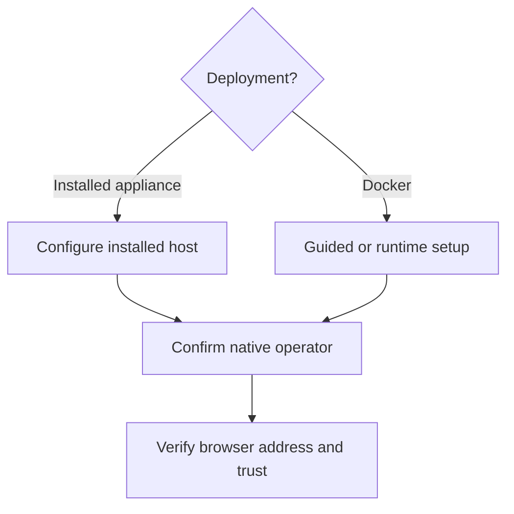

# Set up the operator

Bind Soda's operator role to the intended Forgejo administrator and activate private browser access. After setup, confirm the client trusts and can open the configured private origin.

The appliance operator is a specific native Forgejo user recorded during setup. Complete this one-time binding after the first installed boot so Soda can identify who may use protected operator controls and activate private browser access.

## Configure the appliance

On an appliance installed from ISO, sign in to the host as root using the password selected during disk installation. From the local console or a root SSH terminal, run:

```sh
/usr/libexec/soda/soda-install configure
```

This guided continuation is for the installed Fedora CoreOS appliance. It asks for a private address reachable by your client, guides the native Forgejo site administrator setup, and reads a `read:user` administrator token through hidden input. It records that user's stable Forgejo ID, revokes the bootstrap token after successful setup, and activates local HTTPS. If setup or activation reports an existing configuration or uncertain result, inspect the installed state before retrying; setup refuses to overwrite an existing operator binding.

## Configure Docker

Complete the released installer's guided browser enrollment, or use the lower-level path below from the deployment directory. This path requires a native Forgejo site administrator and the private address assigned to the Docker host and reachable by clients.

1. Forward Forgejo's loopback installer through your Docker host's existing SSH account. Replace `OPERATOR` and `DOCKER_HOST` below with your SSH account and Docker host, then run:

   ```sh
   ssh -N -L 33000:127.0.0.1:3000 OPERATOR@DOCKER_HOST
   ```

   Keep the SSH forward open while using `http://localhost:33000` in a browser. Complete native Forgejo installation and create a site-administrator access token with `read:user` scope. The token is entered only inside the runtime's root shell, never on a command line.

2. From the deployment directory, enter the runtime. Replace `PRIVATE_ADDRESS` below with the reachable private address assigned to the Docker host. Hidden input writes the token into a mode-restricted temporary file:

   ```sh
   docker compose exec soda bash
   set +x
   umask 077
   bootstrap_file=$(mktemp /run/soda-bootstrap.XXXXXX)
   IFS= read -r -s -p 'Forgejo administrator read:user token: ' bootstrap_token
   printf '\n'
   printf '%s\n' "$bootstrap_token" > "$bootstrap_file"
   unset bootstrap_token
   soda-setup --forgejo-url https://PRIVATE_ADDRESS --token-file "$bootstrap_file" && \
     rm -f -- "$bootstrap_file"
   ```

   Successful setup records the operator ID, revokes the bootstrap token and removes the temporary file. If setup reports uncertainty or existing configuration, preserve the file and state for inspection before retrying. Continue only after setup is confirmed successful.

3. Activate the same private address with local TLS:

   ```sh
   soda-activate --bind-ip PRIVATE_ADDRESS --local-tls
   exit
   ```

   Activation configures private HTTPS and exits the runtime shell. The released installer can perform this browser setup for you. The appliance `soda-install configure` command requires installed FCOS and does not run inside Docker.

## Understand operator authority

The configured operator must be a Forgejo site administrator when bootstrapping, but Forgejo administrator status alone does not grant Soda operator authority. Soda uses the recorded user ID. Browser activation does not enable Factory execution or fund provider use; those require separate account, repository-policy and capacity decisions in [Factory authorization](../40-Factory/20-factory-authorization.md).

The setup path depends on where Soda runs: the FCOS appliance uses its installed-host continuation, while Docker uses installer enrollment or lower-level commands inside the runtime. Both paths hand off to client certificate trust; Factory authorization remains separate.



## Trust and open the private browser address

When local TLS is enabled, setup displays the public root certificate's SHA-256 fingerprint. Transfer only the public certificate through a verified channel and compare its fingerprint before adding it to the intended client's trust store. Then open the configured private HTTPS address, sign in with the native Forgejo account and confirm the page loads. A running service or displayed address does not prove that the client can route to it or trusts its certificate.

Continue with [private networking and TLS](20-private-networking-and-tls.md) to configure and verify browser origin, Git advertisement and Project reachability. For ongoing administration and uncertain service state, see [Administration](../70-Operate/10-administration.md).
