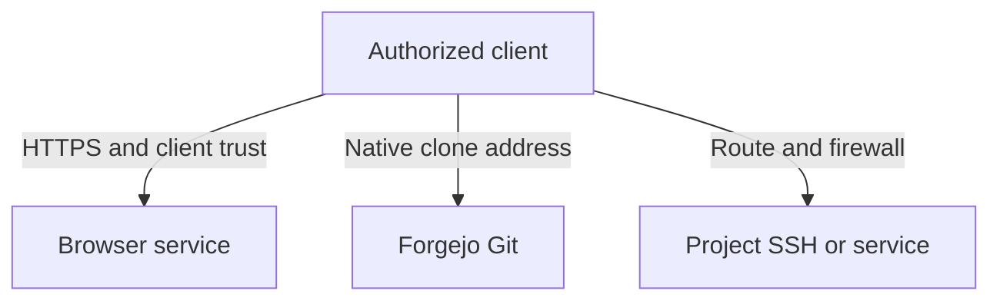

# Configure private networking and TLS

Configure the private browser origin, Git advertisement and Project subnet independently. Verify each required path and certificate from the client that will use it.

SodaOS serves browser and Git access on a private appliance address, while Projects use their own subnet and direct network access. Configure each address for its purpose and verify the route and TLS trust from the intended client.

## Set the browser origin and TLS

The browser origin is the HTTPS address clients open. It must resolve or be reachable at the configured listener, and the appliance certificate must be trusted by each client. You can use the local certificate created during activation or provide a certificate and key for a private hostname.

A purchased domain and public hosting are not required. For a private hostname, configure private DNS and ensure the certificate covers the hostname clients open.

## Configure Git advertisement

Forgejo's advertised Git endpoints are separate from the browser origin and listener. Configure the clone address users should receive, then verify it from a client using native Forgejo credentials. Changing the browser address does not automatically establish a working Git route. Native Forgejo SSH keys or HTTPS tokens authenticate Git; Soda development-access SSH keys have a different purpose.

## Route to the Project subnet

The Project subnet is a third network setting. Choose a private range that does not overlap the appliance LAN, VPN, Docker or other routed networks. Clients that need direct Project SSH or service ports require a route to this subnet.

Browser access and successful Git clone do not prove that Project addresses are reachable. Network routing and firewall policy remain operator responsibilities.

## Trust certificates and verify access

For a local certificate, use the public CA certificate and fingerprint produced by operator setup. Compare the fingerprint after transferring the certificate, then add it to the client's normal trust store. For a supplied certificate, install its matching certificate and private key through the supported operator activation procedure and protect the key as an operator secret. Do not send private keys to users or put them in shared files.

These are three separate client paths. A trusted browser origin does not prove the advertised Git address or Project subnet is reachable.

Verify each path from a real intended client: open the HTTPS browser origin and sign in; clone or fetch a repository using the advertised Git address; and, if required, connect to a Project address or service through its separately configured route. Diagnose name resolution, route, listener and certificate errors at the affected layer. A Tailnet enrollment or observed address alone does not prove reachability. [Optional Tailscale setup](60-tailscale.md) can add private routes, while [operator setup](10-operator-setup.md) owns the initial handoff.
