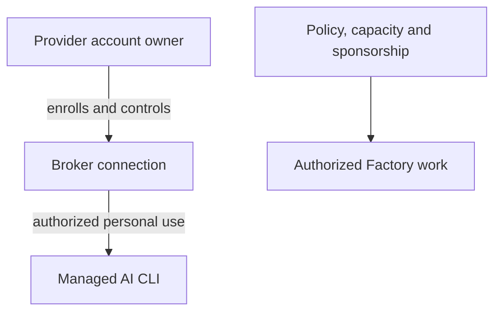

# Connect an AI provider account

Enroll a supported subscription account to authorize your personal managed AI CLI. The broker keeps that connection private to you; Factory policy and sponsorship remain separate.

Provider connections are personal, encrypted broker records; they are separate from Forgejo sign-in, Project membership and the operator's Factory sponsorship.

## Enroll or reconnect an account

Soda supports Codex ChatGPT and Muse Code subscription device sign-in. Open your provider connection controls, choose the provider and complete its native device sign-in. Confirm the connection appears as connected before launching the corresponding CLI.

When more than one authorized connection is available, select the intended connection for the run. If the provider rejects a credential or requires renewed sign-in, reconnect that account through the same controls.

```doc-visual
{
  "placeholder": "Connected provider status shown to its account owner without exposed sign-in material.",
  "caption": "The account owner checks provider connection status without displaying authentication details. Include a reconnect state only when it is present in the actual capture.",
  "alt": "Providers dialog showing the account owner’s provider connection status, with account identifiers and sign-in material obscured.",
  "production": {
    "method": "screenshot",
    "instructions": [
      "An authorized owner of the documentation test account opens the signed-in Project feed, uses the existing AI providers navigation control to open the actual Providers dialog, and reads status; use only accounts approved for documentation capture.",
      "Show one confirmed Connected provider and, only if present in the real test account, a previously enrolled provider that displays Reconnect. Do not start enrollment, click Connect, Reconnect, Disconnect, or expose a device code, sign-in URL, email, token, or provider profile detail.",
      "Capture at 1280x900 in the light theme and check status labels at narrow article width. Record the SodaOS and Fountain revisions and capture date in the asset notes; use the account owner’s approved test account and remove identifying account details from the final crop."
    ],
    "edits": [
      "Crop to the actual Providers dialog and its Connected or Reconnect status labels; obscure any displayed email, account label, sign-in URL, device code, or other identifying value without changing status wording.",
      "Keep the real provider names and controls intact, and do not add markers unless the caption explains each marker.",
      "Update the final caption and alt text to name only Connected and any Reconnect state actually visible in the finished image."
    ]
  }
}
```

## Understand subscription use and custody

Subscription limits and provider quota remain with the provider account. Soda-managed execution uses subscription authentication; an expired or rejected credential or exhausted subscription must stop and explain the required action. Soda does not silently switch to API billing, another account, another provider or another authentication method. A personal managed CLI may use only a connection and Project grant authorized to its owner.

The broker keeps credentials out of prompts and shared Project files. Do not paste credentials into a prompt, terminal transcript, repository, or shared configuration. The managed CLI receives a restricted execution credential for its authorized run; this does not give teammates your account or a credential they can use for a personal takeover.

The personal connection authorizes the account owner's managed CLI use. Factory work also requires separate repository policy, capacity and sponsorship; a personal connection alone does not authorize or fund it.



## Disconnect or revoke a connection

If a connection needs attention, reconnect it using the provider's sign-in flow. To remove it, explicitly disconnect or revoke it in provider controls. Disconnect first denies new use and retires its managed executions; if retirement cannot be confirmed, the broker keeps the connection fenced from reuse until the outcome is reconciled.

Removing a grant can affect only the executions covered by that grant; it does not erase Project files. A rejected credential is a connection problem, while an ordinary CLI error is not proof that sign-in failed.

## Enable Factory use separately

Provider account enrollment does not authorize autonomous Factory work or pay its ongoing costs. The repository's Factory policy, appliance capacity and explicit sponsorship are configured separately in [Factory authorization](../40-Factory/20-factory-authorization.md). For human terminal and Project setup, provider connection is optional; see [First connection](50-first-connection.md).
