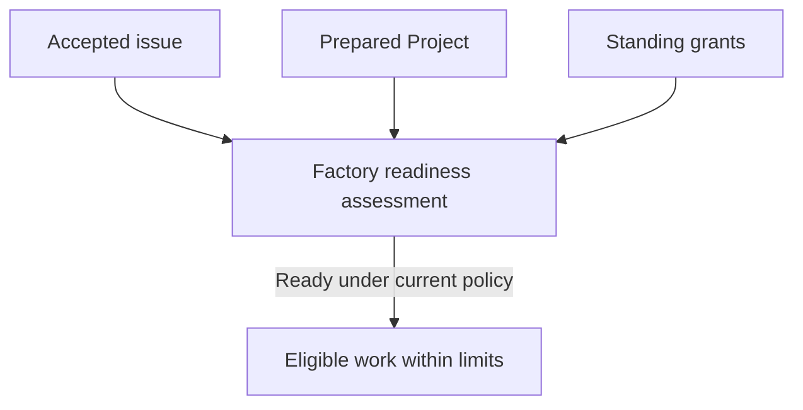

# Factory authorization

Factory work depends on repository policy, Soda appliance capacity and provider-account sponsorship, each authorized and funded by its own owner under a shared standing policy.

## Authorize repository work

Open the repository's Project settings and select **Factory**. The **Factory
authority** view shows current grants and missing setup. Use **Refresh current
authority** after another owner changes a grant. A disabled control or a
permission explanation identifies the authority needed for that action; having
access to the page does not grant every setting.

Before enabling repository policy, have the host administrator complete native
Factory enrollment inside the Soda runtime with the owners' selected native
actors, credentials and repository-operation bindings. Enrollment configures
the identity broker and repository issue-intake hooks; it does not create the
accounts or choose who pays for provider use. [Browser setup](../60-Install/60-operator-setup.md#understand-operator-authority)
is a separate prerequisite and does not enroll these actors. Host administrators
follow [Enroll native Factory operations](#enroll-native-factory-operations)
below before enabling dispatch or creating Factory issues.

A native repository owner or administrator selects the target branch, eligible role harnesses and models, merge method, native actors and repository limits. The policy also names a nonempty set of required native CI checks and the conditions that must hold before merge. Publication, review and merge use attributable native actors; they do not impersonate the issue author or the provider account owner.

In **Repository policy**, select the enrolled **Publisher**, **Pull request
creator**, **Reviewer**, **Thread resolver** and **Merger**, then review **Target branch
ref**, **Required checks (comma separated)**, harness/model selections and
attempt limits. Set **Intent active minutes** explicitly to fund intent planning;
zero leaves it unfunded. This limit is separate from planning calls, provider
allowances and application verification. Check **Enable automatic factory dispatch** when authorizing
automatic work and select **Save repository policy**. **Pause dispatch** keeps
the repository paused. Actor choices come from host enrollment and current
policy; the form offers them before a first policy exists. Saving a choice does
not replace the native permission and binding checks when work runs.

If the required native bindings are missing, ask the host administrator to
inspect enrollment before enabling dispatch. Repeating browser setup or
changing a provider connection does not supply those bindings.

Every issue is considered for readiness. Acceptance binds exact requirements and
prerequisite outcomes; it is established differently depending on where the work
came from.

| Work source | How its requirements become accepted |
| --- | --- |
| A human with current code-write authority creates a native issue under standing policy | Verified creation accepts that original title and body automatically. It does not approve unspecified prerequisites or all existing discussion. |
| Factory generates validated tasks from an already accepted intent | Confirmed native outputs are bound to that exact intent and its delegated scope. Each task does not need a new human approval. |
| An imported issue, outsider request, arbitrary agent-created issue or issue without verifiable creation evidence | A maintainer with current code-write authority explicitly adopts the exact requirements. Attribution or the issue's existence alone is insufficient. |

To adopt an existing issue or accept edited requirements, open its Project's
**Work** view and expand **Adopt or reaccept an issue**. Enter its **Native issue
number** and select **Open requirements review**. The same **Issue requirements**
controls appear in an issue's work detail.

1. Follow **Review issue … in the native forge** and inspect its current title,
   body and discussion. If particular comments supply requirements or approved
   resolutions, enter their native comment IDs in the corresponding fields.
   Leave these fields blank when no discussion is part of the requirements.
2. Select **Review current requirements**. Review the loaded body revision and
   selected comment links. For every direct prerequisite, confirm its
   repository ID, issue number and **Required outcome**. A code outcome uses
   that prerequisite's current accepted requirements; accept those first if
   they are missing or invalid.
3. Check **I reviewed the native issue, selected comments and prerequisite
   outcomes**, then select **Accept requirements** or **Accept revised
   requirements**. **Requirements accepted** confirms the recorded decision.

These controls require current repository code-write authority and a current
session. **Refresh acceptance authority** checks those permissions again. If
the issue or selected evidence changes, load a new preview and review it before
accepting. If a reply is unconfirmed, **Retry same acceptance** checks the same
decision without creating another acceptance command.

A comment reply, Project setup acceptance or reopened issue does not supply
this acceptance. Work that needs adoption waits until its current requirements
are accepted.

An accepted issue still needs a prepared Project, satisfied prerequisites and
current grants before it can run. Creating or reopening an issue does not bypass
those checks.

Comments, labels, author claims and repository instructions cannot enlarge Factory authority. The native forge continues to own issue, pull request, review, merge and check records.

### Changes to accepted work

An edit to an accepted title or body, including whitespace, invalidates that
accepted snapshot. Editing or deleting a selected requirement, question or
answer comment does the same. Adding, removing or recreating a dependency, or
changing its approved outcome, requires adoption of the revised relationship.
Restoring the old-looking text does not restore the earlier acceptance.

For example, changing “clear the search text” to “clear all filters” changes the
catalog request. Accept the revised behavior before its implementation continues.
An unrelated discussion comment or reaction does not silently change the
accepted task.

When a prerequisite delivers the already approved result, Factory reassesses
readiness automatically. A further human confirmation is unnecessary for an
attributable Factory code completion under its accepted inputs. Bounded
reassessment can also revise idle generated tasks within existing delegated
scope; that exception does not authorize arbitrary edits or a new product goal.

## Enroll native Factory operations

The host administrator performs this procedure inside the Soda runtime after
operator setup. On an appliance, use its root console or root SSH session. For
Docker, enter the runtime with `docker compose exec soda bash` from the
deployment directory. Pause dispatch and wait for active managed runs and
provider leases to retire before maintenance; enrollment restarts the broker
and dashboard.

### Prepare accounts and protected files

1. Sign in to native Forgejo as a site administrator. Under **Site
   Administration → User Accounts → Create User**, create separate
   nonadministrator publication, review, merge and issue-graph accounts. The
   publisher also creates pull requests. The reviewer also resolves review
   threads, using a separate token for each operation.
2. As each repository's owner, open **Settings → Collaborators**, add the
   selected service accounts and confirm **Write** access. Grant only the
   intended repositories. Native operation bindings do not replace these
   permissions.
3. Generate each service token with `read:user,read:issue,write:repository`.
   A browser-created token uses **All repositories** resource selection so
   `read:user` is available. Account permissions and exact bindings still
   constrain its repository authority. `write:repository` includes repository
   reads. Keep the Graph account separate from publication and review.

For native token generation, use a root shell with tracing disabled and a
private working directory. Replace the example account with your selected
nonadministrator account. The token is redirected to a file and never appears
in the command line or terminal output:

```sh
set +x
umask 077
enrollment_stage=$(mktemp -d /home/factory-enrollment.XXXXXX)
forgejo() {
  podman exec --user 1000 soda-forgejo /usr/local/bin/gitea \
    -c /data/gitea/conf/app.ini "$@"
}
forgejo admin user generate-access-token --username factory-publisher \
  --token-name soda-factory-publisher \
  --scopes read:user,read:issue,write:repository --raw \
  > "$enrollment_stage/publisher.pat"
```

Repeat with distinct token names for the following files. Generate the resolver
token on the review account. Prepare new files once; during maintenance inspect
and retain existing credentials instead of generating replacements.

| Input | Native account | Protected path | Owner and mode |
| --- | --- | --- | --- |
| Publisher and pull request creator | Publication account | `/etc/soda/factory/publisher.pat` | 2000:2000, 0600 |
| Review submission | Review account | `/etc/soda/factory/reviewer.pat` | 2000:2000, 0600 |
| Review thread resolution | Review account, separate token | `/etc/soda/factory/resolver.pat` | 2000:2000, 0600 |
| Merge | Merge account | `/etc/soda/factory/merger.pat` | 2000:2000, 0600 |
| Issue-graph work | Separate Graph account | `/etc/soda/factory/graph.pat` | 0:2000, 0640 |
| Hook administration | Existing repository owner or administrator | `/etc/soda/enrollment/native-hooks.pat` | 0:0, 0600 |

The hook-administration token needs `read:user,write:repository`; keep it outside
dashboard mounts. Prepare `/etc/soda/factory` as 2000:2000 mode 0700 and
`/etc/soda/enrollment` as 0:0 mode 0700. Use `install -m 0600 -o 2000 -g 2000`
to copy each service token from its private working file to the selected path;
use the table's separate ownership and mode for Graph and hook tokens. Do not
overwrite an existing file during first-time preparation.

Create the intake secret and publication directory once:

```sh
test ! -e /etc/soda/factory/intake.secret || exit 1
head -c 48 /dev/urandom | base64 > "$enrollment_stage/intake.secret"
install -m 0600 -o 2000 -g 2000 "$enrollment_stage/intake.secret" \
  /etc/soda/factory/intake.secret
install -d -m 0700 -o 2000 -g 2000 /var/lib/soda/dashboard/publication
```

The broker also requires its existing private database connection file,
base64-encoded 32-byte encryption key and complete admitted provider executable
pins. These belong to `soda-identity` (2001:2000); files are mode 0600,
executables mode 0700, and provider enrollment roots are private tmpfs
directories. Preserve an existing key, database and provider configuration when
adding repositories. Provider account sign-in is a separate owner action in
[Provider connections](../10-Start-here/50-provider-connections.md).

### Select IDs and apply enrollment

Read actor IDs with `forgejo admin user list` and the stable Soda installation
UUID with `forgejo extensions installation soda`. Token IDs are native record
identifiers, not token values. The host administrator can inspect only their
nonsecret metadata:

```sh
podman exec soda-postgres psql -U postgres -d forgejo -c '
  SELECT t.id AS token_id, t.uid AS actor_id, u.name AS account,
         u.is_admin, t.name AS token_name, t.scope
  FROM access_token t JOIN "user" u ON u.id = t.uid
  WHERE u.name IN ('\''factory-publisher'\'', '\''factory-reviewer'\'',
                   '\''factory-merger'\'', '\''factory-graph'\'')
  ORDER BY t.id;'
```

Write a root-owned mode-0600 `soda-factory-enrollment/v1` JSON manifest. Use the
current dashboard's operator ID and browser/native origins, the selected
repository's exact ID/owner/name, and each account's actual token IDs. This
example shows the required structure with illustrative IDs; replace them and
the disabled provider entries with your existing admitted provider settings.
Secret bytes never enter the manifest.

```json
{
  "format": "soda-factory-enrollment/v1",
  "bindings": {
    "installation_id": "550e8400-e29b-41d4-a716-446655440000",
    "operations": [
      {"token_id": 101, "actor_id": 42, "repository_id": 7, "kind": "git.ref.publish"},
      {"token_id": 101, "actor_id": 42, "repository_id": 7, "kind": "pull_request.create"},
      {"token_id": 102, "actor_id": 43, "repository_id": 7, "kind": "pull_request.review.submit"},
      {"token_id": 103, "actor_id": 43, "repository_id": 7, "kind": "pull_request.review.thread.resolve"},
      {"token_id": 104, "actor_id": 44, "repository_id": 7, "kind": "pull_request.merge"},
      {"token_id": 105, "actor_id": 45, "repository_id": 7, "kind": "issue.graph.mutate"}
    ]
  },
  "hooks": {
    "token_file": "/etc/soda/enrollment/native-hooks.pat",
    "repositories": [{"repository_id": 7, "owner": "repository-owner", "name": "project"}]
  },
  "target": {
    "dashboard_config": "/etc/soda/dashboard.json",
    "identity_config": "/etc/soda/identity.json",
    "operator_id": 1,
    "forgejo_url": "https://forgejo.example.test",
    "forgejo_internal_url": "http://127.0.0.1:3000"
  },
  "dashboard": {
    "forgejo_background_socket": "/ipc/host.sock",
    "forgejo_background_host_uid": 1000,
    "forgejo_background_credential_file": "/etc/soda/factory/publisher.pat",
    "forgejo_review_credential_file": "/etc/soda/factory/reviewer.pat",
    "forgejo_resolve_credential_file": "/etc/soda/factory/resolver.pat",
    "forgejo_merge_credential_file": "/etc/soda/factory/merger.pat",
    "factory_intake_secret_file": "/etc/soda/factory/intake.secret",
    "factory_publication_root": "/var/lib/soda/dashboard/publication"
  },
  "identity": {
    "database_dsn_file": "/home/soda-identity/soda.dsn",
    "key_file": "/home/soda-identity/key",
    "admin_socket": "/run/soda/identity/admin.sock",
    "runtime_socket": "/run/soda/identity/runtime.sock",
    "host_socket": "/run/soda/host/host.sock",
    "codex": {"binary": "", "version": "", "sha256": "", "root": ""},
    "muse": {"binary": "", "version": "", "sha256": "", "root": ""}
  }
}
```

For Graph work, set both `forgejo_graph_credential_file` and
`forgejo_graph_actor_id` in the protected dashboard configuration to the Graph
PAT path and its actual native owner ID. Enrollment preserves this pair and
existing optional credential references. Graph bindings remain separate from
the five policy actor choices. A Graph token added to a running installation
needs the existing dashboard credential context:

```sh
chcon --reference=/etc/soda/factory/publisher.pat /etc/soda/factory/graph.pat
```

Run enrollment only after reviewing those inputs:

```sh
/usr/bin/soda-setup --factory-enrollment-file /etc/soda/factory-enrollment.json
```

If the broker configuration already exists, add `--maintenance` after reviewing
its preserved identity inputs. Include every repository already recorded in
the existing hook receipt. The command confirms native credential owners,
reconciles the exact operation bindings, and creates or updates only its owned
repository issue-intake hooks. Complete this before creating Factory issues so
original creation facts are retained.

### Confirm success or recover the same enrollment

Confirm the selected tuples with `forgejo extensions bindings --installation
INSTALLATION_UUID`. The five policy actor choices appear after refreshing
Factory authority. Verify the broker, dashboard, Forgejo and host services are
active, then confirm normal browser access. The root-only
`/etc/soda/enrollment/hooks.json` receipt identifies the enrolled repositories
and hook IDs. Retain it with the matching intake secret.

On failure, inspect the reported cause and current service state. Setup restores
the prior local configuration and attempts service recovery; native bindings
already added remain. Continue the same selection with `--maintenance` after
resolving the cause. Keep the existing token files and hook receipt. An unowned
or mismatched hook is preserved and refused; establish ownership before another
mutation. Forgejo omits hook secrets from reads, so the successful authenticated
secret update confirms installation while public-field readback confirms the
hook identity and destination. Enrollment does not enable policy, sponsor a
provider account or replace the grants below.

## Provide appliance capacity and sponsorship

The configured Soda operator authorizes bounded appliance resources and concurrency. This permits eligible work to use capacity; it does not grant repository write access or merge authority. The provider-account owner separately selects and sponsors a supported connection for the repository's roles and sets its usage allowance. Account enrollment, personal connections and credential custody are covered in [Provider connections](../10-Start-here/50-provider-connections.md).

Each owner records their part in **Factory authority**:

1. The Soda operator sets **Concurrent runs** and **Queued runs** under **Appliance capacity**, then selects **Save capacity**. Under **Project grants**, set the repository's **Operator concurrent limit**, enable **Active operator grant** and select **Save operator grant**.
2. The current repository owner enables **Permit factory Project setup** and selects **Save Project grant**. Follow [Prepare a Project](30-prepare-project.md) for exact-source acceptance, operational approval and separate role readiness.
3. The provider owner chooses **Provider connection** under **Provider allowance and sponsorship**. Review **Rolling minutes** and select **Save connection budget** for that connection's rolling allowance across repositories.
4. For that connection, select its current **Project access** grant, permitted roles, **Allowance minutes** and **Concurrent sessions**. Enable **Allow Factory to use this account** and select **Save sponsorship** for this repository.
5. Select **Refresh current authority** and inspect **Factory is ready** or **Factory needs setup**, the missing-grant actions and whether **Dispatch** is open. A saved policy or sponsorship alone does not establish complete readiness, and readiness does not prove that an issue has run.

Each grant has its own scope, owner and limit. Repository attempts have bounded execution and correction effort; integrated verification has its own intent allowance; appliance capacity and provider usage have separate constraints. A limit reached in one area does not grant more of another. The Feed and status show whether work waits on authorization, preparation, capacity or sponsorship.



The diagram shows independent prerequisites: no single owner can supply another owner's grant, and the standing grants do not remove issue acceptance or Project preparation.

## Understand the initial limits

These are initial configurable defaults. The responsible owner can lower a
grant or authorize an increase where supported; the tightest applicable limit
wins. Concurrent attempts within one repository are outside this operating
model. Host CPU, memory and storage allocations are set for the actual appliance.

| Limit | Initial value |
| --- | --- |
| Active issues across the appliance | 2 |
| Active attempts / executing Factory sessions per repository | 1 / 1 |
| Cumulative active time per attempt | 120 minutes |
| Correction-and-reverification cycles after the initial candidate | At most 3 |
| Leased Factory session time per provider connection, across repositories | 6 hours per rolling 24 hours |
| Automatic usage-billed spending or overages | Zero |
| Aggregate active time for work from one originating intent | 480 minutes |
| Integrated verification per stable intent | 2 runs / 60 active minutes |

The attempt clock includes assessment, coding, correction, review and CI waits
after activation. Queued, blocked and paused time is excluded only after agents
are confirmed stopped. A resumed attempt uses its remaining allowance in fresh
sessions.

Provider accounting measures leased Factory session time until assigned
processes stop. Overlapping leases add together. Upstream subscription quotas
are separate and can also be consumed by personal CLI use. These time limits
are not token counts or currency estimates.

For example, an active attempt waiting for CI can consume attempt time even
after its agent has stopped using a provider lease. An issue queued for that
provider does not occupy an active slot. A retry starts a new permitted attempt
but retains prior usage and applicable intent, provider and repair limits.

Planning judgments also stay within their explicit workflow allowances; there
is no operator-wide lifetime JEV ceiling. [Application verification](../20-Factory/60-application-verification.md)
owns verification results, and [Factory intervention](../20-Factory/80-factory-intervention.md)
explains repair limits and how to resolve an exhausted allowance.

## Keep policy current

Changes to repository policy, provider sponsorship, appliance capacity or current native permissions can stop or invalidate affected work. Reassessment uses the current accepted issue and grants before continuing. The Soda operator can stop appliance execution but cannot authorize native repository policy or enlarge a provider owner's allowance.

A provider owner can withdraw sponsorship but cannot authorize a merge. A native repository owner or administrator can change repository policy but cannot enlarge host capacity. Code-write authority to accept an issue does not itself grant policy administration.

For normal work, these standing grants let accepted eligible issues proceed without manual admission of each issue. When a grant is missing, expired or exhausted, Factory reports the owner and next action rather than treating the issue as ready. See [Factory intervention](../20-Factory/80-factory-intervention.md) for resolving a specific wait.
