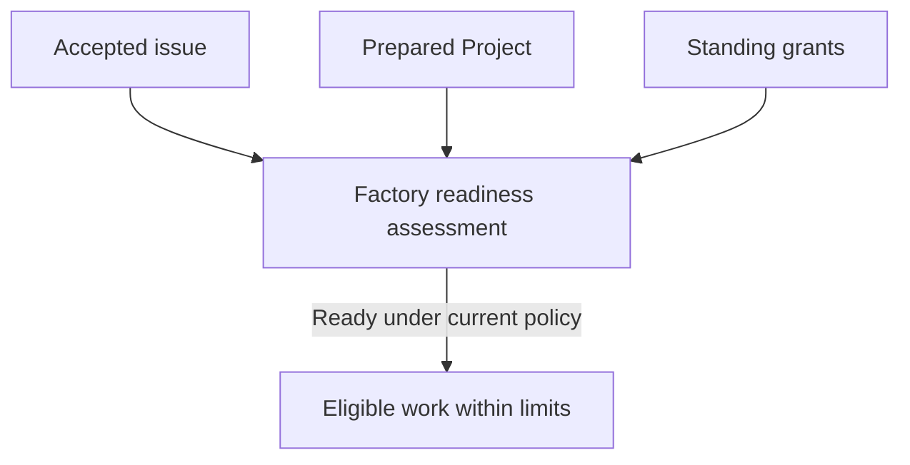

# Factory authorization

Factory work depends on repository policy, Soda appliance capacity and provider-account sponsorship, each authorized and funded by its own owner under a shared standing policy.

## Authorize repository work

Open the repository's Project settings and select **Factory**. The **Factory
authority** view shows current grants and missing setup. Use **Refresh current
authority** after another owner changes a grant. A disabled control or a
permission explanation identifies the authority needed for that action; having
access to the page does not grant every setting.

```doc-pending
{
  "id": "native-factory-enrollment",
  "title": "Native Factory enrollment procedure",
  "message": "The complete credential-preparation and enrollment procedure will be added after its protected file requirements and recovery steps are verified.",
  "guidance": "Have the host administrator confirm enrollment and native bindings before enabling dispatch. Browser setup and provider sign-in do not supply those bindings."
}
```

Before enabling repository policy, have the host administrator complete native
Factory enrollment inside the Soda runtime with the owners' selected native
actors, credentials and repository-operation bindings. Enrollment configures
the identity broker and repository issue-intake hooks; it does not create the
accounts or choose who pays for provider use. [Browser setup](../60-Install/60-operator-setup.md#understand-operator-authority)
is a separate prerequisite and does not enroll these actors.

A native repository owner or administrator selects the target branch, eligible role harnesses and models, merge method, native actors and repository limits. The policy also names a nonempty set of required native CI checks and the conditions that must hold before merge. Publication, review and merge use attributable native actors; they do not impersonate the issue author or the provider account owner.

In **Repository policy**, review the current native bindings, **Target branch
ref**, **Required checks (comma separated)**, harness/model selections and
attempt limits. Check **Enable automatic factory dispatch** when authorizing
automatic work and select **Save repository policy**. **Pause dispatch** keeps
the repository paused. The current native bindings come from enrolled policy;
the form displays them rather than accepting arbitrary actor IDs.

If the required native bindings are missing, ask the host administrator to
inspect enrollment before enabling dispatch. Repeating browser setup or
changing a provider connection does not supply those bindings.

Every issue is considered for readiness. Acceptance binds exact requirements and
prerequisite outcomes; it is established differently depending on where the work
came from.

| Work source | How its requirements become accepted |
| --- | --- |
| A human with current code-write authority creates a native issue under standing policy | Verified creation accepts that original title and body automatically. It does not approve unspecified prerequisites or all existing discussion. |
| Factory generates validated tasks from an already accepted intent | Confirmed native outputs are bound to that exact intent and its delegated scope. Each task does not need a new human approval. |
| An imported issue, outsider request, arbitrary agent-created issue or issue without verifiable creation evidence | A maintainer with current code-write authority explicitly adopts the exact requirements. Attribution or the issue's existence alone is insufficient. |

```doc-pending
{
  "id": "issue-requirements-acceptance",
  "title": "Adopt or reaccept issue requirements",
  "message": "The exact interface steps for adopting an existing issue or accepting revised requirements will be added once the acceptance controls and their results are confirmed.",
  "guidance": "A comment reply, Project setup acceptance or reopened issue does not supply this acceptance. Work that needs adoption waits until its current requirements are accepted."
}
```

An accepted issue still needs a prepared Project, satisfied prerequisites and
current grants before it can run. Creating or reopening an issue does not bypass
those checks.

Comments, labels, author claims and repository instructions cannot enlarge Factory authority. The native forge continues to own issue, pull request, review, merge and check records.

### Changes to accepted work

An edit to an accepted title or body, including whitespace, invalidates that
accepted snapshot. Editing or deleting a selected requirement, question or
answer comment does the same. Adding, removing or recreating a dependency, or
changing its approved outcome, requires adoption of the revised relationship.
Restoring the old-looking text does not restore the earlier acceptance.

For example, changing “clear the search text” to “clear all filters” changes the
catalog request. Accept the revised behavior before its implementation continues.
An unrelated discussion comment or reaction does not silently change the
accepted task.

When a prerequisite delivers the already approved result, Factory reassesses
readiness automatically. A further human confirmation is unnecessary for an
attributable Factory code completion under its accepted inputs. Bounded
reassessment can also revise idle generated tasks within existing delegated
scope; that exception does not authorize arbitrary edits or a new product goal.

## Provide appliance capacity and sponsorship

The configured Soda operator authorizes bounded appliance resources and concurrency. This permits eligible work to use capacity; it does not grant repository write access or merge authority. The provider-account owner separately selects and sponsors a supported connection for the repository's roles and sets its usage allowance. Account enrollment, personal connections and credential custody are covered in [Provider connections](../10-Start-here/50-provider-connections.md).

Each owner records their part in **Factory authority**:

1. The Soda operator sets **Concurrent runs** and **Queued runs** under **Appliance capacity**, then selects **Save capacity**. Under **Project grants**, set the repository's **Operator concurrent limit**, enable **Active operator grant** and select **Save operator grant**.
2. The current repository owner enables **Permit factory Project setup** and selects **Save Project grant**. Follow [Prepare a Project](30-prepare-project.md) for exact-source acceptance, operational approval and separate role readiness.
3. The provider owner chooses **Provider connection** under **Provider allowance and sponsorship**. Review **Rolling minutes** and select **Save connection budget** for that connection's rolling allowance across repositories.
4. For that connection, select its current **Project access** grant, permitted roles, **Allowance minutes** and **Concurrent sessions**. Enable **Allow Factory to use this account** and select **Save sponsorship** for this repository.
5. Select **Refresh current authority** and inspect **Factory is ready** or **Factory needs setup**, the missing-grant actions and whether **Dispatch** is open. A saved policy or sponsorship alone does not establish complete readiness, and readiness does not prove that an issue has run.

Each grant has its own scope, owner and limit. Planning and issue generation consume a planning allowance; repository attempts have bounded execution and correction effort; integrated verification has its own intent allowance; appliance capacity and provider usage have separate constraints. A limit reached in one area does not grant more of another. The Feed and status show whether work waits on authorization, preparation, capacity or sponsorship.



The diagram shows independent prerequisites: no single owner can supply another owner's grant, and the standing grants do not remove issue acceptance or Project preparation.

## Understand the initial limits

These are initial configurable defaults. The responsible owner can lower a
grant or authorize an increase where supported; the tightest applicable limit
wins. Concurrent attempts within one repository are outside this operating
model. Host CPU, memory and storage allocations are set for the actual appliance.

| Limit | Initial value |
| --- | --- |
| Active issues across the appliance | 2 |
| Active attempts / executing Factory sessions per repository | 1 / 1 |
| Cumulative active time per attempt | 120 minutes |
| Correction-and-reverification cycles after the initial candidate | At most 3 |
| Leased Factory session time per provider connection, across repositories | 6 hours per rolling 24 hours |
| Automatic usage-billed spending or overages | Zero |
| Aggregate active time for work from one originating intent | 480 minutes |
| Integrated verification per stable intent | 2 runs / 60 active minutes |

The attempt clock includes assessment, coding, correction, review and CI waits
after activation. Queued, blocked and paused time is excluded only after agents
are confirmed stopped. A resumed attempt uses its remaining allowance in fresh
sessions.

Provider accounting measures leased Factory session time until assigned
processes stop. Overlapping leases add together. Upstream subscription quotas
are separate and can also be consumed by personal CLI use. These time limits
are not token counts or currency estimates.

For example, an active attempt waiting for CI can consume attempt time even
after its agent has stopped using a provider lease. An issue queued for that
provider does not occupy an active slot. A retry starts a new permitted attempt
but retains prior usage and applicable intent, provider and repair limits.

Planning judgments also stay within their explicit workflow allowances; there
is no operator-wide lifetime JEV ceiling. [Application verification](../20-Factory/60-application-verification.md)
owns verification results, and [Factory intervention](../20-Factory/80-factory-intervention.md)
explains repair limits and how to resolve an exhausted allowance.

## Keep policy current

Changes to repository policy, provider sponsorship, appliance capacity or current native permissions can stop or invalidate affected work. Reassessment uses the current accepted issue and grants before continuing. The Soda operator can stop appliance execution but cannot authorize native repository policy or enlarge a provider owner's allowance.

A provider owner can withdraw sponsorship but cannot authorize a merge. A native repository owner or administrator can change repository policy but cannot enlarge host capacity. Code-write authority to accept an issue does not itself grant policy administration.

For normal work, these standing grants let accepted eligible issues proceed without manual admission of each issue. When a grant is missing, expired or exhausted, Factory reports the owner and next action rather than treating the issue as ready. See [Factory intervention](../20-Factory/80-factory-intervention.md) for resolving a specific wait.
