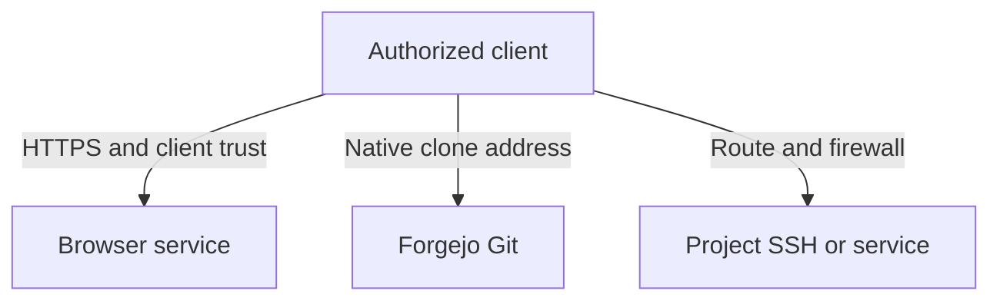

# Configure private networking and TLS

Configure the private browser origin, Git advertisement and Project subnet independently. Verify each required path and certificate from the client that will use it.

SodaOS serves browser and Git access on a private appliance address, while Projects use their own subnet and direct network access. Configure each address for its purpose and verify the route and TLS trust from the intended client.

## Set the browser origin and TLS

The browser origin is the HTTPS address clients open. It must resolve or be reachable at the configured listener, and the appliance certificate must be trusted by each client. You can use the local certificate created during activation or provide a certificate and key for a private hostname.

A purchased domain and public hosting are not required. For a private hostname, configure private DNS and ensure the certificate covers the hostname clients open.

### Give each private application its own trusted origin

An installed application uses a separate HTTPS hostname from Forgejo. Agree that origin with the publisher before building the image: it must match the bundle's `CAN_AUTH_ORIGIN` and the address selected during application setup. For example, `https://board.soda.test` is a separate app origin, not a path beneath Soda's browser address.

Configure that app hostname in private DNS to reach the appliance or Docker host's private proxy listener. Verify the route from the actual administrator's client before first-owner setup, and from each intended member's client before admitting app use.

With internal TLS, use the verified public CA certificate for that proxy and establish client trust. With supplied certificates, their coverage must include every application hostname being served; a certificate covering only Forgejo's hostname does not cover the board automatically. Protect private keys in operator custody.

At the app origin, confirm that DNS resolves to the intended private address and that HTTPS presents a certificate covering the app hostname with a trusted chain. During explicitly launched owner setup, verify the protected Canlang setup flow. After normal Install and explicit Start, verify app-local sign-in and an authorized app operation.

A successful Forgejo login, Tailnet enrollment or backend readiness alone does not establish these app-client checks. App cookies and authorization stay on the app hostname; Forgejo credentials do not become app credentials. Follow [Private applications](../50-Operate/40-private-applications.md#prepare-and-install) for the setup and lifecycle actions.

## Configure Git advertisement

Forgejo's advertised Git endpoints are separate from the browser origin and listener. Configure the clone address users should receive, then verify it from a client using native Forgejo credentials. Changing the browser address does not automatically establish a working Git route. Native Forgejo SSH keys or HTTPS tokens authenticate Git; Soda development-access SSH keys have a different purpose.

## Route to the Project subnet

The Project subnet is a third network setting. Choose a private range that does not overlap the appliance LAN, VPN, Docker or other routed networks. Clients that need direct Project SSH or service ports require a route to this subnet.

The default is `10.89.0.0/24`. Soda reserves `10.88.0.0/16` and `10.90.0.0/24`; do not select a Project range that overlaps either. A collision with your LAN or VPN calls for a different private range, not a universal replacement subnet.

Browser access and successful Git clone do not prove that Project addresses are reachable. Network routing and firewall policy remain operator responsibilities.

## Trust certificates and verify access

For a local certificate, use the public CA certificate and fingerprint produced by operator setup. Compare the fingerprint after transferring the certificate, then add it to the client's normal trust store. For a supplied certificate, install its matching certificate and private key through the supported operator activation procedure and protect the key as an operator secret. Do not send private keys to users or put them in shared files.

For example, a fictional team uses appliance address `192.168.50.10`, private DNS name `soda.team.example` and the nonoverlapping Project subnet `10.89.0.0/24`. Its client checks look like this; replace the example values with your own configuration and use the actual clone URL and Project address shown to you:

| Purpose | Example address and port | Check from the intended client |
| --- | --- | --- |
| Browser origin | `https://soda.team.example`, TCP 443 | Resolve the name to `192.168.50.10`, open it without a certificate warning, and sign in. The certificate must cover `soda.team.example` and chain to a trusted CA. |
| Native Git SSH advertisement | Host `soda.team.example`, TCP 2222 | Clone or fetch using Forgejo's displayed SSH URL and your native Forgejo SSH key. Confirm the server host key through a trusted channel. |
| Direct Project SSH | Example Project `10.89.0.20`, TCP 22 | Establish the separately configured subnet route and connect using your provisioned Project account and development-access key. |
| Direct Project service | Actual Project address and service port | Connect to that service through the Project route; its own listener and access rules must allow it. |

The private hostname requires your DNS configuration; Soda does not create Project DNS names. Port 2222 serves Git, while direct Project SSH uses the Project's address. A browser certificate warning calls for checking hostname and trust rather than bypassing validation.

These are three separate client paths. A trusted browser origin does not prove the advertised Git address or Project subnet is reachable.

Verify each path from a real intended client: open the HTTPS browser origin and sign in; clone or fetch a repository using the advertised Git address; and, if required, connect to a Project address or service through its separately configured route. Diagnose name resolution, route, listener and certificate errors at the affected layer. A Tailnet enrollment or observed address alone does not prove reachability. [Optional Tailscale setup](60-tailscale.md) can add private routes, while [operator setup](../60-Install/60-operator-setup.md) owns the initial handoff.
