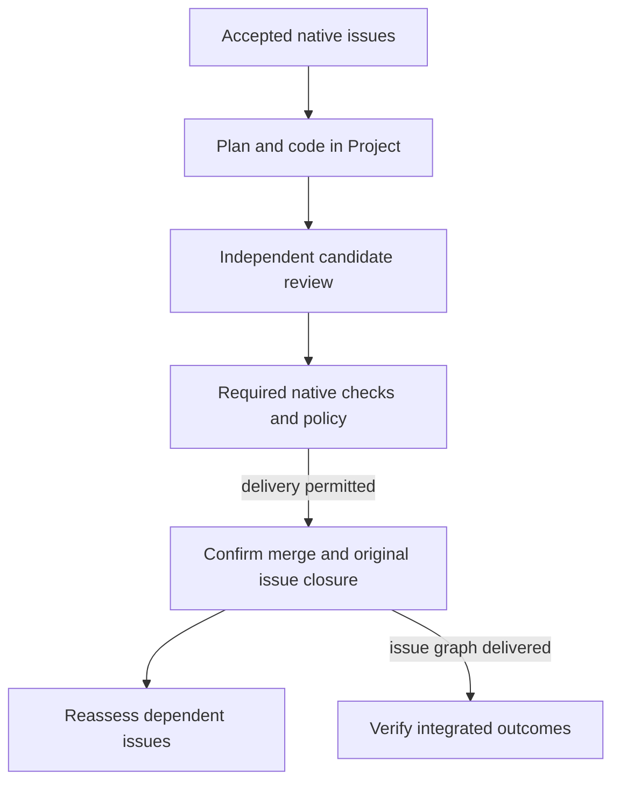

# Software factory

Soda Factory takes accepted repository issues through planning, coding, independent review and native merge, then checks dependent work and verifies the integrated outcome.

## The complete work path

A Product Lead turns an accepted build request into a proposed set of native issues, outcomes and dependencies. A repository maintainer with code-write authority accepts or adopts the exact work and its dependencies. Soda reads the native records, checks readiness and reassesses work when accepted inputs, prerequisites or available resources change.

A missing requirement or prerequisite blocks only the affected work; waiting for a provider lease, Project preparation or capacity is reported as a resource wait. Eligible issues normally proceed under standing policy without manual per-issue admission or a required human merge.

Soda runs eligible work in the same persistent Project that joined humans use. Each role has its own account and checkout. The Architect investigates an issue and produces an executable task plan, including task ownership, lanes, checks and dependency relationships.

The Builder follows that plan, records trusted checkpoints and submits outputs for observation. Independent tasks can continue when another prerequisite fails, while tasks that depend on the failed result wait for a fresh assessment. Research can also answer a bounded prerequisite without producing a code change; the exact evidence returns to the parent issue for reassessment.

The Inspector reviews the exact candidate independently. If it finds a defect, the Fixer addresses the required findings and supplies evidence. The revised candidate receives a fresh review or an authorized assessment of the verified corrections.

Required native CI checks and repository protections apply to the exact current candidate. Changes to the candidate or accepted requirements invalidate evidence that no longer applies.

Once review, checks and policy permit delivery, Soda performs the native merge and closes the original issue through the native completion path. It waits for confirmed effects: a pull request or worker report alone is not completion. The merge and issue outcome trigger reassessment of dependent issues, which may then proceed under the same standing policy.

After the issue graph is delivered, the Test Pilot checks the integrated version against the accepted outcomes and approved verification manifest. It records the exact version, fixtures and receipts, including uncovered or inconclusive outcomes. An empty queue or a set of merged issues does not establish that the whole requested behavior works. Verified application completion is also separate from installing or deploying an application.

This normal path begins with accepted native issues. Confirmed issue delivery releases eligible dependent work; integrated verification assesses the delivered issue graph and does not install or deploy an application. The conditions and correction paths remain described above.

## People and authority

Seven production responsibilities carry the work: Product Lead, Architect, Builder, Inspector, Fixer, Strategist and Test Pilot. A scoped Library Admin maintains reusable knowledge and decision records. These are separate duties and execution identities, not extra authority: repository policy controls native work and merge, the Soda operator controls appliance capacity, and the provider account owner controls sponsored model access. The people, credentials and limits behind those grants are described in [Factory authorization](20-factory-authorization.md) and [provider connections](../30-Set-up/40-provider-connections.md).

The [Factory Feed](70-factory-feed.md) lets people follow activity, inspect evidence and answer questions. [Intervention](90-factory-intervention.md) covers waits or interrupted runs that cannot safely continue automatically.

## Prepare the factory

Before work can run, a native repository maintainer enables its policy, the Soda operator makes bounded appliance capacity available, and a provider owner sponsors an eligible connection. Enroll provider accounts and set up the operator through [provider connections](../30-Set-up/40-provider-connections.md) and [operator setup](../30-Set-up/10-operator-setup.md).

Prepare the repository's persistent environment using [Prepare a Project](../50-Spaces-and-Projects/30-prepare-project.md). Configure required checks through [CI runners](40-ci-runners.md). These are separate responsibilities; success in one does not grant the others.
