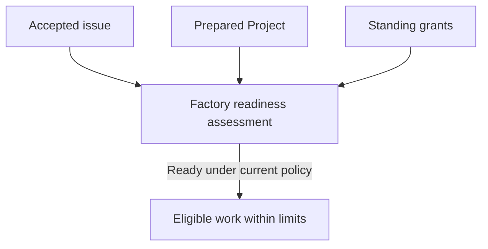

# Factory authorization

Factory work depends on repository policy, Soda appliance capacity and provider-account sponsorship, each authorized and funded by its own owner under a shared standing policy.

## Authorize repository work

A native repository owner or administrator selects the target branch, eligible role harnesses and models, merge method, native actors and repository limits. The policy also names a nonempty set of required native CI checks and the conditions that must hold before merge. Publication, review and merge use attributable native actors; they do not impersonate the issue author or the provider account owner.

Every issue is considered for readiness, but work from an unaccepted source waits for adoption by a maintainer with current code-write authority. Acceptance binds the exact issue requirements and dependencies. A material edit suspends affected work until its revised input is accepted.

Comments, labels, author claims and repository instructions cannot enlarge Factory authority. The native forge continues to own issue, pull request, review, merge and check records.

## Provide appliance capacity and sponsorship

The configured Soda operator authorizes bounded appliance resources and concurrency. This permits eligible work to use capacity; it does not grant repository write access or merge authority. The provider-account owner separately selects and sponsors a supported connection for the repository's roles and sets its usage allowance. Account enrollment, personal connections and credential custody are covered in [Provider connections](../30-Set-up/40-provider-connections.md).

Each grant has its own scope, owner and limit. Planning and issue generation consume a planning allowance; repository attempts have bounded execution and correction effort; integrated verification has its own intent allowance; appliance capacity and provider usage have separate constraints. A limit reached in one area does not grant more of another. The Feed and status show whether work waits on authorization, preparation, capacity or sponsorship.

The diagram shows independent prerequisites: no single owner can supply another owner's grant, and the standing grants do not remove issue acceptance or Project preparation.

## Keep policy current

Changes to repository policy, provider sponsorship, appliance capacity or current native permissions can stop or invalidate affected work. Reassessment uses the current accepted issue and grants before continuing. The Soda operator can stop appliance execution but cannot authorize native repository policy or enlarge a provider owner's allowance.

A provider owner can withdraw sponsorship but cannot authorize a merge. A repository maintainer can change repository policy but cannot enlarge host capacity.

For normal work, these standing grants let accepted eligible issues proceed without manual admission of each issue. When a grant is missing, expired or exhausted, Factory reports the owner and next action rather than treating the issue as ready. See [Factory intervention](90-factory-intervention.md) for resolving a specific wait.
