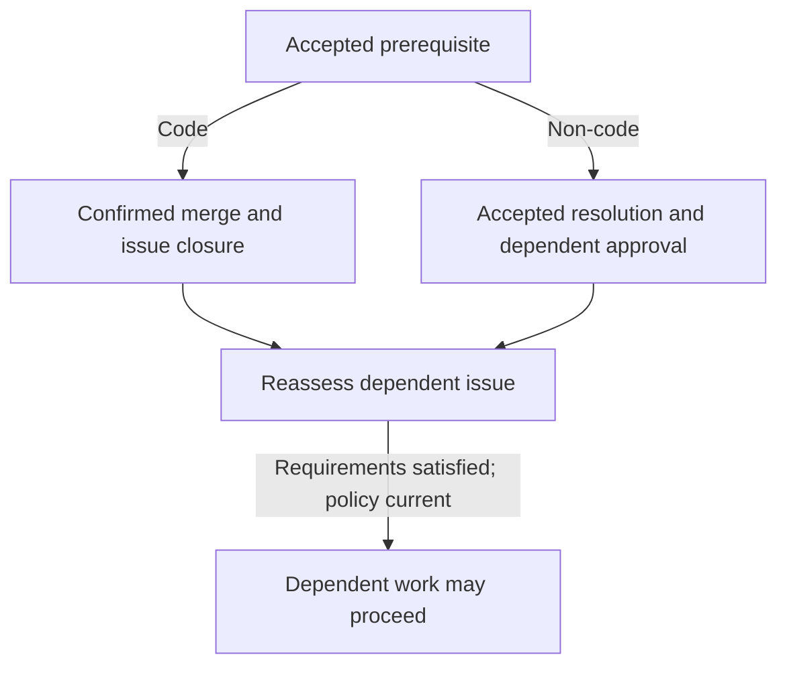

# Issue work and dependencies

Accepted native issues become bounded executable plans whose outputs, prerequisites and evidence determine which tasks can proceed and when work needs reassessment.

## From issue to executable plan

1. **Accept the issue inputs.** A maintainer with current code-write authority accepts the exact requirements and dependency relationships, or explicitly adopts them when they originate elsewhere. Labels, comments, agent confidence and reopening an issue do not supply acceptance. Material changes to the objective, acceptance conditions or dependencies suspend affected work until the changed input is accepted and reassessed.
2. **Plan the issue.** The Architect investigates accepted work and produces an executable task graph: work units and outcomes, responsible lanes, prerequisite edges, checks and expected outputs. It covers the accepted outcome without unrelated scope.
3. **Validate the plan.** The controller checks the graph against the issue and repository context before Builder execution. A submitted plan does not prove that tasks ran or outputs passed checks.
4. **Build and observe outputs.** The Builder works in the assigned checkout of the persistent Project, reports trusted checkpoints and submits task outputs. A checkpoint identifies what was produced and its available evidence; the controller validates outputs against the planned task and checks before dependent work continues.

Independent tasks can progress while another lane is blocked or fails; downstream tasks wait for the required result. Changed task inputs, accepted requirements or prerequisite results require a fresh assessment.

## Resolve prerequisites and research questions

Dependency edges name a required issue outcome. A code prerequisite is satisfied by the required change merged to its stated target branch; merely closing the issue is insufficient. A non-code prerequisite needs an authorized resolution and supporting evidence. The Feed shows the blocker, owner and evidence needed; agents may identify missing work but cannot waive or remove it.

Factory can route a question to bounded research rather than a code change. It creates or reuses follow-up work within the existing authorized allowance, releases or settles the blocked parent's execution slot, and returns accepted evidence to the parent for fresh context and reassessment.

| Research result | Meaning for the prerequisite |
| --- | --- |
| Negative | The investigation did not find an answer under its stated conditions; that result is evidence, not a satisfied prerequisite. |
| Inconclusive | Available evidence is insufficient to decide; the prerequisite remains unresolved. |

The authorized owner decides whether the parent can proceed or its requirements should change.

Reassessment continues eligible dependent work under standing policy when its accepted requirements and prerequisites are satisfied. Research does not itself authorize a waiver or satisfy a declared outcome that remains unmet; a material decision goes to its authorized owner.

## When work becomes stale or cannot proceed

An unreadable or incomplete prerequisite remains unresolved. A cycle remains blocked until an authorized maintainer changes the native dependency graph. If issue content or dependencies change during a run, Soda preserves the observed work but stops publication and continuation that rely on stale inputs.

Reassessment determines which plans and evidence still apply. A failed task does not erase independent completed work, and it does not authorize a dependent task to use a missing result.

See [Review and merge](50-review-and-merge.md) for candidate evidence and delivery, and [Factory intervention](90-factory-intervention.md) when a run, allowance or external resource needs explicit action.
