# Review and merge

Factory requires current independent review, verified corrections, required native checks and repository permission before it confirms merge and closure of the original issue.

## Inspect the candidate

The Inspector receives the candidate and its relevant accepted requirements, changes, coverage obligations and existing findings. It reports concrete defects with impact and evidence, or explicitly records that the complete required review found no defects. An incomplete review does not count as clear. The Builder's own report is useful context but does not replace independent review.

```doc-visual
{
  "placeholder": "Inspect one native pull request with its exact candidate revision, independent review and required check evidence.",
  "caption": "A real native Forgejo pull request for a fictional public-safe sample repository. Markers connect the displayed head revision to its independent review and required check results; the screenshot does not imply that the pull request is merged.",
  "alt": "Forgejo pull request showing the head revision, independent review and required check results",
  "production": {
    "method": "screenshot",
    "instructions": [
      "In the approved Soda documentation instance, open Forgejo's native repository pull-request page for an existing fictional public-safe sample repository. Select a real, attributable candidate whose head revision, independent review and required check results are all visible; do not create a pull request or trigger a review or check for the screenshot.",
      "Use an authorized read-only documentation account. Capture a state before merge, with the exact head revision and target/base context, the independent review result or finding, and required native check evidence for that same candidate. Never merge, approve, rerun checks, or start paid Factory work to obtain the state.",
      "Use only public-safe sample code and repository data. Exclude private repository URLs, personal details, credentials, tokens, device codes, cookies, and profile paths. If no existing candidate shows the complete evidence, defer the capture rather than fabricating or changing a review state.",
      "Record the actual Soda and Fountain revisions and capture date in the asset notes. Capture the real screen at 1280 by 900 in the light theme, then check the labels at a mobile-width preview."
    ],
    "edits": [
      "Crop to the pull-request summary and the review/check evidence while retaining the native repository and pull-request context, exact head revision, and all relevant labels.",
      "Add at most three numbered rectangles linking the head revision, independent review, and required checks. Do not cover code, review text, status labels, or revision identifiers; do not use color alone to convey a result.",
      "Explain every marker in the caption and verify that the crop, label contrast, and alt text match the actual candidate shown."
    ]
  }
}
```

When required findings remain, a Fixer addresses the full required set and provides evidence for each disposition. A proposed fix is not accepted just because code changed. The revised candidate receives a fresh independent review, or an authorized assessment of verified corrections where policy permits.

Disputed findings remain visible until an independent decision resolves them. Optional advice can be declined with its rationale without disguising it as a required finding.

## Require current checks and policy

The candidate identity includes the revision being reviewed and the branch it targets. Required native Actions checks must report on that same candidate. If commits, accepted requirements, branch policy or relevant evidence change, prior review and check results may no longer apply. Factory reassesses the current subject and requests fresh evidence before delivery.

Repository protections remain effective. A Factory review cannot override a required check, current native permission, branch rule or merge restriction. The repository maintainer controls these policies; external runner setup is described in [CI runners](40-ci-runners.md).

```mermaid
stateDiagram-v2
    accTitle: Candidate review and check evidence freshness
    accDescr: Review and required checks apply to one exact candidate and target; relevant changes return the candidate for reassessment and fresh evidence.
    state "Evidence current" as EvidenceCurrent
    state "Eligible for delivery" as DeliveryEligible
    [*] --> Candidate
    Candidate --> EvidenceCurrent: Review and checks current
    EvidenceCurrent --> Candidate: Relevant change
    EvidenceCurrent --> DeliveryEligible: Current policy permits delivery
    DeliveryEligible --> [*]
```



The evidence-current state is tied to one candidate and target. A relevant change returns it for reassessment; delivery and any uncertain native effect follow the confirmation rules below.

## Confirm delivery

When the evidence and policy permit, Factory performs the native merge using its authorized actor. It then confirms both the merged result and closure of the original issue through the native completion path. A created pull request, a submitted merge request, a closed issue without the required merged outcome, or a lost response is not confirmation. If an effect is uncertain, Factory reconciles that original operation before retrying so it does not duplicate native activity.

Confirmed delivery triggers reassessment of dependent issues. Whole-application verification remains a separate step: the [Test Pilot](60-application-verification.md) checks the integrated intent version and approved outcomes after issue delivery.
