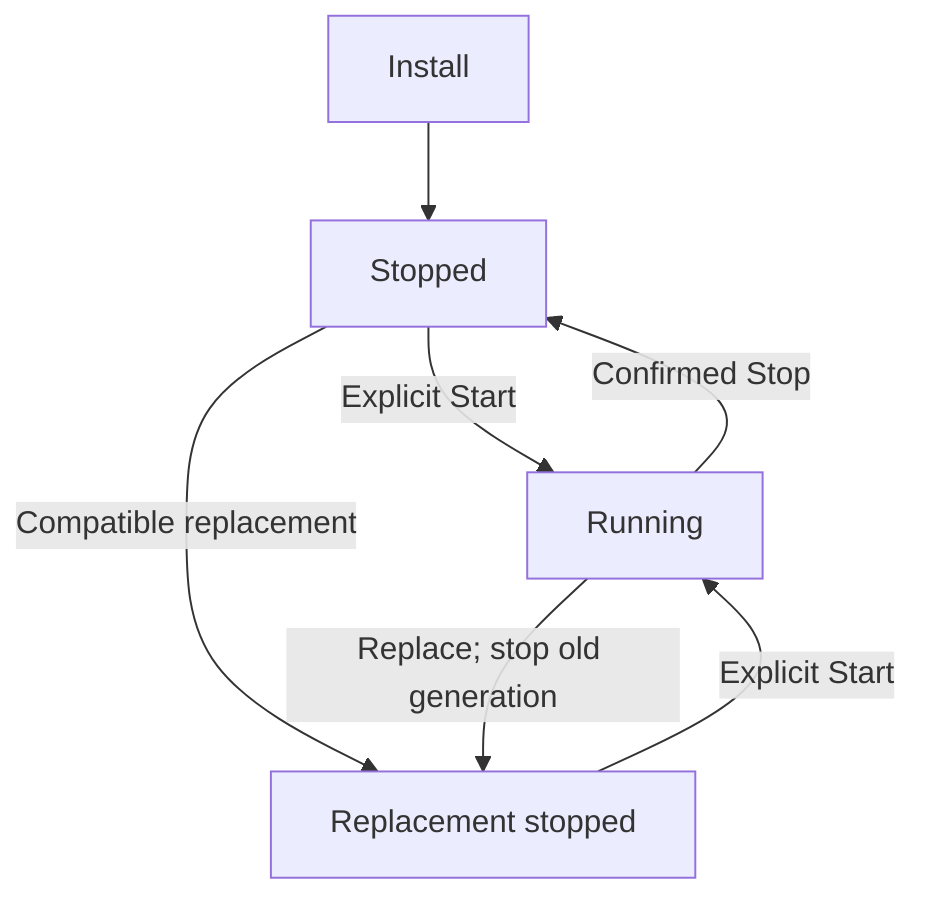

# Operate a private application

Install, start, inspect, replace and stop a private Canlang application while preserving its app-owned identity and data. Its lifetime remains independent from Project activity and Factory merges.

## Prepare and install

Private Canlang applications have their own storage, accounts and service
lifetime. The operator needs an exact prepared application image loaded on the
host, its compatible bundle/runtime/tools references, a fresh application data
identity, a private HTTPS address and an assigned application administrator.

Here, the operator authorizing application setup and lifecycle changes is the
configured Soda operator signed in through Forgejo. Loading an image or running
the stopped member helper additionally requires the appliance's host root
access. Those credentials and permissions are separate.

Obtain the prepared OCI image archive and its exact compatibility references
from the application's publisher through your team's trusted transfer path.
Use the [publisher handoff checklist](#check-the-publisher-handoff) below before
loading it; the authoring side owns [bundle assembly and image export](../30-Projects-and-development/70-canlang-development.md#assemble-an-application-bundle).
Check the publisher's integrity and origin information before loading it. On the
appliance, replace `APP_ARCHIVE` with that archive's absolute path under `/home`:

```sh
sudo podman load --input APP_ARCHIVE
```

The result imports the prepared image into the host's image store; it does not
install or start an application. Record the exact image identity for guided
setup. A tag or a label alone is not verification of the bundled bytes. Source
development and preview belong to [Canlang development](../30-Projects-and-development/70-canlang-development.md);
setup selects prepared local bytes and does not build source, upload arbitrary
images or deploy a Factory merge.

For example, prepare a team board at `https://board.soda.test`, with an application administrator who will own its separate Canlang account. Use your actual private hostname and configure DNS, routing and TLS trust before opening setup.

1. As the operator, open Applications and begin guided setup for the prepared app. Select the exact image, matching storage and private address, and assign the application administrator. Review the displayed identities and consequences before confirming.
2. Explicitly launch owner setup. The assigned administrator or operator uses the short-lived, single-use setup capability to open Canlang's protected first-owner flow at the app's private HTTPS origin. Only setup is available at this stage; ordinary app and MCP access wait for provisioning.
3. Create the first owner in that Canlang flow. Credentials go directly to Canlang, rather than a Soda application record. Setup claims an empty Identity store under an exclusive writer lock; it does not reset existing accounts.
4. Confirm that setup records the owner team and closes setup access. The setup generation stops, and the app becomes eligible for normal installation. If a response is lost or the store is already provisioned, inspect the existing claim and owner-team receipt before continuing; do not create another owner. Normal app sign-in follows installation and Start.
5. As the operator, choose Install for the reviewed application. Installation validates image and storage references, configures the private route and leaves the normal application stopped. Inspect the stopped result before proceeding to Start.

Treat the setup capability as a secret for its intended administrator and exact app/data identity. Keep it out of shared messages, logs, URLs and screenshots.

If it expires or is already used, inspect the existing setup result first. When no owner claim completed, obtain renewed setup access for that same app and data through the authorized setup flow. When the owner receipt exists, continue that setup rather than provisioning again. An uncertain claim remains an inspection task; expiry or a lost response does not authorize resetting Identity, changing data or creating another owner.

Install verifies the private route and restarts the shared proxy, briefly interrupting other browser ingress. Plan that installation with affected users. Start, Stop and image replacement do not restart the proxy.

```doc-visual
{
  "placeholder": "Review the prepared app and private address before opening its separate first-owner setup.",
  "caption": "Guided setup for a fictional board application. Markers identify the prepared image, private address and handoff to the app-owned first-owner flow; credentials and setup capabilities are excluded.",
  "alt": "Guided application setup showing a prepared image, private address and first-owner setup handoff",
  "production": {
    "method": "screenshot",
    "instructions": [
      "Use an approved documentation instance and an existing fictional board app staged for guided first-owner setup. Sign in as its authorized Soda operator; the designated application administrator owns the subsequent Canlang account.",
      "Open Applications and the app's actual guided setup review. Capture the prepared-image identity, fictional private origin and first-owner handoff before opening the protected first-owner flow or entering credentials. Do not install, start, provision or alter the app to obtain this capture; arrange the approved sample state beforehand.",
      "Use only public-safe sample records. Exclude setup URLs or capabilities, passwords, emails, private hostnames, tokens and credential-file contents. If the actual interface cannot show the review without exposing a capability, choose a safe crop of its nonsecret state and adjust the caption to what is visible.",
      "Record the actual SodaOS and Canlang revisions and capture date in asset notes. Capture at 1280 by 900 in the light theme and check label readability at narrow article width."
    ],
    "edits": [
      "Crop to the real guided setup review, retaining the Applications context and labels for image, private address and handoff.",
      "Add at most three numbered rectangles: 1 prepared image, 2 private address, 3 first-owner handoff. Explain the visible markers in the caption, preserve labels and do not rely on color alone.",
      "Check the caption and alt text against the finished crop. Never reconstruct a setup form or display secret capability text."
    ]
  }
}
```

Forgejo users, Project members and AI provider owners do not automatically become application users. The configured administrator or operator may inspect, Start and confirm Stop; registration, Install, replacement and Restore are operator actions. Canlang owns app-local owner/member authorization. First-owner setup does not configure invitation, verification or password-reset email delivery.

The assigned Soda application administrator is a Forgejo identity permitted to administer this app's lifecycle. The Canlang owner is a separate app-local account and owner team created during first-owner setup. One person can hold both roles, but assigning Soda administration does not create a Canlang account or grant access to app records. App members use their own Canlang credentials and the app's authorization rules.

Stopped, private-file Canlang bootstrap/member administration remains available for offline recovery. Use the matching production image, keep credentials in private files rather than arguments, and exclude concurrent runtime/setup writers. A lost setup reply is not permission to reset Identity or create another owner.

## Check the publisher handoff

Keep the archive, its provenance and the compatibility references together. Check that the publisher identifies the intended destination release and application before loading or selecting an image:

| Supplied information | What it identifies |
| --- | --- |
| OCI archive and its integrity/origin evidence | The transferred image bytes and the publisher responsible for them. |
| Exact application image ID | The image to select after loading; a mutable tag is insufficient. |
| Application name and source identity | `descriptor.identity.appName` and `descriptor.identity.sourceRevision` in the bundled deployment descriptor. |
| Compiled artifact digest | `descriptor.identity.artifactDigest`, bound to the parsed compiled application. |
| Portable module-bundle digest | `bundle.mixedSha256`, distinct from an archive-file checksum. |
| Storage fingerprint | `storageFingerprint`, used to assess storage compatibility for replacement. |
| Runtime image and tools archive references | The destination release's selected runtime image configuration ID and Canlang tools-archive SHA-256. The tools digest is not the checksum of `tools.json`. |
| Private application origin | `environment.vars.CAN_AUTH_ORIGIN`, matching the intended HTTPS address. |

The bundle also retains its compatibility date and flags. Preserve the supplied values through packaging and installation. A matching image label alone does not prove the underlying bytes; use the publisher's origin/integrity evidence and the installation checks together.

If identities are missing or do not match the destination's selected runtime and tools, return the mismatch to the publisher before installation. Do not repair a mismatch by relabeling an image. Keep app-owner credentials and production data in their separate custody; the operator and assigned app administrator complete first-owner setup after the image handoff.

## Configure access and start

Configure a separate private application hostname, DNS and client TLS trust as described in [Private networking and TLS](../40-Configure/50-private-networking-and-tls.md). App cookies and authorization remain on that hostname. Once the intended client can reach the origin, select Start and confirm readiness, then sign in using the app's own account. A ready backend alone does not prove client DNS, routing or TLS trust.

In the app record, open **Start or stop application** and select **Start APP_NAME** for the intended app. Use **Inspect APP_NAME** to refresh its observed state:

| Last observed state | Meaning |
| --- | --- |
| Stopped | Expected after Install or a confirmed Stop; Start is a separate action. |
| Ready | The backend passed readiness; check the intended client's access separately. |
| Running; readiness unconfirmed | The process is running, but readiness is not established. |
| State unknown | The outcome is unconfirmed; inspect the current generation and diagnostics before another lifecycle action. |

**Open application** opens the configured address; the link itself does not start the app or prove that it is ready. After an uncertain response, inspect before repeating the action.

## Add a production application member

Use this stopped appliance procedure when an additional member needs app-local access. Coordinate it with the Canlang owner, and use the installed production image and data, not a development preview. Adding a member does not grant Soda lifecycle administration, elevate an existing account or reactivate a removed account.

The selected team must already be claimed and have an active owner. An existing verified account with the supplied password and active membership can be reused; an unverified account, different password or removed membership is refused.

1. [Stop the app through Applications](#replace-or-stop-an-application) and confirm **Last observed: Stopped** for its current generation. Ensure no setup, runtime, backup or other identity-administration writer is using its data. Keep it stopped throughout provisioning.
2. Use the appliance host's root shell as the authorized operator for the commands below. Run Podman against the host store containing the installed production image; paths below refer to that appliance's retained `/home`.
3. Set these variables from the current app record and confirmed owner-team receipt. Replace every placeholder: `APP_IMAGE` is its exact production image ID, `DATA_ID` its existing production data identity, and `TEAM_UUID` its current Canlang owner team. Choose a new private credential filename outside application data and backups:

   ```sh
   set +x
   umask 077
   APP_IMAGE=sha256:EXACT_PRODUCTION_IMAGE_ID
   APP_DATA=/home/soda-applications/data/DATA_ID
   OWNER_TEAM=TEAM_UUID
   MEMBER_CREDENTIALS=/home/soda-applications/private/board-member.json
   install -d -m 0700 -o root -g root /home/soda-applications/private
   ```

   These assignments identify existing production state; do not create a fresh data directory or substitute the publisher's newest image. The private directory holds credential input separately from application storage.

4. Using a private editor, create the new regular credential file at `MEMBER_CREDENTIALS` with mode `0600`. Do not use a symlink or overwrite an existing file; the input must be no larger than 64 KiB. Its JSON contains the new member's real email and a separately chosen production password of 8–512 characters. The following values are placeholders, not development credentials:

   ```json
   {"email":"member@example.test","password":"REPLACE_WITH_PRIVATE_PRODUCTION_PASSWORD"}
   ```

   Keep passwords out of shell arguments, history, repositories and transcripts. After saving, assign the file to the production runtime account:

   ```sh
   chown 10000:10000 "$MEMBER_CREDENTIALS"
   chmod 0600 "$MEMBER_CREDENTIALS"
   ```

5. Run the production image's member command against that stopped data and owner team:

   ```sh
   podman run --rm --read-only --network=none --cap-drop=all \
     --security-opt=no-new-privileges --pids-limit=128 --memory=768m --cpus=2 \
     -v "$APP_DATA:/home/app-state:Z" \
     -v "$MEMBER_CREDENTIALS:/run/canlang-member.json:ro,Z" \
     --entrypoint /opt/canlang/bin/can-soda "$APP_IMAGE" member \
     --bundle /opt/application/bundle.json --data /home/app-state \
     --owner "$OWNER_TEAM" --credentials /run/canlang-member.json
   ```

   Success reports `ok: true` for `command: "member"`. Wait for the command to exit successfully before Start; the printed result alone does not establish that its storage writer has been released. A writer-lock or identity failure requires inspecting the cause; do not reset storage or invoke owner bootstrap as a substitute.

   The helper runs as the image's `10000:10000` account. Its temporary 768 MiB administration limit is separate from the normal app's 1 GiB ceiling. It does not start the installed application.

6. Keep the credential file in separate protected operator custody, outside application data and backup trees. Deliver the member's credentials through your team's private channel; this procedure sends no invitation or password-reset email. Explicitly Start the installed app, confirm readiness and have the member sign in at its private origin to verify the intended permissions. If the helper's outcome is uncertain, inspect the existing identity state before retrying or creating another account.

## Verify the first start

After Start, confirm the recorded generation is ready and open the configured private address from the intended client. Sign in as the app-local owner, create a small record and, where supported, upload and read an authorized file.

Have a [separately provisioned production member](#add-a-production-application-member) sign in with their own app account and verify the intended permissions. Check that an unrelated Forgejo or Project account does not grant app access.

For the board example, stop the development Project and reopen the board address. The app remains independent of that Project. A backend-ready result paired with a browser certificate or route failure belongs to client networking, not another Install attempt.

For application authors, [native Files development](../30-Projects-and-development/70-canlang-development.md#exercise-native-files-with-development-data) provides a separate owner/member example with private development storage and an HTTPS gateway. Those development accounts, files and data directories stay separate from this installed application's first-owner setup and production storage.

## Resource limits

Each normal application has a fixed ceiling of 1 GiB RAM, two CPUs' worth of CPU time and 128 processes/threads. Its container root is read-only; persistent writes belong in its app-owned data. These are per-app ceilings, not dedicated CPU reservations or a guarantee that the host can run any number of apps. Applications shows these limits; there is no arbitrary per-app tuning control.

If an app slows, fails readiness or stops under load, inspect its generation, service journal and resource state to distinguish memory or process pressure from storage errors, application failure or aggregate host contention. Preserve the last acknowledged write and recheck it after recovery. Do not infer data loss or an automatic restart policy from the limit alone; collect the observed failure and use [Troubleshooting](10-troubleshooting.md).

## Replace or stop an application

Replace an image only with a compatible release that uses the same data identity and passes storage compatibility checks. Replacement stops the old generation, installs the new one and leaves it stopped; explicitly Start it after inspection.

Schema migration and using an older image to undo database changes are unsupported. If an action's outcome is uncertain, inspect the recorded generation and service state before repeating it. Factory merge does not install or deploy an application.

To stop the app, open **Start or stop application**, select **Stop APP_NAME for everyone**, then choose **Confirm Stop APP_NAME**. Inspect the result for **Last observed: Stopped**. Stop disables boot startup and retains application data.

## Associate a Project and protect data

The app is independent of Project Stop: stopping a development Project does not stop the application, and opening the Applications view or linking an app to a Project does not start it. Optional Project association changes navigation only; it does not move storage, change the app's lifetime or deploy Project code.

The lifecycle below shows the separate Start action after installation or compatible replacement. Project association does not change any of these transitions.



```doc-visual
{
  "placeholder": "Stopped app record with independent Project link and explicit Start action.",
  "caption": "An installed app remains stopped while its optional Project link and separate Start action are visible.",
  "alt": "Private application record for a fictional installed app, showing Stopped status, a Project association, and the explicit Start control.",
  "production": {
    "method": "screenshot",
    "instructions": [
      "With an authorized documentation operator, open the actual SodaOS Applications view and select a fictional documentation app that is installed and observed stopped, with a fictional Project association. Expand Start or stop application so the real Start control is visible.",
      "Use an approved test record and do not select Start, Stop, Install, replace, change the Project association, or open the app. The example must show the installed stopped state and association together; do not use a private application origin or customer data.",
      "Capture at 1280x900 in the light theme and verify the status, association and Start control remain legible at narrow article width. Record the SodaOS and Fountain revisions and capture date in the asset notes."
    ],
    "edits": [
      "Crop to the actual app record showing its Stopped status, fictional Project association and explicit Start control; obscure the private origin and any non-fictional identifier while retaining actual interface labels.",
      "Do not add a marker unless the caption explains it, and do not fabricate or replace any control or status text."
    ]
  }
}
```

For a stopped app backup or restore, follow the [application snapshot procedure](50-backups-and-restoration.md#private-application-snapshots). Use the separate operator Restore action to bind the same app and address to verified fresh data; ordinary Replace retains its existing data identity.
