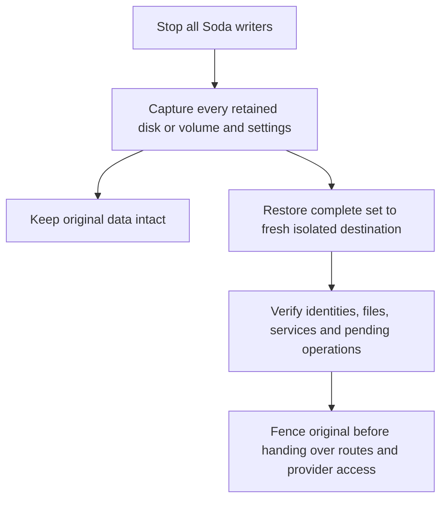

# Back up and restore SodaOS data

Protect the full SodaOS recovery set and coordinate its writers before restoring. Verify recovered data in an isolated target before resuming ordinary work.

## Identify the recovery set

A usable recovery set spans several independent writers and storage domains: Forgejo and Soda databases, retained Project roots and homes, application data, host configuration, broker custody and Docker volumes when applicable. A PostgreSQL dump or a copy of `/home` alone is not a complete appliance backup.

Keep a private inventory with the recovery set so the restored system can be compared with its capture point:

| Retained domain | Record before capture | Verify on the isolated restored system |
| --- | --- | --- |
| Forgejo and Soda | Database identities, repositories and known issue/Factory records | Native login, repository read/clone and the recorded work remain available. |
| Projects | Project/container identities, member accounts, homes, dirty files, writable roots and service volumes | The same members return to their retained identities and files; uncommitted work and service data match the capture. |
| Private applications | App/data identities, compatible image/bundle, origin, owner team and sample records/files | App-local accounts and authorized data work with the matching application. |
| Configuration and trust | Operator assignment, setup/configuration, TLS trust and SSH host identity | The intended operator can administer the system and clients recognize its configured endpoints. |
| Broker and other protected state | Custody locations and the matching recoverable key material | Services can read their retained secrets; provider work remains isolated until pending operations are reconciled. |
| Disks, mounts and Docker settings | Every retained disk/mount or volume, source image and original deployment settings | All members of the same recovery set are attached at the intended paths; no live source disk is substituted. |

Use recognizable, nonsecret samples such as a repository commit, an uncommitted
`recovery-note.txt` in a member's checkout and a known app record. Record their
contents or checksums privately before capture. Keep credentials and encryption
keys in protected operator custody; the inventory is not a place to copy them.

## Capture a complete cold recovery point

Use your platform's disk or volume backup tools to capture one stopped recovery point. Record the source release/image, disk and volume identities, attached retained mounts and capture time. Keep the original intact, and protect the backup and its separately recoverable encryption keys as operator secrets.

1. Notify users, let managed Factory work finish, stop Project sessions and applications, and inspect pending or uncertain operations. Record which Projects, apps and services should remain stopped after recovery.
2. Inventory every retained storage location. Include databases and Forgejo repositories; Podman Project writable roots, accounts, homes and dirty checkouts; application storage; Factory and Identity/broker custody with matching encryption keys; operator setup, configuration, TLS and SSH trust. Include every external retained disk or mount. Project roots are not confined to `/home`.
3. For an appliance, cleanly shut down the machine through host administration. Confirm it is powered off, then capture the boot disk and every attached disk/filesystem holding retained state as one offline set with your hypervisor, cloud or disk-backup tool. Do not boot it partway through that capture.
4. For Docker, stop the Soda runtime from its original Compose project and stop any other writers to its retained storage. Capture all persistent `/etc`, `/var` and `/home` volumes and external retained mounts together. Save the exact Compose file, protected `.env`, project name and pinned image identity. Other workloads can continue if they do not write these locations.
5. Check the backup tool's completed result for every inventoried member. Record omissions or interruption as an incomplete set; do not treat a partial capture as a complete recovery point. Resume the original only after capture finishes.

A cold set includes database files consistently with their surrounding state. The daily database dumps and individual app snapshots below have narrower scope. This procedure is operator-triggered; choose backup frequency and acceptable loss of later writes for your team.

## Restore the complete cold set in isolation

1. Prepare a fresh destination with enough storage and the matching supported appliance image or Docker image/deployment settings. Keep the original machine and retained data untouched.
2. Isolate the destination from ordinary users, production DNS, providers and external write targets before its first boot. Restore every disk, volume and retained mount from the same completed cold set using the backup tool's restore procedure. Restore protected key material through operator custody.
3. Boot only in that isolated context. For Docker, retain the original volume mapping and deployment identity inside the isolated target. Inspect services, retained identities and pending operations before enabling outbound work; a clone must not repeat provider activity or scheduled external effects.
4. Verify operator and Forgejo login, repository clone/read access, retained Project accounts and Join/terminal access, dirty files and homes, app-local sign-in and records/files, Factory records, and startup of services that need retained secrets. Compare sample records and files with your capture notes. Keep intentionally stopped Projects/apps stopped except for a deliberate isolated verification.
5. Resolve failures against that isolated copy. When recovery is ready, stop or fence the original before handing its private routes and provider access to the recovered destination. Restore only the intended running states, then test from a real intended client before admitting ordinary work.

For example, a cold copy of the boot disk plus an external app-data disk is complete only when both belong to the same powered-off capture. Restoring the boot disk while attaching the original live app disk mixes recovery points and risks a second writer. Same-image Docker recovery does not establish cross-version restore compatibility.



## Back up appliance databases

The PostgreSQL backup timer runs daily at 02:00 according to the host's clock.
It writes separate `forgejo.dump`, `soda.dump` and `globals.sql` files under
`/var/lib/soda/backups/postgres/`, retaining the newest seven runs. An operator
can also request a run:

```sh
sudo /usr/bin/soda-pg-backup
```

On success, the command reports `backup complete:` followed by the published
backup directory. Its timestamped name uses UTC. Wait for a successful exit;
an in-progress directory or a scheduled timer is not a completed backup.

Inspect the schedule and last service result as appliance root:

```sh
sudo systemctl list-timers --all soda-postgres-backup.timer
sudo systemctl status soda-postgres-backup.service --no-pager
sudo journalctl -u soda-postgres-backup.service --no-pager -n 50
```

The timer's next/last trigger and the service journal answer different questions.
The backup service is a one-shot job, so `inactive` after completion is normal;
check the command result and reported directory rather than requiring it to
remain running. An inactive timer has no active daily schedule. Investigate its
unit state through [Administration](20-administration.md) and preserve the last
completed backup while resolving the cause.

Each database dump is internally consistent, but the two databases are not captured as one cross-database transaction. The timer does not quiesce Projects or applications.

Schedule a broader backup with writers stopped or coordinated so database, Project, app and configuration copies describe a consistent recovery point. Keep broker encryption keys and other operator secrets protected separately from ordinary backups.

## Back up Docker volumes

Use the Docker branch of [Capture a complete cold recovery point](#capture-a-complete-cold-recovery-point) to stop writers and capture the persistent `/etc`, `/var` and `/home` volumes together with external retained mounts. That procedure also preserves the Compose file, protected `.env`, project name and pinned image identity needed for recovery. A database dump does not contain retained Podman Projects, broker custody or app data.

## Restore PostgreSQL data

Restore is destructive to the selected target. First identify the exact database or storage domain to restore. For PostgreSQL, keep the database itself running and use these ordered steps as appliance root:

1. Confirm Factory runs and other Soda-managed work are stopped, and stop every external/native database writer. Stop the Soda backend and Forgejo, and close the socket that can reactivate the host helper:

   ```sh
   sudo systemctl stop soda-dashboard.service forgejo.service soda-host.service soda-host.socket
   sudo systemctl show --property=Id --property=ActiveState \
     soda-dashboard.service forgejo.service soda-host.service soda-host.socket
   ```

   Confirm each named unit reports `ActiveState=inactive` in the output. Do not stop `soda-postgres.service`.

2. Replace `BACKUP_TIMESTAMP` with the exact existing backup directory. This restores every database dump in the selected run; `--yes` explicitly authorizes replacement:

   ```sh
   sudo /usr/bin/soda-pg-restore --yes \
     /var/lib/soda/backups/postgres/BACKUP_TIMESTAMP
   ```

   The command reports `restored` followed by each database name and its source
   directory. Check a successful command exit and confirmations for every
   selected database. The databases restore in sequence, not as one atomic
   operation: a later failure does not undo an earlier restoration. Keep
   writers stopped and inspect the partial result before retrying.

Restore roles/globals only onto a fresh cluster. Application storage uses its own stopped backup and restore procedure and writes to a new data directory. Restore a private app snapshot into a fresh data identity, then verify records and files with the matching bundle, owner credentials and origin before admitting writes.

After verifying the restored data, restore only the service states intended before maintenance. Check startup logs and native repository access before reopening ordinary work; leave deliberately stopped Projects and applications stopped. A successful restore command alone does not prove that the whole appliance is ready.

## Private application snapshots

Run the storage helper as appliance root. The configured Soda operator's browser role alone does not grant this host access. For Docker, use the existing [runtime's root shell](20-administration.md#inspect-a-docker-deployment), then run the helper there without `sudo`.

Stop the application and confirm its writer is retired before copying storage; exclude owner setup and offline account administration too. The backup helper independently takes the existing writer lock and refuses storage that still has a writer.

Record the app ID, revision, administrator, owner team, current data identity, private origin and port with the snapshot. Preserve its exact [publisher references](40-private-applications.md#check-the-publisher-handoff), including the image, artifact, bundle, runtime, tools and storage fingerprint. Keep owner credentials separately protected. A file checksum inventory alone does not establish which admitted app can use the data.

Replace `DATA_ID` with the app's current data identity and `APP` with a short backup label. Application data IDs have the form `a` followed by 24 lowercase hexadecimal characters. The source and output parent must already be private directories under `/home`; do not substitute symlinked application paths. Choose a new unused output; do not create the output directory first. The helper refuses occupied outputs, links and special files.

Create the stopped snapshot:

```sh
sudo /usr/libexec/soda/soda-canlang-storage backup \
  --source /home/soda-applications/data/DATA_ID \
  --out /home/soda-applications/backups/APP-stopped-001
```

A completed backup contains the authoritative storage tree and `snapshot.json` checksum inventory. The command completes without a success message; check its exit status before treating the snapshot as complete. A failed copy can leave an incomplete output. Preserve it for inspection and choose another fresh output for a retry rather than overwriting it.

For normal same-address recovery, continue with [Restore the same app](#restore-the-same-app-at-its-existing-address). That operation creates and binds fresh data; do not make an extra unbound copy first.

Only for an isolated restoration rehearsal or another deliberate unbound copy, use the helper's separate restore command. Replace `NEW_DATA_ID` with an unused application data identity of the same form, leaving that output directory absent:

```sh
sudo /usr/libexec/soda/soda-canlang-storage restore \
  --source /home/soda-applications/backups/APP-stopped-001 \
  --out /home/soda-applications/data/NEW_DATA_ID
```

The helper verifies the snapshot and copied bytes and assigns runtime ownership when run as root. It creates a fresh data tree without installing, starting or changing an application's binding. Keep that copy unserved until its separate, authorized verification; never run it as a second writable generation of the original app. A failed restore output also remains for inspection and must not be overwritten by a retry.

### Restore the same app at its existing address

1. As the configured Soda operator, [stop the app through Applications](40-private-applications.md#replace-or-stop-an-application) and confirm its writer is retired. Record its current revision, data identity and last confirmed state.
2. In Applications, use Restore for that app and select a host-inventoried snapshot. Review the snapshot timestamp, app and matching bundle, and the acknowledged writes that will be absent after restoring an older snapshot. Snapshot selection uses its inventory identity rather than a browser-supplied filesystem path.
3. Confirm the fresh-data restoration. Restore verifies checksums, bundle/storage compatibility, owner team and origin, then binds the same logical app to the fresh data through a new revision. It preserves the app ID, name, administrator, private address and port, and retains the old revision and old data.
4. Inspect the resulting generation and fresh data identity. It remains stopped. Explicitly Start it, then sign in at the same private address with owner/member credentials valid at the snapshot time. Verify known records, authorized file bytes and work receipts before inviting ordinary writes. Review account or permission changes made after the snapshot before restoring ordinary access.

For a restoration rehearsal, record recognizable sample data before taking the snapshot: a board entry named `Welcome` with `ticks=1`, a file named `welcome.txt` and its exact bytes, and a completed work receipt if the app uses scheduled work. Make a later sample change, such as `ticks=2`, so you can distinguish the recovery points.

After Restore and explicit Start, check that:

- the same app ID and `https://board.soda.test` now use the recorded fresh data identity, while the old revision and data tree remain retained;
- `Welcome` has `ticks=1`, the later change is absent, and an authorized download of `welcome.txt` matches the saved bytes;
- the owner and member have their snapshot-time permissions; if you recorded a completed work receipt, it remains recorded without duplicating its completed effect after restart.

Use your actual private address and sample records. Normal Replace cannot perform this data switch, and an image rollback cannot undo database changes.

A failed copy or validation leaves the old binding intact. An unknown copy, binding or native outcome keeps writes disabled and both data trees retained; inspect the pending operation before retrying. Never overwrite a retained tree or expose two writable generations to resolve uncertainty.

An older app snapshot omits later acknowledged writes. Whole-appliance restoration and its repository/Project checks belong to [the isolated cold-set procedure](#restore-the-complete-cold-set-in-isolation). For uncertain host or native writer state, see [Recovery](80-recovery.md) before restoring data.
