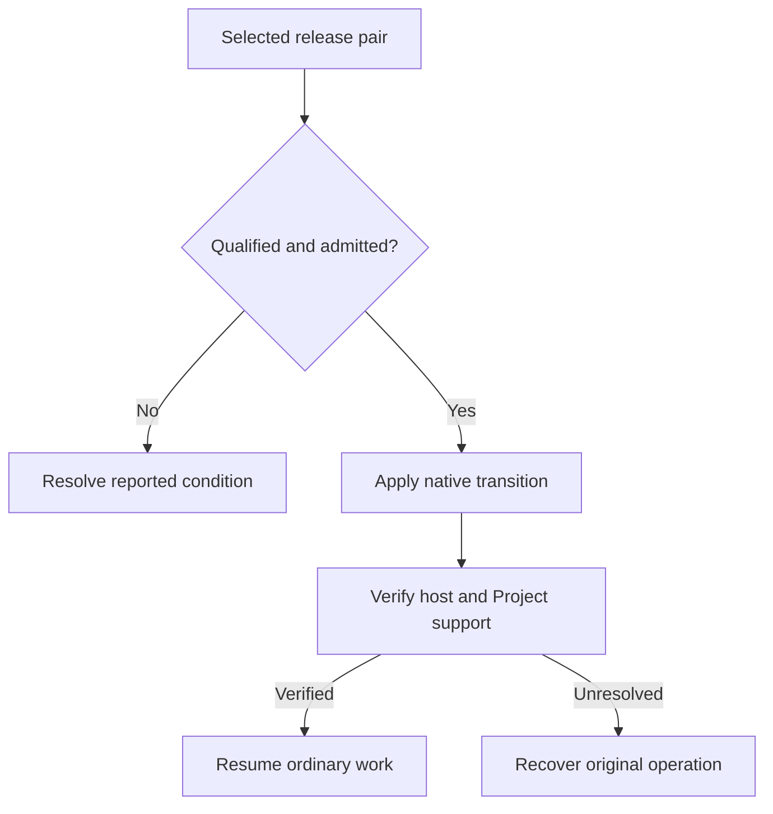

# Update SodaOS and use fallback safely

Apply only a qualified appliance transition or recreate Docker with its existing pinned state. Software rollback and image replacement do not restore database or application data.

Appliance release transitions and Docker container recreation have separate lifecycles. For an appliance, use only a source-to-target pair with its exact native qualification receipt; ordinary first-install media or an advertised update does not by itself qualify a retained-state transition.

## Apply a qualified appliance release

```doc-pending
{
  "id": "release-content-preparation",
  "title": "Prepare locally required release content",
  "message": "The preparation steps for release images and packages required by preflight will be added once the supported acquisition procedure is confirmed.",
  "guidance": "Downloading release assets alone does not prepare every local input. Preserve the complete selected release; a failed preflight does not authorize bypassing checks or applying a partial set."
}
```

Before an admitted appliance transition, review the selected release pair, preserve backups, allow managed Factory work to finish and stop retained Project work that the procedure identifies. As appliance root, download the complete selected release into a root-owned directory not writable by other users. Replace `DIRECTORY` below with that protected directory.

Record the installed source release and selected target release. Maintenance authenticates the promoted release's upgrade receipt from its promotion summary and matches that exact pair; a local receipt file cannot substitute. Use the installed source release's maintenance helper; copying in a newer helper does not qualify an older source. A candidate's declared upgrade source alone is not qualification.

From an appliance root session with the documented GitHub CLI available, replace `TAG` with that target's exact release tag and `DIRECTORY` with a new protected directory under `/home`:

```sh
sudo install -d -m 0700 -o root -g root DIRECTORY
sudo gh release download TAG --repo LevitateOS/sodaos --dir DIRECTORY
```

Download the complete release, rather than selecting individual assets. A successful download places its assets together; admission authenticates them against that selected release and checks the exact source/target pair. Keep the downloaded set intact through verification and recovery. An interrupted download or failed validation is not permission to apply a partial set.

An appliance transition proceeds only when inspection admits the exact qualified pair. Verify the activated host and retained Project support before reopening work; unresolved or interrupted outcomes go to [Recovery](80-recovery.md).



1. Inspect the complete release and retained Projects before applying anything:

   ```sh
   sudo /usr/libexec/soda/soda-project-maintain release --release-dir DIRECTORY --check
   ```

   Review the admitted pair and exact Project count, including retained stopped Projects. Active or unsettled Factory work, uncertain preparation, incomplete provisioning or managed terminal activity prevents admission. Let the affected work finish and resolve uncertainty before proceeding.

   The check extracts and temporarily mounts the downloaded rootfs to verify its bytes and support. It checks locally available image/package content; it does not acquire missing images, replace Project support, stage a native deployment or activate the host. A failed check is a refusal, not permission to apply a partial set.

2. Proceed only for a source-to-target pair with its exact native qualification receipt and after inspection admits it:

   ```sh
   sudo /usr/libexec/soda/soda-project-maintain release --release-dir DIRECTORY
   ```

   The transition closes managed admission, acquires and verifies the selected source/target content, and records the exact release and retained container set. It locks the staged native deployment before updating Project support, prepares the selected extension packages and requests native activation and reboot. It never ends active terminals to proceed. Loss of the command connection does not establish whether activation completed; reconnect or use the console and inspect the result.

## Verify and reconcile the result

After activation, inspect the booted deployment and reconciliation journal as appliance root:

```sh
sudo rpm-ostree status
sudo systemctl status soda-project-release-reconcile.service --no-pager
sudo journalctl -b -u soda-project-release-reconcile.service --no-pager -n 100
```

Compare the booted release with the selected target. For the recorded transition, reconciliation verifies the installed release, retained Project support and selected future Project image before completing the core operation. It then checks extension readiness. A successful boot alone does not establish either result.

Distinguish the active operation from retained history under `/var/lib/soda/project-maintenance/`:

| Observed state | Meaning and next action |
| --- | --- |
| `operation.json` remains for the selected transition | Core completion is not confirmed. Preserve the record and use [Recovery](80-recovery.md); do not clear it to reopen admission. |
| Core verification completed and the record moved to `last-operation`, followed by exit status 75 | The core is applied and verified; extension readiness failed or remains uncertain. Resolve that readiness problem and use the bounded check below. This is not an unfinished host transition or an automatic rollback. |
| No active record and a later reconciliation reports exit status 75 | The current installed release's extension readiness needs attention. Match the booted deployment to your recorded target separately; retained history alone does not prove a newly requested transition completed. |

Core completion retires `operation.json` to `last-operation` before checking extension readiness and releases the maintenance lock. Preserve `last-operation` for recorded rollback and evidence. Exit status 75 prevents automatic service restart; it leaves the completed core intact.

Inspect the service journal and resolve the reported extension problem. Then request a fresh bounded readiness check and inspect its result:

```sh
sudo systemctl restart soda-project-release-reconcile.service
sudo systemctl status soda-project-release-reconcile.service --no-pager
sudo journalctl -b -u soda-project-release-reconcile.service --no-pager -n 100
```

With no active operation, this check follows the current installed release and current administrator enablement choices. It does not replay `last-operation` or restore an older setting to satisfy its history. `release --recover` resumes an unfinished recorded transition; it is not the retry for an applied core with extension attention. For an interrupted transition or deliberate restoration of its recorded host and Project-support pair, follow [Recovery](80-recovery.md). Recorded rollback still requires unchanged container identities, retained source bytes, readable idle managed state and matching extension intent. Neither recovery nor software rollback restores database contents or newer application data.

## Recreate a Docker runtime

For Docker, use the same release image, Compose file, `.env` and project name to stop and recreate the runtime while retaining its `/etc`, `/var` and `/home` volumes. This is container lifecycle management, not the appliance's qualified FCOS transition. Do not pull a different tag into an existing stateful deployment as an assumed upgrade. See [Install with Docker](../60-Install/50-docker.md).

## Recover an interruption

If the operation is interrupted, keep its journal and managed admission state intact and follow [Recovery](80-recovery.md). Never delete operation records, overwrite newer state with an older database, or use a host rollback as a substitute for data restoration. [Backups](50-backups-and-restoration.md) remain a separate protection and restore path.
