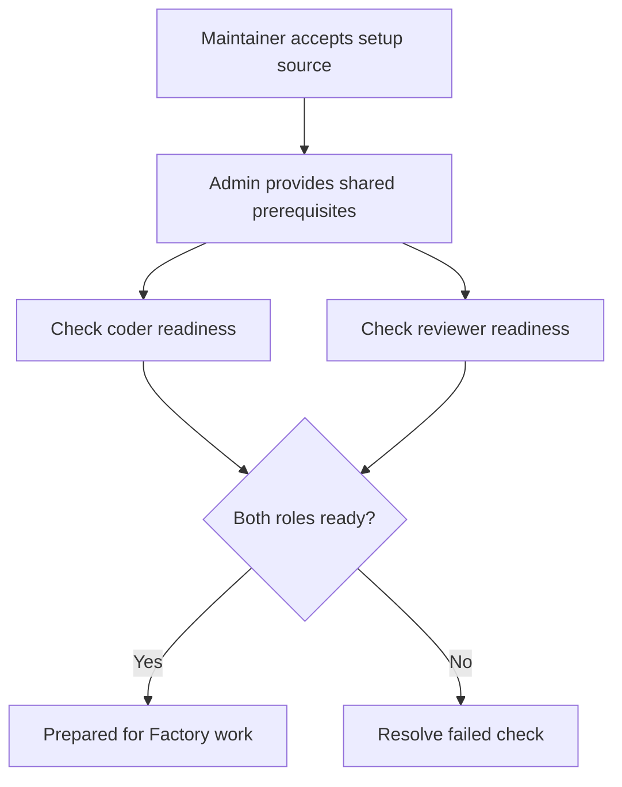

# Prepare a Project for Factory work

Factory work reuses the repository's existing Project. Preparation accepts exact setup source, supplies shared prerequisites, and verifies coder and reviewer access without granting them administrator privileges.

## Accept setup source and requirements

First, a repository maintainer with current native code-write authority selects the setup files and requirements at an exact source revision. Inspect the selected source and complete file set in Project settings, then explicitly accept them. Inputs cover setup entry points, referenced configuration, required tools and versions, writable build paths, services, and readiness checks. Issue text and agent suggestions cannot approve setup. If no source files are selected, acceptance applies only to that source commit.

## Provide shared prerequisites

Next, a Project administrator reviews privileged effects and the shared environment: installed packages and runtimes, root-owned configuration, service definitions, mounts, ports, persistent data, and assigned Factory resources. Provide missing prerequisites through normal Project administration. Repository setup does not run as root or wheel and receives no provider or Factory publication grants.

## Establish role readiness

After acceptance and administrator preparation, run readiness for the coder and reviewer. Each gets its own checkout and private setup state. Readiness confirms actual tools and versions, writable build and dependency paths, assigned service access, and a repository-specific smoke check. A coder's successful setup does not prove that a fresh reviewer checkout is ready.

Factory work can proceed when required role checks succeed for the accepted inputs and current Project state. The result applies to those inputs and that Project state; a running Project alone does not establish readiness.



Both roles need their own successful evidence; one role's result cannot stand in for the other. A changed accepted input or Project state requires the affected checks to be established again.

```doc-visual
{
  "placeholder": "Factory preparation pairs accepted source and administrator review with separate recorded coder and reviewer results.",
  "caption": "handbook-demo Project preparation across authentic views: 1 accepted source inputs, 2 the recorded operational approval, and 3 separate coder and reviewer evidence with their actual statuses. The article explains the administrator checks behind that approval.",
  "alt": "Factory preparation showing accepted source, a recorded operational approval, and separate coder and reviewer evidence",
  "production": {
    "method": "screenshot",
    "instructions": [
      "Use an approved documentation instance and the real handbook-demo Project; sign in as its repository environment owner or authorized operator for read-only capture.",
      "Navigate from the repository through its visible Settings page to Soda Project settings, then select the Factory tab.",
      "Use only an already-recorded preparation state with exact-source acceptance, a recorded operational approval, and distinct coder and reviewer evidence rows. The approval ID identifies a record; it does not display or prove every prerequisite check described in this article.",
      "Capture genuine scroll positions from the same recorded state if one 1280 by 900 view cannot keep accepted source, recorded operational approval and both role rows legible; use only results the application actually recorded.",
      "If the existing instance has no such records, stop and report that limitation; do not submit forms, approve, start role preparation, execute setup commands, or invoke a provider to stage the image. Do not reconstruct the installed-services/resources inputs that disappear after approval.",
      "Record the actual SodaOS release, Fountain revision, and capture date in the repository asset notes; use the light theme, capture at 1280 by 900, and check label readability at a narrow viewport."
    ],
    "edits": [
      "If combining the two scroll positions, place authentic crops from the same recorded preparation state in reading order and make the split explicit in the caption; do not synthesize or imply a result that is absent.",
      "Add at most three numbered markers: 1 for accepted source, 2 for the recorded operational approval, and 3 for separate coder/reviewer rows; explain each marker in the caption. Do not relabel the approval ID as visible evidence of individual prerequisite checks.",
      "Preserve real labels and recorded ready/not-ready values, mask instance-specific opaque IDs and credentials, and do not use color alone to distinguish roles or statuses."
    ]
  }
}
```

## Inspect and recover preparation failures

If a prerequisite is missing, preparation reports what the administrator must provide and waits; it does not elevate an agent or replace the Project. If setup fails or times out, inspect the recorded step and partial effects before retrying. Retry a known safe step only after its prior processes have stopped. Do not blindly repeat shared migrations or delete human data. An uncertain request retains its original preparation identity for inspection and retry.

## Reaccept changes and hold for maintenance

Changing a selected setup file, effective referenced input, accepted requirement, or required human authority invalidates affected readiness. Reaccept the changed exact source and repeat relevant checks.

Before shared maintenance, hold affected Factory work, stop its runs, and settle credential return. Retain the same Project root, make the change, and record fresh readiness. A hold does not authorize rebuilding the environment or resetting persistent data. See [Project maintenance](../70-Operate/30-project-maintenance.md) for retained-root refresh.

Preparation does not enable or fund the Factory. Repository policy, operator capacity, provider sponsorship, and usage limits belong to [Factory authorization](../40-Factory/20-factory-authorization.md). Human Join and terminal access are covered in [Projects and workspaces](20-projects-and-workspaces.md) and [Workspace terminals](40-workspace-terminals.md).
