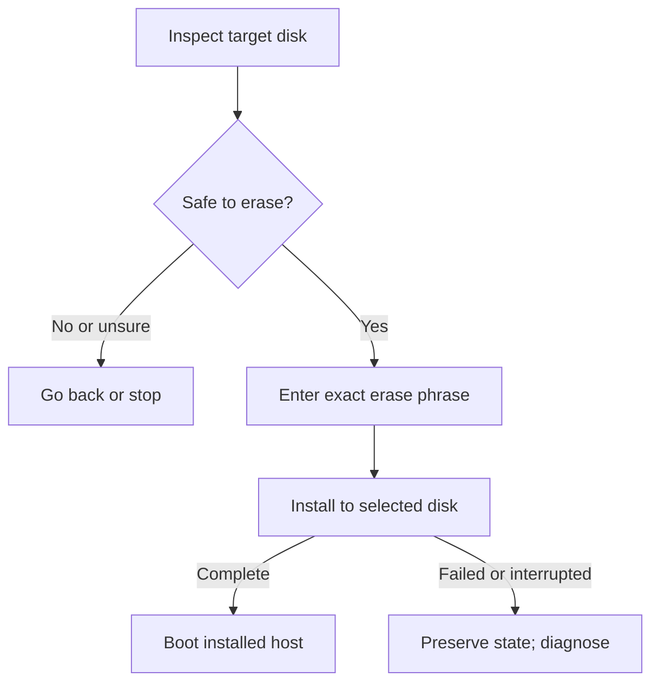

# Install on premises

Install the SodaOS appliance to the reviewed disk, then boot the installed host once. The guided flow records your machine and network choices and requires explicit confirmation before erasing the selected destination.

Use the SodaOS installation media on a dedicated x86_64 computer or a VM's selected virtual disk. The guided installer reviews the destination and configuration before it writes anything; operator setup continues after the installed host's first boot.

## Prepare the machine

Start with [the published release and its verification material](20-verify-downloads.md). Arrange a usable console, connect the machine to the installation network, and identify the exact disk to use. Back up any data on that disk.

The installation downloads its matching authenticated root filesystem from the same release. The installed host also needs network access while it starts and acquires its required application images and Soda package.

## Boot media and review choices

1. Write the verified ISO to a USB device or attach it as virtual optical media, then boot the target from it.
2. At the console, follow the guided `soda-install disk` flow. Review the network settings and hostname. Choose a root password of at least 12 characters and retain it securely for the installed host.
3. Review the default Project subnet, `10.89.0.0/24`. Keep it only if it does not overlap your LAN, VPN, container or other routed networks. Soda rejects overlap with its reserved `10.88.0.0/16` and `10.90.0.0/24` networks. Choose a different private range when needed; direct client routing is configured separately.
4. When the installer displays the destination, check its device identity and capacity against the machine's disk list.

## Confirm the disk erase

**The next confirmation erases the selected destination disk.** Proceed only when the displayed disk is the one you intend to dedicate to SodaOS and its contents are backed up or disposable. If the device is wrong or you are unsure, go back or stop without confirming. The installer writes only after this explicit confirmation and reports installation failure rather than silently treating a partial write as success.

The install path has one destructive gate: review first, confirm only the intended disk, then inspect the first installed boot. If the write fails or is interrupted, preserve that state for diagnosis.



```doc-visual
{
  "placeholder": "Final installer review identifies a disposable target disk before explicit erase confirmation.",
  "caption": "The installer’s final review shows the selected disk and erase warning before any disk write begins.",
  "alt": "Text installer final review for a disposable test machine, showing a selected disk and an erase-all-data warning.",
  "production": {
    "method": "screenshot",
    "instructions": [
      "With an authorized documentation operator, boot the actual SodaOS installer in a disposable x86_64 VM whose only attached destination is a disposable test disk; use the product’s real Final review screen.",
      "Use fictional hostname and subnet values. Stop at Final review before entering the exact erase phrase; do not confirm, write, reboot, or use a disk with retained data. Keep password entry off-screen and out of the capture.",
      "Capture at 1280x900 in the light theme, then check that the selected disk identity and warning remain legible at narrow article width. Record the SodaOS and Fountain revisions, capture date, and disposable VM identity in the asset notes."
    ],
    "edits": [
      "Crop to the actual Final review screen with the selected disk summary and ERASE ALL DATA warning visible; exclude all password input and unrelated console output.",
      "If a numbered marker is needed, use one marker at the selected disk summary and explain it in the caption; preserve all product text and do not add or alter interface labels."
    ]
  }
}
```

## First installed boot

1. When installation reports completion, remove or detach the media and reboot.
2. Log in at the installed host console with the root password you selected. The first boot obtains the release's required runtime components; keep the network available and allow startup to finish.

If startup fails, retain the machine state and console access for diagnosis rather than repeating a disk install over it.

## Continue operator setup

Continue with [operator setup](60-operator-setup.md) to create the configured Soda operator and activate private browser access. Then follow [private networking and TLS](../40-Configure/50-private-networking-and-tls.md) to trust and verify access from a client. The installation itself ends at the first installed boot.
