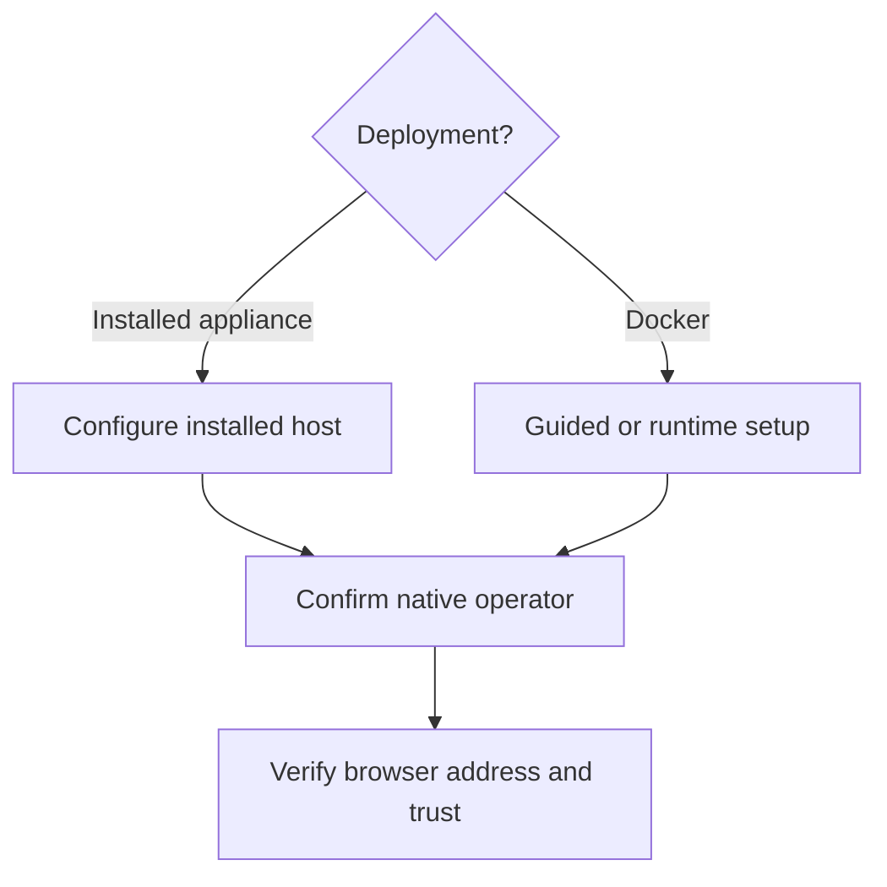

# Set up the operator

Bind Soda's operator role to the intended Forgejo administrator and activate private browser access. After setup, confirm the client trusts and can open the configured private origin.

The Soda operator is a specific native Forgejo user recorded during setup. Complete this one-time binding after the appliance's first installed boot or Docker's initial startup so Soda can identify who may use protected operator controls and activate private browser access.

## Configure the appliance

On an appliance installed from ISO, sign in to the host as root using the password selected during disk installation. From the local console or a root SSH terminal, run:

```sh
/usr/libexec/soda/soda-install configure
```

This guided continuation is for the installed Fedora CoreOS appliance. It asks for a private address reachable by your client, guides the native Forgejo site administrator setup, and reads a `read:user` administrator token through hidden input. Use a stable address or DHCP reservation.

Successful setup records that user's stable Forgejo ID, revokes the bootstrap token and activates local HTTPS. If setup or activation reports an existing configuration or uncertain result, follow [partial setup inspection](#inspect-partial-setup) before retrying; setup refuses to overwrite an existing operator binding.

## Configure Docker

Complete the released installer's guided browser enrollment, or use the lower-level path below from the deployment directory as the same operator who ran the installer. This path requires a native Forgejo site administrator and the private address assigned to the Docker host and reachable by clients. If that account needs sudo for Docker access, prefix the host-side `docker compose` commands with `sudo`.

1. On your client computer, forward Forgejo's loopback installer through your Docker host's existing SSH account. Replace `OPERATOR` and `DOCKER_HOST` below with your SSH account and Docker host, then run:

   ```sh
   ssh -N -L 33000:127.0.0.1:3000 OPERATOR@DOCKER_HOST
   ```

   Keep the SSH forward open while using `http://localhost:33000` in a browser. Complete native Forgejo installation and create a site-administrator access token with `read:user` scope. The token is entered only inside the runtime's root shell, never on a command line.

2. On the Docker host, open a separate operator shell in the original deployment directory and enter the runtime. Replace `PRIVATE_ADDRESS` below with the reachable private address assigned to the Docker host. The remaining commands in this block run inside the runtime; hidden input writes the token into a mode-restricted temporary file:

   ```sh
   docker compose exec soda bash
   set +x
   umask 077
   bootstrap_file=$(mktemp /run/soda-bootstrap.XXXXXX)
   IFS= read -r -s -p 'Forgejo administrator read:user token: ' bootstrap_token
   printf '\n'
   printf '%s\n' "$bootstrap_token" > "$bootstrap_file"
   unset bootstrap_token
   soda-setup --forgejo-url https://PRIVATE_ADDRESS --token-file "$bootstrap_file" && \
     rm -f -- "$bootstrap_file"
   ```

   Successful setup records the operator ID, revokes the bootstrap token and removes the temporary file. If setup reports uncertainty or existing configuration, preserve the file and state for [partial setup inspection](#inspect-partial-setup). Continue only after successful setup or the confirmed token-revocation recovery described there.

3. In that same runtime shell, activate the private address with local TLS:

   ```sh
   soda-activate --bind-ip PRIVATE_ADDRESS --local-tls
   exit
   ```

   Activation configures private HTTPS; `exit` returns to the Docker host shell. The lower-level activation command does not display the public CA fingerprint or export its certificate. Complete the public-certificate retrieval below before trusting the browser address. The appliance `soda-install configure` command requires installed FCOS and does not run inside Docker.

## Inspect partial setup

Run read-only checks before another setup mutation. On an appliance, use its root console; in Docker, first enter the runtime with `docker compose exec soda bash` from the original deployment directory. The following check reports file presence without printing configuration or credentials:

```sh
for path in /etc/soda/activated /etc/soda/dashboard.json /etc/soda/setup-started; do
  if test -e "$path"; then
    printf 'present %s\n' "$path"
  else
    printf 'absent %s\n' "$path"
  fi
done
systemctl --failed
journalctl -b --no-pager -n 100 -u forgejo.service
```

Review diagnostics privately. File presence identifies the continuation boundary; it does not by itself prove a valid binding, healthy service or reachable browser.

| Observation | Safe continuation |
| --- | --- |
| `activated` exists | Keep the existing binding. On an appliance, rerunning guided configure displays read-only access guidance. Verify that origin and client trust before further changes. |
| `dashboard.json` exists but `activated` does not | Setup has written configuration but activation is incomplete. Inspect the existing operator configuration privately and confirm successful setup before using the installed `soda-activate` command with the intended address. Do not replay setup. |
| `setup-started` exists without configuration | A prior attempt reserved setup; success is uncertain. Confirm whether the original process is still running and inspect its result before any retry. Do not delete the reservation while that outcome is unknown. |
| No files exist | Confirm the prior attempt has ended and inspect its failure before retrying the setup path for this deployment. |

If setup reports `dashboard configuration written, but bootstrap-token
revocation was not confirmed`, it has already saved the operator binding.
Sign in to Forgejo as the administrator who supplied the token and open
**Settings → Applications**. Revoke that bootstrap token if it is still active.
Once revocation is confirmed, continue with the installed `soda-activate`
command for the intended private address; do not rerun setup or remove
`dashboard.json`. For the lower-level Docker procedure above, remove only the
temporary token file created by that attempt after confirming revocation.
If you cannot establish which token or configuration belongs to the attempt,
keep the state for inspection before continuing.

For an appliance with only a stale `setup-started` reservation, establish that the original setup attempt has ended and that no setup or activation process remains. Review the process inventory with `ps -eo pid,ppid,comm`, check the original setup terminals and coordinate with any other operator; a marker's presence or an empty service-failure list does not establish that setup is idle. Keep the reservation if process ownership or the prior result remains uncertain.

Only after confirming setup is idle, recheck that neither configuration nor activation exists, remove only the reservation and rerun the installed continuation as appliance root:

```sh
if test ! -e /etc/soda/dashboard.json && test ! -L /etc/soda/dashboard.json &&
   test ! -e /etc/soda/activated && test ! -L /etc/soda/activated; then
  rm -- /etc/soda/setup-started &&
    /usr/libexec/soda/soda-install configure
else
  printf 'Configuration or activation exists; preserve it and inspect before continuing.\n'
fi
```

This is the appliance's stale-reservation continuation. It does not clear an existing binding or authorize replaying an uncertain setup; Docker continues through its original installer or runtime procedure.

If the configuration, reservation or activation result cannot be reconciled, retain it and seek operator support with privately reviewed diagnostics before another mutation. Do not remove the operator binding or repeat disk installation as a setup repair. [Administration](../50-Operate/20-administration.md) provides the bounded host and Docker checks.

## Understand operator authority

The configured operator must be a Forgejo site administrator when bootstrapping, but Forgejo administrator status alone does not grant Soda operator authority. Soda uses the recorded user ID.

Browser activation does not enroll native Factory actors, enable Factory execution or fund provider use. [Factory authorization](../40-Configure/20-factory-authorization.md#authorize-repository-work) explains the separate native enrollment prerequisite and account, repository-policy and capacity decisions.

The setup path depends on where Soda runs: the FCOS appliance uses its installed-host continuation, while Docker uses installer enrollment or lower-level commands inside the runtime. Both paths hand off to client certificate trust; Factory authorization remains separate.



## Trust and open the private browser address

With local TLS, guided appliance configure displays the public root certificate's SHA-256 fingerprint and its verified-SSH copy command. Guided Docker enrollment displays the fingerprint and exports `soda-root.crt` into the original deployment directory. Transfer only that public certificate through your verified SSH connection and compare its fingerprint on the client before adding it to the normal trust store.

For lower-level Docker activation, run these commands on the Docker host from the original deployment directory after activation succeeds:

```sh
docker compose exec -T soda openssl x509 \
  -in /var/lib/soda/proxy/caddy/pki/authorities/local/root.crt \
  -noout -fingerprint -sha256
docker compose cp \
  soda:/var/lib/soda/proxy/caddy/pki/authorities/local/root.crt ./soda-root.crt
openssl x509 -in ./soda-root.crt -noout -fingerprint -sha256
```

Both fingerprint outputs must match. If the certificate is absent, inspect `soda-proxy.service` and its journal before retrying retrieval; do not substitute another certificate or copy the CA private key.

On the intended client, replace `OPERATOR`, `DOCKER_HOST` and `/home/sodaos` with the existing host SSH account, verified host and original deployment directory:

```sh
scp OPERATOR@DOCKER_HOST:/home/sodaos/soda-root.crt ./soda-root.crt
openssl x509 -in ./soda-root.crt -noout -fingerprint -sha256
```

Compare this fingerprint with the one observed over the trusted host connection, then trust the public certificate using the client's normal settings. Keep the CA private key on the runtime. Open the configured private HTTPS address, sign in with the native Forgejo account and confirm the page loads. A running service or displayed address does not prove that the client can route to it or trusts its certificate.

Continue with [private networking and TLS](../40-Configure/50-private-networking-and-tls.md) to configure and verify browser origin, Git advertisement and Project reachability. For ongoing administration and uncertain service state, see [Administration](../50-Operate/20-administration.md).
