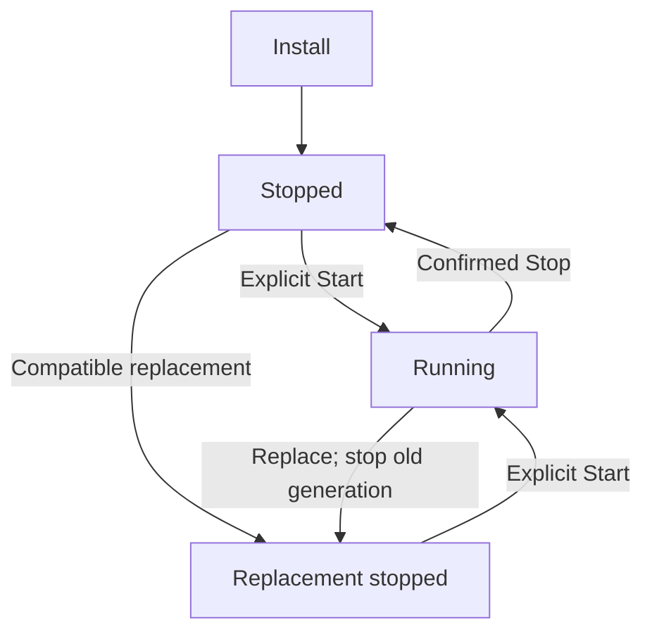

# Operate a private application

Install, start, inspect, replace and stop a private Canlang application while preserving its app-owned identity and data. Its lifetime remains independent from Project activity and Factory merges.

Private Canlang applications have their own storage, accounts and service lifetime. An operator registers and installs a compatible application image; an authorized app administrator or operator then inspects it, explicitly starts it, or confirms a stop.

## Prepare and install

Build and provision a compatible Canlang bundle and image in the Project using [Canlang development](../60-Develop/50-canlang-development.md). Prepare app-local owner/member accounts while the application is stopped.

Forgejo users, Project members and AI provider owners do not automatically become application users. The operator registers the exact loaded image and its separate app data identity, then chooses Install. Installation validates image and storage references, configures its private route and leaves the application stopped.

## Configure access and start

Configure a separate private application hostname, DNS and client TLS trust as described in [Private networking and TLS](../30-Set-up/20-private-networking-and-tls.md). App cookies and authorization remain on that hostname. Once the intended client can reach the origin, select Start and confirm readiness, then sign in using the app's own account. A ready backend alone does not prove client DNS, routing or TLS trust.

## Replace or stop an application

Replace an image only with a compatible release that uses the same data identity and passes storage compatibility checks. Replacement stops the old generation, installs the new one and leaves it stopped; explicitly Start it after inspection.

Schema migration and using an older image to undo database changes are unsupported. If an action's outcome is uncertain, inspect the recorded generation and service state before repeating it. Factory merge does not install or deploy an application.

To stop the app, choose Stop and confirm the effect. Stop disables boot startup and retains application data.

## Associate a Project and protect data

The app is independent of Project Stop: stopping a development Project does not stop the application, and opening the Applications view or linking an app to a Project does not start it. Optional Project association changes navigation only; it does not move storage, change the app's lifetime or deploy Project code.

Application state changes are explicit: installation and compatible replacement leave the app stopped, and Start is a separate action. Project association is an independent navigation link and does not change the app’s runtime state or storage.



```doc-visual
{
  "placeholder": "Stopped app record with independent Project link and explicit Start action.",
  "caption": "An installed app remains stopped while its optional Project link and separate Start action are visible.",
  "alt": "Private application record for a fictional installed app, showing Stopped status, a Project association, and the explicit Start control.",
  "production": {
    "method": "screenshot",
    "instructions": [
      "With an authorized documentation operator, open the actual SodaOS Applications view and select a fictional documentation app that is installed and observed stopped, with a fictional Project association. Expand Start or stop application so the real Start control is visible.",
      "Use an approved test record and do not select Start, Stop, Install, replace, change the Project association, or open the app. The example must show the installed stopped state and association together; do not use a private application origin or customer data.",
      "Capture at 1280x900 in the light theme and verify the status, association and Start control remain legible at narrow article width. Record the SodaOS and Fountain revisions and capture date in the asset notes."
    ],
    "edits": [
      "Crop to the actual app record showing its Stopped status, fictional Project association and explicit Start control; obscure the private origin and any non-fictional identifier while retaining actual interface labels.",
      "Do not add a marker unless the caption explains it, and do not fabricate or replace any control or status text."
    ]
  }
}
```

For a stopped app backup or restore, follow the [application snapshot procedure](60-backups-and-restoration.md#private-application-snapshots). An existing application record cannot be silently retargeted to restored data.
