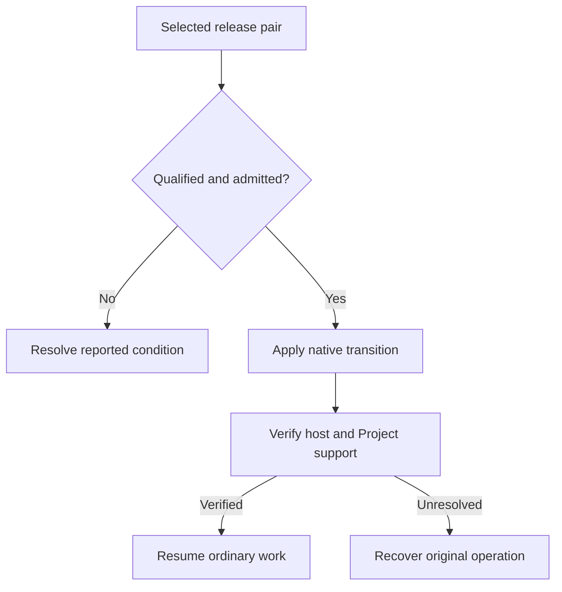

# Update SodaOS and use fallback safely

Apply only a qualified appliance transition or recreate Docker with its existing pinned state. Software rollback and image replacement do not restore database or application data.

Appliance release transitions and Docker container recreation have separate lifecycles. For an appliance, use only a source-to-target pair with its exact native qualification receipt; ordinary first-install media or an advertised update does not by itself qualify a retained-state transition.

## Apply a qualified appliance release

Before an admitted appliance transition, review the selected release pair, preserve backups, allow managed Factory work to finish and stop retained Project work that the procedure identifies. As appliance root, download the complete selected release into a root-owned directory not writable by other users. Replace `DIRECTORY` below with that protected directory.

An appliance transition proceeds only when inspection admits the exact qualified pair. Verify the activated host and retained Project support before reopening work; unresolved or interrupted outcomes go to [Recovery](80-recovery.md).



1. Inspect the complete release and retained Projects before applying anything:

   ```sh
   sudo /usr/libexec/soda/soda-project-maintain release --release-dir DIRECTORY --check
   ```

   Review the reported inputs and any active or uncertain managed work. The check may stage content but does not replace Project support or activate the host.

2. Proceed only for a source-to-target pair with its exact native qualification receipt and after inspection admits it:

   ```sh
   sudo /usr/libexec/soda/soda-project-maintain release --release-dir DIRECTORY
   ```

   The transition closes managed admission, records the operation, updates the host and retained Project support, and requests native activation. It never ends active terminals to proceed.

## Verify and reconcile the result

After activation, verify the booted release, retained Project support and extension readiness before reopening work. If reconciliation reports exit status 75, the core release committed but extension readiness failed or remains uncertain. Do not assume rollback occurred.

Inspect the recorded operation and service journal. `release --recover` resumes the recorded release operation; `release --rollback` restores its recorded host and Project-support pair only when the recorded identities and idle-state checks still match. Neither selects another release or restores database contents or newer application data.

## Recreate a Docker runtime

For Docker, use the same release image, Compose file, `.env` and project name to stop and recreate the runtime while retaining its `/etc`, `/var` and `/home` volumes. This is container lifecycle management, not the appliance's qualified FCOS transition. Do not pull a different tag into an existing stateful deployment as an assumed upgrade. See [Install with Docker](../20-Install/50-docker.md).

## Recover an interruption

If the operation is interrupted, keep its journal and managed admission state intact and follow [Recovery](80-recovery.md). Never delete operation records, overwrite newer state with an older database, or use a host rollback as a substitute for data restoration. [Backups](60-backups-and-restoration.md) remain a separate protection and restore path.
