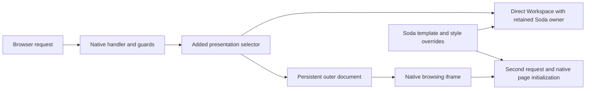

# Fountain frontend integration investigation

The installed frontend has a structural integration problem. Native Forgejo
handlers still own authentication, repository permissions and collaboration, but
an added Fountain layer replaces ordinary page presentation, frames native pages
and manages navigation. Soda also replaces many native templates and supplies a
separately compiled stylesheet graph. These layers do not share a complete
document, initialization, theme or layout contract.

The correction puts the existing Forgejo frontend in charge of its shell and page
lifecycle, with consumers supplying content and local controls. The current
terminal element/renderer/socket guarantee remains binding. Ordinary document
replacement cannot preserve those browser objects, so Fountain needs a proved
native persistent lifecycle. Reconnection is not an approved substitute and
consumers must not build adapters for missing native capabilities. The
[correction plan](https://github.com/LevitateOS/sodaos/blob/83cf27a3c46811617a8615e25364ee9d1ead3df0/docs/development/factory-implementation-plan.md#native-frontend-responsibility-and-correction)
now makes this platform/consumer split explicit. Another incomplete wrapper would
repeat the failure.

This investigation is non-normative. Product and security requirements remain in
[Spaces](../product/spaces.md), [frontend trust](../architecture/trust.md#frontend-and-session-boundary)
and the [integration contract](../reference/forgejo.md). It supplies findings and
correction boundaries rather than authorizing a requirement change.

## Source and installed baseline

The inspected Soda source is `d6f689402b01e009a1013a34921bd4ff6d87179a`;
Fountain is `17fbd56ab3d974f7e654b79f1d0db6d4db213b39`. Soda's unrelated
planning-document commit was preserved. Relevant runtime source is unchanged
from the deployed Soda `31caf48a`. The local upstream comparison is Forgejo
`v15.0.9`; no upstream fetch or version upgrade was required.

The existing development VM runs dashboard image `3516b89f`, extension backend
hash `d448c2b1`, Spaces entry hash `277ec996`, and Fountain version
`15.0.9-soda.17fbd56ab3d9`. Installed custom header, footer, repository header and
`components.css` hashes match their current source files. Those comparisons do
not validate the separately transformed extension stylesheet.

The retained installed capture set contains 123 screenshots covering 100
requested paths and additional settings, dialog, mobile and transition views.
Credential-enrollment/configuration pages and states requiring product writes or
new model calls were excluded. Native forms and many ordinary pages remain
readable; the evidence does not support declaring every native template broken.

Private captures, probes, override inventory and consultation receipts are in
ignored `.artifacts/screenshots/installed-1791812068278/` and
`.artifacts/frontend-investigation-20261012/`. No runtime patch, installation,
service restart, Project lifecycle operation or execution-provider call forms
part of this investigation.

## Actual shell ownership

| Responsibility | Current implementation |
| --- | --- |
| Native handlers, account state, repository assignment and authorization | Forgejo/Fountain server |
| Successful document presentation interception | Fountain `Context.HTMLPresentation` and extension middleware |
| Persistent outer document, native browsing iframe, direct-content replacement, URL/title/history mirroring | Fountain extension frontend |
| Many native page bodies and chrome styling | Soda template overrides and image-owned branding |
| Workspace, requests, settings and terminal views | Soda Lit components |
| Shell execution and terminal session identity | Project runtime and supervised native terminal processes |

Fountain's `base/head.tmpl` and `base/footer.tmpl` match upstream `v15.0.9`.
Reusing those templates does not preserve upstream's navigation lifecycle. The
added presentation hook selects another body template after the native handler
runs. Eligible successful document GETs become `extensions/workspace.tmpl`, with
an iframe and a persistent panel; the outer navbar/footer are hidden. HTMX/XHR,
iframe, authentication, installation, status and credential-bearing responses
retain their separate handling. The iframe performs a second GET for the native
page. Its fetch destination excludes it from recursive wrapping.

Direct Workspace instead uses `extensions/workspace_page.tmpl`, including the
native repository header where applicable. Its content owner remains outside
the fetched native content slot. The added 459-line `extensions.js` module owns
link/form classification, fetches, iframe lifetime, content replacement,
history/title synchronization, top-level escapes and session revalidation.



Source owners: Fountain `routers/web/extensions/extensions.go`,
`services/context/context_response.go`, `templates/extensions/`,
`templates/base/head_navbar.tmpl`, `templates/base/footer_content.tmpl`, and
`web_src/js/features/extensions.js`. Upstream `web_src/js/index.js` initializes
native features on document readiness; its ordinary anchors/forms navigate whole
documents, with targeted HTMX interactions rather than a universal SPA router.

## Confirmed navigation and initialization failures

The installed **native page → Workspace → Issues** sequence remains on
`/workspace` after four seconds, with the same Workspace owner and no native
iframe. Issues becomes highlighted while Workspace content remains visible.

The source explains the structural failure. The native template puts the panels
aside inside `.extension-workspace-layout`. `openWorkspace` removes the iframe
but leaves that nested aside. `openNative` then passes the aside to
`workspace.insertBefore`, although it is not a direct child of `workspace`.
Starting directly on Workspace uses another DOM shape and avoids that particular
failure, which explains why the narrower verifier passed. No JavaScript error
was recorded by the installed observer; the settled route/content failure is
independently demonstrated.

Direct-content transitions also parse a complete native document and copy only
its content children. They update title and a repository dataset, while retaining
the previous head, footer, navbar, `window.config.pageData`, conditional scripts
and already-initialized native features. This is incomplete lifecycle ownership.

The repository switcher is **visible after a direct repository Workspace reload
and hidden after a global-to-repository Back transition**. Soda includes its
script only in an initial repository document, and the enhancer initializes on
load. An inserted header has neither the matching script-load contract nor a
repeatable initialization contract. Repository actions, dropdowns, tooltips,
dirty-form warnings and inserted HTMX controls have related source risks;
individual action failures have not all been exercised.

Fragment strings surviving in history do not establish native fragment scrolling,
focus transfer or per-entry scroll restoration. Those behaviors are absent from
the content-swap contract and require actual checks before acceptance.

## Generated theme values are invalid

The canonical [shared stylesheet](../../assets/branding/forgejo/components.css)
defines valid values such as:

```css
--soda-page-surface: light-dark(var(--soda-light-surface), var(--soda-dark-surface));
```

The [extension builder](../../scripts/build-soda-extension.ts) compiles another
copy of this stylesheet with Bun's browser CSS bundler. The installed output is:

```css
--soda-page-surface: var(--buncss-light,var(--soda-light-surface))var(--buncss-dark,var(--soda-dark-surface));
```

It supplies no `--buncss-light`/`--buncss-dark` selection declarations. Native
light/dark styles own `color-scheme` outside this compilation graph. Both
fallback colors consequently concatenate. The installed browser computes
`--soda-page-surface` as **`#fff#101010`**, while the Department dialog background
becomes transparent. Palette requests succeed, the browser supports
`light-dark()`, and its theme is `soda-auto`.

Bun documents this lowering and the guard variables that accompany scheme rules
in its [CSS documentation](https://bun.sh/docs/bundler/css#light-dark-color-function).
A minimal reproduction using the pinned Bun `1.4.2` produces the same missing
guard pattern with **both minification enabled and disabled**. This is a build
composition failure; disabling minification is not a demonstrated correction.

The dialog's `var(--soda-page-surface, #fff)` fallback cannot fix an existing
custom property that resolves to invalid color tokens. Its background declaration
becomes invalid at computed-value time. This explains the visible background
bleed without requiring a stacking-order defect. Similar malformed edge/action
tokens can invalidate controls' borders and fills. The compiled extension copy
also overrides valid document-level tokens after mounting.

Correction belongs at the stylesheet build/consumption boundary, preserving the
native host's theme selection. Painting one dialog white or adding another theme
owner would leave the underlying contract broken. The emitted stylesheet needs
computed-color checks under the actual external native light/dark scheme.

## Layout and template composition failures

| Installed finding | Established cause and scope |
| --- | --- |
| Large unused region above Workspace | The direct-content structure occupies 230 px; its unused page mount is 140 px at the installed font size. Soda deliberately avoids mounting a second owner, while Fountain still reserves the placeholder. |
| Settings show mostly Identity connections | A 600 px fixed flex parent contains a 453 px Identity sibling. Selected Overview/Access/Network/Factory panels each shrink to 32 px, exactly their padding, despite 587/695/186/3443 px of scroll content. Widgets exist and tab visibility is correct. |
| Creation controls absent from initial mobile viewport | Native unused space, a fixed setup frame and the padded form push actions below view. Actual wheel scrolling does reveal them. Initial clipping is established; permanent inaccessibility is not. |
| Different global and repository chrome | Shared body/navbar rules require `.soda-page` or `.soda-page-marker`; global Workspace lacks them, while the repository header supplies a marker. Invalid compiled colors are an additional issue. |
| Repository Workspace tab in overflow | Soda's overriding repository header appends extension links after native unit tabs. Fountain's native header places them first. The approved link exists; the override reverses the intended prominence. |
| Nearly empty native sidebar | The panel always presents itself, starts in terminal view and has no selected attachment in a fresh browser. Native-mode discovery/guidance differs from full-page presentation, leaving Sessions/+ chrome around empty content. |

Relevant Soda owners are `frontend/spaces/soda-spaces-entry.ts`,
`soda-workspace-panel-entry.ts`, `sodaspaces-workspace.css`,
`sodaspaces-project.css`, `sodaspaces-project.ts`, `sodaspaces-intent.ts`, and
`frontend/forgejo/templates/repo/header.tmpl`. Fountain owns the native content
slot and generic mount geometry. Soda owns reachable content and its settings
composition. Preserve the duplicate-owner guard; removing it to fill the blank
slot would create another ownership defect.

The complete Soda template inventory contains **264 overrides: 243 modified
upstream files and 21 additions**, compared with `v15.0.9`. None is an identical
copy. This inventory establishes maintenance surface, not 243 individual defects.
The correction should assess each actual override responsibility and retain
branding through appropriate native hooks/themes rather than blindly delete
the owner's visual design.

## Tailnet contribution scope is inconsistent

The installed `/tailnet` page returns 404. Its manifest declares a global
contribution, while `cmd/soda-extension/main.go` authorizes Tailnet only when its
scope is `admin` and its actor matches the configured Soda operator. The web
bridge also declares the global contribution. This is a cross-owner scope
mismatch, not evidence that Tailnet enrollment or credentials must be changed.

The pinned Go `1.26.7` execution of the existing test
`TestSodaContributionPolicyUsesDeclaredTailnetScope` fails: the declared page is
denied for the synthetic configured operator despite the test expecting admission.
Scope, public route and narrow operator authorization must agree. A Forgejo site
administrator must not silently become the Soda operator.

## Saved product flow has no supported restoration read

Explore saves an `IntentRevision` and attaches `exploration` only to its POST
response. Current/history GETs return revision records without the illustrated
flow or consolidated recommendation. Browser resume clears exploration and has
no subsequent flow loader. Refresh walkthrough uses the write/explore path and
may consume additional calls; matching judgments can also be cached.

This does **not** prove all evidence was deleted. Durable judgment receipts retain
authored alternatives/steps and selected answers. Their internal snapshot lookup
is not a private request-facing read contract. Planning-call reservations already
link an intent to a snapshot, but not an exact revision; consolidation evidence
omits those identities, and cached advice reuse creates no new reservation link.
That partial relationship does not establish exact revision restoration. Exposing
the whole receipt journal would violate the required ownership boundary.

The relevant owners are `internal/factory/intent.go`,
`internal/web/api/factory_intent_explore.go`, `factory_intents.go`,
`extension_native.go`, `internal/store/factory_intents.go`, and
`frontend/spaces/sodaspaces-intent.ts`. Recovery needs an owner-private,
revision-bound presentation read if the saved review is to restore without
repeating a product write or judgment sequence.

## Terminal lifetime and cached navigation

| Resource | Supported lifetime |
| --- | --- |
| Terminal element, xterm renderer and browser WebSocket | Same-document presentation changes can retain them. Document replacement, invalidation or disposal ends the existing browser resources; a later attachment creates new ones. |
| Saved locator and admitted attachment identity | Can be restored under current actor, Project membership and repository authorization. |
| Supervised native terminal process/session | Can outlive browser closure or transport loss. Explicit End is separate. |
| Execution authority | Must be revalidated; retaining an element or locator never preserves revoked permission. |

The current [Spaces contract](../product/spaces.md) promises identical browser
objects through ordinary native navigation. Removing the custom retained-document
host in favor of ordinary Forgejo document loads changes that promise. A complete
persistent native lifecycle could instead preserve objects during its supported
transitions, but requires page configuration, initialization, disposal, forms,
HTMX and navigation/focus/scroll ownership across native features. It is material
frontend engineering and needs its own capability proof.

The current implementation already fails its broad preservation claim on the
successful Open in drawer path: `sodaspaces-workspace-drawer.ts` calls
`window.location.assign`, replacing the document. Its tests cover failed handoff,
not successful browser-object continuity.

There is also a cached-page lifecycle mismatch. Fountain retains contribution
disposers on persisted `pagehide`, then checks session generation before showing
the cached document. Actual SodaSpaces and SodaTerminal invalidate on pagehide
and persisted pageshow, closing the connection and disposing the renderer. Their
stale owner does not become live merely because the host's session matches. The
new installed Back probe returned a **fresh document**, so this investigation
establishes the source mismatch rather than an installed BFCache failure.

Native guards, contribution authorization, session generation, SDK admission,
live stream authority checks and explicit End semantics must survive any frontend
change. No authorization bypass was demonstrated by these findings.

## Why passing checks missed these failures

The earlier completion inference exceeded the checks' scope:

- Host/component fixtures flatten the real nested wrapper, omit native heading
  and footer, or inject convenient heights. Some project-control fixtures omit
  production CSS or use a presentation without the large Identity sibling.
- Fountain's native checks do not include the installed Soda template overrides;
  they cannot qualify the combined presentation by themselves.
- Shell fixtures switch Workspace pages rather than start with an ordinary
  native document. Account and repository links are counted as URLs rather than
  exercised as initialized native controls.
- The private installed verifier starts at direct Workspace and injects a
  repository link. Its Code → Back path avoids the failing native-first parent
  structure. Renderer checks are conditional in a fresh unattached browser;
  frame existence and `isConnected` do not establish geometry or usable controls.
- Theme fixtures serve raw shared CSS; package checks establish asset closure
  and font embedding without checking the emitted colors in the native host.
- BFCache checks use a placeholder panel instead of the actual Soda component
  retirement lifecycle.
- The optional Fountain live-terminal fixture still sends `expected_user_id`,
  which current Soda's strict handshake rejects. Its default skip/inert-host
  result is not current live PTY proof.
- Resume checks restore revision/generation state, while product-flow checks
  exercise the immediate Explore response. Neither proves flow restoration.

The narrow source, native fixture and installed receipts remain useful at their
original boundaries. Worker percentages and aggregate test counts cannot replace
the missing composed acceptance. The previous 68/68 claim remains withdrawn.

## Delivery responsibilities

Native branding/templates come from `frontend/forgejo/payload.json` and the
Forgejo image's `/usr/share/soda/forgejo` custom root. Changing the extension
package or `/data/gitea/templates` does not update that image-owned repository
header. Soda browser modules/styles are separately built and installed through
native `extensions install --replace`.

The extension install service is oneshot with `RemainAfterExit=yes`. Starting
Forgejo alone does not rerun it. The historical build12 copied-asset claim was
withdrawn and corrected by explicit build13 installation plus byte/readback
verification. That earlier trap does not explain the current byte-verified
layout and generated-color failures.

Future delivery must name the changed native frontend, branding image and
extension outputs independently, verify their actual bytes after activation, and
preserve existing Projects, services, volumes, files and terminal processes.

## Correction sequence and parallel boundaries

The correction target is Fountain-owned native frontend composition and a proved
persistent lifecycle, with content-only consumer mounts. The earlier conditional
document-load/reconnection recommendation would require a product change that has
not been made. Preserving the existing guarantee selects the native persistent
capability for implementation-and-proof; it does not establish that capability
already works. No consumer should supply its native routing, initialization,
container geometry or browser-session lifecycle.

| Packet | Owner and decisive result | Dependencies |
| --- | --- | --- |
| Native frontend boundary | Fountain: prove persistent native navigation/initialization on actual templates independently of Soda, then replace alternate-shell interception, iframe/history router and hidden duplicate chrome. Retain authoritative handlers and contribution/session APIs. | Existing preservation contract; prove one critical native boundary before broad work. |
| Native contribution composition | Fountain: canonical generic mount/presentation/context/lifecycle contract, one owner, usable native containers, no vacant competing mount, declared content routes and initialized native controls. Soda consumes the contract without inspecting host DOM. | Proved native boundary and callable host handoff. |
| Theme build semantics | Soda browser build: emitted tokens remain valid under native light/dark selection; dialog, inputs and actions have correct computed colors. | Independent of native cutover; use existing compiled-payload checks. |
| Content geometry | Soda: settings have usable selected-panel space; creation/dialog/compact content is reachable without hiding its context or actions. | Can start from actual measured geometry; qualify again after native composition settles. |
| Template and route alignment | Soda/Fountain: native extension tabs remain discoverable; Tailnet manifest/bridge/authorizer agree with operator scope; review actual override responsibilities. | Route and permission contracts; no enrollment or provider action needed. |
| Saved review restoration | Soda intent/API/Store owners: private exact-revision flow reads restore the proposed experience without replaying effects. | Establish durable request/revision ownership; never expose global receipts directly. |
| Composed acceptance and delivery | Existing test/delivery owners: real template/asset/initializer integration, both navigation entry sequences, readable settings/colors, current auth/revocation and separately measured terminal lifetimes. | Each completed capability releases its check; one integrator and one VM operator serialize shared resources. |

Theme, layout, route-scope diagnosis and saved-flow contract work need not wait for
whole-lane completion. Native navigation and terminal acceptance depend on the
actual native lifecycle proof. Fountain owns the generic capability; Soda owns
its product fixes and consumer simplification. Production qualification and
execution-provider calls are separate from these frontend checks.

Three corrected, independently reworded Jev consultations with actual
`jev-1.13.0` responses favor native documents at probabilities 0.99, 0.97 and 0.75.
The last confidence is 0.69, with 0.13 for persistent native navigation and 0.11
undetermined. Their independent review confirms equivalent facts/alternatives
and distinguishes native shell ownership from document-loading semantics.
The first consultation set was retained and superseded because explanatory
snippet prose was reused. These judgments provide advice; they supply no
requirement authority, software proof or explanation of the wording sensitivity.

The subsequent responsibility review preserves the existing object guarantee and
selects the Fountain-owned native persistent capability. Its corrected fresh Jev
triplet favors that direction at 1.00, 1.00 and 0.89, with 0.11 insufficient in
the third result. Receipts and independent wording/equivalence review are retained
in `.artifacts/fountain-frontend-boundary-20261012/`. This advice reinforces the
ownership direction, not implementation feasibility; a generic host proof comes
before consumer migration or whole-site conversion.

## Minimum acceptance for the correction

Extend existing native and installed drivers with the actual shipped composition:

1. Native → Workspace → native and Workspace → native → Workspace, using real
   navigation at global and repository scopes, including Back/Forward and reload.
2. Real repository switcher/account controls and relevant native forms initialized
   after each supported transition; canonical prefix, query, fragment, title,
   history and scrolling remain correct.
3. Wide/compact settings and creation with usable geometry, keyboard focus and
   accessible inner scrolling; emitted surface, border and action colors under
   native light/dark selection.
4. Saved request review restoration at the exact private revision without a new
   generation or unauthorized judgment/effect replay.
5. Current native login, stale session, permission loss, logout and cached-page
   recovery; one admitted Workspace owner and no navigation provisioning.
6. One authorized existing synthetic terminal: compare element/renderer/socket
   identities through both ordinary native navigation sequences in case 1 while
   the retention contract remains. Separately compare exact session/process
   identity after reload. New browser objects across ordinary navigation are
   acceptable only after an explicit product decision changes that guarantee.
7. Installed bytes for every changed component and preservation of unrelated
   human state. Source checks, screenshots, installed interactions and release
   qualification remain separately reported.
